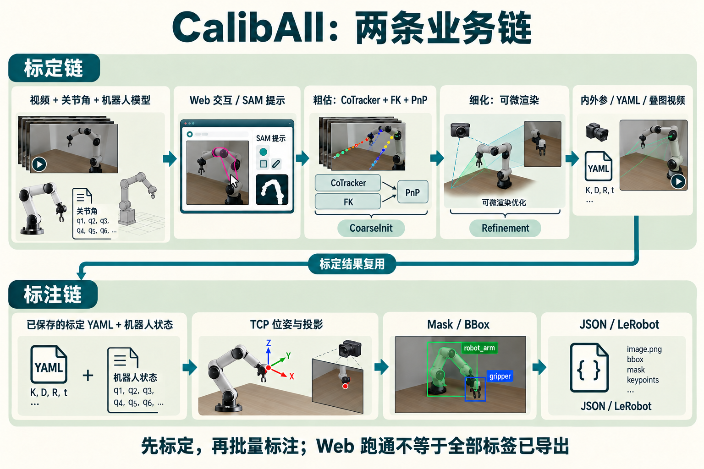
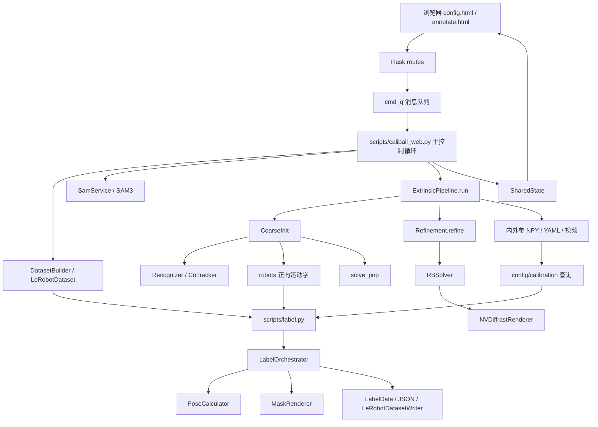
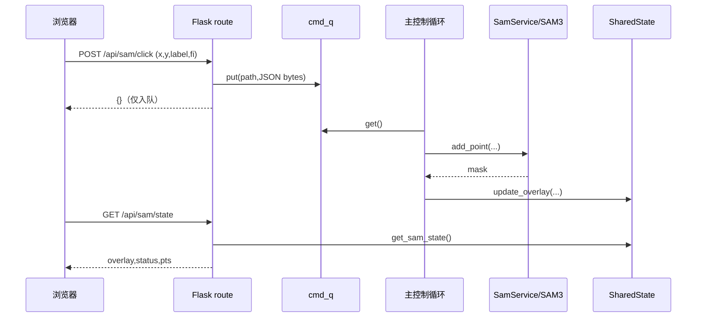
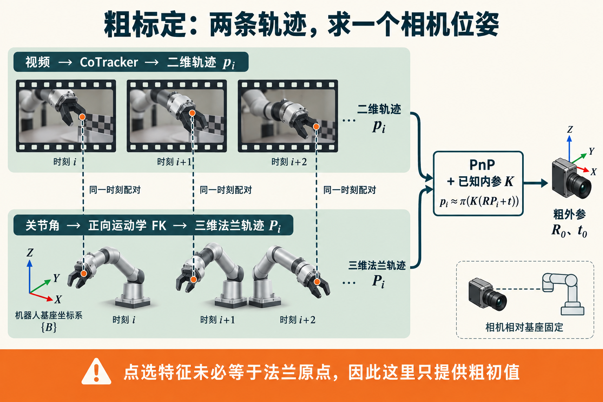
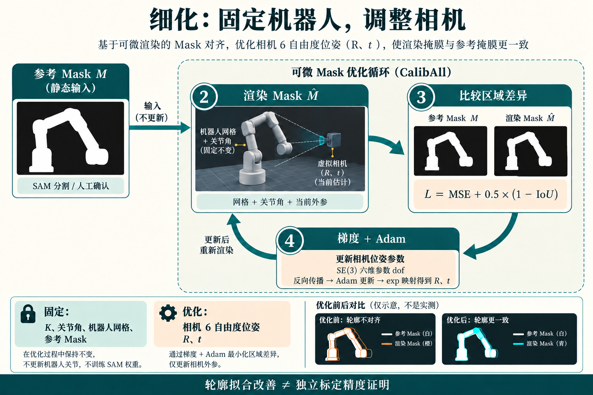

# CalibAll 关键代码走读：从整体架构到标定、渲染与数据标注

> 学习对象：`/home/kason/workspace/CalibAll` 服务器当前代码。整理日期：2026-10-17。基础提交：`666e73f7111a70385fc3c736f8e4b3a1d7d2f3ad`。本文源码通过服务器文件快照直接提取，不把伪代码当成项目实现。
>
> 本文不修改算法或重跑标定。Panda 案例沿用已完成的 Episode 0；截图、loss、外参说明见 [STAR 页面](caliball-star.html)。源码附录记录文件 SHA-256，后续版本变更时需重新核对行号。

## 阅读方式与目录

建议先读 1–3 章建立全景，再沿 4–11 章走完标定，最后读 12–15 章了解机器人抽象和批量标注。第 16 章单列当前版本需要注意的实现细节。附录给出关键文件完整源码，正文中的关键函数也直接展开，避免只列文件名。

1. [整体架构：两条业务链与三个层次](#ch1)
2. [符号、坐标和张量形状](#ch2)
3. [Panda Demo 的端到端调用链](#ch3)
4. [Web 入口、模型生命周期与消息队列](#ch4)
5. [配置、LeRobot 数据读取与时间同步](#ch5)
6. [SAM 标注：点击如何成为参考 Mask](#ch6)
7. [跟踪与特征：二维轨迹如何得到](#ch7)
8. [粗标定：FK + Temporal PnP](#ch8)
9. [精修：参数、损失与迭代更新](#ch9)
10. [可微渲染：网格如何成为可优化的 Mask](#ch10)
11. [结果回传、保存与外参转 position](#ch11)
12. [机器人接口、法兰、TCP 与双臂](#ch12)
13. [批量标注：相机系 TCP、关键点、Mask、BBox](#ch13)
14. [输出数据结构与 LeRobot 写入](#ch14)
15. [本次部署增加的 SO101 / v3 适配](#ch15)
16. [代码中的近似、边界与检查清单](#ch16)
17. [推荐断点与学习练习](#ch17)
18. [附录：关键文件完整源码与校验表](#ch18)

<a id="ch1"></a>

## 1. 整体架构：两条业务链与三个层次



*图 1：标定链与标注链的关系。先由 Web 标定产生 K、T 和 YAML，再将标定结果用于批量标注。图中机器人与场景均为 Image Gen 教学示意，不是本次 Panda 实拍；不需要棋盘格标定靶。精确类名为 CoarseInit，真实调用关系见下方 Mermaid 与源码。*

项目不是一个“输入视频就输出机器人控制”的策略模型，而是离线数据处理工具。最重要的是区分两条业务链：

- **标定链**：视频 + 关节角 + 机器人模型 → 相机内外参 + 可视化；入口 `scripts/caliball_web.py`。
- **标注链**：已有内外参 + 关节角 + 机器人模型 → 相机系 TCP、二维点、Mask、BBox、输出数据集；入口 `scripts/label.py`。

Web 标定结束不意味着逐帧标注数据集已全部生成。两条链通过 calibration YAML 衔接。



| 层次 | 主要文件 | 学习重点 |
|---|---|---|
| 交互与流程 | `scripts/caliball_web.py`、`web/routes/`、`web/state.py` | 谁触发计算、进度如何返回、模型何时加载 |
| 业务编排 | `pipeline/`、`labeling/orchestrator.py` | 组件之间的输入输出，标定和标注的区别 |
| 算法与几何 | `algorithms/`、`rendering/`、`robots/`、`utils/transforms.py` | PnP、FK、SE(3)、可微渲染、坐标变换 |

`CoarseInit` 和 `Refinement` 通过构造函数注入重模型和机器人对象。这样切换机器人可只更新 FK / 网格，不必每次重载视觉网络。

**源码：[src/caliball/pipeline/extrinsic_pipeline.py](../src/caliball/pipeline/extrinsic_pipeline.py)，L23–L27，`ExtrinsicPipeline.__init__`。下列为当前快照原文，未改写。

```python
    def __init__(self, coarse_init, refinement, device: str = "cuda", max_steps: int = 10000):
        self._coarse = coarse_init
        self._refinement = refinement
        self._device = device
        self._max_steps = max_steps
```

**源码：[src/caliball/pipeline/extrinsic_pipeline.py](../src/caliball/pipeline/extrinsic_pipeline.py)，L29–L39，`ExtrinsicPipeline.update_robot`。下列为当前快照原文，未改写。

```python
    def update_robot(self, robot, mesh_paths=None):
        """Update FK models when robot type changes.

        Args:
            robot: new robot instance (from ``build_robot``)
            mesh_paths: mesh file paths for the new robot (defaults to ``robot.MESH_PATHS``)
        """
        if mesh_paths is None:
            mesh_paths = robot.MESH_PATHS
        self._coarse.update_robot(robot)
        self._refinement.update_robot(robot, mesh_paths)
```

<a id="ch2"></a>

## 2. 符号、坐标和张量形状

本文采用 `T_c_b` 表示**基座 b → 相机 c**：`P_c = T_c_b @ P_b`（点为齐次列向量）。它也是代码中 `extrinsic` 的实际用途。不要仅凭 `Tc_c2b` 变量名推断方向，必须看矩阵怎样相乘。

| 数据 | 典型形状 / 类型 | 含义 |
|---|---|---|
| video | `(N,H,W,3)`, uint8 NumPy, RGB | 抽帧后的图像序列 |
| joint_angles | `(N,D)` NumPy | 与图像逐帧对应的机器人状态 |
| tracking_point | `(u,v)` | 一个查询点 |
| points_2d | `(N,2)` | CoTracker 返回的二维轨迹 |
| points_3d | `(N,3)` | FK 得到的法兰原点轨迹 |
| K | `(3,3)` | 像素焦距与主点 |
| extrinsic | `(4,4)` | 基座到相机的齐次变换 |
| fkine_flange(q) | `(n_arms,4,4)` | 各臂法兰在基座系的位姿 |
| fkine_all(q) | 常见 `(n_arms,L,4,4)` | 连杆 / 网格位姿；具体机器人的合并策略需核对 |
| mask | 单帧 `(H,W)` | 二值参考区域 |
| 精修 mask_tensor | `(B,H,W)` | B 个选定参考帧，不是整段 N 帧 |
| link_poses | `(B,L_total,4,4)` | 多臂可合并成同一渲染链 |
| solver.dof | `(6,)`, nn.Parameter | SE(3) 参数，不能直接当作三维 position + 欧拉角 |
| 网格 | 顶点 `(V,3)` float32；三角面 `(F,3)` int32 | 渲染所需几何 |

内参投影：`u = fx*Xc/Zc + cx`，`v = fy*Yc/Zc + cy`。相机在基座中的 position 是 `C_b = -R.T @ t`，不是外参右上角的 t。旋转 / 平移通常使用米和弧度，但输入关节与夹爪字段必须逐机器人确认。

<a id="ch3"></a>

## 3. Panda Demo 的端到端调用链

本次已完成的案例：

```text
data/demo/panda_lerobot
  meta/info.json: v2.1, fps=30, 180 frames
  video key: observation.images.camera_top
  state key: observation.state (7维)
        ↓ DatasetBuilder.build → dataset[0]
video(180,H,W,3), states(180,7)
        ↓ video[::4], states[::4]
video(45,H,W,3), states(45,7)
        ↓ 用户跟踪点 + 第0帧 SAM Mask + 内参设置
ExtrinsicPipeline.run
        ├─ CoarseInit.get_extrinsic
        │    ├─ Tracker.track → points_2d
        │    ├─ robot.fkine_flange → points_3d
        │    └─ solve_pnp → T_coarse, K
        ├─ Refinement.refine → T_refined
        ├─ np.save 内外参
        └─ _render_video → anno_video_h264.mp4
        ↓ Web 主循环生成 demo.yaml
results/extrinsic_notebook/panda_lerobot/ep_000000/pipeline/
```

这里 `45` 是已观察到的抽样帧数，不表示所有运行都会固定为 45。跟踪还可能使用用户选择的片段；精修只取 mask_ids 指定的参考帧。结果视频以 15 FPS 编码，因此这次 45 帧的结果播放约 3 秒，不能按原始视频时长判断是否丢数据。

**源码：[src/caliball/pipeline/extrinsic_pipeline.py](../src/caliball/pipeline/extrinsic_pipeline.py)，L45–L156，`ExtrinsicPipeline.run`。下列为当前快照原文，未改写。

```python
    def run(
        self,
        clip: np.ndarray,
        joint_angles: np.ndarray,
        tracking_point: tuple[float, float],
        masks: list[np.ndarray],
        mask_ids: list[int],
        save_dir: str | Path,
        progress_fn: Optional[Callable] = None,
        stop_check: Optional[Callable] = None,
        arm_index: int = 0,
        full_video: Optional[np.ndarray] = None,
        full_joint_angles: Optional[np.ndarray] = None,
        tracking_img_idx: int = 0,
    ) -> dict:
        """Run the full pipeline.

        Args:
            clip: video clip for tracking/coarse/refine
            joint_angles: joint angles for clip
            full_video: complete video for visualization (if None, uses clip)
            full_joint_angles: complete joint angles for visualization (if None, uses joint_angles)

        Returns dict with: extrinsic_coarse, extrinsic_refined, intrinsic,
                          anno_video_path, loss_dict
        """
        save_dir = Path(save_dir)
        save_dir.mkdir(parents=True, exist_ok=True)

        def _report(stage, message, **kw):
            if progress_fn:
                progress_fn(stage=stage, message=message, **kw)

        # Stage 1: Tracking + Coarse (只用 tracking 范围的帧)
        _report("tracking", "正在追踪…")
        # tracking_img_idx 是 tracking point 帧在 clip 中的偏移
        # tracking 只用 clip 中对应 start:end 范围的帧
        track_clip = clip[tracking_img_idx:]  # 从 tracking point 帧开始到 clip 末尾
        track_joints = joint_angles[tracking_img_idx:]

        def _coarse_progress(msg):
            _report("tracking", msg)

        extrinsic, K, details = self._coarse.get_extrinsic(
            video=track_clip, joint_angles=track_joints,
            tracking_point=list(tracking_point), img_idx=0,
            save_path=str(save_dir), return_details=True,
            arm_index=arm_index, progress_fn=_coarse_progress,
        )

        # Tracking visualization
        pts_2d = details["points_2d"]
        pts_3d = details["points_3d"]
        vis = clip[0].copy()
        for pt in pts_2d:
            cv2.circle(vis, (int(pt[0]), int(pt[1])), 3, (0, 255, 0), -1)

        # 检查 3D 轨迹质量
        tracking_video = save_dir / "tracking.mp4"
        _report("coarse", "Coarse extrinsic estimated",
                image=vis,
                tracking_video_path=str(tracking_video) if tracking_video.exists() else None)

        # Free CoarseInit GPU memory (only drop local ref, like the original pipeline_fn)
        import torch
        gc.collect()
        torch.cuda.empty_cache()

        # Stage 2: Refinement
        _report("refine", "开始 Refinement…", step=0, max_steps=self._max_steps)

        def _refine_cb(step, max_steps, loss, overlay, overlays=None, mask_ids=None, **kwargs):
            _report(
                "refine",
                f"step {step}/{max_steps}  loss={loss:.6f}",
                step=step, max_steps=max_steps,
                image=overlay, overlays=overlays, mask_ids=mask_ids,
            )

        output, loss_dict = self._refinement.refine(
            clip, joint_angles, K, extrinsic, str(save_dir),
            mask=masks, mask_id=mask_ids, max_steps=self._max_steps,
            progress_callback=_refine_cb,
            stop_check=stop_check or (lambda: False),
        )

        refined_tsfm = output["tsfm"].detach().cpu().numpy()

        # Save matrices
        np.save(str(save_dir / "extrinsic_coarse.npy"), extrinsic)
        np.save(str(save_dir / "extrinsic_refined.npy"), refined_tsfm)
        np.save(str(save_dir / "intrinsic.npy"), K)

        # Stage 3: Visualization video (use full video if provided)
        _report("visualize", "生成可视化视频…")
        vis_video = full_video if full_video is not None else clip
        vis_joints = full_joint_angles if full_joint_angles is not None else joint_angles
        anno_path = self._render_video(
            vis_video, vis_joints, refined_tsfm, K, save_dir, _report,
        )

        tracking_video = save_dir / "tracking.mp4"

        return {
            "extrinsic_coarse": extrinsic,
            "extrinsic_refined": refined_tsfm,
            "intrinsic": K,
            "anno_video_path": str(anno_path),
            "tracking_video_path": str(tracking_video) if tracking_video.exists() else None,
            "loss_dict": loss_dict,
            "save_dir": str(save_dir),
        }
```

**沿这段源码逐行追变量：**

1. `tracking_img_idx` 是跟踪起始帧相对扩展 clip 的偏移。
2. `track_clip`、`track_joints` 从该偏移开始切片。
3. `details` 带回二维 / 三维轨迹，但粗估预览只画二维点。
4. `extrinsic,K` 直接传给精修，`masks,mask_ids` 指定参考图像。
5. 结束后保存粗、细两套外参，便于比较。
6. 可视化可使用 `full_video`，所以不必与跟踪片段相同长度。

阅读时注意注释“只用 tracking 范围”与实际 `clip[tracking_img_idx:]` 的差别：如果扩展 clip 因后置 Mask 帧超出用户 end，跟踪也会延伸到扩展 clip 末尾。见第 16 章。

<a id="ch4"></a>

## 4. Web 入口、模型生命周期与消息队列

先读 `main`，不要一开始就读 SAM 或渲染库。Flask 在后台线程接收请求；主控制循环等待配置、加载数据、执行命令。`models_loaded` 让重模型在当前进程首次配置后加载并复用。普通重新标注并不重载权重；停止整个服务进程才释放模型和 GPU 上下文。

`_load_models` 组装 robot、DINOv2、CoTracker、MoGe、Refinement、SAM3。注意它通过 `Sam3Extractor` 加载一套 SAM3，又为交互另建一套 SAM3；因此不能只根据单份权重估计显存。

**源码：[scripts/caliball_web.py](../scripts/caliball_web.py)，L80–L126，`_load_models`。下列为当前快照原文，未改写。

```python
def _load_models(device, robot_type, sam_bpe_path, sam_ckpt_path, update_fn=None):
    """Load CoarseInit, Refinement, SAM3 models."""
    from omegaconf import OmegaConf
    from caliball.pipeline import CoarseInit, Refinement
    from caliball.algorithms.recognizer import Recognizer, build_feature_extractor
    from caliball.algorithms.tracker import build_tracker
    from caliball.algorithms.pose_estimator import solve_pnp
    from caliball.algorithms.mask_extractor import Sam3Extractor
    from sam3.model_builder import build_sam3_image_model
    from sam3.model.sam3_image_processor import Sam3Processor

    def _up(msg, pct=0):
        if update_fn:
            update_fn(msg, pct)
        print(f"[loading] {msg}")

    model_config = OmegaConf.load(str(_PROJECT_ROOT / "src" / "caliball" / "config" / "models.yaml"))
    model_config.robot_type = robot_type

    _up("Loading CoarseInit (DINOv2 + CoTracker + MoGe)...", 20)
    from caliball.algorithms.intrinsic_estimator import build_intrinsic_estimator
    robot = build_robot(robot_type)
    recognizer = Recognizer(build_feature_extractor(model_config))
    tracker = build_tracker(model_config)
    moge_path = str(_PROJECT_ROOT / model_config.get("moge_model_path", "ckpt/moge/model.pt"))
    intrinsic_estimator = build_intrinsic_estimator(model_id=moge_path)
    coarse_init = CoarseInit(robot, recognizer, tracker, solve_pnp, intrinsic_estimator=intrinsic_estimator)
    coarse_init.to(device)

    _up("Loading Refinement...", 50)
    mask_extractor = Sam3Extractor(
        bpe_path=str(_PROJECT_ROOT / sam_bpe_path if not Path(sam_bpe_path).is_absolute() else sam_bpe_path),
        ckpt_path=str(_PROJECT_ROOT / sam_ckpt_path if not Path(sam_ckpt_path).is_absolute() else sam_ckpt_path),
    )
    refinement = Refinement(robot, mask_extractor, robot.MESH_PATHS, device=device)

    bpe = _PROJECT_ROOT / sam_bpe_path if not Path(sam_bpe_path).is_absolute() else Path(sam_bpe_path)
    ckpt = _PROJECT_ROOT / sam_ckpt_path if not Path(sam_ckpt_path).is_absolute() else Path(sam_ckpt_path)
    _up("Loading SAM3...", 75)
    sam3_model = build_sam3_image_model(
        bpe_path=str(bpe), checkpoint_path=str(ckpt),
        device=device, enable_inst_interactivity=True,
    )
    sam3_processor = Sam3Processor(sam3_model, device=device)

    _up("All models loaded", 100)
    return coarse_init, refinement, sam3_model, sam3_processor, model_config
```

**源码：[scripts/caliball_web.py](../scripts/caliball_web.py)，L251–L287。下列为当前快照原文，未改写。

```python
    from caliball.robots import list_robots as _list_robots
    from caliball.robots._registry import get_robot_cls as _get_cls
    from caliball.robots._composite import ArmGripperCompositeTF as _CompTF
    _robot_types = [
        rt for rt in _list_robots()
        if not issubclass(_get_cls(rt), _CompTF)
    ]

    # ── Setup Flask (config page first) ──
    shared_state = SharedState()
    cmd_q = queue.Queue()
    pipeline_stop = threading.Event()

    app = create_app(shared_state=shared_state)
    app.config["cmd_q"] = cmd_q
    app.config["pipeline_stop_event"] = pipeline_stop
    app.config["config_context"] = {
        "robot_types": _robot_types,
        "default_robot_type": "ur5e",
        "default_task_path": "",
        "default_dataset_name": "",
        "default_camera_name": "",
        "default_episode_idx": 0,
        "default_strike": 4,
    }

    # Start Flask — config page at /
    srv_thread = run_app(app, host=args.host, port=args.port, open_browser=not args.no_browser)

    # ── Outer loop: config → load → annotate → (reconfig → repeat | finish → exit) ──
    models_loaded = False
    coarse_init = refinement = sam3_model = sam3_processor = model_config = None
    pipeline = sam_svc = None
    _sam3_state = [None]

    def _update_loading(msg, pct=0):
        shared_state.set("loading_status", {"message": msg, "progress": pct, "done": False})
```

**源码：[scripts/caliball_web.py](../scripts/caliball_web.py)，L310–L370。下列为当前快照原文，未改写。

```python
        # ── Load dataset via DatasetBuilder ──
        _update_loading("Loading dataset...", 5)
        try:
            dataset, ds_info = DatasetBuilder.build(
                yaml_filename, task_path,
                episode_idx=episode_idx,
                overrides=overrides,
            )
            episode = dataset[0]
            video = episode["videos"][camera_name]
            joint_angles = episode["states"]

            video = video[::strike]
            joint_angles = joint_angles[::strike]
            print(f"video shape = {video.shape}, joint shape = {joint_angles.shape}")
        except Exception as e:
            _update_loading(f"Dataset loading failed: {e}", 0)
            print(f"Dataset loading failed: {e}")
            continue

        n_frames = len(video)
        if n_frames == 0:
            _update_loading("Video length is 0", 0)
            continue

        # ── Load models (first time only) ──
        if not models_loaded:
            _update_loading("Loading models...", 10)
            coarse_init, refinement, sam3_model, sam3_processor, model_config = _load_models(
                args.device, robot_type, args.sam_bpe_path, args.sam_ckpt_path, _update_loading,
            )
            pipeline = ExtrinsicPipeline(
                coarse_init=coarse_init, refinement=refinement,
                device=args.device, max_steps=args.max_steps,
            )

            def _set_image(pil_img):
                _sam3_state[0] = sam3_processor.set_image(pil_img)

            def _predict(pts, lbs):
                masks_out, _, _ = sam3_model.predict_inst(
                    _sam3_state[0], point_coords=pts, point_labels=lbs, multimask_output=False,
                )
                return masks_out[0].astype(np.uint8)

            sam_svc = SamService(_predict, _set_image)
            # Initialize Recognizer with default EEF reference
            ref_img_path = _PROJECT_ROOT / "assets" / "test_img" / "source.png"
            if ref_img_path.exists():
                coarse_init._init_recognizer(Image.open(ref_img_path).convert("RGB"), (376, 131))
                print("[web] Recognizer initialized with default reference")
            models_loaded = True
        else:
            if robot_type != model_config.robot_type:
                _update_loading("Updating FK model...", 50)
                model_config.robot_type = robot_type
                new_robot = build_robot(robot_type)
                pipeline.update_robot(new_robot)
            pipeline.reset_intrinsic()

        # ── Prepare annotate page ──
```

### 一次点击怎样走到 GPU？



POST 返回 `{}` 不是分割已经完成。页面轮询状态才获得新的图像。SharedState 用锁保护读写，返回浅拷贝；这是单进程共享会话，不能把它理解为完整的多用户会话隔离。

**源码：[src/caliball/web/routes/annotate_routes.py](../src/caliball/web/routes/annotate_routes.py)，L62–L68，`sam_click`。下列为当前快照原文，未改写。

```python
@annotate_bp.route("/api/sam/click", methods=["POST"])
def sam_click():
    """Handle SAM point click."""
    d = request.get_json(force=True)
    cmd_q: queue.Queue = current_app.config["cmd_q"]
    cmd_q.put(("/api/sam/click", json.dumps(d).encode()))
    return jsonify({})
```

**源码：[src/caliball/web/state.py](../src/caliball/web/state.py)，L25–L31，`SharedState.update_overlay`。下列为当前快照原文，未改写。

```python
    def update_overlay(self, overlay_url: str, status: str = "", pts: int = 0):
        """Set the current overlay image URL and optional status / point count."""
        with self._lock:
            self._data["overlay"] = overlay_url
            if status:
                self._data["status"] = status
            self._data["pts"] = pts
```

**源码：[src/caliball/web/state.py](../src/caliball/web/state.py)，L40–L43，`SharedState.update_pipeline`。下列为当前快照原文，未改写。

```python
    def update_pipeline(self, **kwargs):
        """Merge *kwargs* into the pipeline sub-dict."""
        with self._lock:
            self._pipeline.update(kwargs)
```

**源码：[scripts/caliball_web.py](../scripts/caliball_web.py)，L414–L433。下列为当前快照原文，未改写。

```python
                if path == "/api/sam/set_image":
                    fi = int(d["idx"])
                    sam_svc.set_image(fi, video[fi])
                    fs = sam_svc.get_frame_state(fi)
                    shared_state.update_overlay(_overlay_vis(video[fi], fs["mask"], fs["points"], fs["labels"]), f"Switched to frame {fi}", 0)
                elif path == "/api/sam/switch_frame":
                    fi = int(d["fi"])
                    sam_svc.switch_frame(fi, video[fi])
                    fs = sam_svc.get_frame_state(fi)
                    shared_state.update_overlay(_overlay_vis(video[fi], fs["mask"], fs["points"], fs["labels"]), f"Frame {fi}: {len(fs['points'])} pts", len(fs["points"]))
                elif path == "/api/sam/click":
                    fi = int(d.get("fi", sam_svc.active_frame))
                    sam_svc.add_point(fi, float(d["x"]), float(d["y"]), int(d.get("label", 1)), video[fi])
                    fs = sam_svc.get_frame_state(fi)
                    shared_state.update_overlay(_overlay_vis(video[fi], fs["mask"], fs["points"], fs["labels"]), f"Frame {fi}: {len(fs['points'])} pts", len(fs["points"]))
                elif path == "/api/sam/undo":
                    fi = int(d.get("fi", sam_svc.active_frame))
                    sam_svc.undo(fi)
                    fs = sam_svc.get_frame_state(fi)
                    shared_state.update_overlay(_overlay_vis(video[fi], fs["mask"], fs["points"], fs["labels"]), f"Frame {fi}: {len(fs['points'])} pts after undo", len(fs["points"]))
```

<a id="ch5"></a>

## 5. 配置、LeRobot 数据读取与时间同步

Web 配置与批量任务 YAML 不是同一种入口：Web 的 `config/dataset/*.yaml` 由 DatasetBuilder 解析；批量 `config/*.yaml` 由 Hydra compose，并处理 defaults / 插值。后者使用 `instantiate_tf`、`instantiate_dataset`。

DatasetBuilder 的已知 reader 分支按用户选择的 episode 构造数据集，已支持本次加入的 v3 类；自定义 reader 分支通过 Hydra 直接实例化配置。不要假设两分支自动填充的参数完全相同。

**源码：[src/caliball/web/services/dataset_builder.py](../src/caliball/web/services/dataset_builder.py)，L113–L203，`DatasetBuilder.build`。下列为当前快照原文，未改写。

```python
    @staticmethod
    def build(
        yaml_filename: str,
        task_path: str,
        episode_idx: int,
        overrides: Optional[dict] = None,
    ) -> tuple:
        """构造 dataset。

        Args:
            yaml_filename: web YAML 配置文件名
            task_path: 数据集本地路径
            episode_idx: episode 索引
            overrides: 前端传来的覆盖参数
                单臂: {"state_key": "obs.state", "start": 0, "stop": 6}
                双臂: {"state_key": "obs.left", "start": 0, "stop": 6,
                       "state_key_2": "obs.right", "start_2": 0, "stop_2": 6}

        Returns:
            (dataset, info) where info = {
                "yaml_filename": str,
                "state_keys": list[str],
                "processor_type": str,
                "overrides": dict | None,
            }
        """
        from hydra.utils import instantiate
        from omegaconf import OmegaConf

        from caliball.dataset.lerobot_dataset import LeRobotDataset
        from caliball.dataset.state_processors import StateProcessor

        yaml_path = _CONFIG_DATASET_DIR / yaml_filename
        with open(yaml_path) as f:
            data = yaml.safe_load(f)

        ds_cfg = data.get("dataset", {})
        sp_cfg = dict(ds_cfg.get("state_processor", {}))
        ds_target = ds_cfg.get("_target_", "")

        state_keys = ds_cfg.get("state_keys")
        if isinstance(state_keys, str):
            state_keys = [state_keys]

        if overrides:
            if overrides.get("state_key"):
                state_keys = [overrides["state_key"]]
                if overrides.get("state_key_2"):
                    state_keys.append(overrides["state_key_2"])
            for key in ("start", "stop", "step", "offset",
                        "start_2", "stop_2", "step_2", "offset_2"):
                if key in overrides and overrides[key] is not None:
                    sp_cfg[key] = overrides[key]

        if not state_keys:
            state_keys = ["observation.state"]

        # Instantiate state_processor via Hydra
        sp_target = sp_cfg.get("_target_", "")
        if sp_target:
            processor = instantiate(OmegaConf.create(sp_cfg))
        else:
            processor = StateProcessor()

        processor_type = sp_target.rsplit(".", 1)[-1] if sp_target else "StateProcessor"

        # Construct dataset
        if ds_target in DatasetBuilder._CONFIGURABLE_DATASETS:
            from hydra.utils import get_class
            dataset = get_class(ds_target)(
                repo_id=task_path,
                episodes=[episode_idx],
                state_keys=state_keys,
                state_processor=processor,
                **({"decode_video_keys": ds_cfg["decode_video_keys"]} if "decode_video_keys" in ds_cfg else {}),
            )
        else:
            # 自定义 dataset：透传 YAML 中 dataset 下的所有参数，用 Hydra instantiate
            custom_cfg = {k: v for k, v in ds_cfg.items()}
            custom_cfg.setdefault("repo_id", task_path)
            # custom_cfg.setdefault("episodes", [episode_idx])
            dataset = instantiate(OmegaConf.create(custom_cfg))

        info = {
            "yaml_filename": yaml_filename,
            "state_keys": state_keys,
            "processor_type": processor_type,
            "overrides": overrides,
            "dual_arm": data.get("dual_arm", False),
        }
        return dataset, info
```

**源码：[src/caliball/dataset/lerobot_dataset.py](../src/caliball/dataset/lerobot_dataset.py)，L113–L142，`LeRobotDataset.__getitem__`。下列为当前快照原文，未改写。

```python
    def __getitem__(self, idx: int) -> dict:
        """返回 {"videos": {cam: (T,H,W,3)}, "states": (T, D)}。"""
        start, end = self._ep_from[idx], self._ep_to[idx]
        if start >= end:
            return dict(videos={}, states=None)

        batch = self._read_parquet_range(idx, start, end)
        ep_idx = int(batch["episode_index"].reshape(-1)[0])
        timestamps = batch["timestamp"].flatten().tolist()

        # 视频解码
        videos = {}
        tolerance = 1.0 / self.fps
        for vid_key in (self.decode_video_keys or self.video_keys):
            if vid_key not in self.video_keys:
                continue
            chunk = ep_idx // self._chunks_size
            video_path = self._dataset_path / self._video_path_pattern.format(
                episode_chunk=chunk, video_key=vid_key, episode_index=ep_idx,
            )
            videos[vid_key] = decode_video_frames(video_path, timestamps, tolerance, self.video_backend)

        # columns → state_processor
        columns = {}
        for sk in self.state_keys:
            if sk in batch:
                columns[sk] = np.asarray(batch[sk], dtype=np.float32)
        states = self.state_processor(columns) if columns else None

        return dict(videos=videos, states=states)
```

**源码：[src/caliball/dataset/lerobot_dataset.py](../src/caliball/dataset/lerobot_dataset.py)，L183–L210，`LeRobotDataset._read_parquet_range`。下列为当前快照原文，未改写。

```python
    def _read_parquet_range(self, ep_local_idx: int, start: int, end: int) -> dict:
        """读取指定 episode 的 parquet 帧范围，返回 {列名: ndarray}。"""
        ep_info = self._episodes_info[ep_local_idx]
        ep_index = ep_info["episode_index"]

        # 带缓存的 parquet 加载
        if self._cached_ep_index != ep_index or self._cached_df is None:
            chunk = ep_index // self._chunks_size
            path = self._dataset_path / self._data_path_pattern.format(
                episode_chunk=chunk, episode_index=ep_index,
            )
            if not path.exists():
                raise FileNotFoundError(f"Parquet not found: {path}")
            self._cached_df = pd.read_parquet(path)
            self._cached_ep_index = ep_index

        local_start = start - self._ep_from[ep_local_idx]
        local_end = end - self._ep_from[ep_local_idx]
        sub = self._cached_df.iloc[local_start:local_end]

        result: dict = {}
        for col in sub.columns:
            vals = sub[col].values
            try:
                result[col] = np.stack(vals)
            except (ValueError, TypeError):
                result[col] = list(vals)
        return result
```

**源码：[src/caliball/utils/video_io.py](../src/caliball/utils/video_io.py)，L69–L107，`decode_video_frames`。下列为当前快照原文，未改写。

```python
def decode_video_frames(
    video_path: str,
    timestamps: list,
    tolerance_s: float = 0.04,
    backend: str = "pyav",
) -> np.ndarray:
    """解码指定时间戳的视频帧，返回 (T, H, W, 3) uint8 numpy 数组。"""
    import av

    container = av.open(str(video_path))
    stream = container.streams.video[0]
    stream.codec_context.thread_type = "AUTO"

    timestamps = [float(t) for t in timestamps]
    first_ts, last_ts = min(timestamps), max(timestamps)

    loaded_frames, loaded_ts = [], []
    for frame in container.decode(stream):
        current_ts = float(frame.pts * stream.time_base)
        if current_ts < first_ts - tolerance_s:
            continue
        loaded_frames.append(frame.to_ndarray(format="rgb24"))
        loaded_ts.append(current_ts)
        if current_ts >= last_ts:
            break
    container.close()

    query_ts = torch.as_tensor(timestamps, dtype=torch.float64)
    loaded_ts_t = torch.as_tensor(loaded_ts, dtype=torch.float64)
    dist = torch.cdist(query_ts[:, None], loaded_ts_t[:, None], p=1)
    min_, argmin_ = dist.min(1)

    assert (min_ < tolerance_s).all(), (
        f"Timestamps violate tolerance ({min_[min_ >= tolerance_s]} > {tolerance_s}). "
        f"video: {video_path}"
    )

    frames = np.stack([loaded_frames[idx] for idx in argmin_])
    return frames
```

**时间同步的具体含义：**视频帧以 `frame.pts * stream.time_base` 得到秒级时间；对每个数据时间戳，通过 `torch.cdist` 选最近视频帧，要求误差小于 `1/fps` 左右。它不是简单按文件的“第 i 帧”配第 i 行。

**内存行为：**数据 reader 会解码所选视频序列并堆成 NumPy；Web 随后才抽帧，所以 stride=4 不等于原始解码内存只有 1/4。默认可能解码所有相机，`decode_video_keys` 可以限制；不要把这份 reader 当成大规模流式读取器。

**源码：[src/caliball/dataset/state_processors.py](../src/caliball/dataset/state_processors.py)，L37–L63，`SliceProcessor`。下列为当前快照原文，未改写。

```python
class SliceProcessor(StateProcessor):
    """concat 所有列 → slice[start:stop:step] → 加偏置。

    YAML 示例::

        state_processor:
          _target_: caliball.dataset.state_processors.SliceProcessor
          stop: 7
          offset: [0, 0, 0, 0, 0, 1.5708, 0.7854]
    """

    def __init__(
        self,
        start: Optional[int] = None,
        stop: Optional[int] = None,
        step: int = 1,
        offset: Optional[List[float]] = None,
    ):
        self._sl = slice(start, stop, step)
        self._offset = np.asarray(offset, dtype=np.float32) if offset is not None else None

    def __call__(self, columns: dict[str, np.ndarray]) -> np.ndarray:
        raw = np.concatenate(list(columns.values()), axis=-1)
        result = raw[..., self._sl].copy()
        if self._offset is not None:
            result = result + self._offset
        return result
```

SliceProcessor 只做拼接、切片与 offset，不会自动把度转换为弧度，也不会还原电机归一化值。`offset` 与输出 state 的单位一致。SO101 的角度约定不明时不能直接套用这一步来假装完成校准。

<a id="ch6"></a>

## 6. SAM 标注：点击如何成为参考 Mask

浏览器把显示坐标按图像 naturalWidth / clientWidth 还原为原始像素坐标。左键发送 label=1，右键发送 label=0；每帧保留自己的 points、labels、mask，切换帧不丢弃已有提示。

**源码：[src/caliball/web/templates/annotate.html](../src/caliball/web/templates/annotate.html)，L186–L235。下列为当前快照原文，未改写。

```html
/* Tracking click */
document.getElementById('tw').onclick=function(ev){
var img=document.getElementById('timg');
var r=img.getBoundingClientRect();
var sx=img.naturalWidth/img.clientWidth,sy=img.naturalHeight/img.clientHeight;
S.tx=(ev.clientX-r.left)*sx;S.ty=(ev.clientY-r.top)*sy;
upDot();upInfo();};
/* Update dot */
function upDot(){
var img=document.getElementById('timg'),dot=document.getElementById('td');
if(S.tx===null){dot.style.display='none';return;}
dot.style.left=(S.tx*img.clientWidth/img.naturalWidth)+'px';
dot.style.top=(S.ty*img.clientHeight/img.naturalHeight)+'px';
dot.style.display='block';}
/* Update tracking image */
function upTImg(){
fetch(appUrl('api/frame/'+S.s)).then(function(r){return r.json()}).then(function(d){
var img=document.getElementById('timg');
img.onload=function(){upDot()};img.src=d.url;});}
/* SAM click */
document.getElementById('mw').oncontextmenu=function(e){e.preventDefault()};
document.getElementById('mw').onmousedown=function(ev){
if(ev.button!==0&&ev.button!==2)return;
var img=document.getElementById('mimg');
var r=img.getBoundingClientRect();
var sx=img.naturalWidth/img.clientWidth,sy=img.naturalHeight/img.clientHeight;
fetch(appUrl('api/sam/click'),{method:'POST',headers:{'Content-Type':'application/json'},
body:JSON.stringify({x:(ev.clientX-r.left)*sx,y:(ev.clientY-r.top)*sy,
label:ev.button===2?0:1,fi:S.ms[S.curMI]})});};
/* SAM undo */
function samUndo(){
fetch(appUrl('api/sam/undo'),{method:'POST',headers:{'Content-Type':'application/json'},
body:JSON.stringify({fi:S.ms[S.curMI]})});}
/* Poll SAM */
function pollSam(){
if(S.ma)return;
fetch(appUrl('api/sam/state')).then(function(r){return r.json()}).then(function(d){
document.getElementById('mimg').src=d.overlay;
document.getElementById('ms').textContent=d.status;
samPtsMap[S.ms[S.curMI]]=samPtsMap[S.ms[S.curMI]]===-1?-1:(d.pts||0);renderMTabs();upInfo();});}
var samTimer=setInterval(pollSam,300);
/* Info */
function upInfo(){
var totalPts=0;S.ms.forEach(function(m){totalPts+=(samPtsMap[m]||0);});
document.getElementById('fi').textContent=
'Start: '+S.s+' | End: '+S.e+' | Mask frames: ['+S.ms.join(',')+'] | Length: '+(S.e-S.s+1);
document.getElementById('ti').textContent=
S.tx!==null?'Tracking: ('+S.tx.toFixed(1)+', '+S.ty.toFixed(1)+')':'Tracking: not selected';
document.getElementById('mi').textContent=
S.ma?'Mask: using default ('+S.ms.length+' frames)':'Mask: SAM '+S.ms.length+' frames, '+totalPts+' pts';}
```

**源码：[src/caliball/web/services/sam_service.py](../src/caliball/web/services/sam_service.py)，L52–L69，`SamService.add_point`。下列为当前快照原文，未改写。

```python
    def add_point(
        self,
        fi: int,
        x: float,
        y: float,
        label: int,
        frame: np.ndarray,
    ) -> Optional[np.ndarray]:
        """Add a foreground/background point and return the updated mask."""
        if fi != self._active_frame:
            self.set_image(fi, frame)
        fs = self.get_frame_state(fi)
        fs["points"].append([x, y])
        fs["labels"].append(label)
        pts = np.array(fs["points"], dtype=np.float32)
        lbs = np.array(fs["labels"], dtype=np.int32)
        fs["mask"] = self._predict_fn(pts, lbs)
        return fs["mask"]
```

**源码：[src/caliball/web/services/sam_service.py](../src/caliball/web/services/sam_service.py)，L71–L83，`SamService.undo`。下列为当前快照原文，未改写。

```python
    def undo(self, fi: int) -> Optional[np.ndarray]:
        """Remove the last point and re-predict (or clear the mask)."""
        fs = self.get_frame_state(fi)
        if fs["points"]:
            fs["points"].pop()
            fs["labels"].pop()
        if fs["points"]:
            pts = np.array(fs["points"], dtype=np.float32)
            lbs = np.array(fs["labels"], dtype=np.int32)
            fs["mask"] = self._predict_fn(pts, lbs)
        else:
            fs["mask"] = None
        return fs["mask"]
```

**源码：[scripts/caliball_web.py](../scripts/caliball_web.py)，L346–L355。下列为当前快照原文，未改写。

```python
            def _set_image(pil_img):
                _sam3_state[0] = sam3_processor.set_image(pil_img)

            def _predict(pts, lbs):
                masks_out, _, _ = sam3_model.predict_inst(
                    _sam3_state[0], point_coords=pts, point_labels=lbs, multimask_output=False,
                )
                return masks_out[0].astype(np.uint8)

            sam_svc = SamService(_predict, _set_image)
```

**源码：[src/caliball/web/routes/annotate_routes.py](../src/caliball/web/routes/annotate_routes.py)，L20–L36，`_overlay_vis`。下列为当前快照原文，未改写。

```python
def _overlay_vis(img, msk, pts, labs):
    """Generate overlay visualization with mask + points."""
    v = np.asarray(img).copy()
    if v.dtype != np.uint8:
        v = (v * 255).astype(np.uint8) if v.max() <= 1.0 else v.astype(np.uint8)
    b = v.copy()
    if msk is not None and msk.size:
        mm = msk > 0
        gg = np.zeros_like(v)
        gg[..., 1] = 255
        v = (b.astype(np.float32) * 0.55 + gg.astype(np.float32) * 0.45).astype(np.uint8)
        v = np.where(mm[..., None], v, b)
    for (px, py), lb in zip(pts, labs):
        c = (255, 0, 0) if lb == 1 else (0, 0, 255)
        cv2.circle(v, (int(px), int(py)), 6, c, -1)
        cv2.circle(v, (int(px), int(py)), 6, (255, 255, 255), 1)
    return image_to_data_url(v)
```

`_predict` 取 `masks_out[0]` 转成 uint8，`_overlay_vis` 在 mask>0 的位置混合 55% 原图和 45% 绿色；绿色深浅不是置信度或误差。红色为前景提示，蓝色为背景提示。`Multi-frame` 表示逐帧保存多张参考 Mask，不是自动把一次点选传播到全视频。

SAM 的角色是在**细化**阶段提供参考区域，不直接参与粗 PnP。参考 Mask 应与渲染模型包含的部件一致，尤其是夹爪、电缆、支架和被抓物体。

<a id="ch7"></a>

## 7. 跟踪与特征：二维轨迹如何得到

**源码：[src/caliball/algorithms/recognizer.py](../src/caliball/algorithms/recognizer.py)，L49–L58，`DINOv2Featurizer.forward`。下列为当前快照原文，未改写。

```python
    @torch.no_grad()
    def forward(self, img_tensor, block_index=None):
        feats_dict = self.model.get_intermediate_layers(img_tensor, n=1)
        out = feats_dict[0]  # shape (B, num_tokens, C)

        B, N, C = out.shape
        h = w = int(N ** 0.5)
        out = out.transpose(1, 2).reshape(B, C, h, w)

        return out
```

**源码：[src/caliball/algorithms/recognizer.py](../src/caliball/algorithms/recognizer.py)，L94–L107，`Recognizer.reset`。下列为当前快照原文，未改写。

```python
    def reset(self, img_pil, p):
        self.img_pil = img_pil
        self.p = p

        x, y = p
        feature = self.img_pil_to_feature(img_pil)
        num_channel = feature.size(1)

        src_ft = feature
        src_ft = nn.Upsample(size=(self.img_size, self.img_size), mode='bilinear')(src_ft)
        vec = src_ft[0, :, y, x].view(1, num_channel)  # 1, C

        self.feature = feature
        self.vec = vec
```

**源码：[src/caliball/algorithms/recognizer.py](../src/caliball/algorithms/recognizer.py)，L109–L128，`Recognizer.get_uv`。下列为当前快照原文，未改写。

```python
    def get_uv(self, target_img_pil):
        w, h = target_img_pil.size

        target_img_pil_resized = target_img_pil.resize((self.img_size, self.img_size))
        feature = self.img_pil_to_feature(target_img_pil_resized)
        num_channel = feature.size(1)

        trg_ft = nn.Upsample(size=(self.img_size, self.img_size), mode='bilinear')(feature)  # N, C, H, W
        trg_vec = trg_ft.view(1, num_channel, -1)  # N, C, HW

        src_vec = F.normalize(self.vec)  # 1, C
        trg_vec = F.normalize(trg_vec)  # N, C, HW
        cos_map = torch.matmul(src_vec, trg_vec).view(1, self.img_size, self.img_size).float().cpu().numpy()  # N, H, W

        max_yx = np.unravel_index(cos_map[0].argmax(), cos_map[0].shape)

        x_orig = max_yx[1] * (w / self.img_size)
        y_orig = max_yx[0] * (h / self.img_size)

        return x_orig, y_orig
```

DINOv2 在这里做参考特征匹配：从参考末端图像取一个特征向量，与目标图像特征比较，寻找相似位置。它不直接预测相机外参。`Recognizer.img_size=784` 并把图像变为正方形，`forward` 用 sqrt(N) 恢复特征图；阅读时要把这一输入约束与通用图像尺寸区分开。

人工已经选了 tracking_point 时，CoarseInit 直接使用该点，不必再跑自动定位来替代它。

**源码：[src/caliball/algorithms/tracker.py](../src/caliball/algorithms/tracker.py)，L36–L40，`Tracker.preprocess_video`。下列为当前快照原文，未改写。

```python
    def preprocess_video(self, video):
        video = torch.tensor(video).to(device=self.device, dtype=torch.float32)
        video = video.permute(0, 3, 1, 2)  # T C H W
        video = video.unsqueeze(0)          # B T C H W
        return video
```

**源码：[src/caliball/algorithms/tracker.py](../src/caliball/algorithms/tracker.py)，L42–L55，`Tracker.track`。下列为当前快照原文，未改写。

```python
    def track(self, video, uv, img_idx=0):
        video = self.preprocess_video(video)

        u, v = uv
        queries = [[img_idx, u, v]]
        queries = torch.tensor(queries).to(self.device, dtype=torch.float32)

        pred_tracks, pred_visibility = self.cotracker(video, queries=queries[None])  # B T N 2,  B T N 1

        points_2d = pred_tracks[0].permute(1, 0, 2)
        points_2d = points_2d.detach().cpu().numpy()
        points_2d = points_2d[0]    # only one query here

        return points_2d, pred_tracks, pred_visibility
```

跟踪输入从 `(N,H,W,3)` 变成 `(1,N,3,H,W)`；查询点包含 `[img_idx,u,v]`。CoTracker 返回 tracks 和 visibility，但 CoarseInit 送 PnP 的是完整 points_2d，没有根据 visibility 自动筛点。检查 tracking.mp4 仍是重要环节。视频写入与 H.264 转码属于辅助 I/O，失败时 try/except 可让主标定继续。

<a id="ch8"></a>

## 8. 粗标定：FK + Temporal PnP



*图 2：二维跟踪与三维法兰轨迹共同约束相机外参。按同一时刻配对 pᵢ 和 Pᵢ，结合 K 通过 PnP 求粗外参。可见特征与法兰原点只是近似对应；示意图不表示点击点已被精确定位到 URDF 中。*

**源码：[src/caliball/pipeline/coarse_init.py](../src/caliball/pipeline/coarse_init.py)，L42–L50，`CoarseInit._get_intrinsic`。下列为当前快照原文，未改写。

```python
    def _get_intrinsic(self, img_pil):
        if self._intrinsic is None:
            self._intrinsic, origin_width, origin_height = self.intrinsic_estimator.estimate(img_pil=img_pil)
            width, height = img_pil.size

            self._intrinsic[0, :3] *= 1.0 * width / origin_width
            self._intrinsic[1, :3] *= 1.0 * height / origin_height

        return self._intrinsic
```

**源码：[src/caliball/algorithms/intrinsic_estimator.py](../src/caliball/algorithms/intrinsic_estimator.py)，L95–L101，`MoGeEstimator.estimate`。下列为当前快照原文，未改写。

```python
    def estimate(self, img_pil):
        input_image = np.array(img_pil.convert("RGB"))
        input_image = torch.tensor(input_image / 255.0, dtype=torch.float32, device=self.device).permute(2, 0, 1)

        model_output = self.moge.infer(input_image)
        intrinsic = model_output['intrinsics'].cpu().detach().numpy()
        return intrinsic, 1.0, 1.0
```

MoGe 返回归一化内参；本 wrapper 返回的宽高尺度为 1.0，CoarseInit 再乘目标图像宽高，把它换成像素单位。若通过 `_init_intrinsic` 已设置 K，则复用该值。切换数据时 `reset_intrinsic` 清除缓存；同一会话内自动 / 手动切换的具体路径仍需看主循环。

**源码：[src/caliball/pipeline/coarse_init.py](../src/caliball/pipeline/coarse_init.py)，L52–L91，`CoarseInit.get_extrinsic`。下列为当前快照原文，未改写。

```python
    def get_extrinsic(self, video, joint_angles, tracking_point=None, img_idx=0,
                      method=cv2.SOLVEPNP_EPNP, save_path=None, init_w2c=None,
                      return_details=False, arm_index=0, progress_fn=None):
        _report = progress_fn or (lambda msg: None)

        img_pil = Image.fromarray(video[img_idx])

        if tracking_point is not None:
            u, v = tracking_point
        else:
            u, v = self.recognizer.get_uv(target_img_pil=img_pil)

        _report("tracking points …")
        points_2d, pred_tracks, pred_visibility = self.point_tracker.track(video=video, uv=(u, v), img_idx=img_idx)

        if save_path is not None:
            try:
                self.point_tracker.visualize(
                    video, pred_tracks=pred_tracks, pred_visibility=pred_visibility,
                    path=os.path.join(save_path, "tracking"),
                )
            except Exception as exc:
                import logging
                logging.getLogger(__name__).warning(
                    "tracking video save failed (pipeline continues): %s", exc,
                )

        _report("solving PnP …")
        K = self._get_intrinsic(img_pil)
        hom = np.array([self.robot_tf.fkine_flange(q)[0] for q in joint_angles])  # (T, 4, 4) or (T, 2, 4, 4)
        if hom.ndim == 4:
            hom = hom[:, arm_index, ...]
        points_3d = hom[:, :3, 3]
        extrinsic = self.pnp_solver(
            points_3d=points_3d, points_2d=points_2d,
            camera_matrix=K, method=method, init_w2c=init_w2c,
        )
        if return_details:
            return extrinsic, K, {"points_2d": points_2d, "points_3d": points_3d}
        return extrinsic, K
```

**源码：[src/caliball/algorithms/pose_estimator.py](../src/caliball/algorithms/pose_estimator.py)，L7–L37，`solve_pnp`。下列为当前快照原文，未改写。

```python
def solve_pnp(points_3d, points_2d, camera_matrix, method=cv2.SOLVEPNP_ITERATIVE, init_w2c=None):
    dist_coeffs = np.zeros(shape=[8, 1], dtype='float64')

    assert points_3d.shape[0] == points_2d.shape[0], 'points 3D and points 2D must have same number of vertices'
    if method == cv2.SOLVEPNP_EPNP:
        points_3d = np.expand_dims(points_3d, 0)
        points_2d = np.expand_dims(points_2d, 0)

    points_2d = np.ascontiguousarray(points_2d.astype(np.float64))
    points_3d = np.ascontiguousarray(points_3d.astype(np.float64))
    camera_matrix = camera_matrix.astype(np.float64)

    use_guess = init_w2c is not None
    init_rvec, init_tvec = None, None
    if use_guess:
        init_rvec, _ = cv2.Rodrigues(init_w2c[:3, :3])
        init_tvec = init_w2c[:3, 3:].copy()

    _, R_exp, t = cv2.solvePnP(points_3d,
                                points_2d,
                                camera_matrix,
                                dist_coeffs,
                                rvec=init_rvec,
                                tvec=init_tvec,
                                useExtrinsicGuess=use_guess,
                                flags=method)
    R, _ = cv2.Rodrigues(R_exp)
    w2c = np.eye(4)
    w2c[:3, :3] = R
    w2c[:3, 3:] = t
    return w2c
```

**关键四行：**

```text
points_2d ← 视频跟踪得到各时刻像素
hom       ← fkine_flange(q) 得到各时刻位姿
points_3d ← hom[:, :3, 3] 只取位置
extrinsic ← solvePnP(points_3d, points_2d, K)
```

PnP 在固定相机假设下，用多时刻点对应替代一张图中的多点对应。默认 `SOLVEPNP_EPNP` 是求解算法选择；当前调用不是 solvePnPRansac，不自带 RANSAC 异常点拒绝。wrapper 把畸变系数设为零，且没有检查 `solvePnP` 的成功布尔返回值。

**重要近似：**点选的是可见特征，FK 用的是法兰原点。二者不是严格同点，末端旋转时偏移方向还会变。若真正特征偏移为 r，则 `P(t)=p(t)+R(t)r`；当前粗标定没有求 r，所以结果被设计为初值。

**双臂实现要特别读：**循环中 `fkine_flange(q)[0]` 已先选第一条臂，结果通常是 `(N,4,4)`；随后 `if hom.ndim==4` 往往不会触发。因此不能仅凭参数 arm_index 就断言当前路径正确选择了右臂。本文只指出阅读边界，不在文档任务中修改算法。

<a id="ch9"></a>

## 9. 精修：参数、损失与迭代更新



*图 3：参考 Mask 固定，相机位姿在渲染闭环中更新。网络与机器人姿态不参与训练；更新 SE(3) 参数，经 exp 映射得到 R、t，再渲染并比较区域。所有前后轮廓仅为示意，不是实测精度或本次输出截图。*

粗外参是 RBSolver 的初始值。精修取 `mask_id` 指定的 B 个帧，分别计算连杆位姿与参考 Mask，组合为同一个 batch。输入 K 固定；被优化的是相机刚体位姿参数，不是机器人关节角或视觉模型权重。

**源码：[src/caliball/pipeline/refinement.py](../src/caliball/pipeline/refinement.py)，L35–L43，`Refinement._prepare_link_poses`。下列为当前快照原文，未改写。

```python
    def _prepare_link_poses(self, joint_angles):
        q = np.asarray(joint_angles).squeeze()  # (1, n_joints) -> (n_joints,)
        link_poses_list = self.robot_tf.fkine_all(q)
        # dual-arm: (2, n_links, 4, 4) -> merge to (1, n_left+n_right, 4, 4)
        if link_poses_list.shape[0] == 2 and link_poses_list.ndim == 4:
            link_poses_list = np.concatenate(
                [link_poses_list[0], link_poses_list[1]], axis=0
            )[np.newaxis]
        return torch.as_tensor(link_poses_list, dtype=torch.float32, device=self.device)
```

**源码：[src/caliball/pipeline/refinement.py](../src/caliball/pipeline/refinement.py)，L45–L56，`Refinement._prepare_mask_tensor`。下列为当前快照原文，未改写。

```python
    def _prepare_mask_tensor(self, mask):
        if mask is None:
            raise ValueError("mask cannot be None")

        mask_tensor = self._to_float_tensor(mask)
        if mask_tensor.ndim == 2:
            mask_tensor = mask_tensor.unsqueeze(0)
        if mask_tensor.ndim == 4 and mask_tensor.shape[1] == 1:
            mask_tensor = mask_tensor[:, 0]
        if mask_tensor.ndim != 3:
            raise ValueError(f"mask must be (H, W) or (B, H, W), got shape={tuple(mask_tensor.shape)}")
        return (mask_tensor > 0).float()
```

**源码：[src/caliball/pipeline/refinement.py](../src/caliball/pipeline/refinement.py)，L83–L234，`Refinement.refine`。下列为当前快照原文，未改写。

```python
    def refine(self, video, joint_angles, intrinsic, extrinsic, base_path, mask=None, max_steps=3000, mask_id=0, progress_callback=None, stop_check=None):
        """
        Supports single or multi-frame masks:
          - mask_id: int or list[int]
          - mask: np.ndarray (H,W) or list[np.ndarray] (one per mask_id)
        """
        H, W = video.shape[1:3]

        # Normalise to list format
        if isinstance(mask_id, int):
            mask_ids = [mask_id]
        else:
            mask_ids = list(mask_id)

        if mask is None:
            masks = [self.sam3_extractor.extract_masks(video[mid]) for mid in mask_ids]
        elif isinstance(mask, list):
            masks = mask
        else:
            masks = [mask]

        if len(masks) != len(mask_ids):
            raise ValueError(f"mask count ({len(masks)}) != mask_id count ({len(mask_ids)})")

        print(f"[refine] H={H}, W={W}, mask_ids={mask_ids}, n_masks={len(masks)}")
        extrinsic = self._to_float_tensor(extrinsic)
        print("[refine] creating RBSolver ...")
        solver = RBSolver(self.mesh_paths, H, W, extrinsic, device=self.device)
        solver.to(self.device)
        print("[refine] RBSolver ready")

        # Multi-frame link_poses: fkine_all per frame then concatenate (B, n_links, 4, 4)
        link_poses_parts = [self._prepare_link_poses(joint_angles[mid:mid+1]) for mid in mask_ids]
        link_poses_list = torch.cat(link_poses_parts, dim=0)
        print(f"[refine] link_poses ready, shape={link_poses_list.shape}")

        # Multi-frame mask: (B, H, W)
        mask_tensors = [self._prepare_mask_tensor(m) for m in masks]
        mask_tensor = torch.cat(mask_tensors, dim=0)  # (B, H, W)
        print(f"[refine] mask_tensor shape={mask_tensor.shape}, starting iteration")

        dps = {
            "global_step": 0,
            "mask": mask_tensor,
            "link_poses": link_poses_list,
            "K": self._to_float_tensor(intrinsic).unsqueeze(0),
        }

        pose_optimizer = torch.optim.Adam(
            solver.parameters(),
            lr=5e-4,
            weight_decay=1e-6,
        )
        scheduler = torch.optim.lr_scheduler.CosineAnnealingWarmRestarts(
            pose_optimizer, T_0=2000, T_mult=2, eta_min=1e-5,
        )

        # Best checkpoint tracking
        best_loss = float('inf')
        best_dof = solver.dof.detach().clone()

        os.makedirs(base_path, exist_ok=True)
        for k in range(max_steps):
            if k == 0:
                print("[refine] first forward ...")
            output, loss_dict = solver.forward(dps)
            if k == 0:
                print("[refine] first forward done")

            # Improved loss: MSE + IoU
            rendered = output["rendered_masks"]  # (B, H, W)
            gt = dps["mask"]  # (B, H, W)
            mse_loss = ((rendered - gt) ** 2).mean()
            intersection = (rendered * gt).sum(dim=(1, 2))
            union = rendered.sum(dim=(1, 2)) + gt.sum(dim=(1, 2)) - intersection
            iou_loss = (1 - intersection / (union + 1e-6)).mean()
            loss = mse_loss + 0.5 * iou_loss

            loss.backward()
            torch.nn.utils.clip_grad_norm_(solver.parameters(), max_norm=1.0)
            pose_optimizer.step()
            pose_optimizer.zero_grad(set_to_none=True)
            scheduler.step(k)

            # Update best checkpoint
            loss_val = loss.item()
            if loss_val < best_loss:
                best_loss = loss_val
                best_dof = solver.dof.detach().clone()

            # Check for user-requested stop
            if stop_check is not None and stop_check():
                print(f"[refine] user stop requested (step={k}, best_loss={best_loss:.6f})")
                break

            if k % 100 == 0:
                lr_now = pose_optimizer.param_groups[0]["lr"]
                print(f"{k}  loss={loss_val:.6f}  mse={mse_loss.item():.6f}  iou_l={iou_loss.item():.6f}  lr={lr_now:.2e}  best={best_loss:.6f}")
                tsfm = output["tsfm"]
                loss_cpu = loss.detach().cpu()

                save_path = os.path.join(base_path, f"{k}")
                pred_mask_path = os.path.join(base_path, f"pred_mask")
                os.makedirs(save_path, exist_ok=True)
                os.makedirs(pred_mask_path, exist_ok=True)
                with open(os.path.join(save_path, 'loss.txt'), 'w') as f:
                    f.write(f"loss={loss_val:.6f} mse={mse_loss.item():.6f} iou={iou_loss.item():.6f} best={best_loss:.6f}")
                with open(os.path.join(save_path, 'tsfm.txt'), 'w') as f:
                    f.write(str(tsfm))
                with open(os.path.join(save_path, 'intrinsic.txt'), 'w') as f:
                    f.write(str(intrinsic))

                # Generate overlay for each mask frame
                overlays_rgb = []
                for bi, mid in enumerate(mask_ids):
                    cur_rgb = video[mid][:, :, ::-1]
                    if bi == 0:
                        img = Image.fromarray(video[mid])
                        img.save(os.path.join(base_path, f'origin.png'))

                    render_pre = output["rendered_masks"][bi].detach().cpu()
                    render_gt = mask_tensor.detach().cpu()[bi].float()

                    save_img(render_gt, path=os.path.join(save_path, f'mask_{bi}_gt.png'))
                    save_img(render_pre, path=os.path.join(save_path, f'mask_{bi}_pred.png'))
                    if bi == 0:
                        save_img(render_gt, path=os.path.join(base_path, f'mask_gt.png'))

                    color = [0, 255, 0]
                    mask_render = render_pre.numpy().astype(np.uint8)
                    mask_render = (mask_render > 0).astype(np.uint8)
                    overlay = add_mask(cur_rgb, mask_render, color=color, alpha=0.5)
                    cv2.imwrite(os.path.join(save_path, f'output_with_mask_{bi}.png'), overlay)
                    if bi == 0:
                        cv2.imwrite(os.path.join(pred_mask_path, f'{k}.png'), overlay)
                    overlays_rgb.append(overlay[:, :, ::-1])  # BGR -> RGB

                if progress_callback is not None:
                    progress_callback(step=k, max_steps=max_steps, loss=float(loss_val),
                                      overlay=overlays_rgb[0],
                                      overlays=overlays_rgb, mask_ids=mask_ids)

        # Restore best checkpoint
        with torch.no_grad():
            solver.dof.copy_(best_dof)
            solver.history_ops.zero_()
        print(f"[refine] restored best checkpoint (loss={best_loss:.6f})")

        # Final forward with best parameters
        with torch.no_grad():
            output, loss_dict = solver.forward(dps)
        return output, loss_dict
```

按执行顺序理解优化循环：

1. `solver.forward(dps)` 将当前 dof 转为相机矩阵，并渲染每个参考帧。
2. `rendered` 与 `gt` 均为 `(B,H,W)`。
3. 真正用于 backward 的是 `mse_loss + 0.5*iou_loss`；RBSolver 返回的 `loss_dict` 不是这段总损失本身。
4. `loss.backward()` 沿可微渲染回传到 solver.dof。
5. 梯度范数裁剪、Adam step、清梯度、学习率调度。
6. 记录较优参数；每 100 步写图像和日志；结束时恢复缓存参数并再 forward。

当前 best 缓存存在一步对应差异：loss 在参数更新前计算，best_dof 在更新后缓存。因此日志 best 与最终参数的独立重算值不能直接画等号。返回 loss_dict 也只含 solver 的 mask_loss，不是最终混合 loss 的完整统计。

本次单参考帧对齐指标变好，不能直接解释成独立测试帧、毫米级位姿或跨机器人策略收益。

<a id="ch10"></a>

## 10. 可微渲染：网格如何成为可优化的 Mask

**源码：[src/caliball/algorithms/rendering_optimizer.py](../src/caliball/algorithms/rendering_optimizer.py)，L35–L52，`RBSolver.__init__`。下列为当前快照原文，未改写。

```python
    def __init__(self, mesh_paths, H, W, init_Tc_c2b, device="cuda"):
        super().__init__()
        for link_idx, mesh_path in enumerate(mesh_paths):
            mesh = trimesh.load(mesh_path, force='mesh')
            vertices = torch.from_numpy(mesh.vertices).float()
            faces = torch.from_numpy(mesh.faces).int()
            self.register_buffer(f'vertices_{link_idx}', vertices)
            self.register_buffer(f'faces_{link_idx}', faces)
        self.nlinks = len(mesh_paths)
        # camera parameters
        init_dof = se3_log_map(torch.as_tensor(init_Tc_c2b, dtype=torch.float32)[None].permute(0, 2, 1), eps=1e-5,
                               backend="opencv", test_acc=False)[0]
        self.dof = nn.Parameter(init_dof, requires_grad=True)
        # setup renderer
        self.H, self.W = H, W
        self.renderer = NVDiffrastRenderer([self.H, self.W], device=device)

        self.register_buffer(f'history_ops', torch.zeros(10000, 6))
```

**源码：[src/caliball/algorithms/rendering_optimizer.py](../src/caliball/algorithms/rendering_optimizer.py)，L54–L103，`RBSolver.forward`。下列为当前快照原文，未改写。

```python
    def forward(self, dps, color=False):
        assert dps['global_step'] == 0
        put_id = (self.history_ops == 0).all(dim=1).nonzero()[0, 0].item()
        self.history_ops[put_id] = self.dof.detach()
        Tc_c2b = se3_exp_map(self.dof[None]).permute(0, 2, 1)[0]
        losses = []
        all_frame_all_link_si = []
        all_frame_all_link_co = []
        masks_ref = dps['mask']
        link_poses = dps['link_poses']
        K = dps['K'][0]

        batch_size = masks_ref.shape[0]
        for bid in range(batch_size):
            all_link_si = []
            all_link_co = []
            for link_idx in range(self.nlinks):
                Tc_c2l = Tc_c2b @ link_poses[bid, link_idx]
                Tc_c2l = Tc_c2l.to(dtype=torch.float32)
                verts, faces = getattr(self, f"vertices_{link_idx}"), getattr(self, f"faces_{link_idx}")
                si = self.renderer.render_mask(verts, faces, K=K, object_pose=Tc_c2l)
                if color:
                    co = self.renderer.render_color(verts, faces, K=K, object_pose=Tc_c2l)
                    all_link_co.append(co)
                all_link_si.append(si)
            all_link_si = torch.stack(all_link_si).sum(0).clamp(max=1)
            if color:
                combined_img = torch.zeros_like(all_link_co[0])
                for co in all_link_co:
                    mask = (co.sum(dim=-1) != 0)  # shape = (H, W)
                    combined_img[mask] = co[mask]
                all_frame_all_link_co.append(combined_img)

            all_frame_all_link_si.append(all_link_si)
            loss = torch.sum((all_link_si - masks_ref[bid].float()) ** 2)
            losses.append(loss)
        loss = torch.stack(losses).mean()
        all_frame_all_link_si = torch.stack(all_frame_all_link_si)
        if color:
            all_frame_all_link_co = torch.stack(all_frame_all_link_co)

        output = {"rendered_masks": all_frame_all_link_si,
                  "rendered_rgb": all_frame_all_link_co,
                  "ref_masks": masks_ref,
                  "error_maps": (all_frame_all_link_si - masks_ref.float()).abs(),
                  }
        tsfm = transforms.se3_exp_map(self.dof[None].detach().cpu()).permute(0, 2, 1)[0]
        output['tsfm'] = tsfm
        loss_dict = {"mask_loss": loss}
        return output, loss_dict
```

`register_buffer` 保存不被优化的顶点、三角面和历史记录，随 `.to(device)` 搬到 GPU。只有 dof 是 nn.Parameter。`se3_log_map` 把初始刚体变换变成六维参数，`se3_exp_map` 反向恢复矩阵；`permute` 是本项目与变换库的矩阵布局衔接，不是随意可删的转置。

注意输出 `tsfm` 的构造用了 detach().cpu()：它是报告 / 保存用结果。梯度通过前面未 detach 的 `Tc_c2b` 进入 render_mask，不通过输出 tsfm。

每连杆组合矩阵：`T_c_link = T_c_b @ T_b_link`。各连杆 Mask 求和再 clamp(max=1)，形成机器人整体区域。这个精修分支与批量标注中采用深度选择的 MaskRenderer 不是完全相同的可见性实现。

**源码：[src/caliball/rendering/nvdiffrast_renderer.py](../src/caliball/rendering/nvdiffrast_renderer.py)，L11–L23，`NVDiffrastRenderer.__init__`。下列为当前快照原文，未改写。

```python
    def __init__(self, image_size, device="cuda"):
        """
        image_size: H,W
        """
        # self.
        self.H, self.W = image_size
        self.resolution = image_size
        blender2opencv = torch.tensor([[1, 0, 0, 0],
                                       [0, -1, 0, 0],
                                       [0, 0, -1, 0],
                                       [0, 0, 0, 1]]).to(device=device).float()
        self.opencv2blender = torch.inverse(blender2opencv)
        self.glctx = dr.RasterizeCudaContext(device=device)
```

**源码：[src/caliball/rendering/nvdiffrast_renderer.py](../src/caliball/rendering/nvdiffrast_renderer.py)，L41–L66，`NVDiffrastRenderer.render_mask`。下列为当前快照原文，未改写。

```python
    def render_mask(self, verts, faces, K, object_pose, anti_aliasing=True):
        """
        @param verts: N,3, torch.tensor, float, cuda
        @param faces: M,3, torch.tensor, int32, cuda
        @param K: 3,3 torch.tensor, float ,cuda
        @param object_pose: 4,4 torch.tensor, float, cuda
        @return: mask: 0 to 1, HxW torch.cuda.FloatTensor
        """
        verts, faces, K, object_pose, device = self._prepare_render_inputs(
            verts, faces, K, object_pose
        )

        proj = K_to_projection(K, self.H, self.W, device=device)
        pose = self.opencv2blender @ object_pose
        pos_clip = transform_pos(proj @ pose, verts, device=device).float()

        rast_out, _ = dr.rasterize(self.glctx, pos_clip, faces, resolution=self.resolution)
        if anti_aliasing:
            vtx_color = torch.ones(verts.shape, dtype=torch.float, device=verts.device)
            color, _ = dr.interpolate(vtx_color[None, ...], rast_out, faces)
            color = dr.antialias(color, rast_out, pos_clip, faces)
            mask = color[0, :, :, 0]
        else:
            mask = rast_out[0, :, :, 2] > 0
        mask = torch.flip(mask, dims=[0])
        return mask
```

**源码：[src/caliball/rendering/nvdiffrast_utils.py](../src/caliball/rendering/nvdiffrast_utils.py)，L1–L23。下列为当前快照原文，未改写。

```python
import numpy as np
import torch


def K_to_projection(K, H, W, n=0.001, f=10.0, device = "cuda"):
    fu, fv, cu, cv = K[0, 0], K[1, 1], K[0, 2], K[1, 2]
    proj = torch.tensor([[2 * fu / W, 0, -2 * cu / W + 1, 0],
                         [0, 2 * fv / H, 2 * cv / H - 1, 0],
                         [0, 0, -(f + n) / (f - n), -2 * f * n / (f - n)],
                         [0, 0, -1, 0]]).to(device=device).float()
    return proj


def transform_pos(mtx, pos, device = "cuda"):
    t_mtx = torch.from_numpy(mtx).to(device=device) if isinstance(mtx, np.ndarray) else mtx
    t_mtx = t_mtx.to(device=device, dtype=torch.float32).contiguous()
    pos = pos.to(device=device, dtype=torch.float32).contiguous()
    # (x,y,z) -> (x,y,z,1)
    posw = torch.cat(
        [pos, torch.ones((pos.shape[0], 1), device=device, dtype=torch.float32)],
        axis=1,
    )
    return torch.matmul(posw, t_mtx.t())[None, ...]
```

渲染经过：

```text
连杆局部顶点
 → object_pose 转到相机
 → OpenCV / 图形学坐标约定转换（Y、Z 翻转）
 → K_to_projection 生成投影矩阵
 → 齐次裁剪坐标 pos_clip
 → dr.rasterize 光栅化
 → dr.interpolate / dr.antialias
 → flip 图像竖直方向
 → H×W soft Mask
```

梯度主要经 object_pose 依赖相机 dof。K_to_projection 用 torch.tensor 构造矩阵并不提供完整的内参优化链；这与当前 K 固定的设计一致，不应据此声称本次精修在联合优化内外参。

精修用 soft Mask 的 MSE / IoU；预览用阈值与绿色叠加，不要把屏幕上看见的绿色像素直接等同 loss 中的连续数值。

<a id="ch11"></a>

## 11. 结果回传、保存与外参转 position

**源码：[scripts/caliball_web.py](../scripts/caliball_web.py)，L531–L578。下列为当前快照原文，未改写。

```python
                def _progress(stage, message, **kw):
                    update = {"stage": stage, "message": message}
                    if "image" in kw and isinstance(kw["image"], np.ndarray):
                        update["image"] = image_to_data_url(kw["image"])
                    if "overlays" in kw and isinstance(kw["overlays"], list):
                        update["overlays"] = [image_to_data_url(ov) if isinstance(ov, np.ndarray) else ov for ov in kw["overlays"]]
                    for k in ("step", "max_steps", "video_path", "tracking_video_path", "mask_ids", "warning"):
                        if k in kw: update[k] = kw[k]
                    shared_state.update_pipeline(**update)
                    print(f"[pipeline] [{stage}] {message}")

                try:
                    arm_index = int(result_val.get("armIndex", result_val.get("arm_index", 0)))
                    output = pipeline.run(clip, clip_joint, tp, masks, mask_ids, pipe_save,
                                          progress_fn=_progress, stop_check=lambda: pipeline_stop.is_set(),
                                          arm_index=arm_index, full_video=video, full_joint_angles=joint_angles,
                                          tracking_img_idx=s - clip_start)
                    pipeline_output = output
                    def _fmt(m): return np.array2string(np.array(m), precision=6, suppress_small=True)

                    # Generate calibration yaml immediately so download works
                    import yaml as _yaml
                    K = np.array(output["intrinsic"])
                    T = np.array(output["extrinsic_refined"])
                    calib_data = {"dataset": dataset_name, "cameras": {camera_name: {"intrinsic": K.tolist(), "extrinsic": T.tolist()}}}
                    calib_filename = dataset_name.replace("/", "_").replace(".", "_") + ".yaml"
                    calib_path = pipe_save / calib_filename
                    calib_path.parent.mkdir(parents=True, exist_ok=True)
                    with open(calib_path, "w") as f:
                        _yaml.dump(calib_data, f, default_flow_style=None, allow_unicode=True)
                    print(f"Calibration yaml saved: {calib_path}")

                    shared_state.update_pipeline(
                        stage="done", message="Pipeline complete!",
                        video_path=output.get("anno_video_path"),
                        tracking_video_path=output.get("tracking_video_path"),
                        intrinsic_path=str(pipe_save / "intrinsic.npy"),
                        extrinsic_coarse_path=str(pipe_save / "extrinsic_coarse.npy"),
                        extrinsic_refined_path=str(pipe_save / "extrinsic_refined.npy"),
                        calibration_path=str(calib_path),
                        intrinsic_str=_fmt(output["intrinsic"]),
                        extrinsic_coarse_str=_fmt(output["extrinsic_coarse"]),
                        extrinsic_refined_str=_fmt(output["extrinsic_refined"]),
                    )
                except Exception as exc:
                    import traceback; traceback.print_exc()
                    shared_state.update_pipeline(stage="done", message=f"Pipeline error: {exc}")

```

**源码：[src/caliball/pipeline/extrinsic_pipeline.py](../src/caliball/pipeline/extrinsic_pipeline.py)，L158–L215，`ExtrinsicPipeline._render_video`。下列为当前快照原文，未改写。

```python
    def _render_video(self, clip, joint_angles, tsfm, K, save_dir, report_fn) -> Path:
        """Render annotation overlay video."""
        import torch as _torch
        from caliball.algorithms.rendering_optimizer import RBSolver
        from caliball.utils.image import add_mask as _add_mask

        H, W = clip.shape[1:3]
        vis_solver = RBSolver(self._refinement.mesh_paths, H, W, tsfm, device=self._device)
        vis_solver.to(self._device)
        vis_solver.eval()

        K_t = self._refinement._to_float_tensor(K).unsqueeze(0)

        anno_path = save_dir / "anno_video.mp4"
        fourcc = cv2.VideoWriter_fourcc(*"mp4v")
        vw = cv2.VideoWriter(str(anno_path), fourcc, 15, (W, H))

        last_overlay_rgb = None
        for fi in range(len(clip)):
            link_poses_i = self._refinement._prepare_link_poses(joint_angles[fi:fi + 1])
            dps = {
                "global_step": 0,
                "mask": _torch.zeros((1, H, W), device=self._device),
                "link_poses": link_poses_i,
                "K": K_t,
            }
            with _torch.no_grad():
                out_v, _ = vis_solver.forward(dps)
            rmask = out_v["rendered_masks"][0].detach().cpu().numpy()
            rmask = (rmask > 0).astype(np.uint8)
            frame_bgr = clip[fi][:, :, ::-1].copy()
            overlay_bgr = _add_mask(frame_bgr, rmask, color=[0, 255, 0], alpha=0.5)
            vw.write(overlay_bgr)
            last_overlay_rgb = overlay_bgr[:, :, ::-1]
            if fi % 5 == 0:
                report_fn("visualize", f"可视化 {fi + 1}/{len(clip)}", image=last_overlay_rgb)

        vw.release()

        # Transcode to H.264
        h264_path = save_dir / "anno_video_h264.mp4"
        try:
            import subprocess
            try:
                import imageio_ffmpeg
                ffmpeg_exe = imageio_ffmpeg.get_ffmpeg_exe()
            except ImportError:
                ffmpeg_exe = "ffmpeg"
            subprocess.run(
                [ffmpeg_exe, "-y", "-i", str(anno_path), "-c:v", "libx264",
                 "-preset", "fast", "-crf", "23", "-pix_fmt", "yuv420p", str(h264_path)],
                check=True, capture_output=True,
            )
            anno_path = h264_path
        except Exception:
            pass

        return anno_path
```

进度回调把 NumPy 图像编码为 data URL 并更新 SharedState，页面轮询展示。Pipeline 内立即写 NPY，Web 成功分支立即写 YAML。`save_masks`、`save_config` 的调用则在会话循环退出后的保存阶段，不一定在看到 Pipeline complete 时就已经发生；这解释了为何某些运行结果有矩阵却暂时没有 config.json。

本次保存的 K、T 对应结果目录：

```text
results/extrinsic_notebook/panda_lerobot/ep_000000/pipeline/
  intrinsic.npy
  extrinsic_coarse.npy
  extrinsic_refined.npy
  demo.yaml
  tracking.mp4
  anno_video_h264.mp4
```

外参转相机位置（可在项目 Python 环境中单独学习，不会修改结果）：

```python
import numpy as np
T_c_b = np.load('results/extrinsic_notebook/panda_lerobot/ep_000000/pipeline/extrinsic_refined.npy')
R, t = T_c_b[:3, :3], T_c_b[:3, 3]
C_b = -R.T @ t
T_b_c = np.linalg.inv(T_c_b)
assert np.allclose(C_b, T_b_c[:3, 3])
print('camera position in base:', C_b)
```

本次约 `(0.810,0.922,0.712)` 米。t 是基座原点在相机系中的位置；逆矩阵平移才是相机在基座中的 position。

<a id="ch12"></a>

## 12. 机器人接口、法兰、TCP 与双臂

**源码：[src/caliball/robots/__init__.py](../src/caliball/robots/__init__.py)，L42–L46，`build_robot`。下列为当前快照原文，未改写。

```python
def build_robot(robot_type: str, **kwargs) -> BaseTF:
    """Construct a robot TF instance by registered type name."""
    _register_all()
    cls = get_robot_cls(robot_type)
    return cls(**kwargs)
```

**源码：[src/caliball/robots/_base.py](../src/caliball/robots/_base.py)，L116–L129，`BaseTF.fkine_tcp`。下列为当前快照原文，未改写。

```python
    def fkine_tcp(self, q: np.ndarray) -> np.ndarray:
        """Gripper-closed end-effector pose; equals fkine_flange if no gripper.
        Automatically applies grasp_point_R_align if set.

        Args:
            q: (n_joints,)
        Returns:
            (n_arms, 4, 4)
        """
        result = self._fkine_tcp_raw(q)
        if self.grasp_point_R_align is not None:
            result = result.copy()
            result[:, :3, :3] = result[:, :3, :3] @ self.grasp_point_R_align
        return result
```

**源码：[src/caliball/robots/_rtb.py](../src/caliball/robots/_rtb.py)，L32–L36，`RoboticsToolBoxTF.fkine_flange`。下列为当前快照原文，未改写。

```python
    def fkine_flange(self, q: np.ndarray) -> np.ndarray:
        """Arm end-effector pose, shape (1, 4, 4)."""
        q = np.asarray(q, dtype=np.float64)[: self.robot.n]
        eef_pose = self.robot.fkine(q, end=self.tcp_name).A
        return eef_pose[np.newaxis]  # (1, 4, 4)
```

**源码：[src/caliball/robots/_rtb.py](../src/caliball/robots/_rtb.py)，L42–L52，`RoboticsToolBoxTF.fkine_all`。下列为当前快照原文，未改写。

```python
    def fkine_all(self, q: np.ndarray) -> np.ndarray:
        """All link transforms (with mesh alignment), shape (1, n_links, 4, 4)."""
        q = np.asarray(q, dtype=np.float64)[: self.robot.n]
        all_tf = [self.robot.fkine(q, end=name).A for name in self.name_list]
        result = np.array(all_tf)[np.newaxis]  # (1, n_links, 4, 4)
        # Apply mesh alignment if available
        if self.mesh_adjust:
            for idx, name in enumerate(self.name_list):
                if name in self.mesh_adjust:
                    result[0, idx] = result[0, idx] @ self.mesh_adjust[name]
        return result
```

**源码：[src/caliball/robots/_composite.py](../src/caliball/robots/_composite.py)，L94–L104，`ArmGripperCompositeTF._fkine_tcp_raw`。下列为当前快照原文，未改写。

```python
    def _fkine_tcp_raw(self, q: np.ndarray) -> np.ndarray:
        """Closed-gripper fingertip pose, shape (1, 4, 4)."""
        q = np.asarray(q, dtype=np.float64)
        q_arm = q[: self.arm_joint_num]
        T_mount = self._mount_with_gripper_bias(
            self._mount_T_for_tcp(q_arm)
        )  # (1, 4, 4)
        T_tcp = self.gripper.fkine_tcp(
            np.array([self.gripper_closed_q])
        )  # (1, 4, 4)
        return T_mount @ T_tcp  # (1, 4, 4)
```

**源码：[src/caliball/robots/_composite.py](../src/caliball/robots/_composite.py)，L106–L119，`ArmGripperCompositeTF.fkine_all`。下列为当前快照原文，未改写。

```python
    def fkine_all(self, q: np.ndarray) -> np.ndarray:
        """Arm + gripper all links, shape (1, n_arm+n_grip, 4, 4)."""
        q = np.asarray(q, dtype=np.float64)
        q_arm = q[: self.arm_joint_num]
        q_grip = q[self.arm_joint_num : self.arm_joint_num + 1]  # (1,)
        if q_grip.size == 0:
            q_grip = np.array([0.0])  # default gripper open
        arm_tfs = self.arm.fkine_all(q_arm)  # (1, n_arm_links, 4, 4)
        T_mount = self._mount_with_gripper_bias(
            self._mount_T_for_gripper_meshes(arm_tfs, q_arm)
        )  # (1, 4, 4)
        grip_loc = self.gripper.fkine_all(q_grip)  # (1, n_grip_links, 4, 4)
        grip_w = T_mount[:, np.newaxis] @ grip_loc  # (1, n_grip_links, 4, 4)
        return np.concatenate([arm_tfs, grip_w], axis=1)  # (1, n_total, 4, 4)
```

`build_robot` 自动导入非下划线机器人模块，让注册装饰器生效。接口分工：

- `fkine_flange`：工具安装参考，不带抓取工具偏移，用于粗估轨迹。
- `fkine_tcp`：抓取参考点；基类可右乘 grasp_point_R_align 修正局部朝向。
- `fkine_all`：每个渲染网格对应的位姿，顺序必须与 MESH_PATHS 一致。
- `gripper_scalars`：每臂夹爪状态；单位 / 开闭方向由具体本体决定。

复合模型中 TCP 使用闭合夹爪参考 `gripper_closed_q`，而网格渲染使用当前 q_grip，二者用途不同。纯机械臂默认 TCP=法兰，并不会凭空获得指尖位置。

mesh_adjust 把 URDF visual 原点 / scale 应用到网格。这个通用 helper 取 link.geometry[0]；若一个连杆有多个 visual，不能假设原路径自动合并所有几何。SO101 适配单独做了逐 visual 合并。

<a id="ch13"></a>

## 13. 批量标注：相机系 TCP、关键点、Mask、BBox

标定 YAML 需要放到 `src/caliball/config/calibration/`，以 dataset / aliases 和任务、相机名称匹配。Web 结果目录里的 demo.yaml 不会因为存在就自动进入 registry。registry 在进程内缓存，新增文件后需要新进程或显式清缓存；episode 参数当前不参与选择不同外参。

**源码：[src/caliball/config/camera_intrinsic_extrinsic.py](../src/caliball/config/camera_intrinsic_extrinsic.py)，L62–L99，`get_intrinsic_extrinsic`。下列为当前快照原文，未改写。

```python
def get_intrinsic_extrinsic(dataset_name, task_name, camera_name, episode=None):
    """查找标定矩阵。

    匹配优先级:
      1. dataset + task 在 tasks 列表中 + camera
      2. dataset 匹配且无 tasks 限制（fallback）+ camera
    """
    registry = _get_registry()

    # Pass 1: 精确匹配 dataset + task
    for cfg in registry:
        if not _match_dataset(cfg, dataset_name):
            continue
        if "tasks" in cfg and cfg.tasks is not None:
            if task_name in cfg.tasks:
                cam = _resolve_camera(cfg, camera_name)
                if cam is not None:
                    return (
                        np.array(OmegaConf.to_container(cam.intrinsic), dtype=np.float64),
                        np.array(OmegaConf.to_container(cam.extrinsic), dtype=np.float64),
                    )

    # Pass 2: fallback — dataset 匹配 + 无 tasks 限制
    for cfg in registry:
        if not _match_dataset(cfg, dataset_name):
            continue
        if "tasks" not in cfg or cfg.tasks is None:
            cam = _resolve_camera(cfg, camera_name)
            if cam is not None:
                return (
                    np.array(OmegaConf.to_container(cam.intrinsic), dtype=np.float64),
                    np.array(OmegaConf.to_container(cam.extrinsic), dtype=np.float64),
                )

    raise ValueError(
        f"No calibration found for dataset={dataset_name!r}, "
        f"task={task_name!r}, camera={camera_name!r}"
    )
```

**源码：[src/caliball/labeling/pose_calculator.py](../src/caliball/labeling/pose_calculator.py)，L124–L139，`PoseCalculator.label_grip_point_all_repr`。下列为当前快照原文，未改写。

```python
    def label_grip_point_all_repr(self, joint_angles, tf_model, gripper_state=None, arm_idx=0):
        """
        通过 FK 计算 grip point（TCP）位姿，变换到相机坐标系，返回所有旋转表示。

        Args:
            joint_angles:  关节角
            tf_model:      BaseTF 子类
            gripper_state: 若为 None，则由 tf_model.gripper_scalars 推断
            arm_idx:       臂索引（0=左/单臂，1=右）
        """
        joints = np.asarray(joint_angles, dtype=np.float64)
        hom_world = np.asarray(tf_model.fkine_tcp(joints)[arm_idx], dtype=np.float64)  # (4,4)
        if gripper_state is None:
            gripper_state = float(tf_model.gripper_scalars(joints)[arm_idx])
        g = float(gripper_state)
        return self.label_pose_all_repr(hom_world, g)
```

**源码：[src/caliball/labeling/pose_calculator.py](../src/caliball/labeling/pose_calculator.py)，L80–L107，`PoseCalculator.label_pose_all_repr`。下列为当前快照原文，未改写。

```python
    def label_pose_all_repr(self, hom_world, gripper_state):
        """
        将世界坐标系下的 4x4 齐次矩阵变换到相机坐标系，返回所有旋转表示。

        Args:
            hom_world:    (4, 4) 世界坐标系下的齐次矩阵
            gripper_state: 标量，夹爪状态

        Returns:
            PoseAllRepr
        """
        hom_cam = self.extrinsic @ np.array(hom_world)
        pos_cam = hom_cam[:3, 3]
        rot_cam = hom_cam[:3, :3]

        euler_cam = Rotation.from_matrix(rot_cam).as_euler("xyz")
        quat_xyzw = Rotation.from_matrix(rot_cam).as_quat()  # [qx, qy, qz, qw]
        quat_wxyz = np.array([quat_xyzw[3], quat_xyzw[0], quat_xyzw[1], quat_xyzw[2]])
        mat_flat = rot_cam.flatten()
        g = float(gripper_state)

        return PoseAllRepr(
            pos=np.concatenate([pos_cam, [g]]).tolist(),
            rot_euler=np.concatenate([pos_cam, euler_cam, [g]]).tolist(),
            rot_quat=np.concatenate([pos_cam, quat_wxyz, [g]]).tolist(),
            rot_mat=np.concatenate([pos_cam, mat_flat, [g]]).tolist(),
            hom_cam=hom_cam,
        )
```

**源码：[src/caliball/labeling/pose_calculator.py](../src/caliball/labeling/pose_calculator.py)，L186–L209，`PoseCalculator.label_2d_and_uvd`。下列为当前快照原文，未改写。

```python
    def label_2d_and_uvd(self, hom_cam):
        """
        从相机坐标系的齐次矩阵投影到像素坐标，并获取深度 d（相机 Z 轴）。

        Args:
            hom_cam:   (4, 4) 相机坐标系下的齐次矩阵，或 (3,) 位置向量

        Returns:
            uv:  [u, v]       像素坐标（整数）
            uvd: [u, v, d]    像素坐标 + 深度（米）
        """
        if np.array(hom_cam).shape == (4, 4):
            pt_cam = np.array(hom_cam)[:3, 3]
        else:
            pt_cam = np.array(hom_cam)[:3]

        px = self.intrinsic @ pt_cam
        if abs(px[2]) < 1e-8:
            px[2] = 1e-8
        u = float(px[0] / px[2])
        v = float(px[1] / px[2])
        d = float(pt_cam[2])

        return [round(u), round(v)], [round(u), round(v), d]
```

路径是 `q → fkine_tcp → hom_world → extrinsic @ hom_world → 相机系位姿 → K 投影像素`。Euler 使用弧度；这里 quat 明确重新排列为 wxyz。`uvd` 中 d 是相机 Z 轴深度，不是到相机中心的欧氏距离。投影函数对接近零深度做数值保护，但没有完整拒绝负深度 / 出画点。

**源码：[src/caliball/labeling/orchestrator.py](../src/caliball/labeling/orchestrator.py)，L38–L103，`LabelOrchestrator.label_frame`。下列为当前快照原文，未改写。

```python
    def label_frame(self, frame_idx, joint_angles,
                    tf_model, vertices_list, faces_list,
                    device="cuda", arm_mesh_num=None,
                    skip_mask=False, arm_names=None):
        """
        对单帧进行全量标注。

        Args:
            frame_idx:     帧索引
            joint_angles:  关节角
            tf_model:      BaseTF 子类
            vertices_list: mesh 顶点列表（CUDA）
            faces_list:    mesh 面列表（CUDA）
            device:        torch 设备
            arm_mesh_num:  臂 link mesh 数；None 时按 tf_model 推断
            skip_mask:     是否跳过 mask 渲染
            arm_names:     臂名列表，None 时自动生成

        Returns:
            FrameLabel
        """
        joints = np.array(joint_angles, dtype=np.float64)
        n_arms = tf_model.n_arms

        if arm_names is None:
            arm_names = (["left", "right"] if n_arms == 2 else
                         ["left"] if n_arms == 1 else
                         [f"arm{i}" for i in range(n_arms)])

        gripper_states = list(tf_model.gripper_scalars(joints))  # (n_arms,)

        # Mask 渲染（一次性，返回 per-arm 列表）
        if skip_mask:
            mask_results = [MaskBboxResult(
                mask_all=None, mask_arm=None, mask_gripper=None,
                bbox_all=None, bbox_arm=None, bbox_gripper=None,
            ) for _ in range(n_arms)]
        else:
            mask_results = self.mask_renderer.render_masks(
                joints, tf_model, vertices_list, faces_list,
                arm_mesh_num=arm_mesh_num, device=device,
            )

        # 逐臂计算 grip point
        arms_dict = {}
        for a, arm_name in enumerate(arm_names):
            grip_repr = self.pose_calculator.label_grip_point_all_repr(
                joints, tf_model, gripper_state=gripper_states[a], arm_idx=a
            )
            grip_uv, grip_uvd = self.pose_calculator.label_2d_and_uvd(grip_repr.hom_cam)
            mr = mask_results[a]
            arms_dict[arm_name] = ArmLabel(
                uv=grip_uv,
                xyz_euler_g=grip_repr.rot_euler,
                xyz_quat_g=grip_repr.rot_quat,
                xyz_mat_g=grip_repr.rot_mat,
                uvd=grip_uvd,
                mask_with_gripper=mr.mask_all,
                mask_without_gripper=mr.mask_arm,
                mask_gripper=mr.mask_gripper,
                bbox_with_gripper=mr.bbox_all,
                bbox_without_gripper=mr.bbox_arm,
                bbox_gripper=mr.bbox_gripper,
            )

        return FrameLabel(index=int(frame_idx), arms=arms_dict)
```

**源码：[src/caliball/labeling/mask_renderer.py](../src/caliball/labeling/mask_renderer.py)，L46–L126，`MaskRenderer.render_masks`。下列为当前快照原文，未改写。

```python
    def render_masks(self, joint_angles, tf_model,
                     vertices_list, faces_list,
                     arm_mesh_num=None, device="cuda"):
        """
        使用 NVDiffrast 渲染机器人 mask，计算 bbox。

        Args:
            joint_angles:    关节角（与 label_grip_point_all_repr 相同约定）
            tf_model:        ArmGripperCompositeTF / ...
            vertices_list:   list of (N_i, 3) torch.Tensor（CUDA float）
            faces_list:      list of (M_i, 3) torch.Tensor（CUDA int）
            arm_mesh_num:    每臂前若干 mesh 计为臂体（余下计为夹爪）；None 时全部视为臂体
            device:          torch 设备

        Returns:
            list[MaskBboxResult]，长度等于 tf_model.n_arms，各元素对应一条臂
        """
        joints = np.asarray(joint_angles, dtype=np.float64)
        link_poses = tf_model.fkine_all(joints)  # (n_arms, n_links, 4, 4)
        link_poses_arr = np.asarray(link_poses).reshape(-1, 4, 4)  # (n_arms*n_links, 4, 4)
        link_poses_t = torch.tensor(link_poses_arr, dtype=torch.float32, device=device)

        extrinsic_t = torch.tensor(self.extrinsic, dtype=torch.float32, device=device)

        H, W = self.renderer.H, self.renderer.W
        final_depth = torch.full((H, W), 2.0, dtype=torch.float32, device=device)

        nlinks = len(vertices_list)
        n_arms = tf_model.n_arms
        n_links_per_arm = nlinks // n_arms

        if arm_mesh_num is None:
            arm_mesh_num = n_links_per_arm  # 全部视为臂，无夹爪分离

        arm_masks = [torch.zeros((H, W), dtype=torch.float32, device=device) for _ in range(n_arms)]
        grip_masks = [torch.zeros((H, W), dtype=torch.float32, device=device) for _ in range(n_arms)]

        white = np.array([1.0, 1.0, 1.0], dtype=np.float32)
        K_t = torch.tensor(self.intrinsic, dtype=torch.float32, device=device)

        for link_idx in range(nlinks):
            a = link_idx // n_links_per_arm          # arm index
            local_idx = link_idx % n_links_per_arm   # index within this arm

            Tc_c2l = extrinsic_t @ link_poses_t[link_idx]
            verts = vertices_list[link_idx]
            faces = faces_list[link_idx]

            render_info = self.renderer.render_all(
                verts, faces, K=K_t, object_pose=Tc_c2l, mask_color=white
            )

            cur_depth = render_info["depth"]
            cur_mask = render_info["mask"]
            valid = (cur_depth > 0) & (cur_depth < final_depth)

            final_depth[valid] = cur_depth[valid]

            if local_idx < arm_mesh_num:
                arm_masks[a][valid] = cur_mask[valid]
            else:
                grip_masks[a][valid] = cur_mask[valid]

        final_depth[final_depth > 1] = 0.0
        depth_np = final_depth.cpu().numpy()

        results = []
        for a in range(n_arms):
            arm_np  = (arm_masks[a].cpu().numpy()  > 0.5).astype(np.uint8)
            grip_np = (grip_masks[a].cpu().numpy() > 0.5).astype(np.uint8)
            full_np = np.clip(arm_np + grip_np, 0, 1).astype(np.uint8)
            results.append(MaskBboxResult(
                mask_all=self._encode_mask_rle(full_np),
                mask_arm=self._encode_mask_rle(arm_np),
                mask_gripper=self._encode_mask_rle(grip_np),
                bbox_all=self._mask_to_bbox(full_np),
                bbox_arm=self._mask_to_bbox(arm_np),
                bbox_gripper=self._mask_to_bbox(grip_np),
                depth_map=depth_np if a == 0 else None,
            ))
        return results
```

**源码：[src/caliball/labeling/mask_renderer.py](../src/caliball/labeling/mask_renderer.py)，L128–L133，`MaskRenderer._mask_to_bbox`。下列为当前快照原文，未改写。

```python
    def _mask_to_bbox(self, mask):
        """返回 [x1, y1, x2, y2]，无前景时返回 None。"""
        ys, xs = np.where(mask > 0)
        if len(xs) == 0:
            return None
        return [int(xs.min()), int(ys.min()), int(xs.max()), int(ys.max())]
```

MaskRenderer 用 mesh 顺序区分 arm / gripper，以 n_links_per_arm 划分臂；`arm_mesh_num` 决定每臂前几个 mesh 是臂体，其余是夹爪。这是配置约定，不是模型自动识别出的类别。输出 bbox 是像素最小 / 最大边界 `[x1,y1,x2,y2]`，不是中心宽高，也不是三维框。

当前深度缓冲初始化 2.0，最后又把 >1 的 depth_map 置零，属于需要核对的硬编码；不要不加检查地把 depth_map 用作任意距离场景的深度真值。跳过 Mask 时，当前 label_frame 同时返回空 Mask 和空 bbox，而非保证仍能得到全部 bbox。

<a id="ch14"></a>

## 14. 输出数据结构与 LeRobot 写入

**源码：[src/caliball/labeling/label_data.py](../src/caliball/labeling/label_data.py)，L26–L47，`ArmLabel`。下列为当前快照原文，未改写。

```python
@dataclass
class ArmLabel:
    """单臂 grip point 标注（相机坐标系）。"""

    uv: list[int]               # [u, v]

    xyz_euler_g: list[float]    # [x, y, z, rx, ry, rz, g]          (7,)
    xyz_quat_g: list[float]     # [x, y, z, qw, qx, qy, qz, g]      (8,)
    xyz_mat_g: list[float]      # [x, y, z, r00..r22, g]             (13,)
    uvd: list[float]            # [u, v, d]

    # mask —— COCO RLE dict {"size": [H, W], "counts": str}
    mask_with_gripper: Optional[dict] = None     # 该臂 arm + gripper
    mask_without_gripper: Optional[dict] = None  # 该臂 arm only
    mask_gripper: Optional[dict] = None          # 该臂 gripper only

    # bbox —— [x1, y1, x2, y2]，无前景时为 None
    bbox_with_gripper: Optional[list[int]] = None     # 该臂 arm + gripper
    bbox_without_gripper: Optional[list[int]] = None  # 该臂 arm only
    bbox_gripper: Optional[list[int]] = None          # 该臂 gripper only

    is_placeholder: bool = False  # 单臂时对侧填充的占位臂标记
```

**源码：[src/caliball/labeling/label_data.py](../src/caliball/labeling/label_data.py)，L149–L195，`LabelData.to_columns`。下列为当前快照原文，未改写。

```python
    def to_columns(self, prefix: str = "annotation") -> Dict[str, list]:
        """将标注数据转换为 ``{column_name: [values...]}`` 字典。

        列名格式: ``{prefix}.{camera}.{arm}.{field}``
        """
        cols: Dict[str, list] = {}

        def _col(cam: str, arm: str, fld: str) -> str:
            return f"{prefix}.{cam}.{arm}.{fld}"

        def _bbox_or_zero(bbox) -> list:
            return list(bbox) if bbox is not None else [0, 0, 0, 0]

        for cam, frames in self.cameras.items():
            T = len(frames)
            if T == 0:
                continue
            for arm_name in self.arm_names:
                for fld, _ in self.ARRAY_FIELDS:
                    cols[_col(cam, arm_name, fld)] = [None] * T
                for fld in self.MASK_FIELDS:
                    cols[_col(cam, arm_name, fld)] = [""] * T

            for t, frame in enumerate(frames):
                for arm_name, arm_label in frame.arms.items():
                    if arm_label.is_placeholder:
                        continue
                    cols[_col(cam, arm_name, "uv")][t]                   = list(map(float, arm_label.uv))
                    cols[_col(cam, arm_name, "uvd")][t]                  = list(map(float, arm_label.uvd))
                    cols[_col(cam, arm_name, "xyz_euler_g")][t]          = list(map(float, arm_label.xyz_euler_g))
                    cols[_col(cam, arm_name, "xyz_quat_g")][t]           = list(map(float, arm_label.xyz_quat_g))
                    cols[_col(cam, arm_name, "xyz_mat_g")][t]            = list(map(float, arm_label.xyz_mat_g))
                    cols[_col(cam, arm_name, "bbox_with_gripper")][t]    = _bbox_or_zero(arm_label.bbox_with_gripper)
                    cols[_col(cam, arm_name, "bbox_without_gripper")][t] = _bbox_or_zero(arm_label.bbox_without_gripper)
                    cols[_col(cam, arm_name, "bbox_gripper")][t]         = _bbox_or_zero(arm_label.bbox_gripper)
                    cols[_col(cam, arm_name, "mask_with_gripper")][t]    = self._rle_to_str(arm_label.mask_with_gripper)
                    cols[_col(cam, arm_name, "mask_without_gripper")][t] = self._rle_to_str(arm_label.mask_without_gripper)
                    cols[_col(cam, arm_name, "mask_gripper")][t]         = self._rle_to_str(arm_label.mask_gripper)

        for col, vals in cols.items():
            fill = None
            for v in vals:
                if v is not None:
                    fill = [0.0] * len(v) if isinstance(v, list) else ""
                    break
            cols[col] = [fill if v is None else v for v in vals] if fill is not None else vals
        return cols
```

**源码：[src/caliball/dataset/lerobot_writer.py](../src/caliball/dataset/lerobot_writer.py)，L69–L121，`LeRobotDatasetWriter.write_episode`。下列为当前快照原文，未改写。

```python
    def write_episode(
        self,
        ep_idx: int,
        align_table: pa.Table,
        columns: Dict[str, list],
    ) -> None:
        chunk = ep_idx // self.chunks_size
        out_path = self.output_dir / "data" / f"chunk-{chunk:03d}" / f"episode_{ep_idx:06d}.parquet"
        out_path.parent.mkdir(parents=True, exist_ok=True)

        table = align_table
        n_rows = len(table)

        for col_name, values in columns.items():
            if len(values) != n_rows:
                print(f"[WARN] {col_name} length {len(values)} != {n_rows}, skip")
                continue
            sample = values[0] if values else None
            if isinstance(sample, list):
                flat = [x for row in values for x in row]
                arr = pa.FixedSizeListArray.from_arrays(
                    pa.array(flat, type=pa.float32()), len(sample)
                )
            else:
                arr = pa.array(values, type=pa.large_utf8())
            table = table.append_column(col_name, arr)

        hf_feats: dict = {}
        for col in align_table.schema.names:
            dt = align_table.schema.field(col).type
            hf_feats[col] = {"dtype": str(dt), "_type": "Value"}
        for col_name, values in columns.items():
            s = values[0] if values else None
            if isinstance(s, list):
                hf_feats[col_name] = {
                    "_type": "Sequence",
                    "feature": {"dtype": "float32", "_type": "Value"},
                    "length": len(s),
                }
            else:
                hf_feats[col_name] = {"dtype": "string", "_type": "Value"}

        hf_meta = json.dumps({"info": {"features": hf_feats}}, ensure_ascii=False).encode()
        table = table.replace_schema_metadata({b"huggingface": hf_meta})

        tmp = out_path.with_suffix(".tmp.parquet")
        pq.write_table(table, tmp, compression="zstd")
        tmp.replace(out_path)

        if self._sample_columns is None:
            self._sample_columns = columns
        self._episode_stats.append({"episode_index": ep_idx, "stats": {}})
        self._processed_eps.append(ep_idx)
```

**源码：[src/caliball/dataset/lerobot_writer.py](../src/caliball/dataset/lerobot_writer.py)，L191–L206，`LeRobotDatasetWriter.symlink_videos`。下列为当前快照原文，未改写。

```python
    def symlink_videos(self, ep_indices: Optional[List[int]] = None) -> None:
        if ep_indices is None:
            ep_indices = self._processed_eps
        orig_vid = self.orig_root / "videos"
        if not orig_vid.is_dir():
            return
        out_vid = self.output_dir / "videos"
        for cam_chunk_dir in orig_vid.glob("chunk-*/*"):
            out_cam = out_vid / cam_chunk_dir.relative_to(orig_vid)
            out_cam.mkdir(parents=True, exist_ok=True)
            for ep_idx in ep_indices:
                src = cam_chunk_dir / f"episode_{ep_idx:06d}.mp4"
                if src.exists():
                    link = out_cam / src.name
                    if not link.exists():
                        link.symlink_to(src.resolve())
```

主要层次：`LabelData`（episode、多相机）→ `FrameLabel` → `ArmLabel`。列名为 `annotation.{camera}.{arm}.{field}`；7 / 8 / 13 维分别是位置 + Euler / quaternion / matrix + 夹爪标量，不应统称单一七维 action。

LeRobot 写入器以临时 Parquet 写好再替换，降低半写文件风险。视频是指向原始视频的符号链接，搬动目录或换机器时要管理原始路径。默认输出不复制全部原始 state/action 列，`--include_original` 才按脚本逻辑保留更多原始列；本步骤不是自动替换训练 action 字段。

主流程应接着读附录的 scripts/label.py：加载任务配置 → robot / dataset / meshes → 逐相机查 K/T → LabelOrchestrator → JSON 或 writer → finalize。数据对象存在 V3 reader，不表示这个 V2.1 writer 也已支持 V3 输出。_lerobot_source 对新 V3 类目前没有对应适配。

<a id="ch15"></a>

## 15. 本次部署增加的 SO101 / v3 适配

相对上游参考提交 `c279366`，服务器当前提交新增 / 修改了：

| 文件 | 作用 |
|---|---|
| `robots/so101.py` | 用户指定 URDF 的 FK、逐连杆多 visual 合并、未确认关节单位时拦截 |
| `dataset/lerobot_v3_dataset.py` | 按 episode metadata 与共享视频偏移读取 v3 数据 |
| `web/services/dataset_builder.py` | 已知 reader 集合加入 v3，按 _target_ 选择 reader |
| `config/dataset/so101_v3.yaml` | 六维原始状态预览配置 |
| `config/dataset/official_demo_aloha.yaml` | 官方 ALOHA 样例固定配置 |

不能把这些扩展当成上游已经普遍具备的功能。它们已随服务器当前提交存在，本文快照不是仅上游 c279366。

**源码：[src/caliball/dataset/lerobot_v3_dataset.py](../src/caliball/dataset/lerobot_v3_dataset.py)，L35–L59，`LeRobotV3Dataset.__getitem__`。下列为当前快照原文，未改写。

```python
    def __getitem__(self, idx):
        ep = self.episodes.iloc[idx]
        wanted = int(ep.episode_index)
        # Episode records can cross data shards; select by episode_index across
        # all shards rather than assuming one episode per file or local row 0.
        pieces = []
        for path in sorted((self.root / "data").rglob("*.parquet")):
            part = pd.read_parquet(path, filters=[("episode_index", "=", wanted)])
            if not part.empty: pieces.append(part)
        if not pieces: raise ValueError(f"No rows for episode {wanted}")
        df = pd.concat(pieces, ignore_index=True).sort_values("frame_index")
        if len(df) != int(ep.length): raise ValueError("Episode frame count mismatch")
        if df.frame_index.duplicated().any(): raise ValueError("Duplicate frame indices")
        ts = np.asarray(df.timestamp, dtype=float)
        ts = ts - ts[0]
        videos = {}
        for camera in self.decode_video_keys:
            if camera not in self.video_keys: raise ValueError(f"Unknown camera {camera}")
            prefix = "videos/" + camera
            path = self.root / self.info["video_path"].format(video_key=camera, chunk_index=int(ep[prefix+"/chunk_index"]), file_index=int(ep[prefix+"/file_index"]))
            times = ts + float(ep[prefix+"/from_timestamp"])
            videos[camera] = decode_video_frames(str(path), times.tolist(), 1.0/self.fps, self.video_backend)
            if len(videos[camera]) != len(df): raise ValueError("Video/state frame count mismatch")
        columns = {k: np.stack(df[k].values).astype(np.float32) for k in self.state_keys}
        return {"videos": videos, "states": self.processor(columns)}
```

**源码：[src/caliball/robots/so101.py](../src/caliball/robots/so101.py)，L59–L65，`SO101TF._angles`。下列为当前快照原文，未改写。

```python
    def _angles(self, q):
        if self.input_units == "unconfirmed":
            raise ValueError("SO101 joint units are not confirmed. Dataset preview is available, but calibration is blocked. Confirm all six joint-angle mappings (including gripper), then configure SO101_STATE_UNITS=radians or degrees. Normalized motor values cannot be used as angles.")
        q = np.asarray(q, dtype=float)
        if q.shape != (6,) or not np.isfinite(q).all():
            raise ValueError("SO101 requires six finite joint angles in URDF joint order")
        return np.deg2rad(q) if self.input_units == "degrees" else q
```

**源码：[src/caliball/robots/so101.py](../src/caliball/robots/so101.py)，L67–L83，`SO101TF._poses`。下列为当前快照原文，未改写。

```python
    def _poses(self, q):
        values = dict(zip(self.JOINT_NAMES, self._angles(q)))
        poses = {"base_link": np.eye(4)}
        def pose(name):
            if name in poses: return poses[name]
            j = self.joints[name]
            T = _origin(j.find("origin"))
            if j.get("type") != "fixed":
                axis = np.fromstring(j.find("axis").get("xyz"), sep=" ")
                axis = axis / np.linalg.norm(axis)
                turn = np.eye(4)
                turn[:3, :3] = Rotation.from_rotvec(axis * values[j.get("name")]).as_matrix()
                T = T @ turn
            poses[name] = pose(j.find("parent").get("link")) @ T
            return poses[name]
        for name in self.joints: pose(name)
        return poses
```

V3 一个 Parquet / MP4 可以容纳多段 episode，不能拿文件第零行或视频零秒作为所有 episode 的起点。reader 按 episode_index 取数据，并将 episode 内时间加 `videos/{camera}/from_timestamp` 来定位共享视频。

当前实现读取 episode 时遍历数据分片并做过滤，适合已测试样例，但没有做大型数据集的精细分片索引或跨多个视频文件的完整切片拼接。已测试 episode 0、1，包括第二段非零视频偏移，不等于任意 v3 变体都验证通过。

SO101 模型默认 input_units=unconfirmed。允许预览 / 分割，但 FK 会明确报错，避免将归一化电机数值误作角度。只有六个量都已经是 URDF 所需真实关节角时，才可使用 radians 或 degrees；夹爪 0–100 也不能未经映射就当角度。

<a id="ch16"></a>

## 16. 代码中的近似、边界与检查清单

以下是基于当前代码的阅读提醒，不是已经修复的缺陷列表；本文没有修改应用源码。

| 位置 | 实际行为 | 学习时的注意点 |
|---|---|---|
| CoarseInit | 先 `fkine_flange(q)[0]` | 双臂选择参数可能无法影响已选第一臂的轨迹 |
| Tracker → PnP | 返回 visibility 但未据此过滤 | 出画 / 遮挡点可能污染对应 |
| solve_pnp | 零畸变、非 RANSAC、忽略成功标志 | 不能按接口名假定有鲁棒拒绝和错误检查 |
| 点选与法兰 | 未估计点击点局部偏移 | 近似对应不是精确标定点 |
| ExtrinsicPipeline.run | track_clip 从起点切到扩展 clip 末尾 | 后置参考 Mask 可能扩大跟踪范围 |
| Refinement | K 固定，仅优化 solver 参数 | 不等于联合优化内参、关节和机器人形状 |
| best_dof | loss 在 step 前、参数在 step 后缓存 | 日志 best 和最终位姿需重算验证 |
| RBSolver.history_ops | 固定 `(10000,6)`，零行作为空槽 | 不是无限历史；超长迭代或全零参数有边界问题 |
| Mask 合并 | 求和 clamp；另一分支用深度 | 精修和最终逐标签遮挡逻辑不是同一实现 |
| Web 错误分支 | stage 也设成 done，message 是 Pipeline error | 不能只看 done 就判定成功 |
| 两套 SAM3 | 自动 extractor + 交互模型 | 显存占用和模型生命周期需实际测量 |
| Mask quality | 参考区域来自分割 / 人工 | 参考准且与模型部件一致，比单纯追求“全绿”重要 |
| quaternion | EEFPose 有 xyzw，PoseCalculator 输出 wxyz | 交换模块前必须确认顺序 |
| registry | calibration YAML 懒加载缓存 | 文件放在哪里、键匹配和进程缓存都影响查找 |
| skip_mask | label_frame 的 bbox 也为空 | 不要照 README 的泛化表述推断所有 bbox 仍可用 |
| LeRobot writer | total_frames 可沿用原始 info | 子集输出的统计需要额外核对 |
| 坐标转换变量名 | 部分名含 c2b，但实际左乘基座点到相机 | 以乘法方向判断，不以变量名猜测 |

本次结果说明流程跑通且拟合目标下降；若要报告相机精度，请对最终保存矩阵独立重算，在未参与拟合的帧和独立真值上评测。

<a id="ch17"></a>

## 17. 推荐断点与学习练习

### 第一轮：只跟着数据走，不修改算法

| 断点 | 观察什么 | 应回答的问题 |
|---|---|---|
| DatasetBuilder.build 返回前 | reader 类型、episode filter、processor | Web 配置怎样决定数据类？ |
| dataset[0] 后 | videos 的 key、states shape | 是否只解码目标相机？ |
| video[::strike] 后 | 图像 / 关节长度 | 两条序列是否同步抽样？ |
| SamService.add_point | points、labels、mask shape | 点击改变的是分割提示还是三维位置？ |
| CoarseInit.get_extrinsic 的 PnP 前 | Pᵢ、pᵢ、K | 两者是不是同一个物理点？ |
| RBSolver.forward | dof、Tc_c2b、link_poses | 哪个矩阵从哪里变到哪里？ |
| loss.backward 后 | solver.dof.grad | 梯度是否非零、是否 NaN？ |
| best 缓存与恢复 | loss 对应的参数时刻 | 最低日志与保存矩阵能否严格对应？ |
| PoseCalculator.label_pose_all_repr | hom_world、hom_cam | 相机系 TCP 如何得到？ |
| writer.write_episode | 列名 / 向量长度 | 输出是否包含原始 state/action？ |

### 第二轮：小实验建立几何直觉

1. 用保存外参验证 `C=-R.T@t` 与逆矩阵的平移一致。
2. 在同一个关节状态下比较 fkine_flange 与 fkine_tcp 的位置差，解释工具偏移。
3. 保存同一外参下的渲染 Mask，再仅改变相机平移或朝向，观察各连杆投影怎样变化。
4. 固定 K、关节与网格，在参考 Mask 中故意漏掉一段连杆，预测 loss 会怎样变化；先推理再运行。
5. 给最终保存矩阵重新计算参考帧 MSE / IoU，并与日志 best 比较，理解快照和缓存时机。
6. 使用独立验证帧评测，比较单帧与多帧精修；不要覆盖已完成的结果目录。

### 常见问题定位路径

- 画面正常但模型姿态不对：先查 state 单位 / 顺序、FK 和 URDF，再查外参。
- 粗估飞到远处：查点击点、跟踪视频、K、轨迹变化、二维 / 三维对应。
- loss 降不动：查渲染是否出画、Mask 是否正确、网格范围是否一致、梯度是否存在。
- 单帧好而其他帧差：查同步、内参、模型误差、单帧歧义和固定相机假设。
- 有 YAML 但 label.py 找不到：查 calibration 目录、dataset / alias、task / camera 和 registry 缓存。

附录的代码是阅读材料，不应整段复制去替换项目文件。第三方网络内部（SAM3 / DINOv2 / CoTracker / MoGe）不在本项目关键业务源码附录中展开；当前学习目标是看清它们怎样被接入标定流程。

<a id="ch18"></a>

## 18. 附录：关键文件完整源码与校验表

正文只在必要处展示完整函数；本附录补全上下文。每个文件使用可折叠代码块，展开即可查看整份当前源码。函数行号对应服务器快照，未插入额外注释改变源码本体。较长的 transforms.py 也完整保留，便于追踪 SE(3) 的实际实现。

配置模板与界面 HTML 同样收录，帮助从点击事件一路对照到模型输入。图片、权重、URDF 网格及第三方库内部实现不属于本附录范围。

| 文件 | 行数 | SHA-256 前 16 位 |
|---|---:|---|
| [scripts/caliball_web.py](../scripts/caliball_web.py) | 637 | `7e26205e62f443b6` |
| [scripts/label.py](../scripts/label.py) | 296 | `a30aecdd12fad804` |
| [scripts/visualize.py](../scripts/visualize.py) | 411 | `4d432eece5000ac9` |
| [src/caliball/web/app.py](../src/caliball/web/app.py) | 71 | `8adb066690d55296` |
| [src/caliball/web/state.py](../src/caliball/web/state.py) | 78 | `bc51f8223c021320` |
| [src/caliball/web/routes/config_routes.py](../src/caliball/web/routes/config_routes.py) | 82 | `a127e488d9bfbe2b` |
| [src/caliball/web/routes/annotate_routes.py](../src/caliball/web/routes/annotate_routes.py) | 220 | `94fe67e856ca345c` |
| [src/caliball/web/routes/pipeline_routes.py](../src/caliball/web/routes/pipeline_routes.py) | 31 | `bb6e78e6575ccdfa` |
| [src/caliball/web/services/dataset_builder.py](../src/caliball/web/services/dataset_builder.py) | 203 | `e15d7c91c31cb143` |
| [src/caliball/web/services/sam_service.py](../src/caliball/web/services/sam_service.py) | 99 | `b5101c7e7775756a` |
| [src/caliball/web/templates/config.html](../src/caliball/web/templates/config.html) | 332 | `a95fc6177464c85e` |
| [src/caliball/web/templates/annotate.html](../src/caliball/web/templates/annotate.html) | 411 | `e0216ae01dc94a6e` |
| [src/caliball/pipeline/extrinsic_pipeline.py](../src/caliball/pipeline/extrinsic_pipeline.py) | 215 | `4af82eb526cc2f32` |
| [src/caliball/pipeline/coarse_init.py](../src/caliball/pipeline/coarse_init.py) | 91 | `66682bd621c8e88c` |
| [src/caliball/pipeline/refinement.py](../src/caliball/pipeline/refinement.py) | 234 | `748ff62775b1db64` |
| [src/caliball/pipeline/result_saver.py](../src/caliball/pipeline/result_saver.py) | 85 | `4ffaa8edd2333a07` |
| [src/caliball/algorithms/recognizer.py](../src/caliball/algorithms/recognizer.py) | 128 | `ff7eda4632768086` |
| [src/caliball/algorithms/tracker.py](../src/caliball/algorithms/tracker.py) | 166 | `15b407af8e3a6cc0` |
| [src/caliball/algorithms/pose_estimator.py](../src/caliball/algorithms/pose_estimator.py) | 37 | `ebabdeab98104b72` |
| [src/caliball/algorithms/intrinsic_estimator.py](../src/caliball/algorithms/intrinsic_estimator.py) | 105 | `f1811d56ba8b6b0b` |
| [src/caliball/algorithms/mask_extractor.py](../src/caliball/algorithms/mask_extractor.py) | 39 | `71580a0b2fd5ee30` |
| [src/caliball/algorithms/rendering_optimizer.py](../src/caliball/algorithms/rendering_optimizer.py) | 103 | `95635e0cf2f6287a` |
| [src/caliball/rendering/nvdiffrast_renderer.py](../src/caliball/rendering/nvdiffrast_renderer.py) | 235 | `18fe96a222efa3cf` |
| [src/caliball/rendering/nvdiffrast_utils.py](../src/caliball/rendering/nvdiffrast_utils.py) | 23 | `2b981473b155715b` |
| [src/caliball/robots/__init__.py](../src/caliball/robots/__init__.py) | 53 | `82d5ecc024242e6b` |
| [src/caliball/robots/_registry.py](../src/caliball/robots/_registry.py) | 44 | `7a027552fd51c3c8` |
| [src/caliball/robots/_base.py](../src/caliball/robots/_base.py) | 151 | `7f5e5d3df5ca081c` |
| [src/caliball/robots/_rtb.py](../src/caliball/robots/_rtb.py) | 52 | `d25dfeb58eba6942` |
| [src/caliball/robots/_composite.py](../src/caliball/robots/_composite.py) | 119 | `ad3dd28c00e8021d` |
| [src/caliball/robots/_dual_arm.py](../src/caliball/robots/_dual_arm.py) | 59 | `6c0c12d65e83453d` |
| [src/caliball/robots/franka.py](../src/caliball/robots/franka.py) | 56 | `ad0968e1ae57d293` |
| [src/caliball/robots/franka_hand.py](../src/caliball/robots/franka_hand.py) | 207 | `d846d4588101df1e` |
| [src/caliball/robots/aloha.py](../src/caliball/robots/aloha.py) | 220 | `83af10f32efed70a` |
| [src/caliball/robots/so101.py](../src/caliball/robots/so101.py) | 94 | `c3487445422c29f2` |
| [src/caliball/dataset/lerobot_dataset.py](../src/caliball/dataset/lerobot_dataset.py) | 217 | `f2d48ce15b161711` |
| [src/caliball/dataset/lerobot_v3_dataset.py](../src/caliball/dataset/lerobot_v3_dataset.py) | 62 | `6ee332917082c361` |
| [src/caliball/dataset/state_processors.py](../src/caliball/dataset/state_processors.py) | 108 | `d5cf03bb5591fa65` |
| [src/caliball/dataset/lerobot_writer.py](../src/caliball/dataset/lerobot_writer.py) | 219 | `ad61648c19ee2fa1` |
| [src/caliball/labeling/orchestrator.py](../src/caliball/labeling/orchestrator.py) | 160 | `9b7a1e37eaebf0e8` |
| [src/caliball/labeling/pose_calculator.py](../src/caliball/labeling/pose_calculator.py) | 209 | `4eb0d47f2aadbbaa` |
| [src/caliball/labeling/mask_renderer.py](../src/caliball/labeling/mask_renderer.py) | 156 | `c279a4e104d9f354` |
| [src/caliball/labeling/label_data.py](../src/caliball/labeling/label_data.py) | 195 | `c31b0a0e301c625b` |
| [src/caliball/labeling/eef_pose.py](../src/caliball/labeling/eef_pose.py) | 223 | `8bb076dccd9365fc` |
| [src/caliball/config/__init__.py](../src/caliball/config/__init__.py) | 63 | `5c8fb533de36ea74` |
| [src/caliball/config/camera_intrinsic_extrinsic.py](../src/caliball/config/camera_intrinsic_extrinsic.py) | 113 | `746d656ee14ab26d` |
| [src/caliball/config/models.yaml](../src/caliball/config/models.yaml) | 14 | `f8ae2e055285831e` |
| [src/caliball/config/demo_franka.yaml](../src/caliball/config/demo_franka.yaml) | 24 | `a55648d4afebf2a8` |
| [src/caliball/config/demo_aloha.yaml](../src/caliball/config/demo_aloha.yaml) | 21 | `4d188c8b6251ccc1` |
| [src/caliball/config/dataset/default.yaml](../src/caliball/config/dataset/default.yaml) | 6 | `597bbf8b196d92c7` |
| [src/caliball/config/dataset/official_demo_aloha.yaml](../src/caliball/config/dataset/official_demo_aloha.yaml) | 11 | `aaffbfff511118b3` |
| [src/caliball/config/dataset/so101_v3.yaml](../src/caliball/config/dataset/so101_v3.yaml) | 8 | `d64b82be32228115` |
| [src/caliball/utils/transforms.py](../src/caliball/utils/transforms.py) | 732 | `42c34c99bcc23bef` |
| [src/caliball/utils/video_io.py](../src/caliball/utils/video_io.py) | 107 | `38a07e54a2658195` |
| [src/caliball/utils/mesh_loader.py](../src/caliball/utils/mesh_loader.py) | 48 | `f134400357c9de6f` |

### 附录 01 · `scripts/caliball_web.py`

<details>
<summary>展开完整源码（637 行）</summary>

**源码：[scripts/caliball_web.py](../scripts/caliball_web.py)，L1–L637。下列为当前快照原文，未改写。

```python
"""
CalibAll Web — Extrinsic Calibration Web Interface
===================================================

Usage (no arguments needed, all config done in browser):
  PYTHONPATH=. python scripts/caliball_web.py

Optional server arguments:
  PYTHONPATH=. python scripts/caliball_web.py --host 0.0.0.0 --port 8765 --device cuda
"""

from __future__ import annotations

import argparse
import gc
import json
import queue
import sys
import threading
import time
from pathlib import Path

import cv2
import numpy as np
from PIL import Image

_PROJECT_ROOT = Path(__file__).resolve().parent.parent
_sam3_root = _PROJECT_ROOT / "third_party" / "sam3"
if _sam3_root.is_dir() and str(_sam3_root) not in sys.path:
    sys.path.insert(0, str(_sam3_root))

from caliball.web.app import create_app, run_app
from caliball.web.state import SharedState
from caliball.web.services.image_utils import image_to_data_url, image_to_thumb_url
from caliball.web.services.sam_service import SamService
from caliball.pipeline.extrinsic_pipeline import ExtrinsicPipeline
from caliball.pipeline.result_saver import save_masks, save_tracking_point_vis, save_config
from caliball.utils.image import ensure_dir, save_video_frames, exported_frames_complete, overlay_mask
from caliball.robots import build_robot
from caliball.web.services.dataset_builder import DatasetBuilder


def parse_args():
    p = argparse.ArgumentParser(description="CalibAll Web: extrinsic calibration (all config in browser)")
    p.add_argument("--host", type=str, default="127.0.0.1")
    p.add_argument("--port", type=int, default=8765)
    p.add_argument("--device", type=str, default="cuda")
    p.add_argument("--max-steps", type=int, default=10000)
    p.add_argument("--no-browser", action="store_true")
    p.add_argument("--result-dir", type=str,
                   default=str(_PROJECT_ROOT / "results" / "extrinsic_notebook"))
    p.add_argument("--manual-label-dir", type=str,
                   default=str(_PROJECT_ROOT / "manual_label"))
    p.add_argument("--sam-bpe-path", type=str,
                   default="third_party/sam3/sam3/assets/bpe_simple_vocab_16e6.txt.gz")
    p.add_argument("--sam-ckpt-path", type=str, default="ckpt/sam3/sam3.pt")
    p.add_argument("--config", type=str, default=None,
                   help="Run pipeline from saved config.json (no Web)")
    return p.parse_args()


def _overlay_vis(img, msk, pts, labs):
    """Overlay mask + points on frame for SAM visualization."""
    v = np.asarray(img).copy()
    if v.dtype != np.uint8:
        v = (v * 255).astype(np.uint8) if v.max() <= 1.0 else v.astype(np.uint8)
    b = v.copy()
    if msk is not None and msk.size:
        mm = msk > 0
        gg = np.zeros_like(v); gg[..., 1] = 255
        v = (b.astype(np.float32) * 0.55 + gg.astype(np.float32) * 0.45).astype(np.uint8)
        v = np.where(mm[..., None], v, b)
    for (px, py), lb in zip(pts, labs):
        c = (255, 0, 0) if lb == 1 else (0, 0, 255)
        cv2.circle(v, (int(px), int(py)), 6, c, -1)
        cv2.circle(v, (int(px), int(py)), 6, (255, 255, 255), 1)
    return image_to_data_url(v)


def _load_models(device, robot_type, sam_bpe_path, sam_ckpt_path, update_fn=None):
    """Load CoarseInit, Refinement, SAM3 models."""
    from omegaconf import OmegaConf
    from caliball.pipeline import CoarseInit, Refinement
    from caliball.algorithms.recognizer import Recognizer, build_feature_extractor
    from caliball.algorithms.tracker import build_tracker
    from caliball.algorithms.pose_estimator import solve_pnp
    from caliball.algorithms.mask_extractor import Sam3Extractor
    from sam3.model_builder import build_sam3_image_model
    from sam3.model.sam3_image_processor import Sam3Processor

    def _up(msg, pct=0):
        if update_fn:
            update_fn(msg, pct)
        print(f"[loading] {msg}")

    model_config = OmegaConf.load(str(_PROJECT_ROOT / "src" / "caliball" / "config" / "models.yaml"))
    model_config.robot_type = robot_type

    _up("Loading CoarseInit (DINOv2 + CoTracker + MoGe)...", 20)
    from caliball.algorithms.intrinsic_estimator import build_intrinsic_estimator
    robot = build_robot(robot_type)
    recognizer = Recognizer(build_feature_extractor(model_config))
    tracker = build_tracker(model_config)
    moge_path = str(_PROJECT_ROOT / model_config.get("moge_model_path", "ckpt/moge/model.pt"))
    intrinsic_estimator = build_intrinsic_estimator(model_id=moge_path)
    coarse_init = CoarseInit(robot, recognizer, tracker, solve_pnp, intrinsic_estimator=intrinsic_estimator)
    coarse_init.to(device)

    _up("Loading Refinement...", 50)
    mask_extractor = Sam3Extractor(
        bpe_path=str(_PROJECT_ROOT / sam_bpe_path if not Path(sam_bpe_path).is_absolute() else sam_bpe_path),
        ckpt_path=str(_PROJECT_ROOT / sam_ckpt_path if not Path(sam_ckpt_path).is_absolute() else sam_ckpt_path),
    )
    refinement = Refinement(robot, mask_extractor, robot.MESH_PATHS, device=device)

    bpe = _PROJECT_ROOT / sam_bpe_path if not Path(sam_bpe_path).is_absolute() else Path(sam_bpe_path)
    ckpt = _PROJECT_ROOT / sam_ckpt_path if not Path(sam_ckpt_path).is_absolute() else Path(sam_ckpt_path)
    _up("Loading SAM3...", 75)
    sam3_model = build_sam3_image_model(
        bpe_path=str(bpe), checkpoint_path=str(ckpt),
        device=device, enable_inst_interactivity=True,
    )
    sam3_processor = Sam3Processor(sam3_model, device=device)

    _up("All models loaded", 100)
    return coarse_init, refinement, sam3_model, sam3_processor, model_config


def _run_from_config(args, result_dir, manual_label_dir):
    """Run pipeline directly from a saved config.json (no Web)."""
    with open(args.config, "r", encoding="utf-8") as f:
        cfg = json.load(f)

    task_path = cfg["task_path"]
    camera_name = cfg["camera_name"]
    robot_type = cfg.get("robot_type", "ur5e")
    episode_idx = int(cfg.get("episode_idx", 0))
    strike = int(cfg.get("strike", 4))
    start_idx = int(cfg.get("start_idx", 0))
    end_idx = int(cfg.get("end_idx", 0))
    mask_frame_idxs = cfg.get("mask_frame_idxs", [start_idx])
    tracking_point = tuple(cfg["tracking_point"])
    task_name = cfg.get("task_name") or Path(task_path).name
    dataset_name = cfg.get("dataset_name") or Path(task_path).parent.name

    # Load masks
    mask_paths = cfg.get("mask_save_paths", [])
    if not mask_paths and cfg.get("mask_save_path"):
        mask_paths = [cfg["mask_save_path"]]
    if not mask_paths:
        raise SystemExit("config missing mask_save_paths")
    masks = [np.load(p).astype(np.uint8) for p in mask_paths]

    print(f"[config] task={task_path}, camera={camera_name}, robot={robot_type}")
    print(f"[config] tracking={tracking_point}, masks={len(masks)}")

    # Load dataset — new YAML-based or legacy state_key fallback
    yaml_filename = cfg.get("yaml_filename")
    if yaml_filename:
        overrides = cfg.get("overrides")
        dataset, ds_info = DatasetBuilder.build(
            yaml_filename, task_path,
            episode_idx=episode_idx,
            overrides=overrides,
        )
        episode = dataset[0]
        video = episode["videos"][camera_name]
        joint_angles = episode["states"]
        video = video[::strike]
        joint_angles = joint_angles[::strike]
    else:
        # Legacy fallback: old config.json with state_key
        from caliball.dataset.lerobot_dataset import LeRobotDataset
        state_key = cfg.get("state_key", "observation.state")
        ds = LeRobotDataset(task_path, state_keys=state_key, episodes=[episode_idx])
        episode = ds[0]
        video = episode["videos"][camera_name][::strike]
        joint_angles = episode["states"][::strike]

    # Load models (no SAM needed)
    from omegaconf import OmegaConf
    from caliball.pipeline import CoarseInit, Refinement
    from caliball.algorithms.recognizer import Recognizer, build_feature_extractor
    from caliball.algorithms.tracker import build_tracker
    from caliball.algorithms.pose_estimator import solve_pnp

    model_config = OmegaConf.load(str(_PROJECT_ROOT / "src" / "caliball" / "config" / "models.yaml"))
    model_config.robot_type = robot_type

    print("[loading] CoarseInit...")
    from caliball.algorithms.intrinsic_estimator import build_intrinsic_estimator
    robot = build_robot(robot_type)
    recognizer = Recognizer(build_feature_extractor(model_config))
    tracker = build_tracker(model_config)
    moge_path = str(_PROJECT_ROOT / model_config.get("moge_model_path", "ckpt/moge/model.pt"))
    intrinsic_estimator = build_intrinsic_estimator(model_id=moge_path)
    coarse_init = CoarseInit(robot, recognizer, tracker, solve_pnp, intrinsic_estimator=intrinsic_estimator)
    coarse_init.to(args.device)
    print("[loading] Refinement...")
    refinement = Refinement(robot, None, robot.MESH_PATHS, device=args.device)

    pipeline = ExtrinsicPipeline(
        coarse_init=coarse_init, refinement=refinement,
        device=args.device, max_steps=args.max_steps,
    )

    # Run pipeline
    pipe_save = ensure_dir(result_dir / task_name / f"ep_{episode_idx:06d}" / "pipeline")
    clip = video[start_idx:end_idx + 1]
    clip_joint = joint_angles[start_idx:end_idx + 1]
    mask_ids = [mr - start_idx for mr in mask_frame_idxs]

    output = pipeline.run(clip, clip_joint, tracking_point, masks, mask_ids, pipe_save)
    print(f"Pipeline done: {output['save_dir']}")

    # Save
    dataset_name_fs = dataset_name.replace("/", ".")
    prefix = f"{dataset_name_fs}.{task_name}.{camera_name}.{episode_idx}"
    ep_result_dir = result_dir / task_name / f"ep_{episode_idx:06d}"

    save_masks(masks, mask_frame_idxs, video, camera_name,
               ep_result_dir, manual_label_dir, prefix, overlay_mask)
    save_tracking_point_vis(
        video[start_idx], tracking_point,
        manual_label_dir / f"{prefix}.tracking_point_vis.png",
    )
    save_config({
        "task_path": task_path, "task_name": task_name,
        "dataset_name": dataset_name, "robot_type": robot_type,
        "episode_idx": episode_idx, "camera_name": camera_name,
        "start_idx": start_idx, "end_idx": end_idx,
        "mask_frame_idxs": mask_frame_idxs,
        "tracking_point": list(tracking_point),
        **({"yaml_filename": yaml_filename, "overrides": cfg.get("overrides")} if yaml_filename else {"state_key": cfg.get("state_key", "observation.state")}),
        **{k: str(v) for k, v in output.items() if k != "loss_dict"},
    }, manual_label_dir / f"{prefix}.config.json")
    print("Done.")


def main():
    args = parse_args()
    result_dir = Path(args.result_dir)
    manual_label_dir = ensure_dir(args.manual_label_dir)

    # ── Config mode: no Web, directly run pipeline ──
    if args.config:
        _run_from_config(args, result_dir, manual_label_dir)
        return

    # ── Gather robot types from registry (exclude composite arm+gripper) ──
    from caliball.robots import list_robots as _list_robots
    from caliball.robots._registry import get_robot_cls as _get_cls
    from caliball.robots._composite import ArmGripperCompositeTF as _CompTF
    _robot_types = [
        rt for rt in _list_robots()
        if not issubclass(_get_cls(rt), _CompTF)
    ]

    # ── Setup Flask (config page first) ──
    shared_state = SharedState()
    cmd_q = queue.Queue()
    pipeline_stop = threading.Event()

    app = create_app(shared_state=shared_state)
    app.config["cmd_q"] = cmd_q
    app.config["pipeline_stop_event"] = pipeline_stop
    app.config["config_context"] = {
        "robot_types": _robot_types,
        "default_robot_type": "ur5e",
        "default_task_path": "",
        "default_dataset_name": "",
        "default_camera_name": "",
        "default_episode_idx": 0,
        "default_strike": 4,
    }

    # Start Flask — config page at /
    srv_thread = run_app(app, host=args.host, port=args.port, open_browser=not args.no_browser)

    # ── Outer loop: config → load → annotate → (reconfig → repeat | finish → exit) ──
    models_loaded = False
    coarse_init = refinement = sam3_model = sam3_processor = model_config = None
    pipeline = sam_svc = None
    _sam3_state = [None]

    def _update_loading(msg, pct=0):
        shared_state.set("loading_status", {"message": msg, "progress": pct, "done": False})

    while True:
        # ── Phase 0: Wait for config ──
        shared_state.set("config_done", False)
        shared_state.set("loading_status", {"message": "Preparing...", "progress": 0, "done": False})
        print("Waiting for dataset configuration in browser...")
        while not shared_state.get("config_done"):
            time.sleep(0.2)

        web_cfg = shared_state.get("config_result")
        task_path = web_cfg["task_path"]
        camera_name = web_cfg["camera_name"]
        robot_type = web_cfg.get("robot_type", "ur5e")
        episode_idx = int(web_cfg.get("episode_idx", 0))
        strike = int(web_cfg.get("strike", 4))
        dataset_name = web_cfg.get("dataset_name") or Path(task_path).parent.name
        task_name = Path(task_path).name
        yaml_filename = web_cfg.get("yaml_filename", "default.yaml")
        overrides = web_cfg.get("overrides")

        print(f"Config: task_path={task_path}, camera={camera_name}, yaml={yaml_filename}")

        # ── Load dataset via DatasetBuilder ──
        _update_loading("Loading dataset...", 5)
        try:
            dataset, ds_info = DatasetBuilder.build(
                yaml_filename, task_path,
                episode_idx=episode_idx,
                overrides=overrides,
            )
            episode = dataset[0]
            video = episode["videos"][camera_name]
            joint_angles = episode["states"]

            video = video[::strike]
            joint_angles = joint_angles[::strike]
            print(f"video shape = {video.shape}, joint shape = {joint_angles.shape}")
        except Exception as e:
            _update_loading(f"Dataset loading failed: {e}", 0)
            print(f"Dataset loading failed: {e}")
            continue

        n_frames = len(video)
        if n_frames == 0:
            _update_loading("Video length is 0", 0)
            continue

        # ── Load models (first time only) ──
        if not models_loaded:
            _update_loading("Loading models...", 10)
            coarse_init, refinement, sam3_model, sam3_processor, model_config = _load_models(
                args.device, robot_type, args.sam_bpe_path, args.sam_ckpt_path, _update_loading,
            )
            pipeline = ExtrinsicPipeline(
                coarse_init=coarse_init, refinement=refinement,
                device=args.device, max_steps=args.max_steps,
            )

            def _set_image(pil_img):
                _sam3_state[0] = sam3_processor.set_image(pil_img)

            def _predict(pts, lbs):
                masks_out, _, _ = sam3_model.predict_inst(
                    _sam3_state[0], point_coords=pts, point_labels=lbs, multimask_output=False,
                )
                return masks_out[0].astype(np.uint8)

            sam_svc = SamService(_predict, _set_image)
            # Initialize Recognizer with default EEF reference
            ref_img_path = _PROJECT_ROOT / "assets" / "test_img" / "source.png"
            if ref_img_path.exists():
                coarse_init._init_recognizer(Image.open(ref_img_path).convert("RGB"), (376, 131))
                print("[web] Recognizer initialized with default reference")
            models_loaded = True
        else:
            if robot_type != model_config.robot_type:
                _update_loading("Updating FK model...", 50)
                model_config.robot_type = robot_type
                new_robot = build_robot(robot_type)
                pipeline.update_robot(new_robot)
            pipeline.reset_intrinsic()

        # ── Prepare annotate page ──
        _update_loading("Generating thumbnails...", 90)
        print(f"[web] Generating {n_frames} thumbnails...")
        thumbs = [image_to_thumb_url(f) for f in video]

        start_idx, end_idx = 0, n_frames - 1
        mask_frame_idxs = [start_idx]
        first_mask_ref = mask_frame_idxs[0]
        initial_overlay = image_to_data_url(video[first_mask_ref])
        tracking_url = image_to_data_url(video[start_idx])
        _set_image(Image.fromarray(video[first_mask_ref]))
        sam_svc.clear()

        shared_state.update_overlay(initial_overlay, "Left=foreground Right=background", 0)
        shared_state.clear_pipeline()
        app.config["frames"] = video
        app.config["annotate_context"] = {
            "thumbs": thumbs, "default_start": start_idx, "default_end": end_idx,
            "mask_refs": mask_frame_idxs,
            "tracking_x": "null", "tracking_y": "null",
            "has_default_tracking": False, "has_default_masks": False,
            "has_pipeline": True,
            "initial_overlay": initial_overlay, "tracking_url": tracking_url,
            "robot_html": "", "dataset_html": "",
            "is_dual_arm": ds_info.get("dual_arm", False),
        }
        shared_state.set("loading_status", {"message": "Loading complete", "progress": 100, "done": True})
        print("[web] Annotate page ready")

        # ── Annotation + Pipeline loop ──
        session_done = False
        result_val = None
        pipeline_output = None
        reconfig_requested = False

        while not session_done:
            # Phase 1: Annotation
            while True:
                try:
                    path, raw = cmd_q.get(timeout=0.15)
                except queue.Empty:
                    continue
                d = json.loads(raw.decode("utf-8")) if raw and raw != b"{}" else {}

                if path == "/api/sam/set_image":
                    fi = int(d["idx"])
                    sam_svc.set_image(fi, video[fi])
                    fs = sam_svc.get_frame_state(fi)
                    shared_state.update_overlay(_overlay_vis(video[fi], fs["mask"], fs["points"], fs["labels"]), f"Switched to frame {fi}", 0)
                elif path == "/api/sam/switch_frame":
                    fi = int(d["fi"])
                    sam_svc.switch_frame(fi, video[fi])
                    fs = sam_svc.get_frame_state(fi)
                    shared_state.update_overlay(_overlay_vis(video[fi], fs["mask"], fs["points"], fs["labels"]), f"Frame {fi}: {len(fs['points'])} pts", len(fs["points"]))
                elif path == "/api/sam/click":
                    fi = int(d.get("fi", sam_svc.active_frame))
                    sam_svc.add_point(fi, float(d["x"]), float(d["y"]), int(d.get("label", 1)), video[fi])
                    fs = sam_svc.get_frame_state(fi)
                    shared_state.update_overlay(_overlay_vis(video[fi], fs["mask"], fs["points"], fs["labels"]), f"Frame {fi}: {len(fs['points'])} pts", len(fs["points"]))
                elif path == "/api/sam/undo":
                    fi = int(d.get("fi", sam_svc.active_frame))
                    sam_svc.undo(fi)
                    fs = sam_svc.get_frame_state(fi)
                    shared_state.update_overlay(_overlay_vis(video[fi], fs["mask"], fs["points"], fs["labels"]), f"Frame {fi}: {len(fs['points'])} pts after undo", len(fs["points"]))
                elif path == "/api/auto_detect":
                    fi = int(d.get("fi", 0))
                    resp_q = app.config.get("auto_detect_resp_q")
                    try:
                        img_pil = Image.fromarray(video[fi])
                        state = sam3_processor.set_image(img_pil)
                        out = sam3_processor.set_text_prompt(state=state, prompt="robotic arm")
                        auto_masks = out["masks"]
                        if len(auto_masks) > 0:
                            mask = auto_masks[0]
                            if hasattr(mask, 'cpu'):
                                mask = mask.cpu().numpy()
                            mask = np.asarray(mask, dtype=np.uint8)
                            if mask.ndim == 3:
                                mask = mask.squeeze()
                            fs = sam_svc.get_frame_state(fi)
                            fs["points"] = []
                            fs["labels"] = []
                            fs["mask"] = mask
                            overlay_url = _overlay_vis(video[fi], mask, [], [])
                            shared_state.update_overlay(overlay_url, f"SAM3 auto-detect done frame {fi}", len(fs["points"]))
                            if resp_q:
                                resp_q.put({"ok": True, "overlay": overlay_url})
                        else:
                            if resp_q:
                                resp_q.put({"ok": False, "error": "No robotic arm detected"})
                    except Exception as e:
                        if resp_q:
                            resp_q.put({"ok": False, "error": str(e)})
                elif path == "/api/auto_tracking":
                    resp_q = app.config.get("auto_tracking_resp_q")
                    try:
                        target_fi = int(d.get("target_fi", 0))
                        target_pil = Image.fromarray(video[target_fi])
                        tx, ty = coarse_init.recognizer.get_uv(target_img_pil=target_pil)
                        if resp_q:
                            resp_q.put({"ok": True, "tracking_x": float(tx), "tracking_y": float(ty)})
                    except Exception as e:
                        if resp_q:
                            resp_q.put({"ok": False, "error": str(e)})
                elif path == "/api/done":
                    mask_refs = [int(x) for x in d.get("maskRefs", d.get("maskRef", []))]
                    if isinstance(mask_refs, int):
                        mask_refs = [mask_refs]
                    result_val = {
                        "start": int(d["start"]), "end": int(d["end"]),
                        "mask_refs": mask_refs,
                        "tracking_point": (float(d["trackingX"]), float(d["trackingY"])),
                        "masks": sam_svc.get_masks_for_refs(mask_refs),
                        "robot_type": d.get("robotType") or robot_type,
                        "intrinsic_auto": d.get("intrinsicAuto", True),
                        "intrinsic_fx": d.get("intrinsicFx"),
                        "intrinsic_fy": d.get("intrinsicFy"),
                        "intrinsic_cx": d.get("intrinsicCx"),
                        "intrinsic_cy": d.get("intrinsicCy"),
                    }
                    break
                elif path == "/api/finish":
                    session_done = True; break
                elif path == "/api/reconfig":
                    session_done = True; reconfig_requested = True; break

            if session_done:
                break

            # Phase 2: Pipeline
            if result_val is not None:
                gc.collect()
                s, e = result_val["start"], result_val["end"]
                mask_refs = result_val["mask_refs"]
                # Extend clip range to cover mask ref frames (may be outside start-end)
                clip_start = min(s, *mask_refs)
                clip_end = max(e, *mask_refs)
                clip, clip_joint = video[clip_start:clip_end+1], joint_angles[clip_start:clip_end+1]
                tp, masks = result_val["tracking_point"], result_val["masks"]
                mask_ids = [mr - clip_start for mr in mask_refs]

                sel_robot = result_val.get("robot_type", robot_type)
                if sel_robot != robot_type:
                    robot_type = sel_robot
                    model_config.robot_type = sel_robot
                    new_robot = build_robot(sel_robot)
                    pipeline.update_robot(new_robot)

                # Set user-provided intrinsic if not auto
                if not result_val.get("intrinsic_auto", True):
                    fx = result_val.get("intrinsic_fx")
                    fy = result_val.get("intrinsic_fy")
                    cx = result_val.get("intrinsic_cx")
                    cy = result_val.get("intrinsic_cy")
                    if fx and fy and cx and cy:
                        user_K = np.array([[fx, 0, cx], [0, fy, cy], [0, 0, 1]], dtype=np.float64)
                        pipeline._coarse._init_intrinsic(user_K)
                        print(f"[web] Using user-provided intrinsic: fx={fx}, fy={fy}, cx={cx}, cy={cy}")

                pipe_save = ensure_dir(result_dir / task_name / f"ep_{episode_idx:06d}" / "pipeline")

                def _progress(stage, message, **kw):
                    update = {"stage": stage, "message": message}
                    if "image" in kw and isinstance(kw["image"], np.ndarray):
                        update["image"] = image_to_data_url(kw["image"])
                    if "overlays" in kw and isinstance(kw["overlays"], list):
                        update["overlays"] = [image_to_data_url(ov) if isinstance(ov, np.ndarray) else ov for ov in kw["overlays"]]
                    for k in ("step", "max_steps", "video_path", "tracking_video_path", "mask_ids", "warning"):
                        if k in kw: update[k] = kw[k]
                    shared_state.update_pipeline(**update)
                    print(f"[pipeline] [{stage}] {message}")

                try:
                    arm_index = int(result_val.get("armIndex", result_val.get("arm_index", 0)))
                    output = pipeline.run(clip, clip_joint, tp, masks, mask_ids, pipe_save,
                                          progress_fn=_progress, stop_check=lambda: pipeline_stop.is_set(),
                                          arm_index=arm_index, full_video=video, full_joint_angles=joint_angles,
                                          tracking_img_idx=s - clip_start)
                    pipeline_output = output
                    def _fmt(m): return np.array2string(np.array(m), precision=6, suppress_small=True)

                    # Generate calibration yaml immediately so download works
                    import yaml as _yaml
                    K = np.array(output["intrinsic"])
                    T = np.array(output["extrinsic_refined"])
                    calib_data = {"dataset": dataset_name, "cameras": {camera_name: {"intrinsic": K.tolist(), "extrinsic": T.tolist()}}}
                    calib_filename = dataset_name.replace("/", "_").replace(".", "_") + ".yaml"
                    calib_path = pipe_save / calib_filename
                    calib_path.parent.mkdir(parents=True, exist_ok=True)
                    with open(calib_path, "w") as f:
                        _yaml.dump(calib_data, f, default_flow_style=None, allow_unicode=True)
                    print(f"Calibration yaml saved: {calib_path}")

                    shared_state.update_pipeline(
                        stage="done", message="Pipeline complete!",
                        video_path=output.get("anno_video_path"),
                        tracking_video_path=output.get("tracking_video_path"),
                        intrinsic_path=str(pipe_save / "intrinsic.npy"),
                        extrinsic_coarse_path=str(pipe_save / "extrinsic_coarse.npy"),
                        extrinsic_refined_path=str(pipe_save / "extrinsic_refined.npy"),
                        calibration_path=str(calib_path),
                        intrinsic_str=_fmt(output["intrinsic"]),
                        extrinsic_coarse_str=_fmt(output["extrinsic_coarse"]),
                        extrinsic_refined_str=_fmt(output["extrinsic_refined"]),
                    )
                except Exception as exc:
                    import traceback; traceback.print_exc()
                    shared_state.update_pipeline(stage="done", message=f"Pipeline error: {exc}")

            # Phase 3: Wait for restart/finish/reconfig
            while True:
                try:
                    path, raw = cmd_q.get(timeout=0.15)
                except queue.Empty:
                    continue
                if path == "/api/finish":
                    session_done = True; break
                elif path == "/api/reconfig":
                    session_done = True; reconfig_requested = True; break
                elif path == "/api/restart":
                    break

            if not session_done:
                sam_svc.clear()
                _set_image(Image.fromarray(video[first_mask_ref]))
                shared_state.reset(initial_overlay)
                shared_state.clear_pipeline()
                pipeline_stop.clear()
                print("[web] Re-annotate — page reset")

        # ── Save results ──
        if result_val is not None and pipeline_output is not None:
            ep_result_dir = result_dir / task_name / f"ep_{episode_idx:06d}"
            dataset_name_fs = dataset_name.replace("/", ".")
            prefix = f"{dataset_name_fs}.{task_name}.{camera_name}.{episode_idx}"

            mask_save_paths = save_masks(result_val["masks"], result_val["mask_refs"], video, camera_name, ep_result_dir, manual_label_dir, prefix, overlay_mask)
            save_tracking_point_vis(video[result_val["start"]], result_val["tracking_point"], manual_label_dir / f"{prefix}.tracking_point_vis.png")
            save_config({
                "task_path": task_path, "task_name": task_name,
                "dataset_name": dataset_name, "robot_type": robot_type,
                "episode_idx": episode_idx, "camera_name": camera_name,
                "strike": strike,
                "yaml_filename": yaml_filename,
                "overrides": overrides,
                "start_idx": result_val["start"], "end_idx": result_val["end"],
                "mask_frame_idxs": result_val["mask_refs"],
                "tracking_point": list(result_val["tracking_point"]),
                "mask_save_paths": mask_save_paths,
            }, manual_label_dir / f"{prefix}.config.json")
            print(f"Config saved: manual_label/{prefix}.config.json")

        # ── Reconfig or exit ──
        if reconfig_requested:
            print("[web] Returning to config page...")
            pipeline_stop.clear()
            while not cmd_q.empty():
                try: cmd_q.get_nowait()
                except queue.Empty: break
            continue
        else:
            break

    print("Done.")


if __name__ == "__main__":
    main()
```

</details>

### 附录 02 · `scripts/label.py`

<details>
<summary>展开完整源码（296 行）</summary>

**源码：[scripts/label.py](../scripts/label.py)，L1–L296。下列为当前快照原文，未改写。

```python
#!/usr/bin/env python3
"""
label.py

通过 YAML config 运行标注流水线，支持两种输出格式：
  - json (默认): 导出 episode JSON + pickle LabelData
  - lerobot: 创建 LeRobot 2.1 格式数据集 (parquet + meta + video symlinks)

用法：
    # JSON 格式（默认）
    PYTHONPATH=. python scripts/label.py \\
        --config src/caliball/config/berkeley_autolab_ur5.yaml \\
        --output_dir ./label_out/berkeley_autolab_ur5

    # LeRobot 格式
    PYTHONPATH=. python scripts/label.py \\
        --config src/caliball/config/berkeley_autolab_ur5.yaml \\
        --output_dir ./label_out/berkeley_autolab_ur5_lerobot \\
        --format lerobot

    # 断点续标
    PYTHONPATH=. python scripts/label.py ... --resume
"""
from __future__ import annotations

import argparse
from dataclasses import asdict
import json
import os
from pathlib import Path

import numpy as np
from omegaconf import OmegaConf
import pyarrow.parquet as pq
from tqdm import tqdm

_PROJECT_ROOT = Path(__file__).resolve().parent.parent

from caliball.config import (
    compose_job_config_from_path,
    instantiate_dataset,
    instantiate_tf,
)
from caliball.config.camera_intrinsic_extrinsic import get_intrinsic_extrinsic
from caliball.dataset.lerobot_writer import ALIGN_COLS, LeRobotDatasetWriter
from caliball.labeling import LabelData, LabelOrchestrator, MaskRenderer, PoseCalculator
from caliball.utils.mesh_loader import load_meshes
from caliball.rendering.nvdiffrast_renderer import NVDiffrastRenderer


def parse_args():
    p = argparse.ArgumentParser(description="标注流水线：从 YAML config 生成标注")
    p.add_argument("--config",       required=True,  help="任务 YAML")
    p.add_argument("--output_dir",   default=None,   help="输出目录")
    p.add_argument("--format",       default="json",
                   choices=["json", "lerobot"],
                   help="输出格式: json (默认) 或 lerobot")
    p.add_argument("--base_path",    default=None,   help="覆盖 YAML base_path")
    p.add_argument("--dataset_name", default=None,   help="覆盖 YAML dataset_name")
    p.add_argument("--camera_names", nargs="+",      default=None)
    p.add_argument("--episode_start",type=int, default=None)
    p.add_argument("--max_episodes", type=int, default=None)
    p.add_argument("--device",       default=None)
    p.add_argument("--skip_mask",    action="store_true")
    p.add_argument("--arm_mesh_num", type=int, default=None)
    p.add_argument("--resume",       action="store_true", help="跳过已存在的输出")
    p.add_argument("--include_original", action="store_true",
                   help="(lerobot 模式) 复制原始 state/action 列")
    return p.parse_args()


def _lerobot_source(dataset):
    """Return source root/chunk info for supported LeRobot dataset wrappers."""
    if hasattr(dataset, "lerobot_ds"):
        orig_root = Path(dataset.lerobot_ds.root)
        chunks_size = dataset.lerobot_ds.meta.chunks_size
        get_data_file_path = dataset.lerobot_ds.meta.get_data_file_path
        return orig_root, chunks_size, get_data_file_path

    if hasattr(dataset, "_dataset_path"):
        orig_root = Path(dataset._dataset_path)
        chunks_size = int(getattr(dataset, "_chunks_size", 1000))
        data_path_pattern = getattr(
            dataset,
            "_data_path_pattern",
            "data/chunk-{episode_chunk:03d}/episode_{episode_index:06d}.parquet",
        )

        def get_data_file_path(ep_idx: int) -> str:
            return data_path_pattern.format(
                episode_chunk=ep_idx // chunks_size,
                episode_index=ep_idx,
            )

        return orig_root, chunks_size, get_data_file_path

    raise TypeError(
        "lerobot 模式需要 dataset 提供 lerobot_ds，或 caliball LeRobotDataset 的 "
        "_dataset_path/_chunks_size/_data_path_pattern"
    )


def main():
    args = parse_args()
    cfg = compose_job_config_from_path(args.config, project_root=_PROJECT_ROOT)

    # Override base_path / dataset_name
    if args.base_path:
        cfg.base_path = os.path.expanduser(args.base_path)
    if args.dataset_name:
        cfg.dataset_name = args.dataset_name
    if args.base_path or args.dataset_name:
        bp = Path(str(cfg.get("base_path", ""))).expanduser()
        dn = str(cfg.get("dataset_name", ""))
        if not str(bp) or not dn:
            raise SystemExit("--base_path 和 --dataset_name 需要同时提供")
        if not bp.is_absolute():
            bp = (_PROJECT_ROOT / bp).resolve()
        cfg.dataset.repo_id = str(bp / dn)

    label_over = OmegaConf.to_container(
        cfg.get("label") or OmegaConf.create({}), resolve=True
    ) or {}

    output_dir = args.output_dir or label_over.get("output_dir")
    if not output_dir:
        raise SystemExit("请指定输出目录：YAML label.output_dir 或 --output_dir")
    output_dir = Path(os.path.expanduser(str(output_dir)))
    output_dir.mkdir(parents=True, exist_ok=True)

    calib_name   = str(cfg.get("calib_dataset_name") or cfg.get("dataset_name") or "")
    task_name    = str(cfg.get("dataset_name", "task"))
    camera_names = args.camera_names or label_over.get("camera_names") or ["image"]
    ep_start     = args.episode_start if args.episode_start is not None else int(label_over.get("episode_start", 0))
    max_ep       = args.max_episodes  if args.max_episodes  is not None else label_over.get("max_episodes")
    device       = args.device        or label_over.get("device", "cuda")
    skip_mask    = args.skip_mask     or bool(label_over.get("skip_mask", False))

    if args.arm_mesh_num is not None:
        arm_mesh_num = args.arm_mesh_num
    elif label_over.get("arm_mesh_num") is not None:
        arm_mesh_num = int(label_over["arm_mesh_num"])
    else:
        if "robot" in cfg:
            arm_cfg = (cfg.robot.get("arm") if hasattr(cfg.robot, "get")
                       else getattr(cfg.robot, "arm", None))
            arm_mesh_num = (len(list(arm_cfg.mesh_paths))
                            if arm_cfg and getattr(arm_cfg, "mesh_paths", None) else None)
        else:
            arm_mesh_num = None

    # Init robot TF
    tf_desc = cfg.get("robot_type") or (cfg.tf._target_ if "tf" in cfg and hasattr(cfg.tf, "_target_") else "unknown")
    print(f"[INFO] tf: {tf_desc}")
    tf_model = instantiate_tf(cfg)
    n_arms   = tf_model.n_arms
    arm_names = (["left", "right"] if n_arms == 2
                 else ["left"]     if n_arms == 1
                 else [f"arm{i}"  for i in range(n_arms)])
    print(f"[INFO] n_arms={n_arms}, arm_names={arm_names}")

    # Init dataset
    print(f"[INFO] dataset: {cfg.dataset._target_}")
    dataset = instantiate_dataset(cfg)

    # Load meshes
    if not skip_mask:
        print("[INFO] Loading robot meshes...")
        robot_for_mesh = tf_model if hasattr(cfg, "robot_type") else cfg.robot
        vertices_list, faces_list = load_meshes(robot_for_mesh, device, project_root=_PROJECT_ROOT)
    else:
        vertices_list, faces_list = [], []

    # Init writer (lerobot mode)
    writer = None
    if args.format == "lerobot":
        orig_root, chunks_size, get_data_file_path = _lerobot_source(dataset)
        sample_pq_path = orig_root / get_data_file_path(ep_start)
        orig_schema = pq.read_schema(sample_pq_path)
        align_cols_present = [c for c in ALIGN_COLS if c in orig_schema.names]
        orig_copy_cols = (
            [c for c in orig_schema.names if not c.startswith("annotation")]
            if args.include_original else align_cols_present
        )
        writer = LeRobotDatasetWriter(
            output_dir=output_dir,
            orig_root=orig_root,
            chunks_size=chunks_size,
            include_original=args.include_original,
        )
    else:
        label_data_dir = output_dir / "label_data"
        label_data_dir.mkdir(parents=True, exist_ok=True)

    n_total = len(dataset)
    ep_end  = min(n_total, ep_start + int(max_ep)) if max_ep else n_total
    print(f"[INFO] format={args.format}, 处理 episode [{ep_start}, {ep_end})，共 {ep_end - ep_start} 个")

    for ep_idx in tqdm(range(ep_start, ep_end), desc="Episodes"):
        # Resume check
        if args.resume:
            if args.format == "lerobot" and writer.episode_exists(ep_idx):
                writer._processed_eps.append(ep_idx)
                continue
            elif args.format == "json":
                json_path = output_dir / f"episode_{ep_idx:06d}.json"
                if json_path.exists():
                    continue

        data         = dataset[ep_idx]
        joint_angles = data.get("states")
        videos_data  = data.get("videos") or {}

        if joint_angles is None:
            print(f"[WARN] episode {ep_idx} 缺少 states，跳过")
            continue

        label_data = LabelData(
            dataset_name=task_name,
            episode_id=str(ep_idx),
            arm_names=arm_names,
        )
        episode_json: dict = {}

        for cam_name in camera_names:
            if cam_name not in videos_data:
                print(f"[WARN] episode {ep_idx} 无视频键 {cam_name}，跳过")
                continue
            try:
                intrinsic, extrinsic = get_intrinsic_extrinsic(
                    calib_name, task_name, cam_name, ep_idx
                )
            except (AssertionError, ValueError) as e:
                print(f"[WARN] {e}，跳过 {cam_name}")
                continue

            cam_H, cam_W = videos_data[cam_name][0].shape[:2]
            renderer = (None if skip_mask
                        else NVDiffrastRenderer([cam_H, cam_W], device=device))

            pose_calc = PoseCalculator(intrinsic, extrinsic)
            mask_rend = MaskRenderer(renderer, intrinsic, extrinsic)
            orchestrator = LabelOrchestrator(pose_calc, mask_rend)

            cam_label = orchestrator.label_episode(
                joint_angles_list=joint_angles,
                tf_model=tf_model,
                vertices_list=vertices_list,
                faces_list=faces_list,
                device=device,
                arm_mesh_num=arm_mesh_num,
                skip_mask=skip_mask,
                dataset_name=task_name,
                episode_id=str(ep_idx),
                camera_name=cam_name,
                arm_names=arm_names,
            )
            for frame in cam_label.cameras.get(cam_name, []):
                label_data.add_frame(cam_name, frame)

            if args.format == "json":
                episode_json[cam_name] = {
                    "intrinsic": intrinsic.tolist(),
                    "extrinsic": extrinsic.tolist(),
                    "frames": [asdict(f) for f in cam_label.cameras.get(cam_name, [])],
                }

        # Write output
        if args.format == "lerobot":
            align_table = pq.read_table(
                orig_root / get_data_file_path(ep_idx),
                columns=orig_copy_cols,
            )
            writer.write_episode(ep_idx, align_table, label_data.to_columns())
        else:
            label_data.save(output_dir / "label_data" / f"episode_{ep_idx:06d}.pkl")
            with open(output_dir / f"episode_{ep_idx:06d}.json", "w", encoding="utf-8") as f:
                json.dump(episode_json, f, ensure_ascii=False, indent=2)

    # Finalize
    if args.format == "lerobot" and writer and writer.processed_episodes:
        calib: dict = {}
        for cam_name in camera_names:
            try:
                K, T = get_intrinsic_extrinsic(calib_name, task_name, cam_name, 0)
                calib[cam_name] = {"intrinsic": K.tolist(), "extrinsic": T.tolist()}
            except Exception:
                pass
        writer.write_calibration(calib)
        writer.finalize(align_cols_present)

    print(f"\n[DONE] format={args.format}, 输出: {output_dir}")


if __name__ == "__main__":
    main()
```

</details>

### 附录 03 · `scripts/visualize.py`

<details>
<summary>展开完整源码（411 行）</summary>

**源码：[scripts/visualize.py](../scripts/visualize.py)，L1–L411。下列为当前快照原文，未改写。

```python
#!/usr/bin/env python3
"""
visualize_labels.py

将标注结果叠加到原始视频帧上并输出可视化视频/图片。

支持两种输入格式：
  - json (默认): 从 label.py --format json 生成的 JSON 文件读取
  - lerobot: 从 label.py --format lerobot 生成的 parquet 数据集读取

用法 (JSON 模式)：
    python scripts/visualize_labels.py \\
        --json_path label_out/berkeley/episode_000000.json \\
        --task_path /path/to/lerobot_dataset \\
        --output_dir label_out/vis

用法 (LeRobot 模式)：
    python scripts/visualize_labels.py \\
        --input_format lerobot \\
        --dataset_dir /tmp/ucsd_kitchen_anno \\
        --output_dir /tmp/vis
"""
from __future__ import annotations

import argparse
import glob
import json
import os
import sys
from pathlib import Path
from typing import Dict, List, Optional

import cv2
import numpy as np

from caliball.utils.video_io import FfmpegVideoReader, FfmpegVideoWriter
from caliball.utils.visualization import (
    ArmRenderData,
    BboxItem,
    MaskItem,
    decode_mask,
    render_frame,
    render_frame_split,
)

# ─────────────────────────────── 调色板（脚本层定义） ──────────────────────────

ARM_COLORS = [
    dict(mask_arm=(255, 255, 0), mask_grip=(0, 180, 255),
         bbox_all=(0, 255, 0), bbox_arm=(255, 200, 0), bbox_grip=(0, 128, 255),
         grip=(255, 0, 0)),
    dict(mask_arm=(0, 255, 180), mask_grip=(200, 100, 255),
         bbox_all=(0, 180, 80), bbox_arm=(100, 200, 80), bbox_grip=(180, 80, 255),
         grip=(0, 80, 255)),
]


def _get_palette(arm_i: int) -> dict:
    return ARM_COLORS[min(arm_i, len(ARM_COLORS) - 1)]


# ═══════════════════════════════ 格式转换 ═══════════════════════════════════════


def json_frame_to_arms(frame: dict, mask_shape: tuple, mask_alpha: float = 0.45) -> List[ArmRenderData]:
    """将 JSON 标注帧转换为 ArmRenderData 列表。"""
    result = []
    arm_i = 0
    for arm_name, arm in frame.get("arms", {}).items():
        if arm.get("is_placeholder", False):
            continue
        pal = _get_palette(arm_i)
        tag = arm_name[0].upper()
        xyz_euler_g = arm.get("xyz_euler_g")
        xyz_mat_g = arm.get("xyz_mat_g")

        masks = []
        m = decode_mask(arm.get("mask_without_gripper"), mask_shape)
        if m is not None:
            masks.append(MaskItem(m, pal["mask_arm"], mask_alpha))
        m = decode_mask(arm.get("mask_gripper"), mask_shape)
        if m is not None:
            masks.append(MaskItem(m, pal["mask_grip"], mask_alpha * 0.6))

        bboxes = []
        for key, color, label in [
            ("bbox_with_gripper",    pal["bbox_all"],  f"{tag}:robot"),
            ("bbox_without_gripper", pal["bbox_arm"],  f"{tag}:arm"),
            ("bbox_gripper",         pal["bbox_grip"], f"{tag}:grip"),
        ]:
            b = arm.get(key)
            if b is not None:
                bboxes.append(BboxItem(b, color, label))

        result.append(ArmRenderData(
            name=arm_name,
            uv=arm.get("uv"),
            uv_color=pal["grip"],
            masks=masks,
            bboxes=bboxes,
            xyz_cam=xyz_mat_g[:3] if xyz_mat_g else None,
            rot_flat=xyz_mat_g[3:12] if xyz_mat_g else None,
            gripper_val=float(xyz_euler_g[-1]) if xyz_euler_g else None,
        ))
        arm_i += 1
    return result


def lerobot_row_to_arms(row: dict, cam: str, arm_names: List[str],
                        mask_shape: tuple, prefix: str = "annotation",
                        mask_alpha: float = 0.45) -> List[ArmRenderData]:
    """将 LeRobot parquet 行转换为 ArmRenderData 列表。"""
    result = []
    for arm_i, arm in enumerate(arm_names):
        pal = _get_palette(arm_i)
        tag = arm[0].upper()

        def get(field):
            v = row.get(f"{prefix}.{cam}.{arm}.{field}")
            if v is None:
                return None
            return v.tolist() if hasattr(v, "tolist") else v

        xyz_mat_g = get("xyz_mat_g")

        def decode_rle_str(s):
            if not s:
                return None
            try:
                return decode_mask(json.loads(s), mask_shape)
            except Exception:
                return None

        masks = []
        m = decode_rle_str(get("mask_without_gripper"))
        if m is not None:
            masks.append(MaskItem(m, pal["mask_arm"], mask_alpha))
        m = decode_rle_str(get("mask_gripper"))
        if m is not None:
            masks.append(MaskItem(m, pal["mask_grip"], mask_alpha * 0.6))

        bboxes = []
        for key, color, label in [
            ("bbox_with_gripper",    pal["bbox_all"],  f"{tag}:robot"),
            ("bbox_without_gripper", pal["bbox_arm"],  f"{tag}:arm"),
            ("bbox_gripper",         pal["bbox_grip"], f"{tag}:grip"),
        ]:
            b = get(key)
            if b is not None:
                bboxes.append(BboxItem(b, color, label))

        result.append(ArmRenderData(
            name=arm,
            uv=get("uv"),
            uv_color=pal["grip"],
            masks=masks,
            bboxes=bboxes,
            xyz_cam=xyz_mat_g[:3] if xyz_mat_g and len(xyz_mat_g) >= 12 else None,
            rot_flat=xyz_mat_g[3:12] if xyz_mat_g and len(xyz_mat_g) >= 12 else None,
        ))
    return result


# ═══════════════════════════════ JSON MODE ══════════════════════════════════════


def _camera_keys_from_json(label_data: dict):
    return [k for k, v in label_data.items()
            if k != "video_seg" and isinstance(v, dict) and "frames" in v]


def _visualize_json_episode(json_path, task_path, output_dir,
                            camera_names, fps, show_mask, show_bbox,
                            show_point, mask_alpha, show_axes, axes_scale,
                            first_frame_only):
    with open(json_path, "r", encoding="utf-8") as f:
        label_data = json.load(f)

    if not camera_names:
        camera_names = _camera_keys_from_json(label_data)
        if not camera_names:
            print("[ERROR] 未指定 --cameras，且无法从 JSON 推断")
            return

    ep_idx = int(os.path.splitext(os.path.basename(json_path))[0].split("_")[-1])
    ep_tag = f"ep{ep_idx:06d}"
    os.makedirs(output_dir, exist_ok=True)

    rk = dict(show_mask=show_mask, show_bbox=show_bbox, show_point=show_point,
              show_axes=show_axes, axes_scale=axes_scale)

    for cam_name in camera_names:
        if cam_name not in label_data:
            continue
        cam_data = label_data[cam_name]
        K_mat = cam_data.get("intrinsic") if isinstance(cam_data, dict) else None
        K = np.array(K_mat, dtype=np.float64) if K_mat else None
        vid_pattern = os.path.join(task_path, "videos", "chunk-*", cam_name,
                                   f"episode_{ep_idx:06d}.mp4")
        matches = sorted(glob.glob(vid_pattern))
        if not matches:
            continue
        info_list = cam_data.get("frames", []) if isinstance(cam_data, dict) else cam_data
        tag = f"{ep_tag}_{cam_name}"

        try:
            reader = FfmpegVideoReader(matches[0])
        except Exception:
            continue
        H, W = reader.height, reader.width

        if first_frame_only:
            ok, bgr = reader.read()
            reader.release()
            if not ok:
                continue
            arms = json_frame_to_arms(info_list[0] if info_list else {}, (H, W), mask_alpha)
            full, mask_vis, bbox_vis, pts_vis = render_frame_split(bgr, arms, K=K, **rk)
            for suffix, img in [("full", full), ("mask", mask_vis),
                                ("bbox", bbox_vis), ("points", pts_vis)]:
                cv2.imwrite(os.path.join(output_dir, f"{tag}_{suffix}.jpg"), img)
        else:
            T = len(info_list) if reader.n_frames < 0 else min(reader.n_frames, len(info_list))
            writers = {k: FfmpegVideoWriter(os.path.join(output_dir, f"{tag}_{k}.mp4"), fps, W, H)
                       for k in ("full", "mask", "bbox", "points")}
            for i in range(T):
                ok, bgr = reader.read()
                if not ok:
                    break
                arms = json_frame_to_arms(info_list[i], (H, W), mask_alpha)
                full, mask_vis, bbox_vis, pts_vis = render_frame_split(bgr, arms, K=K, **rk)
                writers["full"].write(full)
                writers["mask"].write(mask_vis)
                writers["bbox"].write(bbox_vis)
                writers["points"].write(pts_vis)
            reader.release()
            for w in writers.values():
                w.release()
        print(f"[OK] ep {ep_idx} / {cam_name} → {output_dir}/")


# ═══════════════════════════════ LEROBOT MODE ══════════════════════════════════

_ANN_PREFIX = "annotation."


def _parse_ann_cols(col_names):
    struct: Dict[str, Dict[str, set]] = {}
    for c in col_names:
        if not c.startswith(_ANN_PREFIX):
            continue
        parts = c[len(_ANN_PREFIX):].split(".")
        if len(parts) < 3:
            continue
        struct.setdefault(".".join(parts[:-2]), {}).setdefault(parts[-2], set()).add(parts[-1])
    return struct


def _find_video(dataset_dir, cam, ep_idx, chunks_size):
    chunk = ep_idx // chunks_size
    ep_str = f"episode_{ep_idx:06d}.mp4"
    for p in [dataset_dir / "videos" / f"chunk-{chunk:03d}" / cam / ep_str,
              dataset_dir / "videos" / cam / f"chunk-{chunk:03d}" / ep_str]:
        if p.exists():
            return p
    return None


def _visualize_lerobot(dataset_dir, output_dir, episodes, fps,
                       show_mask, show_bbox, show_point, mask_alpha, axes_scale):
    import pyarrow.parquet as pq
    from tqdm import tqdm

    dataset_dir = Path(dataset_dir).resolve()
    output_dir = Path(output_dir).resolve()
    output_dir.mkdir(parents=True, exist_ok=True)

    info = json.loads((dataset_dir / "meta" / "info.json").read_text())
    chunks_size = info.get("chunks_size", 1000)
    total_episodes = info.get("total_episodes", 0)

    ann_struct = _parse_ann_cols([k for k in info.get("features", {}) if k.startswith(_ANN_PREFIX)])
    if not ann_struct:
        print("[ERROR] 未找到 annotation 列")
        return

    calib_path = dataset_dir / "meta" / "calibration.json"
    calib = json.loads(calib_path.read_text()) if calib_path.exists() else {}

    ep_list = episodes if episodes is not None else list(range(total_episodes))

    for ep_idx in tqdm(ep_list, desc="Episodes"):
        chunk = ep_idx // chunks_size
        pq_path = dataset_dir / "data" / f"chunk-{chunk:03d}" / f"episode_{ep_idx:06d}.parquet"
        if not pq_path.exists():
            continue

        table = pq.read_table(pq_path)
        n_rows = len(table)
        col_data = {name: table.column(name).to_pylist() for name in table.schema.names}
        ep_out = output_dir / f"episode_{ep_idx:06d}"
        ep_out.mkdir(parents=True, exist_ok=True)

        for cam, arm_dict in ann_struct.items():
            arm_names = sorted(arm_dict.keys())
            K = None
            if cam in calib:
                K = np.array(calib[cam]["intrinsic"], dtype=np.float64)
                if K.shape == (9,):
                    K = K.reshape(3, 3)

            vid_path = _find_video(dataset_dir, cam, ep_idx, chunks_size)
            if vid_path is None:
                continue

            reader = FfmpegVideoReader(str(vid_path))
            out_mp4 = ep_out / f"ep{ep_idx:06d}_{cam}_anno.mp4"
            writer = None

            for t in range(n_rows):
                ok, bgr = reader.read()
                if not ok:
                    break
                H, W = bgr.shape[:2]
                if writer is None:
                    writer = FfmpegVideoWriter(str(out_mp4), fps, W, H)
                row = {name: col_data[name][t] for name in col_data}
                arms = lerobot_row_to_arms(row, cam, arm_names, (H, W), mask_alpha=mask_alpha)
                rendered = render_frame(bgr, arms, K=K, show_mask=show_mask,
                                        show_bbox=show_bbox, show_point=show_point,
                                        axes_scale=axes_scale)
                writer.write(rendered)

            reader.release()
            if writer:
                writer.release()
                print(f"  → {out_mp4.relative_to(output_dir)}")


# ═══════════════════════════════ CLI ═══════════════════════════════════════════


def parse_args():
    p = argparse.ArgumentParser(description="标注可视化（支持 JSON 和 LeRobot 格式输入）")
    p.add_argument("--input_format", default="json", choices=["json", "lerobot"])
    p.add_argument("--json_path", default=None)
    p.add_argument("--json_dir",  default=None)
    p.add_argument("--task_path", default=None)
    p.add_argument("--cameras",   nargs="*", default=None)
    p.add_argument("--first_frame_only", action="store_true")
    p.add_argument("--episode",   type=int, default=None)
    p.add_argument("--dataset_dir", default=None)
    p.add_argument("--episodes",    nargs="*", type=int, default=None)
    p.add_argument("--output_dir", required=True)
    p.add_argument("--fps",        type=int, default=15)
    p.add_argument("--no_mask",    action="store_true")
    p.add_argument("--no_bbox",    action="store_true")
    p.add_argument("--no_point",   action="store_true")
    p.add_argument("--no_axes",    action="store_true")
    p.add_argument("--alpha",      type=float, default=0.45)
    p.add_argument("--axes_scale", type=float, default=0.05)
    return p.parse_args()


def main():
    args = parse_args()

    if args.input_format == "lerobot":
        if not args.dataset_dir:
            print("[ERROR] lerobot 模式需要 --dataset_dir"); sys.exit(1)
        _visualize_lerobot(
            args.dataset_dir, args.output_dir, args.episodes,
            args.fps, not args.no_mask, not args.no_bbox,
            not args.no_point, args.alpha, args.axes_scale,
        )
    else:
        if not args.task_path:
            print("[ERROR] json 模式需要 --task_path"); sys.exit(1)
        cams = args.cameras
        if cams is not None and len(cams) == 0:
            cams = None
        kwargs = dict(
            task_path=args.task_path, camera_names=cams, fps=args.fps,
            show_mask=not args.no_mask, show_bbox=not args.no_bbox,
            show_point=not args.no_point, mask_alpha=args.alpha,
            show_axes=not args.no_axes, axes_scale=args.axes_scale,
            first_frame_only=args.first_frame_only,
        )
        if args.json_path:
            ep_name = os.path.splitext(os.path.basename(args.json_path))[0]
            _visualize_json_episode(json_path=args.json_path,
                                    output_dir=os.path.join(args.output_dir, ep_name), **kwargs)
        elif args.json_dir:
            json_files = sorted(f for f in os.listdir(args.json_dir)
                                if f.startswith("episode_") and f.endswith(".json"))
            if args.episode is not None:
                target = f"episode_{args.episode:06d}.json"
                json_files = [f for f in json_files if f == target]
            for fname in json_files:
                ep_name = os.path.splitext(fname)[0]
                _visualize_json_episode(
                    json_path=os.path.join(args.json_dir, fname),
                    output_dir=os.path.join(args.output_dir, ep_name), **kwargs)
        else:
            print("[ERROR] json 模式需要 --json_path 或 --json_dir"); sys.exit(1)

    print("[DONE]")


if __name__ == "__main__":
    main()
```

</details>

### 附录 04 · `src/caliball/web/app.py`

<details>
<summary>展开完整源码（71 行）</summary>

**源码：[src/caliball/web/app.py](../src/caliball/web/app.py)，L1–L71。下列为当前快照原文，未改写。

```python
"""Flask application factory for CalibAll web interface."""

from __future__ import annotations

import os
import threading
from pathlib import Path
from typing import Optional

from flask import Flask

from caliball.web.state import SharedState


def create_app(
    shared_state: Optional[SharedState] = None,
    template_folder: Optional[str] = None,
) -> Flask:
    """Create and configure the Flask application.

    Args:
        shared_state: Thread-safe shared state. Created if None.
        template_folder: Path to templates directory.
    """
    if template_folder is None:
        template_folder = str(Path(__file__).parent / "templates")

    app = Flask(__name__, template_folder=template_folder)
    app.config["SECRET_KEY"] = os.urandom(24)
    app.config["JSON_AS_ASCII"] = False

    # Shared state
    if shared_state is None:
        shared_state = SharedState()
    app.config["shared_state"] = shared_state

    # Register blueprints
    from caliball.web.routes.config_routes import config_bp
    from caliball.web.routes.annotate_routes import annotate_bp
    from caliball.web.routes.pipeline_routes import pipeline_bp

    app.register_blueprint(config_bp)
    app.register_blueprint(annotate_bp)
    app.register_blueprint(pipeline_bp, url_prefix="/api/pipeline")

    return app


def run_app(
    app: Flask,
    host: str = "127.0.0.1",
    port: int = 8765,
    open_browser: bool = True,
) -> threading.Thread:
    """Run Flask app in a background thread.

    Returns the server thread.
    """
    th = threading.Thread(
        target=lambda: app.run(host=host, port=port, threaded=True, use_reloader=False),
        daemon=True,
    )
    th.start()

    url = f"http://{host}:{port}/"
    print(f"[web] 服务已启动: {url}")
    if open_browser:
        import webbrowser
        webbrowser.open(url)

    return th
```

</details>

### 附录 05 · `src/caliball/web/state.py`

<details>
<summary>展开完整源码（78 行）</summary>

**源码：[src/caliball/web/state.py](../src/caliball/web/state.py)，L1–L78。下列为当前快照原文，未改写。

```python
"""Thread-safe shared state for the web annotation UI.

Replaces the raw ``shared`` dict + ``lock`` pattern used in
``web_interaction.py`` with an encapsulated, lock-protected object.
"""

import threading
from typing import Any, Optional


class SharedState:
    """Thread-safe session state for the web annotation UI."""

    def __init__(self):
        self._lock = threading.Lock()
        self._data: dict = {
            "overlay": "",
            "status": "",
            "pts": 0,
        }
        self._pipeline: dict = {}

    # ── SAM overlay state ────────────────────────────────────────────

    def update_overlay(self, overlay_url: str, status: str = "", pts: int = 0):
        """Set the current overlay image URL and optional status / point count."""
        with self._lock:
            self._data["overlay"] = overlay_url
            if status:
                self._data["status"] = status
            self._data["pts"] = pts

    def get_sam_state(self) -> dict:
        """Return a snapshot of ``{overlay, status, pts}``."""
        with self._lock:
            return dict(self._data)

    # ── Pipeline state ───────────────────────────────────────────────

    def update_pipeline(self, **kwargs):
        """Merge *kwargs* into the pipeline sub-dict."""
        with self._lock:
            self._pipeline.update(kwargs)

    def get_pipeline_state(self) -> dict:
        """Return a shallow copy of the pipeline state."""
        with self._lock:
            return dict(self._pipeline)

    def clear_pipeline(self):
        """Remove all pipeline state."""
        with self._lock:
            self._pipeline.clear()

    # ── Bulk helpers ─────────────────────────────────────────────────

    def reset(self, overlay: str = "", status: str = "\u5de6\u952e=\u524d\u666f \u53f3\u952e=\u80cc\u666f"):
        """Reset both SAM and pipeline state to initial values."""
        with self._lock:
            self._data = {"overlay": overlay, "status": status, "pts": 0}
            self._pipeline.clear()

    # ── Generic key access (for ad-hoc keys like _ds_resp_q) ─────

    def set(self, key: str, value: Any):
        """Set an arbitrary key in the data dict."""
        with self._lock:
            self._data[key] = value

    def get(self, key: str, default=None):
        """Get an arbitrary key from the data dict."""
        with self._lock:
            return self._data.get(key, default)

    def pop(self, key: str, default=None):
        """Pop an arbitrary key from the data dict."""
        with self._lock:
            return self._data.pop(key, default)
```

</details>

### 附录 06 · `src/caliball/web/routes/config_routes.py`

<details>
<summary>展开完整源码（82 行）</summary>

**源码：[src/caliball/web/routes/config_routes.py](../src/caliball/web/routes/config_routes.py)，L1–L82。下列为当前快照原文，未改写。

```python
"""Config page routes: dataset selection, scanning, loading."""

from __future__ import annotations

from flask import Blueprint, render_template, request, jsonify, current_app
from caliball.web.state import SharedState
from caliball.web.services.dataset_builder import DatasetBuilder

config_bp = Blueprint("config", __name__)


@config_bp.route("/")
def config_page():
    """Render the dataset configuration page."""
    ctx = current_app.config.get("config_context", {})
    yaml_configs = DatasetBuilder.list_configs()
    return render_template(
        "config.html",
        yaml_configs=yaml_configs,
        robot_types=ctx.get("robot_types", []),
        default_robot_type=ctx.get("default_robot_type", "ur5e"),
        default_task_path=ctx.get("default_task_path", ""),
        default_dataset_name=ctx.get("default_dataset_name", ""),
        default_camera_name=ctx.get("default_camera_name", ""),
        default_episode_idx=ctx.get("default_episode_idx", 0),
        default_strike=ctx.get("default_strike", 4),
    )


@config_bp.route("/api/scan", methods=["POST"])
def scan_path():
    """Scan a dataset path for cameras and state_keys."""
    from caliball.web.services.scan_service import scan_cameras

    d = request.get_json(force=True)
    task_path = d.get("task_path", "")
    result = scan_cameras(task_path)
    return jsonify(result)


@config_bp.route("/api/config/yaml_info", methods=["POST"])
def yaml_info():
    """Return parsed YAML config info for frontend rendering."""
    d = request.get_json(force=True)
    filename = d.get("filename", "")
    if not filename:
        return jsonify({"error": "filename is required"})
    try:
        info = DatasetBuilder.parse_config(filename)
        return jsonify(info)
    except FileNotFoundError:
        return jsonify({"error": f"YAML not found: {filename}"})
    except Exception as e:
        return jsonify({"error": str(e)})


@config_bp.route("/api/config/submit", methods=["POST"])
def config_submit():
    """Accept dataset configuration and signal ready."""
    from pathlib import Path

    d = request.get_json(force=True)
    tp = Path(d.get("task_path", ""))
    if not tp.is_dir():
        return jsonify({"ok": False, "error": f"Path not found: {tp}"})
    if not (tp / "data").is_dir() and not (tp / "meta").is_dir() and not (tp / "videos").is_dir():
        return jsonify({"ok": False, "error": "Not a valid LeRobot dataset"})

    state: SharedState = current_app.config["shared_state"]
    state.set("config_result", d)
    state.set("config_done", True)
    return jsonify({"ok": True})


@config_bp.route("/api/loading_status")
def loading_status():
    """Poll loading progress."""
    state: SharedState = current_app.config["shared_state"]
    status = state.get("loading_status", {
        "message": "Preparing...", "progress": 0, "done": False
    })
    return jsonify(status)
```

</details>

### 附录 07 · `src/caliball/web/routes/annotate_routes.py`

<details>
<summary>展开完整源码（220 行）</summary>

**源码：[src/caliball/web/routes/annotate_routes.py](../src/caliball/web/routes/annotate_routes.py)，L1–L220。下列为当前快照原文，未改写。

```python
"""Annotation page routes: SAM interaction, tracking, frame management."""

from __future__ import annotations

import json
import os
import queue

import cv2
import numpy as np
from flask import Blueprint, render_template, request, jsonify, current_app, send_file
from PIL import Image

from caliball.web.state import SharedState
from caliball.web.services.image_utils import image_to_data_url, image_to_thumb_url

annotate_bp = Blueprint("annotate", __name__)


def _overlay_vis(img, msk, pts, labs):
    """Generate overlay visualization with mask + points."""
    v = np.asarray(img).copy()
    if v.dtype != np.uint8:
        v = (v * 255).astype(np.uint8) if v.max() <= 1.0 else v.astype(np.uint8)
    b = v.copy()
    if msk is not None and msk.size:
        mm = msk > 0
        gg = np.zeros_like(v)
        gg[..., 1] = 255
        v = (b.astype(np.float32) * 0.55 + gg.astype(np.float32) * 0.45).astype(np.uint8)
        v = np.where(mm[..., None], v, b)
    for (px, py), lb in zip(pts, labs):
        c = (255, 0, 0) if lb == 1 else (0, 0, 255)
        cv2.circle(v, (int(px), int(py)), 6, c, -1)
        cv2.circle(v, (int(px), int(py)), 6, (255, 255, 255), 1)
    return image_to_data_url(v)


@annotate_bp.route("/annotate")
def annotate_page():
    """Render the unified annotation page."""
    ctx = current_app.config.get("annotate_context", {})
    return render_template("annotate.html", **ctx)


@annotate_bp.route("/api/frame/<int:idx>")
def get_frame(idx):
    """Get a single frame as data URL."""
    frames = current_app.config.get("frames")
    if frames is None or not (0 <= idx < len(frames)):
        return jsonify({"error": "invalid index"}), 404
    return jsonify({"url": image_to_data_url(frames[idx])})


@annotate_bp.route("/api/sam/state")
def sam_state():
    """Get current SAM overlay state."""
    state: SharedState = current_app.config["shared_state"]
    return jsonify(state.get_sam_state())


@annotate_bp.route("/api/sam/click", methods=["POST"])
def sam_click():
    """Handle SAM point click."""
    d = request.get_json(force=True)
    cmd_q: queue.Queue = current_app.config["cmd_q"]
    cmd_q.put(("/api/sam/click", json.dumps(d).encode()))
    return jsonify({})


@annotate_bp.route("/api/sam/undo", methods=["POST"])
def sam_undo():
    """Undo last SAM point."""
    d = request.get_json(force=True)
    cmd_q: queue.Queue = current_app.config["cmd_q"]
    cmd_q.put(("/api/sam/undo", json.dumps(d).encode()))
    return jsonify({})


@annotate_bp.route("/api/sam/set_image", methods=["POST"])
def sam_set_image():
    """Set SAM image to a specific frame."""
    d = request.get_json(force=True)
    cmd_q: queue.Queue = current_app.config["cmd_q"]
    cmd_q.put(("/api/sam/set_image", json.dumps(d).encode()))
    return jsonify({})


@annotate_bp.route("/api/sam/switch_frame", methods=["POST"])
def sam_switch_frame():
    """Switch active SAM frame."""
    d = request.get_json(force=True)
    cmd_q: queue.Queue = current_app.config["cmd_q"]
    cmd_q.put(("/api/sam/switch_frame", json.dumps(d).encode()))
    return jsonify({})


@annotate_bp.route("/api/done", methods=["POST"])
def annotation_done():
    """Submit annotation result."""
    d = request.get_json(force=True)
    cmd_q: queue.Queue = current_app.config["cmd_q"]
    cmd_q.put(("/api/done", json.dumps(d).encode()))
    return jsonify({})


@annotate_bp.route("/api/finish", methods=["POST"])
def finish():
    """Finish the session."""
    cmd_q: queue.Queue = current_app.config["cmd_q"]
    cmd_q.put(("/api/finish", b"{}"))
    return jsonify({})


@annotate_bp.route("/api/restart", methods=["POST"])
def restart():
    """Restart annotation (keep same dataset)."""
    cmd_q: queue.Queue = current_app.config["cmd_q"]
    cmd_q.put(("/api/restart", b"{}"))
    return jsonify({})


@annotate_bp.route("/api/reconfig", methods=["POST"])
def reconfig():
    """Go back to dataset config page."""
    cmd_q: queue.Queue = current_app.config["cmd_q"]
    cmd_q.put(("/api/reconfig", b"{}"))
    return jsonify({})


@annotate_bp.route("/api/dataset/load", methods=["POST"])
def dataset_load():
    """Load a different dataset (dynamic switch)."""
    d = request.get_json(force=True)
    cmd_q: queue.Queue = current_app.config["cmd_q"]
    cmd_q.put(("/api/dataset/load", json.dumps(d).encode()))
    # Wait for response from main thread
    resp_q = current_app.config.get("ds_resp_q")
    if resp_q:
        try:
            resp = resp_q.get(timeout=60)
        except queue.Empty:
            resp = {"ok": False, "error": "timeout"}
        return jsonify(resp)
    return jsonify({"ok": False, "error": "not supported"})


@annotate_bp.route("/api/auto_detect", methods=["POST"])
def auto_detect():
    """Auto-detect mask using SAM3 text prompt."""
    d = request.get_json(force=True)
    cmd_q: queue.Queue = current_app.config["cmd_q"]
    resp_q = queue.Queue()
    current_app.config["auto_detect_resp_q"] = resp_q
    cmd_q.put(("/api/auto_detect", json.dumps(d).encode()))
    try:
        resp = resp_q.get(timeout=30)
    except queue.Empty:
        resp = {"ok": False, "error": "timeout"}
    return jsonify(resp)


@annotate_bp.route("/api/auto_tracking", methods=["POST"])
def auto_tracking():
    """Auto-generate tracking point using DINOv2 Recognizer."""
    d = request.get_json(force=True)
    cmd_q: queue.Queue = current_app.config["cmd_q"]
    resp_q = queue.Queue()
    current_app.config["auto_tracking_resp_q"] = resp_q
    cmd_q.put(("/api/auto_tracking", json.dumps(d).encode()))
    try:
        resp = resp_q.get(timeout=30)
    except queue.Empty:
        resp = {"ok": False, "error": "timeout"}
    return jsonify(resp)


@annotate_bp.route("/api/dataset/cameras")
def dataset_cameras():
    """Get cameras for a specific dataset index."""
    datasets_info = current_app.config.get("datasets_info", [])
    try:
        idx = int(request.args.get("idx", "0"))
        cams = datasets_info[idx].get("cameras", []) if idx < len(datasets_info) else []
    except Exception:
        cams = []
    return jsonify({"cameras": cams})


@annotate_bp.route("/api/video")
def serve_video():
    """Serve the annotation overlay video."""
    state: SharedState = current_app.config["shared_state"]
    ps = state.get_pipeline_state()
    vpath = ps.get("video_path")
    if vpath and os.path.isfile(vpath):
        return send_file(vpath, mimetype="video/mp4")
    return "", 404


@annotate_bp.route("/api/tracking_video")
def serve_tracking_video():
    """Serve the tracking video."""
    state: SharedState = current_app.config["shared_state"]
    ps = state.get_pipeline_state()
    vpath = ps.get("tracking_video_path")
    if vpath and os.path.isfile(vpath):
        return send_file(vpath, mimetype="video/mp4")
    return "", 404


@annotate_bp.route("/api/download/<key>")
def download_npy(key):
    """Download npy files (intrinsic, extrinsic_coarse, extrinsic_refined)."""
    state: SharedState = current_app.config["shared_state"]
    ps = state.get_pipeline_state()
    fpath = ps.get(f"{key}_path")
    if fpath and os.path.isfile(fpath):
        return send_file(fpath, as_attachment=True, download_name=os.path.basename(fpath))
    return "", 404
```

</details>

### 附录 08 · `src/caliball/web/routes/pipeline_routes.py`

<details>
<summary>展开完整源码（31 行）</summary>

**源码：[src/caliball/web/routes/pipeline_routes.py](../src/caliball/web/routes/pipeline_routes.py)，L1–L31。下列为当前快照原文，未改写。

```python
"""Pipeline API routes: progress polling and stop control."""

from __future__ import annotations

import threading

from flask import Blueprint, jsonify, current_app

from caliball.web.state import SharedState

pipeline_bp = Blueprint("pipeline", __name__)


@pipeline_bp.route("/state")
def pipeline_state():
    """Get current pipeline execution state."""
    state: SharedState = current_app.config["shared_state"]
    ps = state.get_pipeline_state()
    # Don't send large image data in done stage (blocks fetch)
    if ps.get("stage") == "done":
        ps = {k: v for k, v in ps.items() if k not in ("overlays", "image")}
    return jsonify(ps)


@pipeline_bp.route("/stop", methods=["POST"])
def stop_pipeline():
    """Request pipeline early termination."""
    stop_event: threading.Event = current_app.config.get("pipeline_stop_event")
    if stop_event is not None:
        stop_event.set()
    return jsonify({"ok": True})
```

</details>

### 附录 09 · `src/caliball/web/services/dataset_builder.py`

<details>
<summary>展开完整源码（203 行）</summary>

**源码：[src/caliball/web/services/dataset_builder.py](../src/caliball/web/services/dataset_builder.py)，L1–L203。下列为当前快照原文，未改写。

```python
"""YAML-driven dataset construction service.

Parses dataset YAML configs from ``config/dataset/``, determines whether
the frontend should show state configuration controls, and constructs
the dataset with appropriate StateProcessor.
"""

from __future__ import annotations

from pathlib import Path
from typing import Optional

import yaml


# config/dataset/ YAML directory
_CONFIG_DATASET_DIR = Path(__file__).resolve().parent.parent.parent / "config" / "dataset"


class DatasetBuilder:
    """YAML 驱动的 dataset 构造服务。"""

    _CONFIGURABLE_PROCESSORS = {
        "caliball.dataset.state_processors.SliceProcessor",
        "caliball.dataset.state_processors.DualArmSliceProcessor",
        "caliball.dataset.state_processors.StateProcessor",
    }
    _CONFIGURABLE_DATASETS = {
        "caliball.dataset.lerobot_dataset.LeRobotDataset",
        "caliball.dataset.lerobot_v3_dataset.LeRobotV3Dataset",
    }

    @staticmethod
    def list_configs() -> list[dict]:
        """扫描 config/web/*.yaml，返回配置列表。

        Returns:
            [{"name": "默认（单臂）", "filename": "default.yaml"}, ...]
            按文件名排序，default.yaml 排在最前面。
        """
        configs = []
        if not _CONFIG_DATASET_DIR.is_dir():
            return configs
        for p in sorted(_CONFIG_DATASET_DIR.glob("*.yaml")):
            try:
                with open(p) as f:
                    data = yaml.safe_load(f)
                configs.append({
                    "name": data.get("name", p.stem),
                    "filename": p.name,
                })
            except Exception:
                continue

        def _sort_key(c):
            fn = c["filename"]
            if fn == "default.yaml":
                return (0, fn)
            if fn == "default_dual.yaml":
                return (1, fn)
            return (2, fn)

        configs.sort(key=_sort_key)
        return configs

    @staticmethod
    def parse_config(yaml_filename: str) -> dict:
        """解析 YAML，返回前端需要的信息。

        自动判断 configurable：dataset._target_ 和 state_processor._target_
        都在已知列表中，且存在未指定的参数 → configurable = True。

        Returns:
            {
                "name": str,
                "configurable": bool,
                "processor_type": str,
                "state_keys": list | None,
                "processor_params": dict,
            }
        """
        yaml_path = _CONFIG_DATASET_DIR / yaml_filename
        with open(yaml_path) as f:
            data = yaml.safe_load(f)

        ds_cfg = data.get("dataset", {})
        ds_target = ds_cfg.get("_target_", "")
        sp_cfg = ds_cfg.get("state_processor", {})
        sp_target = sp_cfg.get("_target_", "")

        processor_type = sp_target.rsplit(".", 1)[-1] if sp_target else ""

        state_keys = ds_cfg.get("state_keys")
        if isinstance(state_keys, str):
            state_keys = [state_keys]

        processor_params = {k: v for k, v in sp_cfg.items() if k != "_target_"}

        is_known_ds = ds_target in DatasetBuilder._CONFIGURABLE_DATASETS
        is_known_sp = sp_target in DatasetBuilder._CONFIGURABLE_PROCESSORS
        has_missing = state_keys is None or not processor_params
        configurable = is_known_ds and is_known_sp and has_missing

        return {
            "name": data.get("name", yaml_filename),
            "configurable": configurable,
            "processor_type": processor_type,
            "state_keys": state_keys,
            "processor_params": processor_params,
            "dual_arm": data.get("dual_arm", False),
        }

    @staticmethod
    def build(
        yaml_filename: str,
        task_path: str,
        episode_idx: int,
        overrides: Optional[dict] = None,
    ) -> tuple:
        """构造 dataset。

        Args:
            yaml_filename: web YAML 配置文件名
            task_path: 数据集本地路径
            episode_idx: episode 索引
            overrides: 前端传来的覆盖参数
                单臂: {"state_key": "obs.state", "start": 0, "stop": 6}
                双臂: {"state_key": "obs.left", "start": 0, "stop": 6,
                       "state_key_2": "obs.right", "start_2": 0, "stop_2": 6}

        Returns:
            (dataset, info) where info = {
                "yaml_filename": str,
                "state_keys": list[str],
                "processor_type": str,
                "overrides": dict | None,
            }
        """
        from hydra.utils import instantiate
        from omegaconf import OmegaConf

        from caliball.dataset.lerobot_dataset import LeRobotDataset
        from caliball.dataset.state_processors import StateProcessor

        yaml_path = _CONFIG_DATASET_DIR / yaml_filename
        with open(yaml_path) as f:
            data = yaml.safe_load(f)

        ds_cfg = data.get("dataset", {})
        sp_cfg = dict(ds_cfg.get("state_processor", {}))
        ds_target = ds_cfg.get("_target_", "")

        state_keys = ds_cfg.get("state_keys")
        if isinstance(state_keys, str):
            state_keys = [state_keys]

        if overrides:
            if overrides.get("state_key"):
                state_keys = [overrides["state_key"]]
                if overrides.get("state_key_2"):
                    state_keys.append(overrides["state_key_2"])
            for key in ("start", "stop", "step", "offset",
                        "start_2", "stop_2", "step_2", "offset_2"):
                if key in overrides and overrides[key] is not None:
                    sp_cfg[key] = overrides[key]

        if not state_keys:
            state_keys = ["observation.state"]

        # Instantiate state_processor via Hydra
        sp_target = sp_cfg.get("_target_", "")
        if sp_target:
            processor = instantiate(OmegaConf.create(sp_cfg))
        else:
            processor = StateProcessor()

        processor_type = sp_target.rsplit(".", 1)[-1] if sp_target else "StateProcessor"

        # Construct dataset
        if ds_target in DatasetBuilder._CONFIGURABLE_DATASETS:
            from hydra.utils import get_class
            dataset = get_class(ds_target)(
                repo_id=task_path,
                episodes=[episode_idx],
                state_keys=state_keys,
                state_processor=processor,
                **({"decode_video_keys": ds_cfg["decode_video_keys"]} if "decode_video_keys" in ds_cfg else {}),
            )
        else:
            # 自定义 dataset：透传 YAML 中 dataset 下的所有参数，用 Hydra instantiate
            custom_cfg = {k: v for k, v in ds_cfg.items()}
            custom_cfg.setdefault("repo_id", task_path)
            # custom_cfg.setdefault("episodes", [episode_idx])
            dataset = instantiate(OmegaConf.create(custom_cfg))

        info = {
            "yaml_filename": yaml_filename,
            "state_keys": state_keys,
            "processor_type": processor_type,
            "overrides": overrides,
            "dual_arm": data.get("dual_arm", False),
        }
        return dataset, info
```

</details>

### 附录 10 · `src/caliball/web/services/sam_service.py`

<details>
<summary>展开完整源码（99 行）</summary>

**源码：[src/caliball/web/services/sam_service.py](../src/caliball/web/services/sam_service.py)，L1–L99。下列为当前快照原文，未改写。

```python
"""Per-frame SAM annotation state manager.

Encapsulates the ``per_frame_sam`` dict, ``active_frame_idx``, and
predict / set-image lifecycle that was previously scattered across the
main loop in ``web_interaction.py``.
"""

from __future__ import annotations

from typing import Callable, Optional

import numpy as np
from PIL import Image


class SamService:
    """Manages per-frame SAM annotation state."""

    def __init__(self, predict_fn: Callable, set_image_fn: Callable):
        self._predict_fn = predict_fn
        self._set_image_fn = set_image_fn
        self._per_frame: dict[int, dict] = {}  # fi -> {points, labels, mask}
        self._active_frame: int = 0

    # ── Properties ───────────────────────────────────────────────────

    @property
    def active_frame(self) -> int:
        return self._active_frame

    # ── Frame state helpers ──────────────────────────────────────────

    def get_frame_state(self, fi: int) -> dict:
        """Return the SAM state for frame *fi*, creating it if absent."""
        if fi not in self._per_frame:
            self._per_frame[fi] = {"points": [], "labels": [], "mask": None}
        return self._per_frame[fi]

    # ── Image management ─────────────────────────────────────────────

    def set_image(self, fi: int, frame: np.ndarray):
        """Set *frame* as the active SAM image and update the active index."""
        self._set_image_fn(Image.fromarray(frame))
        self._active_frame = fi

    def switch_frame(self, fi: int, frame: np.ndarray):
        """Switch to frame *fi* without clearing its existing state."""
        self.set_image(fi, frame)

    # ── Annotation actions ───────────────────────────────────────────

    def add_point(
        self,
        fi: int,
        x: float,
        y: float,
        label: int,
        frame: np.ndarray,
    ) -> Optional[np.ndarray]:
        """Add a foreground/background point and return the updated mask."""
        if fi != self._active_frame:
            self.set_image(fi, frame)
        fs = self.get_frame_state(fi)
        fs["points"].append([x, y])
        fs["labels"].append(label)
        pts = np.array(fs["points"], dtype=np.float32)
        lbs = np.array(fs["labels"], dtype=np.int32)
        fs["mask"] = self._predict_fn(pts, lbs)
        return fs["mask"]

    def undo(self, fi: int) -> Optional[np.ndarray]:
        """Remove the last point and re-predict (or clear the mask)."""
        fs = self.get_frame_state(fi)
        if fs["points"]:
            fs["points"].pop()
            fs["labels"].pop()
        if fs["points"]:
            pts = np.array(fs["points"], dtype=np.float32)
            lbs = np.array(fs["labels"], dtype=np.int32)
            fs["mask"] = self._predict_fn(pts, lbs)
        else:
            fs["mask"] = None
        return fs["mask"]

    # ── Queries ──────────────────────────────────────────────────────

    def get_masks_for_refs(self, mask_refs: list[int]) -> list:
        """Return a list of masks for the given frame indices."""
        return [self.get_frame_state(fi)["mask"] for fi in mask_refs]

    def get_point_count(self, fi: int) -> int:
        """Return the number of annotation points on frame *fi*."""
        return len(self.get_frame_state(fi)["points"])

    # ── Lifecycle ────────────────────────────────────────────────────

    def clear(self):
        """Discard all per-frame state (e.g. on restart)."""
        self._per_frame.clear()
```

</details>

### 附录 11 · `src/caliball/web/templates/config.html`

<details>
<summary>展开完整源码（332 行）</summary>

**源码：[src/caliball/web/templates/config.html](../src/caliball/web/templates/config.html)，L1–L332。下列为当前快照原文，未改写。

```html
<!DOCTYPE html>
<html lang="en">
<head>
<meta charset="UTF-8">
<title>Dataset Configuration</title>
<style>
*{box-sizing:border-box}
body{font-family:system-ui;max-width:750px;margin:2rem auto;padding:0 1rem}
.f{margin-bottom:12px}
.f label{display:block;font-size:14px;font-weight:600;margin-bottom:4px}
.f input,.f select{width:100%;padding:8px 10px;font-size:14px;border:1px solid #ccc;border-radius:4px}
.row{display:flex;gap:12px}.row .f{flex:1}
.scan-row{display:flex;gap:8px;align-items:flex-end}
.scan-row .f{flex:1;margin-bottom:0}
.scan-row button{padding:8px 16px;font-size:14px;cursor:pointer;white-space:nowrap;
  border:1px solid #06f;background:#06f;color:#fff;border-radius:4px}
#go{display:block;margin:20px auto;padding:12px 40px;font-size:16px;
  cursor:pointer;background:#334;color:#fff;border:none;border-radius:6px}
#msg{text-align:center;margin-top:8px;font-size:14px}
.ok{color:#090}.err{color:#c00}
.state-section{border:1px solid #ddd;border-radius:6px;padding:12px;margin:8px 0;background:#fafafa}
.state-section.hidden{display:none}
.yaml-fixed{padding:12px;background:#f0f4ff;border-radius:6px;margin:8px 0;font-size:14px;color:#446}
.yaml-fixed.hidden{display:none}
</style>
</head>
<body>
<h2>Dataset Configuration</h2>

<!-- task-path + scan -->
<div class="scan-row" style="margin-bottom:12px">
  <div class="f">
    <label>Dataset Path (task-path)</label>
    <input id="tp" placeholder="/path/to/lerobot_dataset/task_name"
           value="{{ default_task_path }}"/>
  </div>
  <button onclick="scanPath()" style="margin-bottom:0">Scan</button>
</div>
<p id="scan-msg" style="font-size:13px;margin:0 0 8px 0"></p>

<!-- dataset-name / camera -->
<div class="row">
  <div class="f">
    <label>dataset-name (auto-inferred, editable)</label>
    <input id="dn" placeholder="e.g. robomind.franka_3rgb"
           value="{{ default_dataset_name }}"/>
  </div>
  <div class="f">
    <label>camera-name</label>
    <select id="cn"><option value="">Scan path first</option></select>
  </div>
</div>

<!-- YAML config selection -->
<div class="f">
  <label>Dataset Config</label>
  <select id="yaml-sel" onchange="onYamlChange()">
    
    <option value="{{ yc.filename }}">{{ yc.name }}</option>
    
  </select>
</div>

<!-- Fixed config hint (shown when not configurable) -->
<div id="yaml-fixed" class="yaml-fixed hidden"></div>

<!-- state_key config area (shown when configurable) -->
<div id="state-section" class="state-section">
  <div class="row">
    <div class="f" style="flex:2">
      <label id="stk-label">state_key (joint data column)</label>
      <select id="stk" onchange="onStkChange()"><option value="">Scan path first</option></select>
    </div>
    <div class="f" style="flex:0.5">
      <label>start</label>
      <input id="stk-start" type="number" value="0" min="0"/>
    </div>
    <div class="f" style="flex:0.5">
      <label>end</label>
      <input id="stk-end" type="number" value="" placeholder="all"/>
    </div>
    <div class="f" style="flex:0.5;display:flex;align-items:flex-end">
      <span id="stk-dim" style="font-size:13px;color:#666;padding:8px 0"></span>
    </div>
  </div>

  <!-- Dual arm: second state_key (shown when dual_arm) -->
  <div id="dual-arm-row" class="row" style="display:none">
    <div class="f" style="flex:2">
      <label>state_key 2 (right arm joints)</label>
      <select id="stk2" onchange="onStk2Change()"><option value="">Scan path first</option></select>
    </div>
    <div class="f" style="flex:0.5">
      <label>start</label>
      <input id="stk2-start" type="number" value="0" min="0"/>
    </div>
    <div class="f" style="flex:0.5">
      <label>end</label>
      <input id="stk2-end" type="number" value="" placeholder="all"/>
    </div>
    <div class="f" style="flex:0.5;display:flex;align-items:flex-end">
      <span id="stk2-dim" style="font-size:13px;color:#666;padding:8px 0"></span>
    </div>
  </div>
</div>

<!-- robot-type / episode -->
<div class="row">
  <div class="f">
    <label>Robot Type</label>
    <select id="rt">
      
      <option value="{{ rt }}" {{ 'selected' if rt == default_robot_type else '' }}>{{ rt }}</option>
      
    </select>
  </div>
  <div class="f">
    <label>episode-idx</label>
    <input id="ei" type="number" value="{{ default_episode_idx }}"/>
  </div>
</div>

<!-- strike -->
<div class="row">
  <div class="f">
    <label>strike (frame stride)</label>
    <input id="sk" type="number" value="{{ default_strike }}"/>
  </div>
</div>

<button id="go" onclick="go()">Load Dataset</button>
<p id="msg"></p>

<script>
function currentAppBase() {
  var current = new URL(window.location.href);
  var normalizedPath = current.pathname.endsWith('/') ? current.pathname : current.pathname + '/';
  return new URL(normalizedPath, current);
}

var APP_BASE = currentAppBase();

function appUrl(path) {
  return new URL(path, APP_BASE).toString();
}

var currentYamlInfo = null;

function onYamlChange() {
  var filename = document.getElementById('yaml-sel').value;
  if (!filename) return;
  fetch(appUrl('api/config/yaml_info'), {
    method: 'POST',
    headers: {'Content-Type': 'application/json'},
    body: JSON.stringify({filename: filename})
  })
  .then(function(r) { return r.json(); })
  .then(function(info) {
    currentYamlInfo = info;
    var stateSection = document.getElementById('state-section');
    var yamlFixed = document.getElementById('yaml-fixed');
    var dualRow = document.getElementById('dual-arm-row');

    if (info.configurable) {
      stateSection.classList.remove('hidden');
      yamlFixed.classList.add('hidden');
      if (info.dual_arm) {
        dualRow.style.display = 'flex';
        document.getElementById('stk-label').textContent = 'state_key (left arm joints)';
      } else {
        dualRow.style.display = 'none';
        document.getElementById('stk-label').textContent = 'state_key (joint data column)';
      }
    } else {
      stateSection.classList.add('hidden');
      yamlFixed.classList.remove('hidden');
      yamlFixed.textContent = 'Using YAML config: ' + info.name +
        (info.state_keys ? ' — state_keys: ' + info.state_keys.join(', ') : '') +
        (info.processor_params && Object.keys(info.processor_params).length
          ? ' — ' + JSON.stringify(info.processor_params) : '');
    }
  });
}

function onStkChange() {
  var sel = document.getElementById('stk');
  var opt = sel.options[sel.selectedIndex];
  var dim = opt ? (opt.dataset.dim || '') : '';
  document.getElementById('stk-dim').textContent = dim ? 'Total dim: ' + dim : '';
  document.getElementById('stk-start').value = 0;
  document.getElementById('stk-end').value = dim || '';
  document.getElementById('stk-end').placeholder = dim || 'all';
}

function onStk2Change() {
  var sel = document.getElementById('stk2');
  var opt = sel.options[sel.selectedIndex];
  var dim = opt ? (opt.dataset.dim || '') : '';
  document.getElementById('stk2-dim').textContent = dim ? 'Total dim: ' + dim : '';
  document.getElementById('stk2-start').value = 0;
  document.getElementById('stk2-end').value = dim || '';
  document.getElementById('stk2-end').placeholder = dim || 'all';
}

function scanPath() {
  var tp = document.getElementById('tp').value.trim();
  if (!tp) { document.getElementById('scan-msg').textContent = 'Please enter a path first'; return; }
  document.getElementById('scan-msg').textContent = 'Scanning...';
  document.getElementById('scan-msg').className = '';
  fetch(appUrl('api/scan'), {
    method: 'POST',
    headers: {'Content-Type': 'application/json'},
    body: JSON.stringify({task_path: tp})
  })
  .then(function(r) { return r.json(); })
  .then(function(d) {
    if (d.cameras && d.cameras.length > 0) {
      var cn = document.getElementById('cn');
      cn.innerHTML = '';
      d.cameras.forEach(function(c) {
        var o = document.createElement('option');
        o.value = c; o.textContent = c;
        cn.appendChild(o);
      });
      if (d.dataset_name) document.getElementById('dn').value = d.dataset_name;
      if (d.state_keys && d.state_keys.length > 0) {
        ['stk', 'stk2'].forEach(function(id) {
          var sel = document.getElementById(id);
          sel.innerHTML = '';
          d.state_keys.forEach(function(k) {
            var o = document.createElement('option');
            o.value = k.name; o.textContent = k.name + ' [dim=' + k.dim + ']';
            o.dataset.dim = k.dim;
            sel.appendChild(o);
          });
        });
        onStkChange();
        var stk2 = document.getElementById('stk2');
        for (var i = 0; i < stk2.options.length; i++) {
          if (stk2.options[i].value.indexOf('right') >= 0 && stk2.options[i].value.indexOf('joint_position') >= 0) {
            stk2.selectedIndex = i; break;
          }
        }
        onStk2Change();
      }
      document.getElementById('scan-msg').textContent = 'Found ' + d.cameras.length + ' camera(s)';
      document.getElementById('scan-msg').className = 'ok';
    } else {
      document.getElementById('scan-msg').textContent = d.error || 'No cameras found';
      document.getElementById('scan-msg').className = 'err';
    }
  });
}

function go() {
  var tp = document.getElementById('tp').value.trim();
  var dn = document.getElementById('dn').value.trim();
  var cn = document.getElementById('cn').value;
  var yamlFilename = document.getElementById('yaml-sel').value;
  if (!tp) { document.getElementById('msg').textContent = 'Please enter dataset path'; document.getElementById('msg').className = 'err'; return; }
  if (!cn) { document.getElementById('msg').textContent = 'Please scan path and select a camera'; document.getElementById('msg').className = 'err'; return; }
  if (!dn) dn = tp.split('/').filter(Boolean).slice(-2, -1)[0] || 'unknown';

  document.getElementById('go').disabled = true;
  document.getElementById('go').textContent = 'Loading...';

  var payload = {
    task_path: tp,
    dataset_name: dn,
    camera_name: cn,
    robot_type: document.getElementById('rt').value,
    episode_idx: parseInt(document.getElementById('ei').value) || 0,
    strike: parseInt(document.getElementById('sk').value) || 4,
    yaml_filename: yamlFilename,
  };

  if (currentYamlInfo && currentYamlInfo.configurable) {
    var overrides = {
      state_key: document.getElementById('stk').value,
      start: parseInt(document.getElementById('stk-start').value) || 0,
      stop: parseInt(document.getElementById('stk-end').value) || null,
    };
    if (currentYamlInfo.dual_arm) {
      overrides.state_key_2 = document.getElementById('stk2').value;
      overrides.start_2 = parseInt(document.getElementById('stk2-start').value) || 0;
      overrides.stop_2 = parseInt(document.getElementById('stk2-end').value) || null;
    }
    payload.overrides = overrides;
  }

  fetch(appUrl('api/config/submit'), {
    method: 'POST',
    headers: {'Content-Type': 'application/json'},
    body: JSON.stringify(payload)
  })
  .then(function(r) { return r.json(); })
  .then(function(d) {
    if (d.ok) {
      document.body.innerHTML =
        '<div style="max-width:600px;margin:3rem auto;text-align:center;font-family:system-ui">' +
        '<h2>Loading Models</h2>' +
        '<p id="ls" style="font-size:16px;color:#334">Preparing...</p>' +
        '<div style="background:#eee;border-radius:8px;height:8px;margin:16px 0">' +
        '<div id="lb" style="background:#06f;height:100%;border-radius:8px;width:0%;transition:width 0.3s"></div></div>' +
        '<p id="ld" style="font-size:13px;color:#999"></p></div>';
      var lt = setInterval(function() {
        fetch(appUrl('api/loading_status')).then(function(r) { return r.json(); }).then(function(s) {
          document.getElementById('ls').textContent = s.message || 'Loading...';
          if (s.progress !== undefined) document.getElementById('lb').style.width = s.progress + '%';
          if (s.detail) document.getElementById('ld').textContent = s.detail;
          if (s.done) {
            clearInterval(lt);
            document.getElementById('ls').textContent = 'Done! Redirecting...';
            document.getElementById('lb').style.width = '100%';
            setTimeout(function(){ window.location.href = appUrl('annotate'); }, 500);
          }
        });
      }, 500);
    } else {
      document.getElementById('msg').textContent = d.error || 'Loading failed';
      document.getElementById('msg').className = 'err';
      document.getElementById('go').disabled = false;
      document.getElementById('go').textContent = 'Load Dataset';
    }
  });
}

// Init: trigger YAML info for default selection
onYamlChange();
</script>
</body>
</html>
```

</details>

### 附录 12 · `src/caliball/web/templates/annotate.html`

<details>
<summary>展开完整源码（411 行）</summary>

**源码：[src/caliball/web/templates/annotate.html](../src/caliball/web/templates/annotate.html)，L1–L411。下列为当前快照原文，未改写。

```html
<!DOCTYPE html><html lang=en><head><meta charset=UTF-8>
<title>Extrinsic Calibration - Annotation</title><style>
*{box-sizing:border-box}
body{font-family:system-ui;max-width:1100px;margin:0 auto;padding:1rem}
.step{border:1px solid #ddd;border-radius:6px;margin-bottom:12px;overflow:hidden}
.sh{display:flex;justify-content:space-between;align-items:center;padding:8px 12px;background:#f5f5f5;border-bottom:1px solid #ddd}
.sh h3{margin:0;font-size:15px}
.tg{font-size:13px;cursor:pointer;user-select:none}
.sb{padding:10px 12px}.sb.off{opacity:.35;pointer-events:none}
.si{padding:4px 12px;font-size:13px;color:#555;background:#fafafa}
.grid{display:flex;flex-wrap:wrap;gap:3px;max-height:40vh;overflow-y:auto}
.t{position:relative;cursor:pointer;border:3px solid transparent;border-radius:3px}
.t img{display:block}.t span{position:absolute;bottom:0;right:0;background:rgba(0,0,0,.6);color:#fff;font-size:9px;padding:1px 3px}
.t.ir{background:rgba(100,200,100,.15)}
.t.ss{border-color:#0a0}.t.se{border-color:#c00}.t.sm{border-color:#06f}
.mb{margin-bottom:6px}.mb button{padding:4px 12px;border:1px solid #999;border-radius:3px;cursor:pointer;background:#fff;margin-right:4px}
.mb button.a{background:#334;color:#fff}
.lg{display:flex;gap:10px;font-size:12px;margin-bottom:4px}
.lg span{display:inline-flex;align-items:center;gap:3px}
.lg i{display:inline-block;width:12px;height:12px;border:2px solid;border-radius:2px}
#tw{position:relative;display:inline-block;cursor:crosshair}
#tw img{display:block;max-width:100%;max-height:40vh}
.dot{position:absolute;width:14px;height:14px;margin:-7px 0 0 -7px;border:2px solid #fff;border-radius:50%;background:#e11;box-shadow:0 0 0 1px #0008;pointer-events:none}
#mw{display:inline-block;cursor:crosshair}#mw img{display:block;max-width:100%;max-height:40vh}
.sb2{margin-bottom:6px;font-size:13px}
.sb2 button{padding:3px 10px;cursor:pointer;margin-right:4px}
#sub{display:block;margin:16px auto;padding:10px 32px;font-size:16px;cursor:pointer;background:#334;color:#fff;border:none;border-radius:6px}
#pipeline{display:none}
.ps{padding:6px 10px;margin:2px 0;font-size:14px;border-radius:4px}
.ps.active{background:#e8f4e8;font-weight:bold}
.ps.done{color:#0a0}
#fin-btn{display:none;margin:16px auto;padding:10px 32px;font-size:16px;cursor:pointer;background:#0a0;color:#fff;border:none;border-radius:6px}
.mtabs{display:flex;gap:4px;margin-bottom:8px;flex-wrap:wrap}
.mtab{padding:4px 12px;border:2px solid #06f;border-radius:4px;cursor:pointer;background:#fff;font-size:13px}
.mtab.a{background:#06f;color:#fff}
.mtab .x{margin-left:6px;color:#c00;font-weight:bold}
</style></head><body>
<div style="display:flex;justify-content:space-between;align-items:center">
<h2>Extrinsic Calibration - Annotation</h2>
<button onclick="reconfig()" style="padding:6px 16px;font-size:13px;cursor:pointer;background:#f80;color:#fff;border:none;border-radius:4px">Back to Config</button>
</div>
{{ dataset_html | safe }}{{ robot_html | safe }}
<!-- Intrinsic input (optional) -->
<section class=step>
<div class=sh><h3>Camera Intrinsic</h3>
<label class=tg><input type=checkbox id=intr-auto checked onchange="togIntr()"> Auto (model estimate)</label></div>
<div class='sb off' id=intr-panel style="padding:8px 12px">
<div style="display:flex;gap:8px;flex-wrap:wrap;font-size:13px">
<label>fx <input id=intr-fx type=number step=any style="width:100px;padding:3px 6px"></label>
<label>fy <input id=intr-fy type=number step=any style="width:100px;padding:3px 6px"></label>
<label>cx <input id=intr-cx type=number step=any style="width:100px;padding:3px 6px"></label>
<label>cy <input id=intr-cy type=number step=any style="width:100px;padding:3px 6px"></label>
</div>
</div></section>
<!-- Step 1: Frame Selection -->
<section class=step>
<div class=sh><h3>1. Frame Selection</h3>
<label class=tg><input type=checkbox id=fa onchange="tog('f')"> Use Default</label></div>
<div class=si id=fi></div>
<div class='sb' id=fb>
<div class=mb id=fmb>
<button class=a data-m=start onclick="sfm('start')">Start Frame</button>
<button data-m=end onclick="sfm('end')">End Frame</button>
<button data-m=mask onclick="sfm('mask')">Mask Ref Frame (multi)</button></div>
<div class=lg>
<span><i style='border-color:#0a0'></i>Start</span>
<span><i style='border-color:#c00'></i>End</span>
<span><i style='border-color:#06f'></i>Mask</span></div>
<div class=grid id=fg></div></div></section>
<!-- Step 2: Tracking Point -->
<section class=step>
<div class=sh><h3>2. Tracking Point</h3>
<span style='display:flex;gap:8px;align-items:center'>

<select id="arm-sel" style="padding:3px 8px;font-size:12px;border-radius:3px">
  <option value="0">Left Arm</option>
  <option value="1">Right Arm</option>
</select>

<button onclick=autoTracking() style='padding:3px 10px;font-size:12px;cursor:pointer;background:#06f;color:#fff;border:none;border-radius:3px'>Auto (DINOv2)</button>
<span id=at-msg style='font-size:11px;color:#666'></span>
<label class=tg id=tl><input type=checkbox id=ta checked onchange="tog('t')"> Use Default</label>
</span></div>
<div class=si id=ti></div>
<div class='sb off' id=tb>
<div id=tw>
<div class=dot id=td style=display:none></div></div>
</div></section>
<!-- Step 3: Multi-mask -->
<section class=step>
<div class=sh><h3>3. Mask (Multi-frame)</h3>
<span style='display:flex;gap:8px;align-items:center'>
<button onclick=autoDetect() style='padding:3px 10px;font-size:12px;cursor:pointer;background:#06f;color:#fff;border:none;border-radius:3px'>SAM3 Auto</button>
<span id=auto-msg style='font-size:11px;color:#666'></span>
<label class=tg id=ml><input type=checkbox id=mau checked onchange="tog('m')"> Use Default</label>
</span></div>
<div class=si id=mi></div>
<div class='sb off' id=mmb>
<div class=mtabs id=mtabs></div>
<div class=sb2><button onclick=samUndo()>Undo</button>
<span id=ms>Left=foreground Right=background</span></div>
<div id=mw></div></div></section>
<button id=sub onclick=go()>Submit</button>
<section class=step id=pipeline>
<div class=sh><h3>Pipeline</h3></div>
<div class=sb>
<div id=p-stages>
<div class=ps id=ps-tracking>&#9203; Tracking</div>
<div class=ps id=ps-coarse>&#9203; Coarse Init (PnP)</div>
<div class=ps id=ps-refine>&#9203; Refinement <span id=p-step></span></div>
</div>
<button id=stop-btn onclick='stopRefine()' style='display:none;margin:8px 0;padding:6px 16px;font-size:14px;cursor:pointer;background:#c00;color:#fff;border:none;border-radius:4px'>Stop Refinement</button>
<p id=p-msg style='margin:8px 0;font-size:14px'>Waiting for annotation...</p>
<div class=mtabs id=p-mtabs style='display:none'></div>

</div></section>
<button id=fin-btn onclick=fin()>Exit</button>
<button id=restart-btn style='display:none;margin:16px auto;padding:10px 32px;font-size:16px;cursor:pointer;background:#06f;color:#fff;border:none;border-radius:6px' onclick=restart()>Re-annotate</button>
<button id=reconfig-btn style='display:none;margin:16px auto;padding:10px 32px;font-size:16px;cursor:pointer;background:#f80;color:#fff;border:none;border-radius:6px' onclick=reconfig()>Change Dataset</button>
<!-- JavaScript -->
<script>
var APP_BASE = new URL('.', window.location.href);
function appUrl(path){return new URL(path, APP_BASE).toString();}
var T={{ thumbs | tojson }};
var S={s:{{ default_start }},e:{{ default_end }},ms:{{ mask_refs | tojson }},curMI:0,tx:{{ tracking_x }},ty:{{ tracking_y }},fm:'start',fa:false,ta:{{ has_default_tracking | tojson }},ma:{{ has_default_masks | tojson }}};
var HDT={{ has_default_tracking | tojson }},HDM={{ has_default_masks | tojson }},HP={{ has_pipeline | tojson }};
/* Per-frame SAM pts tracker (client side) */
var samPtsMap={};
S.ms.forEach(function(m){samPtsMap[m]=0;});
/* Intrinsic toggle */
function togIntr(){
var auto=document.getElementById('intr-auto').checked;
document.getElementById('intr-panel').classList.toggle('off',auto);}
/* Frame grid */
function renderGrid(){
var g=document.getElementById('fg');g.innerHTML='';
for(var i=0;i<T.length;i++){
var d=document.createElement('div');d.className='t';
if(i>=S.s&&i<=S.e)d.classList.add('ir');
if(i===S.s)d.classList.add('ss');
if(i===S.e)d.classList.add('se');
if(S.ms.indexOf(i)>=0)d.classList.add('sm');
var im=document.createElement('img');im.src=T[i];d.appendChild(im);
var sp=document.createElement('span');sp.textContent=i;d.appendChild(sp);
d.dataset.idx=i;d.onclick=function(){pickF(parseInt(this.dataset.idx))};
g.appendChild(d);}}
/* Pick frame */
function pickF(i){
if(S.fm==='start'){S.s=i;if(S.e<i)S.e=i;}
else if(S.fm==='end'){S.e=i;if(S.s>i)S.s=i;}
else{/* mask mode: toggle (not restricted to start-end range) */
var idx=S.ms.indexOf(i);
if(idx>=0){if(S.ms.length>1)S.ms.splice(idx,1);}
else{S.ms.push(i);S.ms.sort(function(a,b){return a-b;});}
if(!(i in samPtsMap))samPtsMap[i]=0;}
S.curMI=0;
renderGrid();renderMTabs();upInfo();upTImg();
if(!S.ma)switchMask(0);}
/* Frame mode */
function sfm(m){S.fm=m;
document.querySelectorAll('#fmb button[data-m]')
.forEach(function(b){b.classList.toggle('a',b.dataset.m===m)});}
/* Mask tabs */
function renderMTabs(){
var c=document.getElementById('mtabs');c.innerHTML='';
S.ms.forEach(function(m,i){
var b=document.createElement('div');b.className='mtab'+(i===S.curMI?' a':'');
b.textContent='Frame '+m;
var pts=samPtsMap[m]||0;
if(pts>0){var sp=document.createElement('span');sp.textContent=' ('+pts+' pts)';sp.style.fontSize='11px';b.appendChild(sp);}
b.onclick=function(){switchMask(i);};
c.appendChild(b);});}
/* Switch mask tab */
function switchMask(idx){
S.curMI=idx;
renderMTabs();
fetch(appUrl('api/sam/switch_frame'),{method:'POST',headers:{'Content-Type':'application/json'},
body:JSON.stringify({fi:S.ms[idx]})});}
/* Toggle */
function tog(w){
if(w==='f')S.fa=document.getElementById('fa').checked;
else if(w==='t')S.ta=document.getElementById('ta').checked;
else{S.ma=document.getElementById('mau').checked;if(!S.ma)switchMask(S.curMI);}
document.getElementById(w==='f'?'fb':w==='t'?'tb':'mmb')
.classList.toggle('off',w==='f'?S.fa:w==='t'?S.ta:S.ma);upInfo();}
/* Tracking click */
document.getElementById('tw').onclick=function(ev){
var img=document.getElementById('timg');
var r=img.getBoundingClientRect();
var sx=img.naturalWidth/img.clientWidth,sy=img.naturalHeight/img.clientHeight;
S.tx=(ev.clientX-r.left)*sx;S.ty=(ev.clientY-r.top)*sy;
upDot();upInfo();};
/* Update dot */
function upDot(){
var img=document.getElementById('timg'),dot=document.getElementById('td');
if(S.tx===null){dot.style.display='none';return;}
dot.style.left=(S.tx*img.clientWidth/img.naturalWidth)+'px';
dot.style.top=(S.ty*img.clientHeight/img.naturalHeight)+'px';
dot.style.display='block';}
/* Update tracking image */
function upTImg(){
fetch(appUrl('api/frame/'+S.s)).then(function(r){return r.json()}).then(function(d){
var img=document.getElementById('timg');
img.onload=function(){upDot()};img.src=d.url;});}
/* SAM click */
document.getElementById('mw').oncontextmenu=function(e){e.preventDefault()};
document.getElementById('mw').onmousedown=function(ev){
if(ev.button!==0&&ev.button!==2)return;
var img=document.getElementById('mimg');
var r=img.getBoundingClientRect();
var sx=img.naturalWidth/img.clientWidth,sy=img.naturalHeight/img.clientHeight;
fetch(appUrl('api/sam/click'),{method:'POST',headers:{'Content-Type':'application/json'},
body:JSON.stringify({x:(ev.clientX-r.left)*sx,y:(ev.clientY-r.top)*sy,
label:ev.button===2?0:1,fi:S.ms[S.curMI]})});};
/* SAM undo */
function samUndo(){
fetch(appUrl('api/sam/undo'),{method:'POST',headers:{'Content-Type':'application/json'},
body:JSON.stringify({fi:S.ms[S.curMI]})});}
/* Poll SAM */
function pollSam(){
if(S.ma)return;
fetch(appUrl('api/sam/state')).then(function(r){return r.json()}).then(function(d){
document.getElementById('mimg').src=d.overlay;
document.getElementById('ms').textContent=d.status;
samPtsMap[S.ms[S.curMI]]=samPtsMap[S.ms[S.curMI]]===-1?-1:(d.pts||0);renderMTabs();upInfo();});}
var samTimer=setInterval(pollSam,300);
/* Info */
function upInfo(){
var totalPts=0;S.ms.forEach(function(m){totalPts+=(samPtsMap[m]||0);});
document.getElementById('fi').textContent=
'Start: '+S.s+' | End: '+S.e+' | Mask frames: ['+S.ms.join(',')+'] | Length: '+(S.e-S.s+1);
document.getElementById('ti').textContent=
S.tx!==null?'Tracking: ('+S.tx.toFixed(1)+', '+S.ty.toFixed(1)+')':'Tracking: not selected';
document.getElementById('mi').textContent=
S.ma?'Mask: using default ('+S.ms.length+' frames)':'Mask: SAM '+S.ms.length+' frames, '+totalPts+' pts';}
/* Dataset switch */
function switchDs(){
var sel=document.getElementById('ds');
fetch(appUrl('api/dataset/cameras?idx='+sel.value)).then(function(r){return r.json()}).then(function(d){
var c=document.getElementById('cam');c.innerHTML='';
d.cameras.forEach(function(n){var o=document.createElement('option');o.value=n;o.textContent=n;c.appendChild(o);});});}
function loadDs(){
var di=document.getElementById('ds').value;
var cn=document.getElementById('cam').value;
document.getElementById('ds-status').textContent='Loading...';
fetch(appUrl('api/dataset/load'),{method:'POST',headers:{'Content-Type':'application/json'},
body:JSON.stringify({dataset_idx:parseInt(di),camera:cn})})
.then(function(r){return r.json()}).then(function(d){
if(d.ok){document.getElementById('ds-status').textContent='Loaded '+d.n_frames+' frames';
T=d.thumbs;S.s=0;S.e=d.n_frames-1;S.ms=[0];S.curMI=0;samPtsMap={0:0};
renderGrid();renderMTabs();upInfo();upTImg();}
else{document.getElementById('ds-status').textContent='Load failed: '+(d.error||'');}});}
/* Submit */
function go(){
if(S.tx===null||S.ty===null){alert('Please select a tracking point');return;}
if(!S.ma){
var missing=[];S.ms.forEach(function(m){if(!samPtsMap[m]||samPtsMap[m]===0)missing.push(m);});
if(missing.length>0){alert('These mask frames are not annotated: '+missing.join(', '));return;}}
fetch(appUrl('api/done'),{method:'POST',headers:{'Content-Type':'application/json'},
body:JSON.stringify({start:S.s,end:S.e,maskRefs:S.ms,
trackingX:S.tx,trackingY:S.ty,maskAuto:S.ma,
armIndex:document.getElementById('arm-sel')?parseInt(document.getElementById('arm-sel').value):0,
robotType:document.getElementById('rt')?document.getElementById('rt').value:'',
intrinsicAuto:document.getElementById('intr-auto').checked,
intrinsicFx:parseFloat(document.getElementById('intr-fx').value)||null,
intrinsicFy:parseFloat(document.getElementById('intr-fy').value)||null,
intrinsicCx:parseFloat(document.getElementById('intr-cx').value)||null,
intrinsicCy:parseFloat(document.getElementById('intr-cy').value)||null})})
.then(function(){if(HP){
clearInterval(samTimer);
document.querySelectorAll('.step').forEach(function(s){s.style.display='none'});
document.getElementById('sub').style.display='none';
document.getElementById('pipeline').style.display='block';
pipeTimer=setInterval(pollPipe,1000);
}else{document.body.innerHTML=
'<p style="text-align:center;margin-top:3rem;font-size:18px">Submitted. You may close this page.</p>';}});}
/* Init */
renderGrid();renderMTabs();upInfo();upDot();
if(!HDT){document.getElementById('tl').style.display='none';
document.getElementById('tb').classList.remove('off');}
if(!HDM){document.getElementById('ml').style.display='none';
document.getElementById('mmb').classList.remove('off');switchMask(0);}
/* Pipeline JS */
var pipeTimer,pOverlays=[],pMaskIds=[],pCurOv=0;
function renderPTabs(){
var c=document.getElementById('p-mtabs');
if(pMaskIds.length<=1){c.style.display='none';return;}
c.style.display='flex';c.innerHTML='';
pMaskIds.forEach(function(m,i){
var b=document.createElement('div');b.className='mtab'+(i===pCurOv?' a':'');
b.textContent='Frame '+m;
b.onclick=function(){pCurOv=i;renderPTabs();
if(pOverlays[i]){var img=document.getElementById('p-img');img.src=pOverlays[i];img.style.display='';}};
c.appendChild(b);});}
function pollPipe(){
fetch(appUrl('api/pipeline/state')).then(function(r){return r.json()}).then(function(d){
if(!d||!d.stage)return;
document.getElementById('p-msg').textContent=d.message||'';
/* Warning display */
var warnEl=document.getElementById('p-warn');
if(!warnEl){warnEl=document.createElement('p');warnEl.id='p-warn';
warnEl.style.cssText='background:#fff3cd;color:#856404;padding:8px 12px;border-radius:4px;font-size:14px;margin:4px 0;display:none';
document.getElementById('p-msg').after(warnEl);}
if(d.warning){warnEl.textContent='\u26a0\ufe0f '+d.warning;warnEl.style.display='block';}
else{warnEl.style.display='none';}
var ss=['tracking','coarse','refine'],ci=ss.indexOf(d.stage);
ss.forEach(function(s,i){
var el=document.getElementById('ps-'+s);
if(d.stage==='done'||d.stage==='visualize'||i<ci){el.className='ps done';}
else if(i===ci){el.className='ps active';}
else{el.className='ps';}});
if(d.step!==undefined)document.getElementById('p-step').textContent='('+d.step+'/'+(d.max_steps||'?')+')';
document.getElementById('stop-btn').style.display=(d.stage==='refine')?'inline-block':'none';
if(d.overlays&&d.overlays.length>0){
pOverlays=d.overlays;
if(d.mask_ids)pMaskIds=d.mask_ids;
renderPTabs();
var img=document.getElementById('p-img');img.src=pOverlays[pCurOv];img.style.display='';}
else if(d.image){var img=document.getElementById('p-img');img.src=d.image;img.style.display='';}
/* Show tracking video as soon as available */
if(d.tracking_video_path&&!document.getElementById('trk-video')){
var c2=document.getElementById('p-img').parentNode;
var th=document.createElement('h4');th.style.marginTop='12px';th.textContent='Tracking Video';c2.appendChild(th);
var v2=document.createElement('video');v2.id='trk-video';
v2.src=appUrl('api/tracking_video');v2.controls=true;v2.loop=true;v2.muted=true;v2.autoplay=true;
v2.style.maxWidth='100%';v2.style.maxHeight='50vh';v2.style.marginTop='4px';
v2.setAttribute('playsinline','');c2.appendChild(v2);}
if(d.stage==='done'){clearInterval(pipeTimer);
document.getElementById('fin-btn').style.display='block';
document.getElementById('restart-btn').style.display='block';
document.getElementById('reconfig-btn').style.display='block';
/* Show intrinsic/extrinsic matrices */
var mc=document.getElementById('p-img').parentNode;
if(d.intrinsic_str||d.extrinsic_refined_str){
var md=document.createElement('div');md.style.marginTop='12px';
md.innerHTML='<h4 style="margin:8px 0 4px">Intrinsic (K)</h4>'
+'<pre style="background:#f5f5f5;padding:8px;border-radius:4px;font-size:12px;overflow-x:auto">'+(d.intrinsic_str||'N/A')+'</pre>'
+'<h4 style="margin:8px 0 4px">Extrinsic (Refined)</h4>'
+'<pre style="background:#f5f5f5;padding:8px;border-radius:4px;font-size:12px;overflow-x:auto">'+(d.extrinsic_refined_str||'N/A')+'</pre>'
+'<h4 style="margin:8px 0 4px">Extrinsic (Coarse)</h4>'
+'<pre style="background:#f5f5f5;padding:8px;border-radius:4px;font-size:12px;overflow-x:auto">'+(d.extrinsic_coarse_str||'N/A')+'</pre>'
+'<div style="margin-top:8px;font-size:14px">'
+'<a href="'+appUrl('api/download/intrinsic')+'" download style="margin-right:12px">Download intrinsic.npy</a>'
+'<a href="'+appUrl('api/download/extrinsic_refined')+'" download style="margin-right:12px">Download extrinsic_refined.npy</a>'
+'<a href="'+appUrl('api/download/extrinsic_coarse')+'" download>Download extrinsic_coarse.npy</a>'
+'<br/><a href="'+appUrl('api/download/calibration')+'" download style="margin-top:8px;display:inline-block;font-weight:bold;color:#06f">Download calibration.yaml</a>'
+'</div>';
mc.appendChild(md);}
/* Video */
if(d.video_path){
var v=document.createElement('video');
v.src=appUrl('api/video');v.controls=true;v.autoplay=true;v.loop=true;v.muted=true;
v.style.maxWidth='100%';v.style.maxHeight='50vh';v.style.marginTop='8px';
v.setAttribute('playsinline','');
var c=document.getElementById('p-img').parentNode;c.appendChild(v);
var dl=document.createElement('a');dl.href=appUrl('api/video');dl.download='anno_video.mp4';
dl.textContent='Download Video';dl.style.display='block';dl.style.marginTop='8px';dl.style.fontSize='14px';
c.appendChild(dl);}
/* Tracking video (skip if already shown in coarse stage) */
if(d.tracking_video_path&&!document.getElementById('trk-video')){
var c2=document.getElementById('p-img').parentNode;
var th=document.createElement('h4');th.style.marginTop='16px';th.textContent='Tracking Video';c2.appendChild(th);
var v2=document.createElement('video');v2.id='trk-video';
v2.src=appUrl('api/tracking_video');v2.controls=true;v2.loop=true;v2.muted=true;
v2.style.maxWidth='100%';v2.style.maxHeight='50vh';v2.style.marginTop='4px';
v2.setAttribute('playsinline','');c2.appendChild(v2);
var dl2=document.createElement('a');dl2.href=appUrl('api/tracking_video');dl2.download='tracking.mp4';
dl2.textContent='Download Tracking Video';dl2.style.display='block';dl2.style.marginTop='8px';dl2.style.fontSize='14px';
c2.appendChild(dl2);}}
}).catch(function(e){console.error('pollPipe error:',e);});}
function fin(){
fetch(appUrl('api/finish'),{method:'POST'}).then(function(){
document.body.innerHTML='<p style="text-align:center;margin-top:3rem;font-size:18px">Done</p>';});}
function autoDetect(){
document.getElementById('auto-msg').textContent='Detecting...';
var fi=S.ms[S.curMI];
fetch(appUrl('api/auto_detect'),{method:'POST',headers:{'Content-Type':'application/json'},
body:JSON.stringify({fi:fi})})
.then(function(r){return r.json()}).then(function(d){
if(d.ok){
document.getElementById('auto-msg').textContent='Mask generated';document.getElementById('auto-msg').style.color='#090';
if(d.overlay){document.getElementById('mimg').src=d.overlay;}
samPtsMap[fi]=-1;renderMTabs();
}else{document.getElementById('auto-msg').textContent=d.error||'Detection failed';document.getElementById('auto-msg').style.color='#c00';}
}).catch(function(){document.getElementById('auto-msg').textContent='Request failed';document.getElementById('auto-msg').style.color='#c00';});}
function autoTracking(){
document.getElementById('at-msg').textContent='Recognizing...';
fetch(appUrl('api/auto_tracking'),{method:'POST',headers:{'Content-Type':'application/json'},
body:JSON.stringify({fi:S.ms[S.curMI],target_fi:S.s})})
.then(function(r){return r.json()}).then(function(d){
if(d.ok){
S.tx=d.tracking_x;S.ty=d.tracking_y;upDot();upTImg();upInfo();
document.getElementById('at-msg').textContent='Tracking point set ('+d.tracking_x.toFixed(1)+','+d.tracking_y.toFixed(1)+')';
document.getElementById('at-msg').style.color='#090';
}else{document.getElementById('at-msg').textContent=d.error||'Recognition failed';document.getElementById('at-msg').style.color='#c00';}
}).catch(function(){document.getElementById('at-msg').textContent='Request failed';document.getElementById('at-msg').style.color='#c00';});}
function restart(){
if(pipeTimer)clearInterval(pipeTimer);
if(typeof samTimer!=='undefined')clearInterval(samTimer);
fetch(appUrl('api/restart'),{method:'POST'})
.then(function(){setTimeout(function(){location.reload();},300);})
.catch(function(){location.reload();});}
function reconfig(){
fetch(appUrl('api/reconfig'),{method:'POST'}).then(function(){
setTimeout(function(){window.location.href=APP_BASE.toString();},300);})
.catch(function(){window.location.href=APP_BASE.toString();});}
function stopRefine(){
fetch(appUrl('api/pipeline/stop'),{method:'POST'}).then(function(){
document.getElementById('stop-btn').disabled=true;
document.getElementById('stop-btn').textContent='Stopping...';});}
</script></body></html>
```

</details>

### 附录 13 · `src/caliball/pipeline/extrinsic_pipeline.py`

<details>
<summary>展开完整源码（215 行）</summary>

**源码：[src/caliball/pipeline/extrinsic_pipeline.py](../src/caliball/pipeline/extrinsic_pipeline.py)，L1–L215。下列为当前快照原文，未改写。

```python
"""Extrinsic calibration pipeline: tracking -> coarse -> refinement -> visualization."""

from __future__ import annotations

import gc
from pathlib import Path
from typing import Callable, Optional

import cv2
import numpy as np


class ExtrinsicPipeline:
    """Encapsulates the full extrinsic calibration pipeline.

    Args:
        coarse_init: CoarseInit model instance
        refinement: Refinement model instance
        device: torch device string
        max_steps: maximum refinement iterations
    """

    def __init__(self, coarse_init, refinement, device: str = "cuda", max_steps: int = 10000):
        self._coarse = coarse_init
        self._refinement = refinement
        self._device = device
        self._max_steps = max_steps

    def update_robot(self, robot, mesh_paths=None):
        """Update FK models when robot type changes.

        Args:
            robot: new robot instance (from ``build_robot``)
            mesh_paths: mesh file paths for the new robot (defaults to ``robot.MESH_PATHS``)
        """
        if mesh_paths is None:
            mesh_paths = robot.MESH_PATHS
        self._coarse.update_robot(robot)
        self._refinement.update_robot(robot, mesh_paths)

    def reset_intrinsic(self):
        """Reset cached intrinsic (for new camera/resolution)."""
        self._coarse.reset_intrinsic()

    def run(
        self,
        clip: np.ndarray,
        joint_angles: np.ndarray,
        tracking_point: tuple[float, float],
        masks: list[np.ndarray],
        mask_ids: list[int],
        save_dir: str | Path,
        progress_fn: Optional[Callable] = None,
        stop_check: Optional[Callable] = None,
        arm_index: int = 0,
        full_video: Optional[np.ndarray] = None,
        full_joint_angles: Optional[np.ndarray] = None,
        tracking_img_idx: int = 0,
    ) -> dict:
        """Run the full pipeline.

        Args:
            clip: video clip for tracking/coarse/refine
            joint_angles: joint angles for clip
            full_video: complete video for visualization (if None, uses clip)
            full_joint_angles: complete joint angles for visualization (if None, uses joint_angles)

        Returns dict with: extrinsic_coarse, extrinsic_refined, intrinsic,
                          anno_video_path, loss_dict
        """
        save_dir = Path(save_dir)
        save_dir.mkdir(parents=True, exist_ok=True)

        def _report(stage, message, **kw):
            if progress_fn:
                progress_fn(stage=stage, message=message, **kw)

        # Stage 1: Tracking + Coarse (只用 tracking 范围的帧)
        _report("tracking", "正在追踪…")
        # tracking_img_idx 是 tracking point 帧在 clip 中的偏移
        # tracking 只用 clip 中对应 start:end 范围的帧
        track_clip = clip[tracking_img_idx:]  # 从 tracking point 帧开始到 clip 末尾
        track_joints = joint_angles[tracking_img_idx:]

        def _coarse_progress(msg):
            _report("tracking", msg)

        extrinsic, K, details = self._coarse.get_extrinsic(
            video=track_clip, joint_angles=track_joints,
            tracking_point=list(tracking_point), img_idx=0,
            save_path=str(save_dir), return_details=True,
            arm_index=arm_index, progress_fn=_coarse_progress,
        )

        # Tracking visualization
        pts_2d = details["points_2d"]
        pts_3d = details["points_3d"]
        vis = clip[0].copy()
        for pt in pts_2d:
            cv2.circle(vis, (int(pt[0]), int(pt[1])), 3, (0, 255, 0), -1)

        # 检查 3D 轨迹质量
        tracking_video = save_dir / "tracking.mp4"
        _report("coarse", "Coarse extrinsic estimated",
                image=vis,
                tracking_video_path=str(tracking_video) if tracking_video.exists() else None)

        # Free CoarseInit GPU memory (only drop local ref, like the original pipeline_fn)
        import torch
        gc.collect()
        torch.cuda.empty_cache()

        # Stage 2: Refinement
        _report("refine", "开始 Refinement…", step=0, max_steps=self._max_steps)

        def _refine_cb(step, max_steps, loss, overlay, overlays=None, mask_ids=None, **kwargs):
            _report(
                "refine",
                f"step {step}/{max_steps}  loss={loss:.6f}",
                step=step, max_steps=max_steps,
                image=overlay, overlays=overlays, mask_ids=mask_ids,
            )

        output, loss_dict = self._refinement.refine(
            clip, joint_angles, K, extrinsic, str(save_dir),
            mask=masks, mask_id=mask_ids, max_steps=self._max_steps,
            progress_callback=_refine_cb,
            stop_check=stop_check or (lambda: False),
        )

        refined_tsfm = output["tsfm"].detach().cpu().numpy()

        # Save matrices
        np.save(str(save_dir / "extrinsic_coarse.npy"), extrinsic)
        np.save(str(save_dir / "extrinsic_refined.npy"), refined_tsfm)
        np.save(str(save_dir / "intrinsic.npy"), K)

        # Stage 3: Visualization video (use full video if provided)
        _report("visualize", "生成可视化视频…")
        vis_video = full_video if full_video is not None else clip
        vis_joints = full_joint_angles if full_joint_angles is not None else joint_angles
        anno_path = self._render_video(
            vis_video, vis_joints, refined_tsfm, K, save_dir, _report,
        )

        tracking_video = save_dir / "tracking.mp4"

        return {
            "extrinsic_coarse": extrinsic,
            "extrinsic_refined": refined_tsfm,
            "intrinsic": K,
            "anno_video_path": str(anno_path),
            "tracking_video_path": str(tracking_video) if tracking_video.exists() else None,
            "loss_dict": loss_dict,
            "save_dir": str(save_dir),
        }

    def _render_video(self, clip, joint_angles, tsfm, K, save_dir, report_fn) -> Path:
        """Render annotation overlay video."""
        import torch as _torch
        from caliball.algorithms.rendering_optimizer import RBSolver
        from caliball.utils.image import add_mask as _add_mask

        H, W = clip.shape[1:3]
        vis_solver = RBSolver(self._refinement.mesh_paths, H, W, tsfm, device=self._device)
        vis_solver.to(self._device)
        vis_solver.eval()

        K_t = self._refinement._to_float_tensor(K).unsqueeze(0)

        anno_path = save_dir / "anno_video.mp4"
        fourcc = cv2.VideoWriter_fourcc(*"mp4v")
        vw = cv2.VideoWriter(str(anno_path), fourcc, 15, (W, H))

        last_overlay_rgb = None
        for fi in range(len(clip)):
            link_poses_i = self._refinement._prepare_link_poses(joint_angles[fi:fi + 1])
            dps = {
                "global_step": 0,
                "mask": _torch.zeros((1, H, W), device=self._device),
                "link_poses": link_poses_i,
                "K": K_t,
            }
            with _torch.no_grad():
                out_v, _ = vis_solver.forward(dps)
            rmask = out_v["rendered_masks"][0].detach().cpu().numpy()
            rmask = (rmask > 0).astype(np.uint8)
            frame_bgr = clip[fi][:, :, ::-1].copy()
            overlay_bgr = _add_mask(frame_bgr, rmask, color=[0, 255, 0], alpha=0.5)
            vw.write(overlay_bgr)
            last_overlay_rgb = overlay_bgr[:, :, ::-1]
            if fi % 5 == 0:
                report_fn("visualize", f"可视化 {fi + 1}/{len(clip)}", image=last_overlay_rgb)

        vw.release()

        # Transcode to H.264
        h264_path = save_dir / "anno_video_h264.mp4"
        try:
            import subprocess
            try:
                import imageio_ffmpeg
                ffmpeg_exe = imageio_ffmpeg.get_ffmpeg_exe()
            except ImportError:
                ffmpeg_exe = "ffmpeg"
            subprocess.run(
                [ffmpeg_exe, "-y", "-i", str(anno_path), "-c:v", "libx264",
                 "-preset", "fast", "-crf", "23", "-pix_fmt", "yuv420p", str(h264_path)],
                check=True, capture_output=True,
            )
            anno_path = h264_path
        except Exception:
            pass

        return anno_path
```

</details>

### 附录 14 · `src/caliball/pipeline/coarse_init.py`

<details>
<summary>展开完整源码（91 行）</summary>

**源码：[src/caliball/pipeline/coarse_init.py](../src/caliball/pipeline/coarse_init.py)，L1–L91。下列为当前快照原文，未改写。

```python
"""Coarse extrinsic initialisation via feature matching + PnP.

Dependency-injection version: all heavy models (recognizer, tracker, etc.)
are constructed externally and passed in.
"""

from PIL import Image
import cv2
import numpy as np
import os


class CoarseInit:
    def __init__(self, robot, recognizer, tracker, pnp_solver, intrinsic_estimator=None):
        self.robot_tf = robot
        self.recognizer = recognizer
        self.point_tracker = tracker
        self.pnp_solver = pnp_solver
        self.intrinsic_estimator = intrinsic_estimator
        self._intrinsic = None

    def update_robot(self, robot):
        """Switch the FK model (does not reload DINOv2/CoTracker)."""
        self.robot_tf = robot

    def reset_intrinsic(self):
        """Reset the cached intrinsic so it is re-estimated on next call."""
        self._intrinsic = None

    def to(self, device):
        self.recognizer.to(device)
        self.point_tracker.to(device)
        if self.intrinsic_estimator is not None:
            self.intrinsic_estimator.to(device)

    def _init_recognizer(self, given_img_pil, given_p):
        self.recognizer.reset(img_pil=given_img_pil, p=given_p)

    def _init_intrinsic(self, intrinsic=None):
        self._intrinsic = intrinsic

    def _get_intrinsic(self, img_pil):
        if self._intrinsic is None:
            self._intrinsic, origin_width, origin_height = self.intrinsic_estimator.estimate(img_pil=img_pil)
            width, height = img_pil.size

            self._intrinsic[0, :3] *= 1.0 * width / origin_width
            self._intrinsic[1, :3] *= 1.0 * height / origin_height

        return self._intrinsic

    def get_extrinsic(self, video, joint_angles, tracking_point=None, img_idx=0,
                      method=cv2.SOLVEPNP_EPNP, save_path=None, init_w2c=None,
                      return_details=False, arm_index=0, progress_fn=None):
        _report = progress_fn or (lambda msg: None)

        img_pil = Image.fromarray(video[img_idx])

        if tracking_point is not None:
            u, v = tracking_point
        else:
            u, v = self.recognizer.get_uv(target_img_pil=img_pil)

        _report("tracking points …")
        points_2d, pred_tracks, pred_visibility = self.point_tracker.track(video=video, uv=(u, v), img_idx=img_idx)

        if save_path is not None:
            try:
                self.point_tracker.visualize(
                    video, pred_tracks=pred_tracks, pred_visibility=pred_visibility,
                    path=os.path.join(save_path, "tracking"),
                )
            except Exception as exc:
                import logging
                logging.getLogger(__name__).warning(
                    "tracking video save failed (pipeline continues): %s", exc,
                )

        _report("solving PnP …")
        K = self._get_intrinsic(img_pil)
        hom = np.array([self.robot_tf.fkine_flange(q)[0] for q in joint_angles])  # (T, 4, 4) or (T, 2, 4, 4)
        if hom.ndim == 4:
            hom = hom[:, arm_index, ...]
        points_3d = hom[:, :3, 3]
        extrinsic = self.pnp_solver(
            points_3d=points_3d, points_2d=points_2d,
            camera_matrix=K, method=method, init_w2c=init_w2c,
        )
        if return_details:
            return extrinsic, K, {"points_2d": points_2d, "points_3d": points_3d}
        return extrinsic, K
```

</details>

### 附录 15 · `src/caliball/pipeline/refinement.py`

<details>
<summary>展开完整源码（234 行）</summary>

**源码：[src/caliball/pipeline/refinement.py](../src/caliball/pipeline/refinement.py)，L1–L234。下列为当前快照原文，未改写。

```python
"""Rendering-based extrinsic refinement.

Dependency-injection version: robot, mask extractor, and mesh paths
are constructed externally and passed in.
"""

import torch
import cv2
import numpy as np
import os
from PIL import Image

from caliball.utils.image import save_imgs, save_img
from caliball.algorithms.rendering_optimizer import RBSolver
from caliball.utils.image import add_mask


class Refinement:
    def __init__(self, robot, mask_extractor, mesh_paths, device="cuda"):
        self.robot_tf = robot
        self.sam3_extractor = mask_extractor
        self.mesh_paths = mesh_paths
        self.device = device

    def update_robot(self, robot, mesh_paths):
        """Switch the FK model and mesh paths (does not reload SAM3)."""
        self.robot_tf = robot
        self.mesh_paths = mesh_paths

    def _to_float_tensor(self, value):
        if isinstance(value, torch.Tensor):
            return value.detach().clone().to(device=self.device, dtype=torch.float32)
        return torch.as_tensor(value, dtype=torch.float32, device=self.device)

    def _prepare_link_poses(self, joint_angles):
        q = np.asarray(joint_angles).squeeze()  # (1, n_joints) -> (n_joints,)
        link_poses_list = self.robot_tf.fkine_all(q)
        # dual-arm: (2, n_links, 4, 4) -> merge to (1, n_left+n_right, 4, 4)
        if link_poses_list.shape[0] == 2 and link_poses_list.ndim == 4:
            link_poses_list = np.concatenate(
                [link_poses_list[0], link_poses_list[1]], axis=0
            )[np.newaxis]
        return torch.as_tensor(link_poses_list, dtype=torch.float32, device=self.device)

    def _prepare_mask_tensor(self, mask):
        if mask is None:
            raise ValueError("mask cannot be None")

        mask_tensor = self._to_float_tensor(mask)
        if mask_tensor.ndim == 2:
            mask_tensor = mask_tensor.unsqueeze(0)
        if mask_tensor.ndim == 4 and mask_tensor.shape[1] == 1:
            mask_tensor = mask_tensor[:, 0]
        if mask_tensor.ndim != 3:
            raise ValueError(f"mask must be (H, W) or (B, H, W), got shape={tuple(mask_tensor.shape)}")
        return (mask_tensor > 0).float()

    def render(self, video, joint_angles, intrinsic, extrinsic):
        H, W = video.shape[1:3]
        solver = RBSolver(self.mesh_paths, H, W, extrinsic, device=self.device)
        solver.to(self.device)

        link_poses_list = self._prepare_link_poses(joint_angles[:1])

        dps = {
            "global_step": 0,
            "mask": torch.zeros((H, W), device=self.device, dtype=torch.float32).unsqueeze(0),
            "link_poses": link_poses_list,
            "K": self._to_float_tensor(intrinsic).unsqueeze(0),
        }

        result, loss_dict = solver.forward(dps)

        cur_rgb = video[0][:, :, ::-1]
        render_pre = result["rendered_masks"][0].detach().cpu()
        overlay = cur_rgb.copy()
        mask_render = render_pre.numpy().astype(np.uint8)
        mask_render = (mask_render > 0).astype(np.uint8)
        overlay = add_mask(cur_rgb, mask_render)

        return result, loss_dict

    def refine(self, video, joint_angles, intrinsic, extrinsic, base_path, mask=None, max_steps=3000, mask_id=0, progress_callback=None, stop_check=None):
        """
        Supports single or multi-frame masks:
          - mask_id: int or list[int]
          - mask: np.ndarray (H,W) or list[np.ndarray] (one per mask_id)
        """
        H, W = video.shape[1:3]

        # Normalise to list format
        if isinstance(mask_id, int):
            mask_ids = [mask_id]
        else:
            mask_ids = list(mask_id)

        if mask is None:
            masks = [self.sam3_extractor.extract_masks(video[mid]) for mid in mask_ids]
        elif isinstance(mask, list):
            masks = mask
        else:
            masks = [mask]

        if len(masks) != len(mask_ids):
            raise ValueError(f"mask count ({len(masks)}) != mask_id count ({len(mask_ids)})")

        print(f"[refine] H={H}, W={W}, mask_ids={mask_ids}, n_masks={len(masks)}")
        extrinsic = self._to_float_tensor(extrinsic)
        print("[refine] creating RBSolver ...")
        solver = RBSolver(self.mesh_paths, H, W, extrinsic, device=self.device)
        solver.to(self.device)
        print("[refine] RBSolver ready")

        # Multi-frame link_poses: fkine_all per frame then concatenate (B, n_links, 4, 4)
        link_poses_parts = [self._prepare_link_poses(joint_angles[mid:mid+1]) for mid in mask_ids]
        link_poses_list = torch.cat(link_poses_parts, dim=0)
        print(f"[refine] link_poses ready, shape={link_poses_list.shape}")

        # Multi-frame mask: (B, H, W)
        mask_tensors = [self._prepare_mask_tensor(m) for m in masks]
        mask_tensor = torch.cat(mask_tensors, dim=0)  # (B, H, W)
        print(f"[refine] mask_tensor shape={mask_tensor.shape}, starting iteration")

        dps = {
            "global_step": 0,
            "mask": mask_tensor,
            "link_poses": link_poses_list,
            "K": self._to_float_tensor(intrinsic).unsqueeze(0),
        }

        pose_optimizer = torch.optim.Adam(
            solver.parameters(),
            lr=5e-4,
            weight_decay=1e-6,
        )
        scheduler = torch.optim.lr_scheduler.CosineAnnealingWarmRestarts(
            pose_optimizer, T_0=2000, T_mult=2, eta_min=1e-5,
        )

        # Best checkpoint tracking
        best_loss = float('inf')
        best_dof = solver.dof.detach().clone()

        os.makedirs(base_path, exist_ok=True)
        for k in range(max_steps):
            if k == 0:
                print("[refine] first forward ...")
            output, loss_dict = solver.forward(dps)
            if k == 0:
                print("[refine] first forward done")

            # Improved loss: MSE + IoU
            rendered = output["rendered_masks"]  # (B, H, W)
            gt = dps["mask"]  # (B, H, W)
            mse_loss = ((rendered - gt) ** 2).mean()
            intersection = (rendered * gt).sum(dim=(1, 2))
            union = rendered.sum(dim=(1, 2)) + gt.sum(dim=(1, 2)) - intersection
            iou_loss = (1 - intersection / (union + 1e-6)).mean()
            loss = mse_loss + 0.5 * iou_loss

            loss.backward()
            torch.nn.utils.clip_grad_norm_(solver.parameters(), max_norm=1.0)
            pose_optimizer.step()
            pose_optimizer.zero_grad(set_to_none=True)
            scheduler.step(k)

            # Update best checkpoint
            loss_val = loss.item()
            if loss_val < best_loss:
                best_loss = loss_val
                best_dof = solver.dof.detach().clone()

            # Check for user-requested stop
            if stop_check is not None and stop_check():
                print(f"[refine] user stop requested (step={k}, best_loss={best_loss:.6f})")
                break

            if k % 100 == 0:
                lr_now = pose_optimizer.param_groups[0]["lr"]
                print(f"{k}  loss={loss_val:.6f}  mse={mse_loss.item():.6f}  iou_l={iou_loss.item():.6f}  lr={lr_now:.2e}  best={best_loss:.6f}")
                tsfm = output["tsfm"]
                loss_cpu = loss.detach().cpu()

                save_path = os.path.join(base_path, f"{k}")
                pred_mask_path = os.path.join(base_path, f"pred_mask")
                os.makedirs(save_path, exist_ok=True)
                os.makedirs(pred_mask_path, exist_ok=True)
                with open(os.path.join(save_path, 'loss.txt'), 'w') as f:
                    f.write(f"loss={loss_val:.6f} mse={mse_loss.item():.6f} iou={iou_loss.item():.6f} best={best_loss:.6f}")
                with open(os.path.join(save_path, 'tsfm.txt'), 'w') as f:
                    f.write(str(tsfm))
                with open(os.path.join(save_path, 'intrinsic.txt'), 'w') as f:
                    f.write(str(intrinsic))

                # Generate overlay for each mask frame
                overlays_rgb = []
                for bi, mid in enumerate(mask_ids):
                    cur_rgb = video[mid][:, :, ::-1]
                    if bi == 0:
                        img = Image.fromarray(video[mid])
                        img.save(os.path.join(base_path, f'origin.png'))

                    render_pre = output["rendered_masks"][bi].detach().cpu()
                    render_gt = mask_tensor.detach().cpu()[bi].float()

                    save_img(render_gt, path=os.path.join(save_path, f'mask_{bi}_gt.png'))
                    save_img(render_pre, path=os.path.join(save_path, f'mask_{bi}_pred.png'))
                    if bi == 0:
                        save_img(render_gt, path=os.path.join(base_path, f'mask_gt.png'))

                    color = [0, 255, 0]
                    mask_render = render_pre.numpy().astype(np.uint8)
                    mask_render = (mask_render > 0).astype(np.uint8)
                    overlay = add_mask(cur_rgb, mask_render, color=color, alpha=0.5)
                    cv2.imwrite(os.path.join(save_path, f'output_with_mask_{bi}.png'), overlay)
                    if bi == 0:
                        cv2.imwrite(os.path.join(pred_mask_path, f'{k}.png'), overlay)
                    overlays_rgb.append(overlay[:, :, ::-1])  # BGR -> RGB

                if progress_callback is not None:
                    progress_callback(step=k, max_steps=max_steps, loss=float(loss_val),
                                      overlay=overlays_rgb[0],
                                      overlays=overlays_rgb, mask_ids=mask_ids)

        # Restore best checkpoint
        with torch.no_grad():
            solver.dof.copy_(best_dof)
            solver.history_ops.zero_()
        print(f"[refine] restored best checkpoint (loss={best_loss:.6f})")

        # Final forward with best parameters
        with torch.no_grad():
            output, loss_dict = solver.forward(dps)
        return output, loss_dict
```

</details>

### 附录 16 · `src/caliball/pipeline/result_saver.py`

<details>
<summary>展开完整源码（85 行）</summary>

**源码：[src/caliball/pipeline/result_saver.py](../src/caliball/pipeline/result_saver.py)，L1–L85。下列为当前快照原文，未改写。

```python
"""Save pipeline results: masks, tracking point visualization, config JSON."""

from __future__ import annotations

import json
from pathlib import Path
from typing import Any, Optional

import numpy as np
from PIL import Image, ImageDraw


def save_masks(
    masks: list[np.ndarray],
    mask_frame_idxs: list[int],
    video: np.ndarray,
    camera_key: str,
    result_dir: Path,
    manual_label_dir: Path,
    filename_prefix: str,
    overlay_fn=None,
) -> list[str]:
    """Save mask arrays and overlay images. Returns list of mask save paths."""
    # overlay function
    if overlay_fn is None:
        from caliball.utils.image import overlay_mask
        overlay_fn = overlay_mask

    mask_output_dir = result_dir / "masks"
    mask_output_dir.mkdir(parents=True, exist_ok=True)
    manual_label_dir.mkdir(parents=True, exist_ok=True)

    mask_save_paths = []
    for mi, (mfi, msk) in enumerate(zip(mask_frame_idxs, masks)):
        if msk is None:
            continue
        # Save to result dir
        result_mask_path = mask_output_dir / f"{camera_key}_{mfi:06d}.npy"
        result_overlay_path = mask_output_dir / f"{camera_key}_{mfi:06d}_overlay.png"
        np.save(result_mask_path, msk.astype(np.uint8))
        Image.fromarray(overlay_fn(video[mfi], msk)).save(result_overlay_path)

        # Save to manual_label dir
        suffix = f".mask_{mfi}" if len(mask_frame_idxs) > 1 else ".mask"
        manual_mask_path = manual_label_dir / f"{filename_prefix}{suffix}.npy"
        mask_overlay_path = manual_label_dir / f"{filename_prefix}{suffix}_overlay.png"
        np.save(manual_mask_path, msk.astype(np.uint8))
        Image.fromarray(overlay_fn(video[mfi], msk)).save(mask_overlay_path)
        mask_save_paths.append(str(manual_mask_path))

    return mask_save_paths


def save_tracking_point_vis(
    frame: np.ndarray,
    tracking_point: tuple[float, float],
    save_path: Path,
):
    """Save tracking point visualization image."""
    if frame.max() <= 1.0:
        frame = (frame * 255).astype(np.uint8)
    vis_img = Image.fromarray(frame)
    draw = ImageDraw.Draw(vis_img)
    r = 7
    x, y = tracking_point
    draw.ellipse([x - r, y - r, x + r, y + r], outline=(255, 0, 0), width=3, fill=(255, 0, 0))
    vis_img.save(save_path)


def save_config(config: dict, save_path: Path):
    """Save pipeline config as JSON."""
    def _serialize(v: Any) -> Any:
        if isinstance(v, Path):
            return str(v)
        if isinstance(v, dict):
            return {k: _serialize(x) for k, x in v.items()}
        if isinstance(v, (list, tuple)):
            return [_serialize(x) for x in v]
        if isinstance(v, (str, int, float, bool)) or v is None:
            return v
        return str(v)

    save_path.parent.mkdir(parents=True, exist_ok=True)
    with open(save_path, "w", encoding="utf-8") as f:
        json.dump(_serialize(config), f, indent=2, ensure_ascii=False)
```

</details>

### 附录 17 · `src/caliball/algorithms/recognizer.py`

<details>
<summary>展开完整源码（128 行）</summary>

**源码：[src/caliball/algorithms/recognizer.py](../src/caliball/algorithms/recognizer.py)，L1–L128。下列为当前快照原文，未改写。

```python
"""Feature recognizer — DINOv2 featurizer + cosine-similarity matcher.

Merges ``caliball.utils.feature_extractor`` and ``caliball.pipeline.recognition``
into a single module.
"""

from torchvision.transforms import PILToTensor
import torch
import torch.nn as nn
import numpy as np
import torch.nn.functional as F
from PIL import Image


# ---------------------------------------------------------------------------
# DINOv2 feature extractor
# ---------------------------------------------------------------------------

class DINOv2Featurizer:
    def __init__(self, repo_dir='facebookresearch/dinov2', model_id='dinov2_vitb14', local_ckpt_path=None, device=None):
        if local_ckpt_path is None:
            self.model = torch.hub.load(repo_dir, model_id)
        else:
            self.model = torch.hub.load(
                repo_dir,
                model_id,
                source="local",
                trust_repo=True,
                pretrained=False,
            )
            ckpt = torch.load(
                local_ckpt_path,
                map_location="cpu"
            )
            if "model" in ckpt:
                ckpt = ckpt["model"]
            self.model.load_state_dict(ckpt, strict=False)
        self.model.eval()

        self.device = None
        if device is not None:
            self.to(device)

    def to(self, device):
        self.device = torch.device(device)
        self.model.to(self.device)
        return self

    @torch.no_grad()
    def forward(self, img_tensor, block_index=None):
        feats_dict = self.model.get_intermediate_layers(img_tensor, n=1)
        out = feats_dict[0]  # shape (B, num_tokens, C)

        B, N, C = out.shape
        h = w = int(N ** 0.5)
        out = out.transpose(1, 2).reshape(B, C, h, w)

        return out


def build_feature_extractor(config):
    return DINOv2Featurizer(local_ckpt_path=config.dinov2_ckpt_path, repo_dir=config.repo_dir, model_id=config.dino_id)


# ---------------------------------------------------------------------------
# Recognizer — cosine-similarity keypoint matcher
# ---------------------------------------------------------------------------

class Recognizer:
    def __init__(self, feature_extractor, img_pil=None, p=None, img_size=784, device="cuda"):
        self.img_size = img_size
        self.device = device
        self.feature_extractor = feature_extractor

        self.img_pil = img_pil
        self.p = p
        self.vec = None
        self.feature = None
        if self.img_pil is not None:
            self.reset(img_pil, p)

    def to(self, device):
        self.device = device
        self.feature_extractor.to(device)

    def img_pil_to_feature(self, img_pil):
        assert self.img_pil is not None
        img_pil = img_pil.resize((self.img_size, self.img_size))
        img_tensor = (PILToTensor()(img_pil) / 255.0 - 0.5) * 2
        img_tensor = img_tensor.unsqueeze(0).to(self.device)
        feature = self.feature_extractor.forward(img_tensor, block_index=1)
        return feature

    def reset(self, img_pil, p):
        self.img_pil = img_pil
        self.p = p

        x, y = p
        feature = self.img_pil_to_feature(img_pil)
        num_channel = feature.size(1)

        src_ft = feature
        src_ft = nn.Upsample(size=(self.img_size, self.img_size), mode='bilinear')(src_ft)
        vec = src_ft[0, :, y, x].view(1, num_channel)  # 1, C

        self.feature = feature
        self.vec = vec

    def get_uv(self, target_img_pil):
        w, h = target_img_pil.size

        target_img_pil_resized = target_img_pil.resize((self.img_size, self.img_size))
        feature = self.img_pil_to_feature(target_img_pil_resized)
        num_channel = feature.size(1)

        trg_ft = nn.Upsample(size=(self.img_size, self.img_size), mode='bilinear')(feature)  # N, C, H, W
        trg_vec = trg_ft.view(1, num_channel, -1)  # N, C, HW

        src_vec = F.normalize(self.vec)  # 1, C
        trg_vec = F.normalize(trg_vec)  # N, C, HW
        cos_map = torch.matmul(src_vec, trg_vec).view(1, self.img_size, self.img_size).float().cpu().numpy()  # N, H, W

        max_yx = np.unravel_index(cos_map[0].argmax(), cos_map[0].shape)

        x_orig = max_yx[1] * (w / self.img_size)
        y_orig = max_yx[0] * (h / self.img_size)

        return x_orig, y_orig
```

</details>

### 附录 18 · `src/caliball/algorithms/tracker.py`

<details>
<summary>展开完整源码（166 行）</summary>

**源码：[src/caliball/algorithms/tracker.py](../src/caliball/algorithms/tracker.py)，L1–L166。下列为当前快照原文，未改写。

```python
"""Point tracker — CoTracker wrapper for 2-D keypoint tracking."""

import logging
import os
import subprocess
from pathlib import Path

import cv2
import numpy as np
import torch

from cotracker.predictor import CoTrackerPredictor
from cotracker.utils.visualizer import Visualizer

logger = logging.getLogger(__name__)


class Tracker:
    def __init__(self, repo_dir="facebookresearch/co-tracker", model_id="cotracker3_offline", local_ckpt_path=None, device=None) -> None:
        self.device = device

        if local_ckpt_path is not None:
            self.cotracker = CoTrackerPredictor(checkpoint=local_ckpt_path, window_len=60, v2=False)
        else:
            self.cotracker = torch.hub.load(repo_dir, model_id)
        self.cotracker.eval()

        if device is not None:
            self.cotracker.to(device)

    def to(self, device):
        self.device = device
        self.cotracker.to(device)
        return self

    def preprocess_video(self, video):
        video = torch.tensor(video).to(device=self.device, dtype=torch.float32)
        video = video.permute(0, 3, 1, 2)  # T C H W
        video = video.unsqueeze(0)          # B T C H W
        return video

    def track(self, video, uv, img_idx=0):
        video = self.preprocess_video(video)

        u, v = uv
        queries = [[img_idx, u, v]]
        queries = torch.tensor(queries).to(self.device, dtype=torch.float32)

        pred_tracks, pred_visibility = self.cotracker(video, queries=queries[None])  # B T N 2,  B T N 1

        points_2d = pred_tracks[0].permute(1, 0, 2)
        points_2d = points_2d.detach().cpu().numpy()
        points_2d = points_2d[0]    # only one query here

        return points_2d, pred_tracks, pred_visibility

    def visualize(self, video, pred_tracks, pred_visibility, path, pad_value=100):
        """Save tracking overlay video.

        CoTracker's default imageio+ffmpeg writer often hits Broken pipe when
        frame count is small or dimensions need padding. Use OpenCV instead.
        """
        out_path = path if str(path).endswith(".mp4") else f"{path}.mp4"
        os.makedirs(os.path.dirname(os.path.abspath(out_path)), exist_ok=True)

        try:
            video_t = self.preprocess_video(video)
            vis = Visualizer(save_dir=".", pad_value=pad_value, fps=10)
            res = vis.visualize(
                video=video_t,
                tracks=pred_tracks,
                visibility=pred_visibility,
                filename="tracking",
                save_video=False,
            )
            frames = res[0].permute(0, 2, 3, 1).contiguous().cpu().numpy()
            if frames.shape[0] < 1:
                logger.warning("No frames for tracking video")
                return
            self._write_mp4_cv2(frames, out_path, fps=vis.fps)
            self._try_h264_transcode(out_path)
            logger.info("Tracking video saved to %s", out_path)
        except Exception as exc:
            logger.warning("Tracking visualization failed (%s), using fallback", exc)
            self._write_tracking_fallback(video, pred_tracks, out_path, pad_value)

    @staticmethod
    def _write_mp4_cv2(frames_rgb: np.ndarray, out_path: str, fps: float = 10.0) -> None:
        """Write RGB frames with OpenCV (even dimensions for codec compatibility)."""
        frames_rgb = np.ascontiguousarray(frames_rgb, dtype=np.uint8)
        t, h, w = frames_rgb.shape[:3]
        w2, h2 = w - (w % 2), h - (h % 2)
        fourcc = cv2.VideoWriter_fourcc(*"mp4v")
        writer = cv2.VideoWriter(out_path, fourcc, float(fps), (w2, h2))
        if not writer.isOpened():
            raise RuntimeError(f"cv2.VideoWriter failed to open {out_path}")
        try:
            for i in range(t):
                frame = frames_rgb[i, :h2, :w2]
                if frame.shape[2] == 3:
                    frame = cv2.cvtColor(frame, cv2.COLOR_RGB2BGR)
                writer.write(frame)
        finally:
            writer.release()

    @staticmethod
    def _try_h264_transcode(path: str) -> None:
        """Optional H.264 transcode for browser playback; keep mp4v on failure."""
        from caliball.utils.video_io import get_ffmpeg_exe

        src = Path(path)
        tmp = src.with_name(src.stem + "_h264.mp4")
        try:
            subprocess.run(
                [
                    get_ffmpeg_exe(), "-y", "-i", str(src),
                    "-c:v", "libx264", "-preset", "fast", "-crf", "23",
                    "-pix_fmt", "yuv420p", str(tmp),
                ],
                check=True,
                capture_output=True,
                timeout=180,
            )
            tmp.replace(src)
        except Exception:
            if tmp.exists():
                tmp.unlink()

    def _write_tracking_fallback(
        self, video, pred_tracks, out_path: str, pad_value: int,
    ) -> None:
        """Minimal overlay when CoTracker Visualizer fails."""
        frames = np.asarray(video)
        if frames.ndim != 4 or frames.shape[0] < 1:
            return
        tracks = pred_tracks[0].detach().cpu().numpy()
        pad = int(pad_value)
        t, h, w = frames.shape[:3]
        w2, h2 = w - (w % 2), h - (h % 2)
        out_w, out_h = w2 + 2 * pad, h2 + 2 * pad
        writer = cv2.VideoWriter(
            out_path, cv2.VideoWriter_fourcc(*"mp4v"), 10.0, (out_w, out_h),
        )
        if not writer.isOpened():
            return
        try:
            for i in range(t):
                frame = np.ascontiguousarray(frames[i, :h2, :w2], dtype=np.uint8)
                if pad:
                    frame = cv2.copyMakeBorder(
                        frame, pad, pad, pad, pad,
                        cv2.BORDER_CONSTANT, value=(255, 255, 255),
                    )
                u = int(tracks[i, 0, 0] + pad)
                v = int(tracks[i, 0, 1] + pad)
                cv2.circle(frame, (u, v), 5, (0, 255, 0), -1)
                if frame.shape[2] == 3:
                    frame = cv2.cvtColor(frame, cv2.COLOR_RGB2BGR)
                writer.write(frame)
        finally:
            writer.release()


def build_tracker(config, device=None):
    tracker = Tracker(repo_dir=config.tracker_repo_dir, model_id=config.tracker_id, local_ckpt_path=config.tracker_ckpt_path, device=device)
    return tracker
```

</details>

### 附录 19 · `src/caliball/algorithms/pose_estimator.py`

<details>
<summary>展开完整源码（37 行）</summary>

**源码：[src/caliball/algorithms/pose_estimator.py](../src/caliball/algorithms/pose_estimator.py)，L1–L37。下列为当前快照原文，未改写。

```python
"""PnP-based pose estimation (world-to-camera transform)."""

import numpy as np
import cv2


def solve_pnp(points_3d, points_2d, camera_matrix, method=cv2.SOLVEPNP_ITERATIVE, init_w2c=None):
    dist_coeffs = np.zeros(shape=[8, 1], dtype='float64')

    assert points_3d.shape[0] == points_2d.shape[0], 'points 3D and points 2D must have same number of vertices'
    if method == cv2.SOLVEPNP_EPNP:
        points_3d = np.expand_dims(points_3d, 0)
        points_2d = np.expand_dims(points_2d, 0)

    points_2d = np.ascontiguousarray(points_2d.astype(np.float64))
    points_3d = np.ascontiguousarray(points_3d.astype(np.float64))
    camera_matrix = camera_matrix.astype(np.float64)

    use_guess = init_w2c is not None
    init_rvec, init_tvec = None, None
    if use_guess:
        init_rvec, _ = cv2.Rodrigues(init_w2c[:3, :3])
        init_tvec = init_w2c[:3, 3:].copy()

    _, R_exp, t = cv2.solvePnP(points_3d,
                                points_2d,
                                camera_matrix,
                                dist_coeffs,
                                rvec=init_rvec,
                                tvec=init_tvec,
                                useExtrinsicGuess=use_guess,
                                flags=method)
    R, _ = cv2.Rodrigues(R_exp)
    w2c = np.eye(4)
    w2c[:3, :3] = R
    w2c[:3, 3:] = t
    return w2c
```

</details>

### 附录 20 · `src/caliball/algorithms/intrinsic_estimator.py`

<details>
<summary>展开完整源码（105 行）</summary>

**源码：[src/caliball/algorithms/intrinsic_estimator.py](../src/caliball/algorithms/intrinsic_estimator.py)，L1–L105。下列为当前快照原文，未改写。

```python
"""Monocular intrinsic-parameter estimation (MoGe)."""

import os
import torch
from PIL import Image
from torchvision import transforms as TF
import numpy as np
import cv2
from moge.model.v2 import MoGeModel

_PROJECT_ROOT = os.path.dirname(os.path.dirname(os.path.dirname(os.path.dirname(os.path.abspath(__file__)))))
_DEFAULT_LOCAL_PATH = os.path.join(_PROJECT_ROOT, "ckpt", "moge")
_DEFAULT_HF_ID = "Ruicheng/moge-2-vitl-normal"


def preprocess_images(img_pil, mode="crop"):
    # Validate mode
    if mode not in ["crop", "pad"]:
        raise ValueError("Mode must be either 'crop' or 'pad'")

    images = []
    shapes = set()
    to_tensor = TF.ToTensor()
    target_size = 518

    img = img_pil

    # If there's an alpha channel, blend onto white background:
    if img.mode == "RGBA":
        background = Image.new("RGBA", img.size, (255, 255, 255, 255))
        img = Image.alpha_composite(background, img)

    img = img.convert("RGB")

    width, height = img.size

    if mode == "pad":
        if width >= height:
            new_width = target_size
            new_height = round(height * (new_width / width) / 14) * 14
        else:
            new_height = target_size
            new_width = round(width * (new_height / height) / 14) * 14
    else:  # mode == "crop"
        new_width = target_size
        new_height = round(height * (new_width / width) / 14) * 14

    img = img.resize((new_width, new_height), Image.Resampling.BICUBIC)
    img = to_tensor(img)

    if mode == "crop" and new_height > target_size:
        start_y = (new_height - target_size) // 2
        img = img[:, start_y : start_y + target_size, :]

    if mode == "pad":
        h_padding = target_size - img.shape[1]
        w_padding = target_size - img.shape[2]

        if h_padding > 0 or w_padding > 0:
            pad_top = h_padding // 2
            pad_bottom = h_padding - pad_top
            pad_left = w_padding // 2
            pad_right = w_padding - pad_left

            img = torch.nn.functional.pad(
                img, (pad_left, pad_right, pad_top, pad_bottom), mode="constant", value=1.0
            )

    shapes.add((img.shape[1], img.shape[2]))
    images.append(img)

    images = torch.stack(images)

    if images.dim() == 3:
        images = images.unsqueeze(0)

    return images


class MoGeEstimator:
    def __init__(self, model_id=None, device=None):
        self.device = device
        if model_id is None:
            local_ckpt = os.path.join(_DEFAULT_LOCAL_PATH, "model.pt")
            model_id = local_ckpt if os.path.exists(local_ckpt) else _DEFAULT_HF_ID
        self.moge = MoGeModel.from_pretrained(model_id)

        if device is not None:
            self.to(device)

    def to(self, device):
        self.device = device
        self.moge.to(device)

    def estimate(self, img_pil):
        input_image = np.array(img_pil.convert("RGB"))
        input_image = torch.tensor(input_image / 255.0, dtype=torch.float32, device=self.device).permute(2, 0, 1)

        model_output = self.moge.infer(input_image)
        intrinsic = model_output['intrinsics'].cpu().detach().numpy()
        return intrinsic, 1.0, 1.0


def build_intrinsic_estimator(model_id=None):
    return MoGeEstimator(model_id=model_id)
```

</details>

### 附录 21 · `src/caliball/algorithms/mask_extractor.py`

<details>
<summary>展开完整源码（39 行）</summary>

**源码：[src/caliball/algorithms/mask_extractor.py](../src/caliball/algorithms/mask_extractor.py)，L1–L39。下列为当前快照原文，未改写。

```python
"""SAM3-based mask extraction for robot segmentation."""

import torch
import numpy as np
import cv2
import os
from typing import Optional, List, Dict
from PIL import Image
from matplotlib.colors import to_rgb

from sam3.model_builder import build_sam3_image_model
from sam3.model.sam3_image_processor import Sam3Processor

from caliball.utils.image import save_mask_as_image, save_image_with_mask


class Sam3Extractor:
    def __init__(self, bpe_path, ckpt_path):
        self.bpe_path = bpe_path
        self.ckpt_path = ckpt_path
        self.model = build_sam3_image_model(bpe_path=self.bpe_path, checkpoint_path=self.ckpt_path)
        self.processor = Sam3Processor(self.model)

    def extract_masks(self, img_pil, prompt="robotic arm"):
        if isinstance(img_pil, str):
            img_pil = Image.open(img_pil)
        elif isinstance(img_pil, np.ndarray):
            img_pil = Image.fromarray(img_pil)
        else:
            assert isinstance(img_pil, Image.Image)
        inference_state = self.processor.set_image(img_pil)
        output = self.processor.set_text_prompt(state=inference_state, prompt=prompt)
        masks, boxes, scores = output["masks"], output["boxes"], output["scores"]

        if len(masks) > 0:
            best_mask = masks[0]
            return best_mask
        else:
            return None
```

</details>

### 附录 22 · `src/caliball/algorithms/rendering_optimizer.py`

<details>
<summary>展开完整源码（103 行）</summary>

**源码：[src/caliball/algorithms/rendering_optimizer.py](../src/caliball/algorithms/rendering_optimizer.py)，L1–L103。下列为当前快照原文，未改写。

```python
"""Rendering-based pose optimiser (mask-loss via NVDiffrast)."""

import os.path as osp

import numpy as np
import torch
import torch.nn as nn
import trimesh

from typing import (
    Any,
    Callable,
    Dict,
    Iterator,
    List,
    Mapping,
    Optional,
    overload,
    Set,
    Tuple,
    TypeVar,
    Union,
)
from typing_extensions import Self

from torch import device, dtype, Tensor
from torch._prims_common import DeviceLikeType

from caliball.rendering.nvdiffrast_renderer import NVDiffrastRenderer
from caliball.utils import transforms
from caliball.utils.transforms import se3_log_map, se3_exp_map


class RBSolver(nn.Module):
    def __init__(self, mesh_paths, H, W, init_Tc_c2b, device="cuda"):
        super().__init__()
        for link_idx, mesh_path in enumerate(mesh_paths):
            mesh = trimesh.load(mesh_path, force='mesh')
            vertices = torch.from_numpy(mesh.vertices).float()
            faces = torch.from_numpy(mesh.faces).int()
            self.register_buffer(f'vertices_{link_idx}', vertices)
            self.register_buffer(f'faces_{link_idx}', faces)
        self.nlinks = len(mesh_paths)
        # camera parameters
        init_dof = se3_log_map(torch.as_tensor(init_Tc_c2b, dtype=torch.float32)[None].permute(0, 2, 1), eps=1e-5,
                               backend="opencv", test_acc=False)[0]
        self.dof = nn.Parameter(init_dof, requires_grad=True)
        # setup renderer
        self.H, self.W = H, W
        self.renderer = NVDiffrastRenderer([self.H, self.W], device=device)

        self.register_buffer(f'history_ops', torch.zeros(10000, 6))

    def forward(self, dps, color=False):
        assert dps['global_step'] == 0
        put_id = (self.history_ops == 0).all(dim=1).nonzero()[0, 0].item()
        self.history_ops[put_id] = self.dof.detach()
        Tc_c2b = se3_exp_map(self.dof[None]).permute(0, 2, 1)[0]
        losses = []
        all_frame_all_link_si = []
        all_frame_all_link_co = []
        masks_ref = dps['mask']
        link_poses = dps['link_poses']
        K = dps['K'][0]

        batch_size = masks_ref.shape[0]
        for bid in range(batch_size):
            all_link_si = []
            all_link_co = []
            for link_idx in range(self.nlinks):
                Tc_c2l = Tc_c2b @ link_poses[bid, link_idx]
                Tc_c2l = Tc_c2l.to(dtype=torch.float32)
                verts, faces = getattr(self, f"vertices_{link_idx}"), getattr(self, f"faces_{link_idx}")
                si = self.renderer.render_mask(verts, faces, K=K, object_pose=Tc_c2l)
                if color:
                    co = self.renderer.render_color(verts, faces, K=K, object_pose=Tc_c2l)
                    all_link_co.append(co)
                all_link_si.append(si)
            all_link_si = torch.stack(all_link_si).sum(0).clamp(max=1)
            if color:
                combined_img = torch.zeros_like(all_link_co[0])
                for co in all_link_co:
                    mask = (co.sum(dim=-1) != 0)  # shape = (H, W)
                    combined_img[mask] = co[mask]
                all_frame_all_link_co.append(combined_img)

            all_frame_all_link_si.append(all_link_si)
            loss = torch.sum((all_link_si - masks_ref[bid].float()) ** 2)
            losses.append(loss)
        loss = torch.stack(losses).mean()
        all_frame_all_link_si = torch.stack(all_frame_all_link_si)
        if color:
            all_frame_all_link_co = torch.stack(all_frame_all_link_co)

        output = {"rendered_masks": all_frame_all_link_si,
                  "rendered_rgb": all_frame_all_link_co,
                  "ref_masks": masks_ref,
                  "error_maps": (all_frame_all_link_si - masks_ref.float()).abs(),
                  }
        tsfm = transforms.se3_exp_map(self.dof[None].detach().cpu()).permute(0, 2, 1)[0]
        output['tsfm'] = tsfm
        loss_dict = {"mask_loss": loss}
        return output, loss_dict
```

</details>

### 附录 23 · `src/caliball/rendering/nvdiffrast_renderer.py`

<details>
<summary>展开完整源码（235 行）</summary>

**源码：[src/caliball/rendering/nvdiffrast_renderer.py](../src/caliball/rendering/nvdiffrast_renderer.py)，L1–L235。下列为当前快照原文，未改写。

```python
import matplotlib.pyplot as plt
import numpy as np
import torch
import nvdiffrast.torch as dr
import trimesh

from caliball.rendering.nvdiffrast_utils import K_to_projection, transform_pos


class NVDiffrastRenderer:
    def __init__(self, image_size, device="cuda"):
        """
        image_size: H,W
        """
        # self.
        self.H, self.W = image_size
        self.resolution = image_size
        blender2opencv = torch.tensor([[1, 0, 0, 0],
                                       [0, -1, 0, 0],
                                       [0, 0, -1, 0],
                                       [0, 0, 0, 1]]).to(device=device).float()
        self.opencv2blender = torch.inverse(blender2opencv)
        self.glctx = dr.RasterizeCudaContext(device=device)

    def _prepare_render_inputs(self, verts, faces, K, object_pose=None):
        if object_pose is not None:
            device = object_pose.device
        else:
            device = verts.device

        verts = verts.to(device=device, dtype=torch.float32).contiguous()
        faces = faces.to(device=device, dtype=torch.int32).contiguous()
        K = K.to(device=device, dtype=torch.float32).contiguous()
        self.opencv2blender = self.opencv2blender.to(device=device, dtype=torch.float32)

        if object_pose is not None:
            object_pose = object_pose.to(device=device, dtype=torch.float32).contiguous()

        return verts, faces, K, object_pose, device

    def render_mask(self, verts, faces, K, object_pose, anti_aliasing=True):
        """
        @param verts: N,3, torch.tensor, float, cuda
        @param faces: M,3, torch.tensor, int32, cuda
        @param K: 3,3 torch.tensor, float ,cuda
        @param object_pose: 4,4 torch.tensor, float, cuda
        @return: mask: 0 to 1, HxW torch.cuda.FloatTensor
        """
        verts, faces, K, object_pose, device = self._prepare_render_inputs(
            verts, faces, K, object_pose
        )

        proj = K_to_projection(K, self.H, self.W, device=device)
        pose = self.opencv2blender @ object_pose
        pos_clip = transform_pos(proj @ pose, verts, device=device).float()

        rast_out, _ = dr.rasterize(self.glctx, pos_clip, faces, resolution=self.resolution)
        if anti_aliasing:
            vtx_color = torch.ones(verts.shape, dtype=torch.float, device=verts.device)
            color, _ = dr.interpolate(vtx_color[None, ...], rast_out, faces)
            color = dr.antialias(color, rast_out, pos_clip, faces)
            mask = color[0, :, :, 0]
        else:
            mask = rast_out[0, :, :, 2] > 0
        mask = torch.flip(mask, dims=[0])
        return mask

    def render_color(self, verts, faces, K, object_pose):
        """
        @param verts: N,3, torch.tensor, float, cuda
        @param faces: M,3, torch.tensor, int32, cuda
        @param K: 3,3 torch.tensor, float ,cuda
        @param object_pose: 4,4 torch.tensor, float, cuda
        @return: mask: 0 to 1, HxW torch.cuda.FloatTensor
        """
        verts, faces, K, object_pose, device = self._prepare_render_inputs(
            verts, faces, K, object_pose
        )

        proj = K_to_projection(K, self.H, self.W, device=device)
        pose = self.opencv2blender @ object_pose
        pos_clip = transform_pos(proj @ pose, verts, device=device).float()

        rast_out, _ = dr.rasterize(self.glctx, pos_clip, faces, resolution=self.resolution)
        color_value = torch.rand(3, device=device).view(1,3)  # RGB 0~1
        vtx_color = color_value.expand(verts.shape[0], 3)  # N,3
        vtx_color = vtx_color.to(dtype=torch.float, device=verts.device)
        vtx_color = vtx_color.contiguous()
        # vtx_color = torch.ones(verts.shape, dtype=torch.float, device=verts.device)
        # vtx_color[:, 0] = 1.0  # R
        # vtx_color[:, 1] = 0.5  # G
        # vtx_color[:, 2] = 0.0  # B
        color, _ = dr.interpolate(vtx_color[None, ...], rast_out, faces)
        color = dr.antialias(color, rast_out, pos_clip, faces)
        color = color[0]
        color = torch.flip(color, dims=[0])
        return color

    def render_all(self, verts, faces, K, object_pose, mask_color = None):
        """
        @param verts: N,3, torch.tensor, float, cuda
        @param faces: M,3, torch.tensor, int32, cuda
        @param K: 3,3 torch.tensor, float ,cuda
        @param object_pose: 4,4 torch.tensor, float, cuda
        @return: results: dict, 包含 'color', 'mask', 'depth'
        """
        verts, faces, K, object_pose, device = self._prepare_render_inputs(
            verts, faces, K, object_pose
        )

        proj = K_to_projection(K, self.H, self.W, device=device)

        # 1. 坐标变换 (世界 -> 相机 -> 裁剪空间)
        # T_cam_obj = self.opencv2blender @ object_pose
        pose = self.opencv2blender @ object_pose

        # pos_clip 形状: 1, N, 4
        # Note: transform_pos 内部应该处理 pose 矩阵乘法的顺序和齐次坐标转换
        pos_clip = transform_pos(proj @ pose, verts, device=device).float()

        # 2. 光栅化 (Rasterization)
        # rast_out: (1, H, W, 4) - 包含 (x, y, z/w, primitive_id)
        rast_out, _ = dr.rasterize(self.glctx, pos_clip, faces, resolution=self.resolution)

        # 3. 渲染 Color (使用随机颜色)
        # ------------------------------------------------------------------------
        if mask_color is None:
            color_value = torch.rand(3, device=device).view(1,3)
        else:
            color_value = torch.tensor(mask_color, device=device).view(1,3)
        vtx_color = color_value.expand(verts.shape[0], 3) # N,3
        vtx_color = vtx_color.to(dtype=torch.float, device=verts.device)
        vtx_color = vtx_color.contiguous()

        color, _ = dr.interpolate(vtx_color[None, ...], rast_out, faces)
        color = dr.antialias(color, rast_out, pos_clip, faces)

        # 4. 渲染 Mask (使用单通道 1.0 作为顶点颜色)
        # ------------------------------------------------------------------------
        # N, 1 的张量，所有值设为 1.0
        mask_color_value = torch.tensor([1.0,1.0,1.0], device=device).view(1,3)
        mask_vtx_color = mask_color_value.expand(verts.shape[0], 3) # N,3
        mask_vtx_color = mask_vtx_color.to(dtype=torch.float, device=verts.device)
        mask_vtx_color = mask_vtx_color.contiguous()
        mask_render, _ = dr.interpolate(mask_vtx_color[None, ...], rast_out, faces)
        mask_render = dr.antialias(mask_render, rast_out, pos_clip, faces)
        mask = mask_render[0, :, :, 0]
        mask = torch.flip(mask, dims=[0])

        # 5. 渲染 Depth (使用 z/w 值作为深度信息)
        # ------------------------------------------------------------------------
        depth = rast_out[..., 2]

        # 6. 后处理和返回
        # ------------------------------------------------------------------------
        # 移除批次维度 [0] 并应用翻转 (flip)
        color = color[0]
        color = torch.flip(color, dims=[0])

        depth_final = depth[0]
        # 深度图也需要翻转
        depth_final = torch.flip(depth_final, dims=[0])

        # 原始的 z/w 值是 [-1, 1] 范围，但只有靠近 1 的值是可见的。
        # 0.0 表示背景（在光栅化中 primitive_id=0 的区域）
        # 我们可以通过 Mask 排除背景
        # depth_final[mask_final == 0] = 0.0 # 将背景深度设为 0.0

        return {
            'color': color,
            'mask': mask,
            'depth': depth_final # 0.0 到 1.0 的线性深度 (z/w)
        }

    def batch_render_mask(self, verts, faces, K, anti_aliasing=True):
        """
        @param batch_verts: N,3, torch.tensor, float, cuda
        @param batch_faces: M,3, torch.tensor, int32, cuda
        @param K: 3,3 torch.tensor, float ,cuda
        # @param batch_object_poses: N,4,4 torch.tensor, float, cuda
        @return: mask: 0 to 1, HxW torch.cuda.FloatTensor
        """
        verts, faces, K, _, device = self._prepare_render_inputs(verts, faces, K)
        proj = K_to_projection(K, self.H, self.W, device=device)

        pose = self.opencv2blender

        pos_clip = transform_pos(proj @ pose, verts, device=device).float()

        rast_out, _ = dr.rasterize(self.glctx, pos_clip, faces, resolution=self.resolution)
        if anti_aliasing:
            vtx_color = torch.ones(verts.shape, dtype=torch.float, device=verts.device)
            color, _ = dr.interpolate(vtx_color[None, ...], rast_out, faces)
            color = dr.antialias(color, rast_out, pos_clip, faces)
            mask = color[0, :, :, 0]
        else:
            mask = rast_out[0, :, :, 2] > 0
        mask = torch.flip(mask, dims=[0])
        return mask


def main():
    pose = np.array([[0.99638397, -0.0846324, 0.00750877, -0.20668708],
                     [-0.00875172, -0.19013488, -0.9817189, 0.08405855],
                     [0.0845129, 0.97810328, -0.19018805, 0.77892876],
                     [0., 0., 0., 1.]]).astype(np.float32)
    pose = torch.from_numpy(pose).cuda()
    pose.requires_grad = True
    mesh = trimesh.load_mesh("third_party/xarm_ros/xarm_description/meshes/xarm7/visual/link_base.stl")
    # K = np.loadtxt("data/realsense/20230124_092547/K.txt")
    K = np.array([
        [914.589,0.,651.099],
        [0,914.438,371.634],
        [0,0,1]
    ])
    H, W = 720, 1280
    renderer = NVDiffrastRenderer([H, W])
    mask = renderer.render_mask(torch.from_numpy(mesh.vertices).cuda().float(),
                                torch.from_numpy(mesh.faces).cuda().int(),
                                torch.from_numpy(K).cuda().float(),
                                pose)
    import pdb; pdb.set_trace()
    mask = mask.detach().cpu()
    image_np = (mask.numpy() * 255).astype(np.uint8)  # 转为 uint8 类型
    # 保存为 PNG 图像
    from PIL import Image
    image_bw = Image.fromarray(image_np)
    image_bw.save("binary_image.png")

    plt.imshow(mask.detach().cpu())
    plt.show()


if __name__ == '__main__':
    main()
```

</details>

### 附录 24 · `src/caliball/rendering/nvdiffrast_utils.py`

<details>
<summary>展开完整源码（23 行）</summary>

**源码：[src/caliball/rendering/nvdiffrast_utils.py](../src/caliball/rendering/nvdiffrast_utils.py)，L1–L23。下列为当前快照原文，未改写。

```python
import numpy as np
import torch


def K_to_projection(K, H, W, n=0.001, f=10.0, device = "cuda"):
    fu, fv, cu, cv = K[0, 0], K[1, 1], K[0, 2], K[1, 2]
    proj = torch.tensor([[2 * fu / W, 0, -2 * cu / W + 1, 0],
                         [0, 2 * fv / H, 2 * cv / H - 1, 0],
                         [0, 0, -(f + n) / (f - n), -2 * f * n / (f - n)],
                         [0, 0, -1, 0]]).to(device=device).float()
    return proj


def transform_pos(mtx, pos, device = "cuda"):
    t_mtx = torch.from_numpy(mtx).to(device=device) if isinstance(mtx, np.ndarray) else mtx
    t_mtx = t_mtx.to(device=device, dtype=torch.float32).contiguous()
    pos = pos.to(device=device, dtype=torch.float32).contiguous()
    # (x,y,z) -> (x,y,z,1)
    posw = torch.cat(
        [pos, torch.ones((pos.shape[0], 1), device=device, dtype=torch.float32)],
        axis=1,
    )
    return torch.matmul(posw, t_mtx.t())[None, ...]
```

</details>

### 附录 25 · `src/caliball/robots/__init__.py`

<details>
<summary>展开完整源码（53 行）</summary>

**源码：[src/caliball/robots/__init__.py](../src/caliball/robots/__init__.py)，L1–L53。下列为当前快照原文，未改写。

```python
"""caliball.robots -- Robot type registry with self-contained implementations.

Usage::

    from caliball.robots import build_robot, list_robots

    print(list_robots())          # ['aloha_cobot_magic', 'arx5_robotwin', ...]
    robot = build_robot("franka")
    T = robot.fkine_flange(q)        # (1, 4, 4)

Adding a new robot:
    Create a new .py file in this directory with @register_robot("name").
    It will be auto-discovered — no need to modify this file.
"""

from __future__ import annotations

import importlib
from pathlib import Path

from caliball.robots._base import BaseTF
from caliball.robots._registry import get_robot_cls

__all__ = ["build_robot", "list_robots", "BaseTF"]

_ALL_REGISTERED = False


def _register_all() -> None:
    """Auto-import all robot modules (non-underscore .py files) to trigger @register_robot."""
    global _ALL_REGISTERED
    if _ALL_REGISTERED:
        return
    pkg_dir = Path(__file__).parent
    for py in sorted(pkg_dir.glob("*.py")):
        if py.name.startswith("_") or py.name == "__init__.py":
            continue
        importlib.import_module(f"caliball.robots.{py.stem}")
    _ALL_REGISTERED = True


def build_robot(robot_type: str, **kwargs) -> BaseTF:
    """Construct a robot TF instance by registered type name."""
    _register_all()
    cls = get_robot_cls(robot_type)
    return cls(**kwargs)


def list_robots() -> list[str]:
    """Return sorted list of all registered robot type names."""
    _register_all()
    from caliball.robots._registry import list_robots as _lr
    return _lr()
```

</details>

### 附录 26 · `src/caliball/robots/_registry.py`

<details>
<summary>展开完整源码（44 行）</summary>

**源码：[src/caliball/robots/_registry.py](../src/caliball/robots/_registry.py)，L1–L44。下列为当前快照原文，未改写。

```python
"""Robot type registry with decorator-based registration."""

from __future__ import annotations

from typing import TYPE_CHECKING, Type

if TYPE_CHECKING:
    from caliball.robots._base import BaseTF

_REGISTRY: dict[str, Type["BaseTF"]] = {}


def register_robot(name: str):
    """Class decorator: ``@register_robot("franka")`` registers the class
    so that ``build_robot("franka", ...)`` can find it."""

    def _wrap(cls: Type["BaseTF"]) -> Type["BaseTF"]:
        if name in _REGISTRY:
            raise ValueError(
                f"Robot type {name!r} already registered "
                f"({_REGISTRY[name].__qualname__}); "
                f"cannot re-register with {cls.__qualname__}"
            )
        _REGISTRY[name] = cls
        cls._robot_type_name = name  # type: ignore[attr-defined]
        return cls

    return _wrap


def get_robot_cls(name: str) -> Type["BaseTF"]:
    """Return the class registered under *name*, or raise ``KeyError``."""
    try:
        return _REGISTRY[name]
    except KeyError:
        raise KeyError(
            f"Unknown robot type {name!r}. "
            f"Available: {sorted(_REGISTRY)}"
        ) from None


def list_robots() -> list[str]:
    """Return sorted list of all registered robot type names."""
    return sorted(_REGISTRY)
```

</details>

### 附录 27 · `src/caliball/robots/_base.py`

<details>
<summary>展开完整源码（151 行）</summary>

**源码：[src/caliball/robots/_base.py](../src/caliball/robots/_base.py)，L1–L151。下列为当前快照原文，未改写。

```python
"""BaseTF -- abstract base class for all robot TF implementations.

Adds shared static helpers (``build_mesh_adjust``, ``build_joint_idx_map``)
that were previously duplicated across 5+ files.
"""

from __future__ import annotations

from abc import ABC, abstractmethod
from typing import Optional

import numpy as np


class BaseTF(ABC):
    """Robot TF base class.  Single-frame input q: (n_joints,).

    - Single arm: n_arms=1, output (1, 4, 4)
    - Dual arm:   n_arms=2, order [left, right], output (2, 4, 4)
    """

    n_arms: int = 1

    # Subclasses may override these with concrete values.
    LINK_NAMES: list[str] = []
    MESH_PATHS: list[str] = []
    TCP_NAME: str = ""

    grasp_point_R_align: Optional[np.ndarray] = None  # (3,3) or None

    # ------------------------------------------------------------------
    # Shared static helpers (previously duplicated across many files)
    # ------------------------------------------------------------------

    @staticmethod
    def build_mesh_adjust(robot, name_list: list[str]) -> dict[str, np.ndarray]:
        """Build mesh alignment matrices from URDF geometry.

        For each link whose name is in *name_list* and that carries at least
        one geometry primitive, compute T @ S where T encodes the geometry
        origin (translation + quaternion rotation) and S encodes the scale.
        """
        from scipy.spatial.transform import Rotation

        adjust: dict[str, np.ndarray] = {name: np.eye(4) for name in name_list}
        for link in robot.links:
            if link is None or link.name not in adjust or len(link.geometry) == 0:
                continue
            geo = link.geometry[0]
            T = np.eye(4)
            T[:3, 3] = geo._wT[:3, 3]
            T[:3, :3] = Rotation.from_quat(geo._wq).as_matrix()
            S = np.eye(4)
            S[:3, :3] = np.diag(geo.scale)
            adjust[link.name] = T @ S
        return adjust

    @staticmethod
    def build_joint_idx_map(robot) -> dict[str, int]:
        """Build joint name -> index mapping (by link traversal order)."""
        result: dict[str, int] = {}
        idx = 0
        for link in robot.links:
            if link.isjoint:
                result[link.name] = idx
                idx += 1
        return result

    # ------------------------------------------------------------------
    # grasp_point_rotation_align helper
    # ------------------------------------------------------------------

    @staticmethod
    def _build_grasp_point_R_align(val) -> Optional[np.ndarray]:
        """Convert grasp_point_rotation_align config to (3,3) rotation matrix.

        Accepts None, [rx, ry, rz] (degrees, euler_xyz), or 3x3 nested list.
        """
        if val is None:
            return None
        from scipy.spatial.transform import Rotation

        arr = np.array(val, dtype=np.float64)
        if arr.shape == (3,):
            return Rotation.from_euler("xyz", arr, degrees=True).as_matrix()
        if arr.shape == (3, 3):
            return arr
        raise ValueError(
            f"grasp_point_rotation_align shape should be (3,) or (3,3), got {arr.shape}"
        )

    # ------------------------------------------------------------------
    # Abstract / default FK interface
    # ------------------------------------------------------------------

    @abstractmethod
    def fkine_flange(self, q: np.ndarray) -> np.ndarray:
        """Arm end-effector pose (no gripper offset).

        Args:
            q: (n_joints,)
        Returns:
            (n_arms, 4, 4)
        """

    @abstractmethod
    def _fkine_tcp_raw(self, q: np.ndarray) -> np.ndarray:
        """Raw gripper FK (before rotation alignment). Subclass implements.

        Args:
            q: (n_joints,)
        Returns:
            (n_arms, 4, 4)
        """

    def fkine_tcp(self, q: np.ndarray) -> np.ndarray:
        """Gripper-closed end-effector pose; equals fkine_flange if no gripper.
        Automatically applies grasp_point_R_align if set.

        Args:
            q: (n_joints,)
        Returns:
            (n_arms, 4, 4)
        """
        result = self._fkine_tcp_raw(q)
        if self.grasp_point_R_align is not None:
            result = result.copy()
            result[:, :3, :3] = result[:, :3, :3] @ self.grasp_point_R_align
        return result

    @abstractmethod
    def fkine_all(self, q: np.ndarray) -> np.ndarray:
        """All link transforms.

        Args:
            q: (n_joints,)
        Returns:
            (n_arms, n_links, 4, 4)
        """

    def fkine(self, q: np.ndarray) -> np.ndarray:
        """Alias for fkine_tcp."""
        return self.fkine_tcp(q)

    def gripper_scalar(self, q: np.ndarray) -> float:
        """Extract gripper open/close scalar from joint vector (default: last)."""
        return float(np.asarray(q, dtype=np.float64)[-1])

    def gripper_scalars(self, q: np.ndarray) -> np.ndarray:
        """Per-arm gripper scalars, shape (n_arms,)."""
        return np.array([self.gripper_scalar(q)], dtype=np.float64)
```

</details>

### 附录 28 · `src/caliball/robots/_rtb.py`

<details>
<summary>展开完整源码（52 行）</summary>

**源码：[src/caliball/robots/_rtb.py](../src/caliball/robots/_rtb.py)，L1–L52。下列为当前快照原文，未改写。

```python
"""RoboticsToolBoxTF -- base class for arms that use roboticstoolbox FK."""

from __future__ import annotations

from abc import ABC, abstractmethod

import numpy as np

from caliball.robots._base import BaseTF


class RoboticsToolBoxTF(BaseTF, ABC):
    """Base class for single-arm robots using roboticstoolbox.

    Pure arm: fkine_tcp = fkine_flange.
    """

    def __init__(self, name_list: list[str], tcp_name: str, **kwargs):
        self.name_list = list(name_list)
        self.tcp_name = tcp_name
        self.mesh_adjust: dict[str, np.ndarray] = {}

    @property
    @abstractmethod
    def robot(self):
        """Return the underlying roboticstoolbox Robot instance."""

    def _init_urdf(self) -> None:
        """Call after self.robot is available to build mesh_adjust dict."""
        self.mesh_adjust = BaseTF.build_mesh_adjust(self.robot, self.name_list)

    def fkine_flange(self, q: np.ndarray) -> np.ndarray:
        """Arm end-effector pose, shape (1, 4, 4)."""
        q = np.asarray(q, dtype=np.float64)[: self.robot.n]
        eef_pose = self.robot.fkine(q, end=self.tcp_name).A
        return eef_pose[np.newaxis]  # (1, 4, 4)

    def _fkine_tcp_raw(self, q: np.ndarray) -> np.ndarray:
        """Pure arm has no gripper, same as fkine_flange, shape (1, 4, 4)."""
        return self.fkine_flange(q)

    def fkine_all(self, q: np.ndarray) -> np.ndarray:
        """All link transforms (with mesh alignment), shape (1, n_links, 4, 4)."""
        q = np.asarray(q, dtype=np.float64)[: self.robot.n]
        all_tf = [self.robot.fkine(q, end=name).A for name in self.name_list]
        result = np.array(all_tf)[np.newaxis]  # (1, n_links, 4, 4)
        # Apply mesh alignment if available
        if self.mesh_adjust:
            for idx, name in enumerate(self.name_list):
                if name in self.mesh_adjust:
                    result[0, idx] = result[0, idx] @ self.mesh_adjust[name]
        return result
```

</details>

### 附录 29 · `src/caliball/robots/_composite.py`

<details>
<summary>展开完整源码（119 行）</summary>

**源码：[src/caliball/robots/_composite.py](../src/caliball/robots/_composite.py)，L1–L119。下列为当前快照原文，未改写。

```python
"""ArmGripperCompositeTF -- base class for arm + gripper composites."""

from __future__ import annotations

import numpy as np

from caliball.robots._base import BaseTF


class ArmGripperCompositeTF(BaseTF):
    """Arm TF + end-effector sub-chain TF (gripper / hand) composite base.

    Subclass ``__init__`` must call::

        super().__init__(arm_joint_num=..., gripper_closed_q=..., gripper_mount_yaw_deg=...)

    then set ``self.arm`` and ``self.gripper``.

    Subclasses may override:
      - _mount_T_for_tcp(q_arm)             -> (1, 4, 4)   used by fkine_tcp
      - _mount_T_for_gripper_meshes(arm_tfs, q_arm) -> (1, 4, 4)   used by fkine_all

    Default implementations use ``self.arm.fkine_flange(q_arm)``.

    Class-level attributes (override in subclass):
      - ARM_JOINT_NUM: int           -- number of arm joints
      - GRIPPER_CLOSED_Q: float      -- closed gripper joint value
      - MOUNT_LINK: str              -- mount link name (for FK to mount point)
      - MOUNT_YAW_DEG: float         -- yaw offset at mount (degrees)
    """

    ARM_JOINT_NUM: int = 7
    GRIPPER_CLOSED_Q: float = 0.0
    MOUNT_LINK: str = ""
    MOUNT_YAW_DEG: float = 0.0

    def __init__(
        self,
        arm_joint_num: int,
        gripper_closed_q: float,
        gripper_mount_yaw_deg: float = 0.0,
        **kwargs,
    ):
        self.arm_joint_num = int(arm_joint_num)
        self.gripper_closed_q = float(gripper_closed_q)
        self.gripper_mount_yaw_deg = float(gripper_mount_yaw_deg)

    @staticmethod
    def _Rz_4x4(rad: float) -> np.ndarray:
        c, s = np.cos(rad), np.sin(rad)
        T = np.eye(4, dtype=np.float64)
        T[0, 0] = c
        T[0, 1] = -s
        T[1, 0] = s
        T[1, 1] = c
        return T

    def _gripper_mount_bias_T(self) -> np.ndarray:
        """(4,4) fixed yaw bias at mount; identity when 0 deg."""
        return self._Rz_4x4(float(np.deg2rad(self.gripper_mount_yaw_deg)))

    def _mount_with_gripper_bias(self, T_mount: np.ndarray) -> np.ndarray:
        """T_mount: (1, 4, 4) -> (1, 4, 4), insert Z-axis mount bias."""
        Tb = self._gripper_mount_bias_T()
        return np.asarray(T_mount, dtype=np.float64) @ Tb

    # ------------------------------------------------------------------
    # Default mount-point methods (can be overridden by subclasses)
    # ------------------------------------------------------------------

    def _mount_T_for_tcp(self, q_arm: np.ndarray) -> np.ndarray:
        """Default: use arm FK to get EEF pose. Override for custom mount.
        q_arm: (arm_joints,) -> (1, 4, 4)
        """
        return self.arm.fkine_flange(q_arm)  # (1, 4, 4)

    def _mount_T_for_gripper_meshes(
        self, arm_tfs: np.ndarray, q_arm: np.ndarray
    ) -> np.ndarray:
        """Default: same as _mount_T_for_tcp. Override for custom mount.
        arm_tfs: (1, n_arm_links, 4, 4), q_arm: (arm_joints,) -> (1, 4, 4)
        """
        return self._mount_T_for_tcp(q_arm)

    # ------------------------------------------------------------------
    # FK interface
    # ------------------------------------------------------------------

    def fkine_flange(self, q: np.ndarray) -> np.ndarray:
        """Arm end-effector TCP (no gripper offset), shape (1, 4, 4)."""
        q = np.asarray(q, dtype=np.float64)
        return self.arm.fkine_flange(q[: self.arm_joint_num])

    def _fkine_tcp_raw(self, q: np.ndarray) -> np.ndarray:
        """Closed-gripper fingertip pose, shape (1, 4, 4)."""
        q = np.asarray(q, dtype=np.float64)
        q_arm = q[: self.arm_joint_num]
        T_mount = self._mount_with_gripper_bias(
            self._mount_T_for_tcp(q_arm)
        )  # (1, 4, 4)
        T_tcp = self.gripper.fkine_tcp(
            np.array([self.gripper_closed_q])
        )  # (1, 4, 4)
        return T_mount @ T_tcp  # (1, 4, 4)

    def fkine_all(self, q: np.ndarray) -> np.ndarray:
        """Arm + gripper all links, shape (1, n_arm+n_grip, 4, 4)."""
        q = np.asarray(q, dtype=np.float64)
        q_arm = q[: self.arm_joint_num]
        q_grip = q[self.arm_joint_num : self.arm_joint_num + 1]  # (1,)
        if q_grip.size == 0:
            q_grip = np.array([0.0])  # default gripper open
        arm_tfs = self.arm.fkine_all(q_arm)  # (1, n_arm_links, 4, 4)
        T_mount = self._mount_with_gripper_bias(
            self._mount_T_for_gripper_meshes(arm_tfs, q_arm)
        )  # (1, 4, 4)
        grip_loc = self.gripper.fkine_all(q_grip)  # (1, n_grip_links, 4, 4)
        grip_w = T_mount[:, np.newaxis] @ grip_loc  # (1, n_grip_links, 4, 4)
        return np.concatenate([arm_tfs, grip_w], axis=1)  # (1, n_total, 4, 4)
```

</details>

### 附录 30 · `src/caliball/robots/_dual_arm.py`

<details>
<summary>展开完整源码（59 行）</summary>

**源码：[src/caliball/robots/_dual_arm.py](../src/caliball/robots/_dual_arm.py)，L1–L59。下列为当前快照原文，未改写。

```python
"""DualArmTF -- generic dual-arm composite base class."""

from __future__ import annotations

import numpy as np

from caliball.robots._base import BaseTF


class DualArmTF(BaseTF):
    """Generic dual-arm composite.  Holds left and right single-arm TFs.

    q: (n_left_joints + n_right_joints,), first half left, second half right.
    fkine_flange:     (2, 4, 4)
    fkine_tcp: (2, 4, 4)
    fkine_all:     (2, n_links, 4, 4)  -- left and right must have same n_links
    """

    n_arms = 2

    def __init__(self, left: BaseTF, right: BaseTF, n_left_joints: int, **kwargs):
        self.left = left
        self.right = right
        self.n_left_joints = n_left_joints

    def fkine_flange(self, q: np.ndarray) -> np.ndarray:
        q = np.asarray(q, dtype=np.float64)
        ql, qr = q[: self.n_left_joints], q[self.n_left_joints :]
        return np.stack(
            [self.left.fkine_flange(ql)[0], self.right.fkine_flange(qr)[0]]
        )  # (2, 4, 4)

    def _fkine_tcp_raw(self, q: np.ndarray) -> np.ndarray:
        q = np.asarray(q, dtype=np.float64)
        ql, qr = q[: self.n_left_joints], q[self.n_left_joints :]
        return np.stack(
            [self.left.fkine_tcp(ql)[0], self.right.fkine_tcp(qr)[0]]
        )  # (2, 4, 4)

    def fkine_all(self, q: np.ndarray) -> np.ndarray:
        q = np.asarray(q, dtype=np.float64)
        ql, qr = q[: self.n_left_joints], q[self.n_left_joints :]
        tfl = self.left.fkine_all(ql)   # (1, n_links, 4, 4)
        tfr = self.right.fkine_all(qr)  # (1, n_links, 4, 4)
        return np.stack([tfl[0], tfr[0]])  # (2, n_links, 4, 4)

    def gripper_scalar(self, q: np.ndarray) -> float:
        """Left arm gripper scalar (last joint of left arm)."""
        return float(np.asarray(q, dtype=np.float64)[self.n_left_joints - 1])

    def gripper_scalars(self, q: np.ndarray) -> np.ndarray:
        """Return [left_gripper, right_gripper], shape (2,)."""
        q = np.asarray(q, dtype=np.float64)
        ql = q[: self.n_left_joints]
        qr = q[self.n_left_joints :]
        return np.array(
            [self.left.gripper_scalar(ql), self.right.gripper_scalar(qr)],
            dtype=np.float64,
        )
```

</details>

### 附录 31 · `src/caliball/robots/franka.py`

<details>
<summary>展开完整源码（56 行）</summary>

**源码：[src/caliball/robots/franka.py](../src/caliball/robots/franka.py)，L1–L56。下列为当前快照原文，未改写。

```python
"""Franka Panda arm (pure arm, no URDF file -- uses rtb.models.Panda)."""

from __future__ import annotations

import numpy as np
import roboticstoolbox as rtb

from caliball.robots._base import BaseTF
from caliball.robots._registry import register_robot


@register_robot("franka")
class FrankaTF(BaseTF):
    """Franka Panda arm (pure arm). q: (7,), fkine_tcp = fkine_flange.

    Uses rtb.models.Panda() directly; FK uses hardcoded fkine_all indices.
    """

    JOINT_NUM = 7

    LINK_NAMES: list[str] = []
    TCP_NAME = ""
    MESH_PATHS = [
        "third_party/urdf/franka_description/meshes/visual/link0.dae",
        "third_party/urdf/franka_description/meshes/visual/link1.dae",
        "third_party/urdf/franka_description/meshes/visual/link2.dae",
        "third_party/urdf/franka_description/meshes/visual/link3.dae",
        "third_party/urdf/franka_description/meshes/visual/link4.dae",
        "third_party/urdf/franka_description/meshes/visual/link5.dae",
        "third_party/urdf/franka_description/meshes/visual/link6.dae",
        "third_party/urdf/franka_description/meshes/visual/link7.dae",
    ]

    def __init__(self, **kwargs):
        self._robot = rtb.models.Panda()

    def fkine_flange(self, q: np.ndarray) -> np.ndarray:
        """panda_link8 pose, shape (1, 4, 4)."""
        q = np.asarray(q, dtype=np.float64)[: self.JOINT_NUM]
        all_tf = self._robot.fkine_all(q)
        eef_pose = all_tf[9].A
        return eef_pose[np.newaxis]  # (1, 4, 4)

    def _fkine_tcp_raw(self, q: np.ndarray) -> np.ndarray:
        """Pure arm, same as fkine_flange, shape (1, 4, 4)."""
        return self.fkine_flange(q)

    def fkine_all(self, q: np.ndarray) -> np.ndarray:
        """Arm links (link1-link8 + panda_hand), shape (1, 9, 4, 4)."""
        q = np.asarray(q, dtype=np.float64)[: self.JOINT_NUM]
        all_tf = self._robot.fkine_all(q)
        link8 = all_tf[9]
        arm_links = all_tf[1:9]
        tf_hand = link8 @ self._robot.grippers[0].links[0].A()
        tfs = np.array([item.A for item in arm_links] + [tf_hand.A])
        return tfs[np.newaxis]  # (1, 9, 4, 4)
```

</details>

### 附录 32 · `src/caliball/robots/franka_hand.py`

<details>
<summary>展开完整源码（207 行）</summary>

**源码：[src/caliball/robots/franka_hand.py](../src/caliball/robots/franka_hand.py)，L1–L207。下列为当前快照原文，未改写。

```python
"""FR3 arm + FR3 panda hand (original factory gripper) composite."""

from __future__ import annotations

import numpy as np
from roboticstoolbox.robot.Robot import Robot

from caliball.robots._base import BaseTF
from caliball.robots._composite import ArmGripperCompositeTF
from caliball.robots._registry import register_robot
from caliball.robots._rtb import RoboticsToolBoxTF


# ---------------------------------------------------------------------------
# URDF loaders (inlined)
# ---------------------------------------------------------------------------

class _Fr3Arm(Robot):
    """FR3 arm (no hand), fr3.urdf, 7 revolute joints."""

    def __init__(self):
        links, name, urdf_string, urdf_filepath = self.URDF_read(
            file_path="robots/fr3/fr3.urdf",
            tld="./third_party/urdf/franka_description",
        )
        super().__init__(
            links,
            name=name,
            manufacturer="Franka",
            urdf_string=urdf_string,
            urdf_filepath=urdf_filepath,
        )


class _Fr3Hand(Robot):
    """fr3_hand.urdf (7 arm + 2 finger). Sub-chain FK in fr3_link8 flange frame."""

    def __init__(self):
        links, name, urdf_string, urdf_filepath = self.URDF_read(
            file_path="robots/fr3/fr3_hand.urdf",
            tld="./third_party/urdf/franka_description",
        )
        super().__init__(
            links,
            name=name,
            manufacturer="Franka",
            urdf_string=urdf_string,
            urdf_filepath=urdf_filepath,
        )


# ---------------------------------------------------------------------------
# FR3 Arm TF (internal, used as sub-component)
# ---------------------------------------------------------------------------

class _Fr3ArmTF(RoboticsToolBoxTF):
    """FR3 arm (pure arm). q: (7,), fkine_tcp = fkine_flange."""

    ARM_NAMES = [
        "fr3_link0", "fr3_link1", "fr3_link2", "fr3_link3",
        "fr3_link4", "fr3_link5", "fr3_link6", "fr3_link7",
    ]
    ARM_TCP_NAME = "fr3_link8"

    def __init__(self, name_list=None, tcp_name=None, **kwargs):
        super().__init__(name_list or self.ARM_NAMES, tcp_name or self.ARM_TCP_NAME)
        self._robot = _Fr3Arm()
        self._init_urdf()

    @property
    def robot(self):
        return self._robot


# ---------------------------------------------------------------------------
# FR3 Panda Gripper TF (internal, gripper sub-chain)
# ---------------------------------------------------------------------------

class _Fr3PandaGripperTF(BaseTF):
    """FR3 factory hand sub-chain (fr3_hand.urdf). Poses in fr3_link8 (flange) frame.

    q: (1,) single scalar [0, FINGER_MAX], duplicated to two prismatic fingers.
    fkine_flange: eef link pose in flange frame.
    fkine_tcp: same as fkine_flange (fingertip = eef).
    """

    ARM_DOF = 7
    FLANGE_LINK = "fr3_link8"
    FINGER_CLOSED = 0.04

    GRIPPER_NAMES = ["fr3_hand", "fr3_leftfinger", "fr3_rightfinger"]
    GRIPPER_TCP_NAME = "fr3_hand_tcp"

    def __init__(self, name_list=None, tcp_name=None, **kwargs):
        self.name_list = list(name_list or self.GRIPPER_NAMES)
        self.tcp_name = tcp_name or self.GRIPPER_TCP_NAME
        self._robot = _Fr3Hand()

        self.mesh_adjust = BaseTF.build_mesh_adjust(self._robot, self.name_list)

        q0 = np.zeros(9)
        T_fl = self._robot.fkine(q0, end=self.FLANGE_LINK).A
        self._T_fl_inv_zero = np.linalg.inv(T_fl)

    def _q_full(self, g: float) -> np.ndarray:
        return np.concatenate([np.zeros(self.ARM_DOF), [g, g]])

    def fkine_flange(self, q: np.ndarray) -> np.ndarray:
        """eef link pose in flange frame, shape (1, 4, 4)."""
        q = np.asarray(q, dtype=np.float64)
        g = float(q[0])
        qf = self._q_full(g)
        T_w = self._robot.fkine(qf, end=self.tcp_name).A
        return (self._T_fl_inv_zero @ T_w)[np.newaxis]  # (1, 4, 4)

    def _fkine_tcp_raw(self, q: np.ndarray) -> np.ndarray:
        """Same as fkine_flange, shape (1, 4, 4)."""
        return self.fkine_flange(q)

    def fkine_all(self, q: np.ndarray) -> np.ndarray:
        """Gripper links in flange frame, shape (1, n_links, 4, 4)."""
        q = np.asarray(q, dtype=np.float64)
        g = float(q[0])
        qf = self._q_full(g)
        row = []
        for name in self.name_list:
            T_w = self._robot.fkine(qf, end=name).A
            T_rel = self._T_fl_inv_zero @ T_w
            row.append(T_rel @ self.mesh_adjust[name])
        return np.array(row)[np.newaxis]  # (1, n_links, 4, 4)


# ---------------------------------------------------------------------------
# Composite: FR3 arm + panda hand
# ---------------------------------------------------------------------------

@register_robot("franka_panda_hand")
class FrankaPandaHandTF(ArmGripperCompositeTF):
    """FR3 arm (fr3.urdf) + factory hand (fr3_hand sub-chain).

    q: (8,) = 7 arm joints + 1 finger open/close (duplicated to both fingers).
    fkine_flange: fr3 flange pose.
    fkine_tcp: flange pose @ closed TCP.
    """

    ARM_NAMES = _Fr3ArmTF.ARM_NAMES
    ARM_TCP_NAME = _Fr3ArmTF.ARM_TCP_NAME
    GRIPPER_NAMES = _Fr3PandaGripperTF.GRIPPER_NAMES
    GRIPPER_TCP_NAME = _Fr3PandaGripperTF.GRIPPER_TCP_NAME

    LINK_NAMES = [
        # arm (fr3)
        "fr3_link0", "fr3_link1", "fr3_link2", "fr3_link3",
        "fr3_link4", "fr3_link5", "fr3_link6", "fr3_link7",
        # gripper (panda hand)
        "fr3_hand", "fr3_leftfinger", "fr3_rightfinger",
    ]
    TCP_NAME = "fr3_hand_tcp"
    MESH_PATHS = [
        # arm (fr3)
        "third_party/urdf/franka_description/meshes/visual/link0.dae",
        "third_party/urdf/franka_description/meshes/visual/link1.dae",
        "third_party/urdf/franka_description/meshes/visual/link2.dae",
        "third_party/urdf/franka_description/meshes/visual/link3.dae",
        "third_party/urdf/franka_description/meshes/visual/link4.dae",
        "third_party/urdf/franka_description/meshes/visual/link5.dae",
        "third_party/urdf/franka_description/meshes/visual/link6.dae",
        "third_party/urdf/franka_description/meshes/visual/link7.dae",
        # gripper (panda hand)
        "third_party/urdf/franka_description/meshes/visual/hand.dae",
        "third_party/urdf/franka_description/meshes/visual/finger.dae",
        "third_party/urdf/franka_description/meshes/visual/finger.dae",
    ]

    def __init__(
        self,
        arm_names=None,
        arm_tcp_name=None,
        gripper_names=None,
        gripper_tcp_name=None,
        *,
        gripper_mount_yaw_deg: float = 0.0,
        grasp_point_rotation_align=None,
        **kwargs,
    ):
        super().__init__(
            arm_joint_num=7,
            gripper_closed_q=float(_Fr3PandaGripperTF.FINGER_CLOSED),
            gripper_mount_yaw_deg=gripper_mount_yaw_deg,
        )
        arm_names = arm_names or self.ARM_NAMES
        arm_tcp_name = arm_tcp_name or self.ARM_TCP_NAME
        gripper_names = gripper_names or self.GRIPPER_NAMES
        gripper_tcp_name = gripper_tcp_name or self.GRIPPER_TCP_NAME
        self.arm = _Fr3ArmTF(list(arm_names), arm_tcp_name)
        self.gripper = _Fr3PandaGripperTF(list(gripper_names), gripper_tcp_name)
        self.grasp_point_R_align = self._build_grasp_point_R_align(
            grasp_point_rotation_align
        )

    def _mount_T_for_tcp(self, q_arm: np.ndarray) -> np.ndarray:
        return self.arm.fkine_flange(q_arm)  # (1, 4, 4)

    def _mount_T_for_gripper_meshes(
        self, arm_tfs: np.ndarray, q_arm: np.ndarray
    ) -> np.ndarray:
        return self.arm.fkine_flange(q_arm)  # (1, 4, 4)
```

</details>

### 附录 33 · `src/caliball/robots/aloha.py`

<details>
<summary>展开完整源码（220 行）</summary>

**源码：[src/caliball/robots/aloha.py](../src/caliball/robots/aloha.py)，L1–L220。下列为当前快照原文，未改写。

```python
"""ALOHA dual-arm robot (front-left + front-right)."""

from __future__ import annotations

from typing import Literal, Sequence, Union

import numpy as np
from scipy.spatial.transform import Rotation as R
from roboticstoolbox.robot.Robot import Robot

from caliball.robots._base import BaseTF
from caliball.robots._dual_arm import DualArmTF
from caliball.robots._registry import register_robot


# ---------------------------------------------------------------------------
# URDF loader (inlined from robot/urdf/aloha.py)
# ---------------------------------------------------------------------------

class _AlohaCobotMagic(Robot):
    """ALOHA dual-arm robot (front-left + front-right only)."""

    def __init__(self):
        links, name, urdf_string, urdf_filepath = self.URDF_read(
            file_path="aloha_new_description/urdf/aloha_new.urdf",
            tld="./third_party/urdf/aloha",
        )
        super().__init__(
            links,
            name=name,
            manufacturer="aloha",
            urdf_string=urdf_string,
            urdf_filepath=urdf_filepath,
        )


# ---------------------------------------------------------------------------
# Constants
# ---------------------------------------------------------------------------

_PREFIX = {"left": "fl_", "right": "fr_"}
_DEFAULT_TCP = {"left": "fl_link6", "right": "fr_link6"}
_TIP_LINK = {"left": "fl_link8", "right": "fr_link8"}


def _build_aloha_joint_idx_map(robot):
    """Robot joint name -> q vector index (robust to jindex vs link order)."""
    pairs = []
    for link in robot.links:
        j = getattr(link, "joint", None)
        if j is None or not getattr(j, "isjoint", True):
            continue
        name = (getattr(j, "name", None) or "").strip()
        ji = getattr(j, "jindex", None)
        if not name or ji is None:
            continue
        pairs.append((int(ji), name))
    if pairs:
        pairs.sort(key=lambda x: x[0])
        if len(pairs) == int(getattr(robot, "n", len(pairs))):
            return {nm: i for i, nm in pairs}
    # Fallback: enumerate by links order
    result = []
    for link in robot.links:
        j = getattr(link, "joint", None)
        if j is not None and getattr(j, "isjoint", True):
            result.append(
                (getattr(j, "jindex", len(result)), getattr(j, "name", ""))
            )
    result.sort(key=lambda x: x[0])
    return {nm: i for i, nm in result}


# ---------------------------------------------------------------------------
# Single-arm TF
# ---------------------------------------------------------------------------

class _AlohaArmTF(BaseTF):
    """ALOHA single arm. q: (7,) = 6 arm joints + 1 gripper distance [0, 0.1].

    Holds the full dual-arm robot (can be shared); side determines joint prefix (fl_ / fr_).
    Gripper internally expanded as two symmetric prismatic: joint7 = +g/2, joint8 = -g/2.

    fkine_flange:     wrist (tcp_name) pose, shape (1, 4, 4).
    fkine_tcp: fingertip (link8) pose, shape (1, 4, 4).
    fkine_all:     this arm all links (with mesh alignment), shape (1, n_links, 4, 4).
    """

    def __init__(
        self,
        side: Literal["left", "right"],
        name_list,
        tcp_name: str,
        robot=None,
        **kwargs,
    ):
        self.side = side
        self.name_list = list(name_list)
        self.tcp_name = tcp_name or _DEFAULT_TCP[side]
        self.tip_link = _TIP_LINK[side]
        self._prefix = _PREFIX[side]

        self._robot = robot if robot is not None else _AlohaCobotMagic()
        self._jmap = _build_aloha_joint_idx_map(self._robot)

        self.mesh_adjust = BaseTF.build_mesh_adjust(self._robot, self.name_list)

    def _expand_q(self, q: np.ndarray) -> np.ndarray:
        """q: (7,) -> full robot joint vector (nq,), other joints set to 0."""
        q = np.asarray(q, dtype=np.float64)
        p = self._prefix
        idx = self._jmap
        out = np.zeros(self._robot.n, dtype=np.float64)
        for i in range(6):
            jname = f"{p}joint{i + 1}"
            if jname in idx:
                out[idx[jname]] = q[i]
        gripper = float(q[6])
        if f"{p}joint7" in idx:
            out[idx[f"{p}joint7"]] = gripper / 2
        if f"{p}joint8" in idx:
            out[idx[f"{p}joint8"]] = -gripper / 2  # symmetric open
        return out

    def fkine_flange(self, q: np.ndarray) -> np.ndarray:
        T = self._robot.fkine(self._expand_q(q), end=self.tcp_name).A
        return T[np.newaxis]  # (1, 4, 4)

    def _fkine_tcp_raw(self, q: np.ndarray) -> np.ndarray:
        T = self._robot.fkine(self._expand_q(q), end=self.tip_link).A
        return T[np.newaxis]  # (1, 4, 4)

    def fkine_all(self, q: np.ndarray) -> np.ndarray:
        q_full = self._expand_q(q)
        tfs = np.array(
            [self._robot.fkine(q_full, end=name).A for name in self.name_list]
        )
        for i, name in enumerate(self.name_list):
            tfs[i] = tfs[i] @ self.mesh_adjust[name]
        return tfs[np.newaxis]  # (1, n_links, 4, 4)


# ---------------------------------------------------------------------------
# Dual-arm composite
# ---------------------------------------------------------------------------

# @register_robot("aloha_cobot_magic")
# @register_robot("aloha")
class AlohaCobotMagicTF(DualArmTF):
    """ALOHA dual-arm. q: (14,) = left arm 7 + right arm 7, order [left, right].

    names: all link names (fl_* auto-assigned left, fr_* auto-assigned right).
    tcp_name: str or [left_tcp, right_tcp], default fl_link6 / fr_link6.
    """

    ALL_NAMES = [
        # left arm
        "fl_base_link", "fl_link1", "fl_link2", "fl_link3",
        "fl_link4", "fl_link5", "fl_link6", "fl_link7", "fl_link8",
        # right arm
        "fr_base_link", "fr_link1", "fr_link2", "fr_link3",
        "fr_link4", "fr_link5", "fr_link6", "fr_link7", "fr_link8",
    ]
    DEFAULT_TCP = "fl_link8"

    LINK_NAMES = ALL_NAMES
    TCP_NAME = "fl_link8"
    MESH_PATHS = [
        # left arm
        "third_party/urdf/aloha/aloha_new_description/meshes/base_link.dae",
        "third_party/urdf/aloha/aloha_new_description/meshes/link1.dae",
        "third_party/urdf/aloha/aloha_new_description/meshes/link2.dae",
        "third_party/urdf/aloha/aloha_new_description/meshes/link3.dae",
        "third_party/urdf/aloha/aloha_new_description/meshes/link4.dae",
        "third_party/urdf/aloha/aloha_new_description/meshes/link5.dae",
        "third_party/urdf/aloha/aloha_new_description/meshes/piper_slave_meshes/link6.dae",
        "third_party/urdf/aloha/aloha_new_description/meshes/piper_slave_meshes/link7.dae",
        "third_party/urdf/aloha/aloha_new_description/meshes/piper_slave_meshes/link8.dae",
        # right arm
        "third_party/urdf/aloha/aloha_new_description/meshes/base_link.dae",
        "third_party/urdf/aloha/aloha_new_description/meshes/link1.dae",
        "third_party/urdf/aloha/aloha_new_description/meshes/link2.dae",
        "third_party/urdf/aloha/aloha_new_description/meshes/link3.dae",
        "third_party/urdf/aloha/aloha_new_description/meshes/link4.dae",
        "third_party/urdf/aloha/aloha_new_description/meshes/link5.dae",
        "third_party/urdf/aloha/aloha_new_description/meshes/piper_slave_meshes/link6.dae",
        "third_party/urdf/aloha/aloha_new_description/meshes/piper_slave_meshes/link7.dae",
        "third_party/urdf/aloha/aloha_new_description/meshes/piper_slave_meshes/link8.dae",
    ]

    def __init__(
        self,
        names=None,
        tcp_name=None,
        grasp_point_rotation_align=None,
        **kwargs,
    ):
        all_names = list(names or self.ALL_NAMES)
        left_names = [n for n in all_names if n.startswith("fl_")]
        right_names = [n for n in all_names if n.startswith("fr_")]

        if tcp_name is None:
            tcp_name = self.DEFAULT_TCP

        if isinstance(tcp_name, str):
            left_tcp, right_tcp = _DEFAULT_TCP["left"], tcp_name
        else:
            seq = list(tcp_name)
            left_tcp = seq[0] if len(seq) >= 1 else _DEFAULT_TCP["left"]
            right_tcp = seq[1] if len(seq) >= 2 else _DEFAULT_TCP["right"]

        _robot = _AlohaCobotMagic()  # loaded once, shared by both arms
        super().__init__(
            left=_AlohaArmTF("left", left_names, left_tcp, robot=_robot),
            right=_AlohaArmTF("right", right_names, right_tcp, robot=_robot),
            n_left_joints=7,
        )
        self.grasp_point_R_align = self._build_grasp_point_R_align(
            grasp_point_rotation_align
        )
```

</details>

### 附录 34 · `src/caliball/robots/so101.py`

<details>
<summary>展开完整源码（94 行）</summary>

**源码：[src/caliball/robots/so101.py](../src/caliball/robots/so101.py)，L1–L94。下列为当前快照原文，未改写。

```python
"""SO101 geometry and FK from the user-supplied calibrated URDF.

State units must be explicitly confirmed before using this model for calibration.
All visual elements are merged per link, including URDF visual origin/scale.
"""
from pathlib import Path
import hashlib
import os
import xml.etree.ElementTree as ET
import numpy as np
from scipy.spatial.transform import Rotation
import trimesh
from caliball.robots._base import BaseTF
from caliball.robots._registry import register_robot

_ROOT = Path(__file__).resolve().parents[3]
_URDF = _ROOT / "third_party/urdf/so101/so101_new_calib.urdf"

def _origin(node):
    T = np.eye(4)
    if node is not None:
        T[:3, 3] = np.fromstring(node.get("xyz", "0 0 0"), sep=" ")
        T[:3, :3] = Rotation.from_euler("xyz", np.fromstring(node.get("rpy", "0 0 0"), sep=" ")).as_matrix()
    return T

@register_robot("so101")
class SO101TF(BaseTF):
    JOINT_NAMES = ["shoulder_pan", "shoulder_lift", "elbow_flex", "wrist_flex", "wrist_roll", "gripper"]
    TCP_NAME = "gripper_frame_link"

    def __init__(self, input_units=None, **kwargs):
        self.input_units = input_units or os.environ.get("SO101_STATE_UNITS", "unconfirmed")
        if self.input_units not in ("radians", "degrees", "unconfirmed"):
            raise ValueError("SO101_STATE_UNITS must be radians, degrees or unconfirmed")
        self.tree = ET.parse(_URDF).getroot()
        self.joints = {j.find("child").get("link"): j for j in self.tree.findall("joint")}
        self.LINK_NAMES = [l.get("name") for l in self.tree.findall("link") if l.findall("visual")]
        signature = hashlib.sha256(_URDF.read_bytes()).hexdigest()[:16]
        cache = _ROOT / "work/cache/so101" / signature
        cache.mkdir(parents=True, exist_ok=True)
        self.MESH_PATHS = []
        for link_name in self.LINK_NAMES:
            path = cache / (link_name + ".ply")
            if not path.exists():
                link = next(l for l in self.tree.findall("link") if l.get("name") == link_name)
                parts = []
                for visual in link.findall("visual"):
                    spec = visual.find("geometry/mesh")
                    if spec is None:
                        raise ValueError("SO101 adapter expects mesh visuals")
                    mesh = trimesh.load(_URDF.parent / spec.get("filename"), force="mesh")
                    mesh.apply_scale(np.fromstring(spec.get("scale", "1 1 1"), sep=" "))
                    mesh.apply_transform(_origin(visual.find("origin")))
                    parts.append(mesh)
                trimesh.util.concatenate(parts).export(path)
            self.MESH_PATHS.append(str(path))
        self.grasp_point_R_align = self._build_grasp_point_R_align(kwargs.get("grasp_point_rotation_align"))

    def _angles(self, q):
        if self.input_units == "unconfirmed":
            raise ValueError("SO101 joint units are not confirmed. Dataset preview is available, but calibration is blocked. Confirm all six joint-angle mappings (including gripper), then configure SO101_STATE_UNITS=radians or degrees. Normalized motor values cannot be used as angles.")
        q = np.asarray(q, dtype=float)
        if q.shape != (6,) or not np.isfinite(q).all():
            raise ValueError("SO101 requires six finite joint angles in URDF joint order")
        return np.deg2rad(q) if self.input_units == "degrees" else q

    def _poses(self, q):
        values = dict(zip(self.JOINT_NAMES, self._angles(q)))
        poses = {"base_link": np.eye(4)}
        def pose(name):
            if name in poses: return poses[name]
            j = self.joints[name]
            T = _origin(j.find("origin"))
            if j.get("type") != "fixed":
                axis = np.fromstring(j.find("axis").get("xyz"), sep=" ")
                axis = axis / np.linalg.norm(axis)
                turn = np.eye(4)
                turn[:3, :3] = Rotation.from_rotvec(axis * values[j.get("name")]).as_matrix()
                T = T @ turn
            poses[name] = pose(j.find("parent").get("link")) @ T
            return poses[name]
        for name in self.joints: pose(name)
        return poses

    def fkine_flange(self, q):
        # Rigid gripper attachment, before the fixed TCP offset.
        return self._poses(q)["gripper_link"][None]

    def _fkine_tcp_raw(self, q):
        return self._poses(q)[self.TCP_NAME][None]

    def fkine_all(self, q):
        poses = self._poses(q)
        return np.stack([poses[n] for n in self.LINK_NAMES])[None]
```

</details>

### 附录 35 · `src/caliball/dataset/lerobot_dataset.py`

<details>
<summary>展开完整源码（217 行）</summary>

**源码：[src/caliball/dataset/lerobot_dataset.py](../src/caliball/dataset/lerobot_dataset.py)，L1–L217。下列为当前快照原文，未改写。

```python
"""
LeRobot 2.1 数据集读取器
========================

直接读取本地 parquet + meta + video 文件，无 lerobot 库依赖。

数据集目录结构::

    dataset_root/
    ├── meta/
    │   ├── info.json
    │   └── episodes.jsonl
    ├── data/
    │   └── chunk-000/
    │       └── episode_000000.parquet
    └── videos/
        └── chunk-000/
            └── <video_key>/
                └── episode_000000.mp4
"""

from __future__ import annotations

import json
import re
import numpy as np
import pandas as pd
from pathlib import Path
from typing import Optional, List, Union

from caliball.dataset.state_processors import StateProcessor
from caliball.utils.video_io import decode_video_frames


class LeRobotDataset:
    """LeRobot 2.1 数据集读取器。

    Args:
        repo_id: 数据集本地目录路径
        episodes: 要加载的 episode 索引列表，None = 全部
        state_keys: 要读取的 parquet 列名
        state_processor: StateProcessor 实例，处理 columns → joint angles
        decode_video_keys: 要解码的视频 key 列表，None = 全部
        video_backend: 视频解码后端
    """

    def __init__(
        self,
        repo_id: str,
        episodes: Optional[List[int]] = None,
        state_keys: Union[str, List[str]] = "observation.state",
        state_processor: Optional[StateProcessor] = None,
        decode_video_keys: Optional[List[str]] = None,
        video_backend: str = "pyav",
    ) -> None:
        self.repo_id = repo_id
        if isinstance(state_keys, str):
            state_keys = [state_keys]
        self.state_keys = list(state_keys)
        self.state_processor = state_processor or StateProcessor()
        self.decode_video_keys = decode_video_keys
        self.video_backend = video_backend

        self._dataset_path = Path(repo_id)
        if not self._dataset_path.exists():
            raise FileNotFoundError(f"Dataset not found: {self._dataset_path}")

        # --- 读取 meta/info.json ---
        info = self._load_json(self._dataset_path / "meta" / "info.json")
        self.fps: float = info.get("fps", 30)
        self.robot_type: str = info.get("robot_type", "unknown")
        self._chunks_size: int = info.get("chunks_size", 1000)
        self._data_path_pattern: str = info.get(
            "data_path",
            "data/chunk-{episode_chunk:03d}/episode_{episode_index:06d}.parquet",
        )
        self._video_path_pattern: str = info.get("video_path", "")

        # 从 features 提取视频/相机 key
        features = info.get("features", {})
        self.video_keys: set[str] = set()
        self.camera_keys: list[str] = []
        for k, v in features.items():
            if isinstance(v, dict) and v.get("dtype") == "video":
                self.video_keys.add(k)
                self.camera_keys.append(k)

        # --- 读取 episodes ---
        episodes_info = self._load_episodes(episodes)
        self._episodes_info = episodes_info
        self.total_episodes = len(episodes_info)

        # episode 帧范围索引
        self._ep_from: list[int] = []
        self._ep_to: list[int] = []
        running = 0
        for ep in episodes_info:
            self._ep_from.append(running)
            running += ep["length"]
            self._ep_to.append(running)

        # parquet 缓存
        self._cached_ep_index: Optional[int] = None
        self._cached_df: Optional[pd.DataFrame] = None

    # ------------------------------------------------------------------
    # 公共接口
    # ------------------------------------------------------------------

    def __len__(self) -> int:
        return self.total_episodes

    def __getitem__(self, idx: int) -> dict:
        """返回 {"videos": {cam: (T,H,W,3)}, "states": (T, D)}。"""
        start, end = self._ep_from[idx], self._ep_to[idx]
        if start >= end:
            return dict(videos={}, states=None)

        batch = self._read_parquet_range(idx, start, end)
        ep_idx = int(batch["episode_index"].reshape(-1)[0])
        timestamps = batch["timestamp"].flatten().tolist()

        # 视频解码
        videos = {}
        tolerance = 1.0 / self.fps
        for vid_key in (self.decode_video_keys or self.video_keys):
            if vid_key not in self.video_keys:
                continue
            chunk = ep_idx // self._chunks_size
            video_path = self._dataset_path / self._video_path_pattern.format(
                episode_chunk=chunk, video_key=vid_key, episode_index=ep_idx,
            )
            videos[vid_key] = decode_video_frames(video_path, timestamps, tolerance, self.video_backend)

        # columns → state_processor
        columns = {}
        for sk in self.state_keys:
            if sk in batch:
                columns[sk] = np.asarray(batch[sk], dtype=np.float32)
        states = self.state_processor(columns) if columns else None

        return dict(videos=videos, states=states)

    def __iter__(self):
        for i in range(len(self)):
            yield self[i]

    # ------------------------------------------------------------------
    # 内部方法
    # ------------------------------------------------------------------

    def _load_episodes(self, episodes_filter: Optional[List[int]] = None) -> list:
        """读取 meta/episodes.jsonl，可选按 episode_index 过滤。"""
        path = self._dataset_path / "meta" / "episodes.jsonl"
        if not path.exists():
            raise FileNotFoundError(f"episodes.jsonl not found: {path}")

        # 如果未指定 filter，扫描实际存在的 parquet 文件
        if episodes_filter is None:
            data_dir = self._dataset_path / "data"
            if data_dir.is_dir():
                available = set()
                for p in data_dir.rglob("episode_*.parquet"):
                    m = re.match(r"episode_(\d+)\.parquet$", p.name)
                    if m:
                        available.add(int(m.group(1)))
                if available:
                    episodes_filter = sorted(available)

        filter_set = set(episodes_filter) if episodes_filter else None
        episodes = []
        with open(path) as f:
            for line in f:
                line = line.strip()
                if not line:
                    continue
                ep = json.loads(line)
                if filter_set is not None and ep["episode_index"] not in filter_set:
                    continue
                episodes.append(ep)
        return episodes

    def _read_parquet_range(self, ep_local_idx: int, start: int, end: int) -> dict:
        """读取指定 episode 的 parquet 帧范围，返回 {列名: ndarray}。"""
        ep_info = self._episodes_info[ep_local_idx]
        ep_index = ep_info["episode_index"]

        # 带缓存的 parquet 加载
        if self._cached_ep_index != ep_index or self._cached_df is None:
            chunk = ep_index // self._chunks_size
            path = self._dataset_path / self._data_path_pattern.format(
                episode_chunk=chunk, episode_index=ep_index,
            )
            if not path.exists():
                raise FileNotFoundError(f"Parquet not found: {path}")
            self._cached_df = pd.read_parquet(path)
            self._cached_ep_index = ep_index

        local_start = start - self._ep_from[ep_local_idx]
        local_end = end - self._ep_from[ep_local_idx]
        sub = self._cached_df.iloc[local_start:local_end]

        result: dict = {}
        for col in sub.columns:
            vals = sub[col].values
            try:
                result[col] = np.stack(vals)
            except (ValueError, TypeError):
                result[col] = list(vals)
        return result

    @staticmethod
    def _load_json(path: Path) -> dict:
        if not path.exists():
            raise FileNotFoundError(f"Not found: {path}")
        with open(path) as f:
            return json.load(f)
```

</details>

### 附录 36 · `src/caliball/dataset/lerobot_v3_dataset.py`

<details>
<summary>展开完整源码（62 行）</summary>

**源码：[src/caliball/dataset/lerobot_v3_dataset.py](../src/caliball/dataset/lerobot_v3_dataset.py)，L1–L62。下列为当前快照原文，未改写。

```python
"""Read LeRobot v3 episode metadata and shared video offsets without conversion."""
from pathlib import Path
import json
import numpy as np
import pandas as pd
from caliball.dataset.state_processors import StateProcessor
from caliball.utils.video_io import decode_video_frames

class LeRobotV3Dataset:
    def __init__(self, repo_id, episodes=None, state_keys="observation.state", state_processor=None, decode_video_keys=None, video_backend="pyav"):
        self.root = Path(repo_id)
        self.info = json.loads((self.root / "meta/info.json").read_text())
        if self.info.get("codebase_version") != "v3.0":
            raise ValueError("LeRobotV3Dataset requires codebase_version v3.0")
        self.fps = self.info["fps"]
        self.robot_type = self.info.get("robot_type", "unknown")
        self.camera_keys = [k for k,v in self.info["features"].items() if v.get("dtype") == "video"]
        self.video_keys = set(self.camera_keys)
        self.decode_video_keys = decode_video_keys or self.camera_keys
        self.state_keys = [state_keys] if isinstance(state_keys, str) else list(state_keys)
        self.processor = state_processor or StateProcessor()
        self.video_backend = video_backend
        paths = sorted((self.root / "meta/episodes").rglob("*.parquet"))
        if not paths: raise FileNotFoundError("No v3 episode metadata found")
        rows = pd.concat([pd.read_parquet(p) for p in paths], ignore_index=True)
        if episodes is not None:
            missing = set(episodes) - set(rows.episode_index)
            if missing: raise ValueError(f"Episodes not found: {sorted(missing)}")
            rows = rows[rows.episode_index.isin(episodes)]
        self.episodes = rows.sort_values("episode_index").reset_index(drop=True)
        self.total_episodes = len(self.episodes)

    def __len__(self): return len(self.episodes)

    def __getitem__(self, idx):
        ep = self.episodes.iloc[idx]
        wanted = int(ep.episode_index)
        # Episode records can cross data shards; select by episode_index across
        # all shards rather than assuming one episode per file or local row 0.
        pieces = []
        for path in sorted((self.root / "data").rglob("*.parquet")):
            part = pd.read_parquet(path, filters=[("episode_index", "=", wanted)])
            if not part.empty: pieces.append(part)
        if not pieces: raise ValueError(f"No rows for episode {wanted}")
        df = pd.concat(pieces, ignore_index=True).sort_values("frame_index")
        if len(df) != int(ep.length): raise ValueError("Episode frame count mismatch")
        if df.frame_index.duplicated().any(): raise ValueError("Duplicate frame indices")
        ts = np.asarray(df.timestamp, dtype=float)
        ts = ts - ts[0]
        videos = {}
        for camera in self.decode_video_keys:
            if camera not in self.video_keys: raise ValueError(f"Unknown camera {camera}")
            prefix = "videos/" + camera
            path = self.root / self.info["video_path"].format(video_key=camera, chunk_index=int(ep[prefix+"/chunk_index"]), file_index=int(ep[prefix+"/file_index"]))
            times = ts + float(ep[prefix+"/from_timestamp"])
            videos[camera] = decode_video_frames(str(path), times.tolist(), 1.0/self.fps, self.video_backend)
            if len(videos[camera]) != len(df): raise ValueError("Video/state frame count mismatch")
        columns = {k: np.stack(df[k].values).astype(np.float32) for k in self.state_keys}
        return {"videos": videos, "states": self.processor(columns)}

    def __iter__(self):
        for i in range(len(self)): yield self[i]
```

</details>

### 附录 37 · `src/caliball/dataset/state_processors.py`

<details>
<summary>展开完整源码（108 行）</summary>

**源码：[src/caliball/dataset/state_processors.py](../src/caliball/dataset/state_processors.py)，L1–L108。下列为当前快照原文，未改写。

```python
"""预定义的 StateProcessor 实现。

StateProcessor 从 parquet 列字典中提取关节角。
LeRobotDataset 读取 state_keys 指定的列，传给 processor 处理。

用法：
    - 默认（无 processor）：concat 所有列
    - SliceProcessor：concat → slice → offset
    - 自定义：继承 StateProcessor 覆盖 __call__
"""

from __future__ import annotations

from typing import List, Optional

import numpy as np


class StateProcessor:
    """从 columns dict 提取关节角的基类。

    子类覆盖 __call__ 实现自定义逻辑。
    可通过 Hydra _target_ 在 YAML 中配置。
    """

    def __call__(self, columns: dict[str, np.ndarray]) -> np.ndarray:
        """处理列字典，返回关节角数组。

        Args:
            columns: {parquet列名: (T, D) ndarray}
        Returns:
            (T, n_joints) 关节角数组
        """
        return np.concatenate(list(columns.values()), axis=-1)


class SliceProcessor(StateProcessor):
    """concat 所有列 → slice[start:stop:step] → 加偏置。

    YAML 示例::

        state_processor:
          _target_: caliball.dataset.state_processors.SliceProcessor
          stop: 7
          offset: [0, 0, 0, 0, 0, 1.5708, 0.7854]
    """

    def __init__(
        self,
        start: Optional[int] = None,
        stop: Optional[int] = None,
        step: int = 1,
        offset: Optional[List[float]] = None,
    ):
        self._sl = slice(start, stop, step)
        self._offset = np.asarray(offset, dtype=np.float32) if offset is not None else None

    def __call__(self, columns: dict[str, np.ndarray]) -> np.ndarray:
        raw = np.concatenate(list(columns.values()), axis=-1)
        result = raw[..., self._sl].copy()
        if self._offset is not None:
            result = result + self._offset
        return result


class DualArmSliceProcessor(StateProcessor):
    """双臂：分别 slice 两个 state_key，然后拼接。

    YAML 示例::

        state_processor:
          _target_: caliball.dataset.state_processors.DualArmSliceProcessor
          start: 0
          stop: 6
          start_2: 0
          stop_2: 6

    Web 端传入 state_keys=["obs.left", "obs.right"] 和 start/stop 参数。
    """

    def __init__(
        self,
        start: Optional[int] = None,
        stop: Optional[int] = None,
        step: int = 1,
        offset: Optional[List[float]] = None,
        start_2: Optional[int] = None,
        stop_2: Optional[int] = None,
        step_2: int = 1,
        offset_2: Optional[List[float]] = None,
    ):
        self._sl1 = slice(start, stop, step)
        self._sl2 = slice(start_2, stop_2, step_2)
        self._offset = np.asarray(offset, dtype=np.float32) if offset else None
        self._offset_2 = np.asarray(offset_2, dtype=np.float32) if offset_2 else None

    def __call__(self, columns: dict[str, np.ndarray]) -> np.ndarray:
        # 依赖 dict 插入顺序（Python 3.7+），与 LeRobotDataset.state_keys 顺序一致
        keys = list(columns.keys())
        left = columns[keys[0]][..., self._sl1].copy()
        # 如果只有一个 key，从同一列做第二个 slice
        right_key = keys[1] if len(keys) > 1 else keys[0]
        right = columns[right_key][..., self._sl2].copy()
        if self._offset is not None:
            left += self._offset
        if self._offset_2 is not None:
            right += self._offset_2
        return np.concatenate([left, right], axis=-1)
```

</details>

### 附录 38 · `src/caliball/dataset/lerobot_writer.py`

<details>
<summary>展开完整源码（219 行）</summary>

**源码：[src/caliball/dataset/lerobot_writer.py](../src/caliball/dataset/lerobot_writer.py)，L1–L219。下列为当前快照原文，未改写。

```python
"""
LeRobot 数据集写入器。

将任意列数据写入 LeRobot 2.1 格式：
  - data/chunk-NNN/episode_NNNNNN.parquet
  - meta/ (info.json, episodes.jsonl, tasks.jsonl, episodes_stats.jsonl)
  - videos/ (symlink)
"""

from __future__ import annotations

import json
import shutil
from pathlib import Path
from typing import Dict, List, Optional

import pyarrow as pa
import pyarrow.parquet as pq


ALIGN_COLS = ["episode_index", "frame_index", "index", "timestamp", "task_index"]

_ALIGN_INFO_SCHEMA = {
    "episode_index": {"dtype": "int64",   "shape": [1], "names": None},
    "frame_index":   {"dtype": "int64",   "shape": [1], "names": None},
    "index":         {"dtype": "int64",   "shape": [1], "names": None},
    "timestamp":     {"dtype": "float32", "shape": [1], "names": None},
    "task_index":    {"dtype": "int64",   "shape": [1], "names": None},
}


class LeRobotDatasetWriter:
    """LeRobot 2.1 格式数据集写入器。

    Parameters
    ----------
    output_dir : 输出根目录
    orig_root : 原始数据集根目录（用于复制 meta 和 symlink videos）
    chunks_size : parquet chunk 大小（episode 分片依据）
    include_original : 是否复制原始数据集的非视频列
    """

    def __init__(
        self,
        output_dir: str | Path,
        orig_root: str | Path,
        chunks_size: int,
        include_original: bool = False,
    ) -> None:
        self.output_dir = Path(output_dir)
        self.orig_root = Path(orig_root)
        self.chunks_size = chunks_size
        self.include_original = include_original
        self.output_dir.mkdir(parents=True, exist_ok=True)

        self._episode_stats: List[dict] = []
        self._processed_eps: List[int] = []
        self._sample_columns: Optional[Dict[str, list]] = None

    @property
    def processed_episodes(self) -> List[int]:
        return list(self._processed_eps)

    def episode_exists(self, ep_idx: int) -> bool:
        chunk = ep_idx // self.chunks_size
        path = self.output_dir / "data" / f"chunk-{chunk:03d}" / f"episode_{ep_idx:06d}.parquet"
        return path.exists()

    def write_episode(
        self,
        ep_idx: int,
        align_table: pa.Table,
        columns: Dict[str, list],
    ) -> None:
        chunk = ep_idx // self.chunks_size
        out_path = self.output_dir / "data" / f"chunk-{chunk:03d}" / f"episode_{ep_idx:06d}.parquet"
        out_path.parent.mkdir(parents=True, exist_ok=True)

        table = align_table
        n_rows = len(table)

        for col_name, values in columns.items():
            if len(values) != n_rows:
                print(f"[WARN] {col_name} length {len(values)} != {n_rows}, skip")
                continue
            sample = values[0] if values else None
            if isinstance(sample, list):
                flat = [x for row in values for x in row]
                arr = pa.FixedSizeListArray.from_arrays(
                    pa.array(flat, type=pa.float32()), len(sample)
                )
            else:
                arr = pa.array(values, type=pa.large_utf8())
            table = table.append_column(col_name, arr)

        hf_feats: dict = {}
        for col in align_table.schema.names:
            dt = align_table.schema.field(col).type
            hf_feats[col] = {"dtype": str(dt), "_type": "Value"}
        for col_name, values in columns.items():
            s = values[0] if values else None
            if isinstance(s, list):
                hf_feats[col_name] = {
                    "_type": "Sequence",
                    "feature": {"dtype": "float32", "_type": "Value"},
                    "length": len(s),
                }
            else:
                hf_feats[col_name] = {"dtype": "string", "_type": "Value"}

        hf_meta = json.dumps({"info": {"features": hf_feats}}, ensure_ascii=False).encode()
        table = table.replace_schema_metadata({b"huggingface": hf_meta})

        tmp = out_path.with_suffix(".tmp.parquet")
        pq.write_table(table, tmp, compression="zstd")
        tmp.replace(out_path)

        if self._sample_columns is None:
            self._sample_columns = columns
        self._episode_stats.append({"episode_index": ep_idx, "stats": {}})
        self._processed_eps.append(ep_idx)

    def write_meta(
        self,
        align_cols_present: Optional[List[str]] = None,
    ) -> None:
        if not self._processed_eps:
            return

        if align_cols_present is None:
            align_cols_present = ALIGN_COLS

        meta_out = self.output_dir / "meta"
        meta_out.mkdir(exist_ok=True)

        for fname in ("episodes.jsonl", "tasks.jsonl"):
            src = self.orig_root / "meta" / fname
            if src.exists():
                shutil.copy2(src, meta_out / fname)

        orig_info = json.loads((self.orig_root / "meta" / "info.json").read_text())
        new_feats: dict = {}
        if self.include_original:
            new_feats.update(orig_info.get("features", {}))
        else:
            for col, feat in orig_info.get("features", {}).items():
                if feat.get("dtype") in ("video", "image"):
                    new_feats[col] = feat
        for col in align_cols_present:
            if col in _ALIGN_INFO_SCHEMA:
                new_feats[col] = _ALIGN_INFO_SCHEMA[col]

        sample = self._sample_columns
        if sample is None:
            first_ep = self._processed_eps[0]
            chunk = first_ep // self.chunks_size
            first_pq = (self.output_dir / "data" / f"chunk-{chunk:03d}" /
                        f"episode_{first_ep:06d}.parquet")
            schema = pq.read_schema(first_pq)
            sample = {}
            for c in schema.names:
                if c in ALIGN_COLS:
                    continue
                fld = schema.field(c)
                if pa.types.is_fixed_size_list(fld.type):
                    sample[c] = [[0.0] * fld.type.list_size]
                else:
                    sample[c] = [""]

        for col, vals in sample.items():
            s = vals[0] if vals else None
            if isinstance(s, list):
                new_feats[col] = {"dtype": "float32", "shape": [len(s)], "names": None}
            else:
                new_feats[col] = {"dtype": "string", "shape": [], "names": None}

        new_info = {
            **orig_info,
            "features": new_feats,
            "total_episodes": len(self._processed_eps),
            "total_frames": orig_info.get("total_frames", 0),
        }
        (meta_out / "info.json").write_text(
            json.dumps(new_info, indent=4, ensure_ascii=False)
        )

        with open(meta_out / "episodes_stats.jsonl", "w") as f:
            for s in self._episode_stats:
                f.write(json.dumps(s, ensure_ascii=False) + "\n")

    def symlink_videos(self, ep_indices: Optional[List[int]] = None) -> None:
        if ep_indices is None:
            ep_indices = self._processed_eps
        orig_vid = self.orig_root / "videos"
        if not orig_vid.is_dir():
            return
        out_vid = self.output_dir / "videos"
        for cam_chunk_dir in orig_vid.glob("chunk-*/*"):
            out_cam = out_vid / cam_chunk_dir.relative_to(orig_vid)
            out_cam.mkdir(parents=True, exist_ok=True)
            for ep_idx in ep_indices:
                src = cam_chunk_dir / f"episode_{ep_idx:06d}.mp4"
                if src.exists():
                    link = out_cam / src.name
                    if not link.exists():
                        link.symlink_to(src.resolve())

    def write_calibration(self, calib: dict) -> None:
        if not calib:
            return
        meta_out = self.output_dir / "meta"
        meta_out.mkdir(exist_ok=True)
        (meta_out / "calibration.json").write_text(
            json.dumps(calib, indent=2, ensure_ascii=False)
        )

    def finalize(self, align_cols_present: Optional[List[str]] = None) -> None:
        self.write_meta(align_cols_present)
        self.symlink_videos()
```

</details>

### 附录 39 · `src/caliball/labeling/orchestrator.py`

<details>
<summary>展开完整源码（160 行）</summary>

**源码：[src/caliball/labeling/orchestrator.py](../src/caliball/labeling/orchestrator.py)，L1–L160。下列为当前快照原文，未改写。

```python
"""
标注编排器：单帧标注、episode 标注。

LabelOrchestrator 组合 PoseCalculator + MaskRenderer，提供高层标注接口。
"""

from __future__ import annotations

from typing import Optional

import numpy as np

from caliball.labeling.label_data import ArmLabel, FrameLabel, LabelData
from caliball.labeling.mask_renderer import MaskBboxResult, MaskRenderer
from caliball.labeling.pose_calculator import PoseCalculator


class LabelOrchestrator:
    """标注编排器。

    Args:
        pose_calculator:  PoseCalculator 实例
        mask_renderer:    MaskRenderer 实例
    """

    def __init__(
        self,
        pose_calculator: PoseCalculator,
        mask_renderer: MaskRenderer,
    ):
        self.pose_calculator = pose_calculator
        self.mask_renderer = mask_renderer

    # ------------------------------------------------------------------
    # 单帧标注
    # ------------------------------------------------------------------

    def label_frame(self, frame_idx, joint_angles,
                    tf_model, vertices_list, faces_list,
                    device="cuda", arm_mesh_num=None,
                    skip_mask=False, arm_names=None):
        """
        对单帧进行全量标注。

        Args:
            frame_idx:     帧索引
            joint_angles:  关节角
            tf_model:      BaseTF 子类
            vertices_list: mesh 顶点列表（CUDA）
            faces_list:    mesh 面列表（CUDA）
            device:        torch 设备
            arm_mesh_num:  臂 link mesh 数；None 时按 tf_model 推断
            skip_mask:     是否跳过 mask 渲染
            arm_names:     臂名列表，None 时自动生成

        Returns:
            FrameLabel
        """
        joints = np.array(joint_angles, dtype=np.float64)
        n_arms = tf_model.n_arms

        if arm_names is None:
            arm_names = (["left", "right"] if n_arms == 2 else
                         ["left"] if n_arms == 1 else
                         [f"arm{i}" for i in range(n_arms)])

        gripper_states = list(tf_model.gripper_scalars(joints))  # (n_arms,)

        # Mask 渲染（一次性，返回 per-arm 列表）
        if skip_mask:
            mask_results = [MaskBboxResult(
                mask_all=None, mask_arm=None, mask_gripper=None,
                bbox_all=None, bbox_arm=None, bbox_gripper=None,
            ) for _ in range(n_arms)]
        else:
            mask_results = self.mask_renderer.render_masks(
                joints, tf_model, vertices_list, faces_list,
                arm_mesh_num=arm_mesh_num, device=device,
            )

        # 逐臂计算 grip point
        arms_dict = {}
        for a, arm_name in enumerate(arm_names):
            grip_repr = self.pose_calculator.label_grip_point_all_repr(
                joints, tf_model, gripper_state=gripper_states[a], arm_idx=a
            )
            grip_uv, grip_uvd = self.pose_calculator.label_2d_and_uvd(grip_repr.hom_cam)
            mr = mask_results[a]
            arms_dict[arm_name] = ArmLabel(
                uv=grip_uv,
                xyz_euler_g=grip_repr.rot_euler,
                xyz_quat_g=grip_repr.rot_quat,
                xyz_mat_g=grip_repr.rot_mat,
                uvd=grip_uvd,
                mask_with_gripper=mr.mask_all,
                mask_without_gripper=mr.mask_arm,
                mask_gripper=mr.mask_gripper,
                bbox_with_gripper=mr.bbox_all,
                bbox_without_gripper=mr.bbox_arm,
                bbox_gripper=mr.bbox_gripper,
            )

        return FrameLabel(index=int(frame_idx), arms=arms_dict)

    # ------------------------------------------------------------------
    # 整个 episode 标注
    # ------------------------------------------------------------------

    def label_episode(self, joint_angles_list,
                      tf_model, vertices_list, faces_list,
                      device="cuda", arm_mesh_num=None,
                      skip_mask=False,
                      dataset_name: str = "", episode_id: str = "",
                      camera_name: str = "", arm_names=None) -> LabelData:
        """
        对整个 episode 的所有帧进行标注。

        Args:
            joint_angles_list: (T, n_joints) 关节角数组
            tf_model:          ArmGripperCompositeTF / ...
            vertices_list:     mesh 顶点列表（CUDA）
            faces_list:        mesh 面列表（CUDA）
            device:            torch 设备
            arm_mesh_num:      臂 mesh 数；None 时按 tf_model 推断
            skip_mask:         是否跳过 mask 渲染
            dataset_name:      数据集名
            episode_id:        episode 标识
            camera_name:       相机名
            arm_names:         臂名列表；None 时自动推断

        Returns:
            LabelData
        """
        n_arms = tf_model.n_arms
        if arm_names is None:
            arm_names = (["left", "right"] if n_arms == 2 else
                         ["left"] if n_arms == 1 else
                         [f"arm{i}" for i in range(n_arms)])

        label_data = LabelData(
            dataset_name=dataset_name,
            episode_id=str(episode_id),
            arm_names=arm_names,
        )

        for i, joints in enumerate(joint_angles_list):
            frame_label = self.label_frame(
                frame_idx=i,
                joint_angles=joints,
                tf_model=tf_model,
                vertices_list=vertices_list,
                faces_list=faces_list,
                device=device,
                arm_mesh_num=arm_mesh_num,
                skip_mask=skip_mask,
                arm_names=arm_names,
            )
            label_data.add_frame(camera_name, frame_label)

        return label_data
```

</details>

### 附录 40 · `src/caliball/labeling/pose_calculator.py`

<details>
<summary>展开完整源码（209 行）</summary>

**源码：[src/caliball/labeling/pose_calculator.py](../src/caliball/labeling/pose_calculator.py)，L1–L209。下列为当前快照原文，未改写。

```python
"""
3D 位姿计算、2D 投影、旋转表示转换、帧间差分。

PoseCalculator 封装 intrinsic / extrinsic 矩阵，提供：
  - 世界坐标系 -> 相机坐标系变换
  - 相机坐标系 -> 像素坐标系投影
  - 所有旋转表示（euler / quat / rotation_matrix）
  - 帧间 delta 计算
"""

from __future__ import annotations

from dataclasses import dataclass
from typing import Optional

import numpy as np
from scipy.spatial.transform import Rotation

from caliball.utils.transforms import hom_mat_to_pose, pose_to_hom_mat


@dataclass
class PoseAllRepr:
    """相机坐标系位姿的所有旋转表示（内部计算用）。"""
    pos: list         # [x, y, z, g]
    rot_euler: list   # [x, y, z, rx, ry, rz, g]
    rot_quat: list    # [x, y, z, qw, qx, qy, qz, g]
    rot_mat: list     # [x, y, z, r00..r22, g]
    hom_cam: np.ndarray  # (4, 4)


@dataclass
class PoseDelta:
    """两帧位姿差分（内部计算用）。"""
    pos_delta: list
    rot_euler_delta: list
    rot_quat_delta: list
    rot_mat_delta: list


class PoseCalculator:
    """3D 位姿计算器，封装 intrinsic / extrinsic 矩阵。

    Args:
        intrinsic:  (3, 3) 相机内参矩阵
        extrinsic:  (4, 4) 世界 -> 相机外参矩阵
    """

    def __init__(self, intrinsic: np.ndarray, extrinsic: np.ndarray):
        self.intrinsic = np.asarray(intrinsic, dtype=np.float64)
        self.extrinsic = np.asarray(extrinsic, dtype=np.float64)

    # ------------------------------------------------------------------
    # 基础 3D / 2D 变换
    # ------------------------------------------------------------------

    def label_3d_mat(self, eef_pose, rotation_type="euler_xyz"):
        mat = pose_to_hom_mat(eef_pose, rotation_type)
        mat = np.dot(self.extrinsic, mat)
        pose = hom_mat_to_pose(mat, rotation_type)
        return pose

    def label_3d_point(self, eef_pose):
        eef_pose = np.array(eef_pose)[:3]
        eef_pose = np.append(eef_pose, 1)
        point_3d = np.dot(self.extrinsic, eef_pose)
        return point_3d[:3]

    def label_2d_point(self, eef_pose):
        point_3d = self.label_3d_point(eef_pose)
        point_2d = np.dot(self.intrinsic, point_3d)
        point_2d = point_2d / point_2d[2]
        return int(point_2d[0]), int(point_2d[1])


    # ------------------------------------------------------------------
    # EEF / Grip Point 位姿计算（所有旋转表示）
    # ------------------------------------------------------------------

    def label_pose_all_repr(self, hom_world, gripper_state):
        """
        将世界坐标系下的 4x4 齐次矩阵变换到相机坐标系，返回所有旋转表示。

        Args:
            hom_world:    (4, 4) 世界坐标系下的齐次矩阵
            gripper_state: 标量，夹爪状态

        Returns:
            PoseAllRepr
        """
        hom_cam = self.extrinsic @ np.array(hom_world)
        pos_cam = hom_cam[:3, 3]
        rot_cam = hom_cam[:3, :3]

        euler_cam = Rotation.from_matrix(rot_cam).as_euler("xyz")
        quat_xyzw = Rotation.from_matrix(rot_cam).as_quat()  # [qx, qy, qz, qw]
        quat_wxyz = np.array([quat_xyzw[3], quat_xyzw[0], quat_xyzw[1], quat_xyzw[2]])
        mat_flat = rot_cam.flatten()
        g = float(gripper_state)

        return PoseAllRepr(
            pos=np.concatenate([pos_cam, [g]]).tolist(),
            rot_euler=np.concatenate([pos_cam, euler_cam, [g]]).tolist(),
            rot_quat=np.concatenate([pos_cam, quat_wxyz, [g]]).tolist(),
            rot_mat=np.concatenate([pos_cam, mat_flat, [g]]).tolist(),
            hom_cam=hom_cam,
        )

    def label_eef_all_repr(self, eef_pose_world, gripper_state,
                           rotation_type="euler_xyz"):
        """
        将数据集中的 EEF 位姿（世界坐标系）变换到相机坐标系，返回所有旋转表示。

        Args:
            eef_pose_world: 长度 6+ 的数组 [x, y, z, r1, r2, r3, ...]
            gripper_state:  标量
            rotation_type:  输入旋转的表示方式（euler_xyz / axis_angle / quaternion 等）。
                ``axis_angle``：r1,r2,r3 为旋转向量（与 OXE 轴角残差约定一致时用 ``axis_angle_residual`` 别名）。
        """
        eef_pose = np.array(eef_pose_world[:6])
        hom_world = pose_to_hom_mat(eef_pose, rotation_type)
        return self.label_pose_all_repr(hom_world, gripper_state)

    def label_grip_point_all_repr(self, joint_angles, tf_model, gripper_state=None, arm_idx=0):
        """
        通过 FK 计算 grip point（TCP）位姿，变换到相机坐标系，返回所有旋转表示。

        Args:
            joint_angles:  关节角
            tf_model:      BaseTF 子类
            gripper_state: 若为 None，则由 tf_model.gripper_scalars 推断
            arm_idx:       臂索引（0=左/单臂，1=右）
        """
        joints = np.asarray(joint_angles, dtype=np.float64)
        hom_world = np.asarray(tf_model.fkine_tcp(joints)[arm_idx], dtype=np.float64)  # (4,4)
        if gripper_state is None:
            gripper_state = float(tf_model.gripper_scalars(joints)[arm_idx])
        g = float(gripper_state)
        return self.label_pose_all_repr(hom_world, g)

    # ------------------------------------------------------------------
    # Delta（帧间差分）计算
    # ------------------------------------------------------------------

    def label_pose_delta(self, curr_repr: PoseAllRepr, prev_repr: Optional[PoseAllRepr]) -> PoseDelta:
        """
        计算两帧位姿之间的差分（delta）。
        pos_delta = curr_pos - prev_pos（相机坐标系）
        rot_delta = curr_rot @ inv(prev_rot)
        """
        if prev_repr is None:
            g = float(curr_repr.pos[-1])
            return PoseDelta(
                pos_delta=[0.0, 0.0, 0.0, g],
                rot_euler_delta=[0.0, 0.0, 0.0, 0.0, 0.0, 0.0, g],
                rot_quat_delta=[0.0, 0.0, 0.0, 1.0, 0.0, 0.0, 0.0, g],
                rot_mat_delta=[0.0, 0.0, 0.0,
                               1.0, 0.0, 0.0,
                               0.0, 1.0, 0.0,
                               0.0, 0.0, 1.0, g],
            )

        curr_hom = curr_repr.hom_cam
        prev_hom = prev_repr.hom_cam
        g = float(curr_repr.pos[-1])

        pos_delta = curr_hom[:3, 3] - prev_hom[:3, 3]
        rot_delta = curr_hom[:3, :3] @ np.linalg.inv(prev_hom[:3, :3])

        euler_delta = Rotation.from_matrix(rot_delta).as_euler("xyz")
        quat_xyzw = Rotation.from_matrix(rot_delta).as_quat()
        quat_wxyz = np.array([quat_xyzw[3], quat_xyzw[0], quat_xyzw[1], quat_xyzw[2]])
        mat_flat = rot_delta.flatten()

        return PoseDelta(
            pos_delta=np.concatenate([pos_delta, [g]]).tolist(),
            rot_euler_delta=np.concatenate([pos_delta, euler_delta, [g]]).tolist(),
            rot_quat_delta=np.concatenate([pos_delta, quat_wxyz, [g]]).tolist(),
            rot_mat_delta=np.concatenate([pos_delta, mat_flat, [g]]).tolist(),
        )

    # ------------------------------------------------------------------
    # 2D 投影 & UVD
    # ------------------------------------------------------------------

    def label_2d_and_uvd(self, hom_cam):
        """
        从相机坐标系的齐次矩阵投影到像素坐标，并获取深度 d（相机 Z 轴）。

        Args:
            hom_cam:   (4, 4) 相机坐标系下的齐次矩阵，或 (3,) 位置向量

        Returns:
            uv:  [u, v]       像素坐标（整数）
            uvd: [u, v, d]    像素坐标 + 深度（米）
        """
        if np.array(hom_cam).shape == (4, 4):
            pt_cam = np.array(hom_cam)[:3, 3]
        else:
            pt_cam = np.array(hom_cam)[:3]

        px = self.intrinsic @ pt_cam
        if abs(px[2]) < 1e-8:
            px[2] = 1e-8
        u = float(px[0] / px[2])
        v = float(px[1] / px[2])
        d = float(pt_cam[2])

        return [round(u), round(v)], [round(u), round(v), d]
```

</details>

### 附录 41 · `src/caliball/labeling/mask_renderer.py`

<details>
<summary>展开完整源码（156 行）</summary>

**源码：[src/caliball/labeling/mask_renderer.py](../src/caliball/labeling/mask_renderer.py)，L1–L156。下列为当前快照原文，未改写。

```python
"""
Mask 渲染与 BBox 计算（基于 NVDiffrast）。

MaskRenderer 封装 renderer / intrinsic / extrinsic，提供：
  - 机器人各 link mesh 的 mask 渲染
  - arm / gripper 区分
  - COCO RLE 编码
  - bbox 提取
"""

from __future__ import annotations

from dataclasses import dataclass
from typing import Optional

import numpy as np
import torch


@dataclass
class MaskBboxResult:
    """mask 渲染与 bbox 结果。"""
    mask_all: Optional[dict]
    mask_arm: Optional[dict]
    mask_gripper: Optional[dict]
    bbox_all: Optional[list]
    bbox_arm: Optional[list]
    bbox_gripper: Optional[list]
    depth_map: Optional[np.ndarray] = None


class MaskRenderer:
    """机器人 mask 渲染器，封装 renderer / intrinsic / extrinsic。

    Args:
        renderer:   NVDiffrastRenderer 实例（可为 None，此时 render_masks 返回空结果）
        intrinsic:  (3, 3) 相机内参矩阵
        extrinsic:  (4, 4) 世界 -> 相机外参矩阵
    """

    def __init__(self, renderer, intrinsic: np.ndarray, extrinsic: np.ndarray):
        self.renderer = renderer
        self.intrinsic = np.asarray(intrinsic, dtype=np.float64)
        self.extrinsic = np.asarray(extrinsic, dtype=np.float64)

    def render_masks(self, joint_angles, tf_model,
                     vertices_list, faces_list,
                     arm_mesh_num=None, device="cuda"):
        """
        使用 NVDiffrast 渲染机器人 mask，计算 bbox。

        Args:
            joint_angles:    关节角（与 label_grip_point_all_repr 相同约定）
            tf_model:        ArmGripperCompositeTF / ...
            vertices_list:   list of (N_i, 3) torch.Tensor（CUDA float）
            faces_list:      list of (M_i, 3) torch.Tensor（CUDA int）
            arm_mesh_num:    每臂前若干 mesh 计为臂体（余下计为夹爪）；None 时全部视为臂体
            device:          torch 设备

        Returns:
            list[MaskBboxResult]，长度等于 tf_model.n_arms，各元素对应一条臂
        """
        joints = np.asarray(joint_angles, dtype=np.float64)
        link_poses = tf_model.fkine_all(joints)  # (n_arms, n_links, 4, 4)
        link_poses_arr = np.asarray(link_poses).reshape(-1, 4, 4)  # (n_arms*n_links, 4, 4)
        link_poses_t = torch.tensor(link_poses_arr, dtype=torch.float32, device=device)

        extrinsic_t = torch.tensor(self.extrinsic, dtype=torch.float32, device=device)

        H, W = self.renderer.H, self.renderer.W
        final_depth = torch.full((H, W), 2.0, dtype=torch.float32, device=device)

        nlinks = len(vertices_list)
        n_arms = tf_model.n_arms
        n_links_per_arm = nlinks // n_arms

        if arm_mesh_num is None:
            arm_mesh_num = n_links_per_arm  # 全部视为臂，无夹爪分离

        arm_masks = [torch.zeros((H, W), dtype=torch.float32, device=device) for _ in range(n_arms)]
        grip_masks = [torch.zeros((H, W), dtype=torch.float32, device=device) for _ in range(n_arms)]

        white = np.array([1.0, 1.0, 1.0], dtype=np.float32)
        K_t = torch.tensor(self.intrinsic, dtype=torch.float32, device=device)

        for link_idx in range(nlinks):
            a = link_idx // n_links_per_arm          # arm index
            local_idx = link_idx % n_links_per_arm   # index within this arm

            Tc_c2l = extrinsic_t @ link_poses_t[link_idx]
            verts = vertices_list[link_idx]
            faces = faces_list[link_idx]

            render_info = self.renderer.render_all(
                verts, faces, K=K_t, object_pose=Tc_c2l, mask_color=white
            )

            cur_depth = render_info["depth"]
            cur_mask = render_info["mask"]
            valid = (cur_depth > 0) & (cur_depth < final_depth)

            final_depth[valid] = cur_depth[valid]

            if local_idx < arm_mesh_num:
                arm_masks[a][valid] = cur_mask[valid]
            else:
                grip_masks[a][valid] = cur_mask[valid]

        final_depth[final_depth > 1] = 0.0
        depth_np = final_depth.cpu().numpy()

        results = []
        for a in range(n_arms):
            arm_np  = (arm_masks[a].cpu().numpy()  > 0.5).astype(np.uint8)
            grip_np = (grip_masks[a].cpu().numpy() > 0.5).astype(np.uint8)
            full_np = np.clip(arm_np + grip_np, 0, 1).astype(np.uint8)
            results.append(MaskBboxResult(
                mask_all=self._encode_mask_rle(full_np),
                mask_arm=self._encode_mask_rle(arm_np),
                mask_gripper=self._encode_mask_rle(grip_np),
                bbox_all=self._mask_to_bbox(full_np),
                bbox_arm=self._mask_to_bbox(arm_np),
                bbox_gripper=self._mask_to_bbox(grip_np),
                depth_map=depth_np if a == 0 else None,
            ))
        return results

    def _mask_to_bbox(self, mask):
        """返回 [x1, y1, x2, y2]，无前景时返回 None。"""
        ys, xs = np.where(mask > 0)
        if len(xs) == 0:
            return None
        return [int(xs.min()), int(ys.min()), int(xs.max()), int(ys.max())]

    def _encode_mask_rle(self, mask):
        """将二值 mask 编码为 COCO RLE 格式（JSON 可序列化）。"""
        try:
            from pycocotools import mask as coco_mask
            mask_f = np.asfortranarray(mask.astype(np.uint8))
            rle = coco_mask.encode(mask_f)
            if isinstance(rle["counts"], bytes):
                rle["counts"] = rle["counts"].decode("utf-8")
            return rle
        except ImportError:
            flat = mask.flatten().tolist()
            runs = []
            if flat:
                val, count = flat[0], 1
                for x in flat[1:]:
                    if x == val:
                        count += 1
                    else:
                        runs.append([int(val), count])
                        val, count = x, 1
                runs.append([int(val), count])
            return {"size": list(mask.shape), "counts": runs, "format": "simple_rle"}
```

</details>

### 附录 42 · `src/caliball/labeling/label_data.py`

<details>
<summary>展开完整源码（195 行）</summary>

**源码：[src/caliball/labeling/label_data.py](../src/caliball/labeling/label_data.py)，L1–L195。下列为当前快照原文，未改写。

```python
"""
标注结果数据结构，支持单臂和双臂、多相机。

层级：
  LabelData          —— episode 级元信息 + 按相机存储的帧列表
    cameras            —— dict[camera_name, list[FrameLabel]]
      FrameLabel       —— 单帧，各臂数据（含各自 mask/bbox）
        ArmLabel       —— 单臂 grip point 2D/3D 轨迹 + mask/bbox

序列化格式：pickle（默认）。
"""

from __future__ import annotations

import json
import pickle
from dataclasses import dataclass, field
from pathlib import Path
from typing import ClassVar, Dict, List, Optional, Tuple


# ---------------------------------------------------------------------------
# 单臂 grip point
# ---------------------------------------------------------------------------

@dataclass
class ArmLabel:
    """单臂 grip point 标注（相机坐标系）。"""

    uv: list[int]               # [u, v]

    xyz_euler_g: list[float]    # [x, y, z, rx, ry, rz, g]          (7,)
    xyz_quat_g: list[float]     # [x, y, z, qw, qx, qy, qz, g]      (8,)
    xyz_mat_g: list[float]      # [x, y, z, r00..r22, g]             (13,)
    uvd: list[float]            # [u, v, d]

    # mask —— COCO RLE dict {"size": [H, W], "counts": str}
    mask_with_gripper: Optional[dict] = None     # 该臂 arm + gripper
    mask_without_gripper: Optional[dict] = None  # 该臂 arm only
    mask_gripper: Optional[dict] = None          # 该臂 gripper only

    # bbox —— [x1, y1, x2, y2]，无前景时为 None
    bbox_with_gripper: Optional[list[int]] = None     # 该臂 arm + gripper
    bbox_without_gripper: Optional[list[int]] = None  # 该臂 arm only
    bbox_gripper: Optional[list[int]] = None          # 该臂 gripper only

    is_placeholder: bool = False  # 单臂时对侧填充的占位臂标记


# ---------------------------------------------------------------------------
# 单帧
# ---------------------------------------------------------------------------

@dataclass
class FrameLabel:
    """单帧标注：各臂数据（含各自 mask/bbox）。"""

    index: int
    arms: dict[str, ArmLabel]   # 键为臂名（如 "left" / "right" / "single"）


# ---------------------------------------------------------------------------
# 单个 episode（多相机）
# ---------------------------------------------------------------------------

@dataclass
class LabelData:
    """存储一个 episode 的完整标注结果，支持多相机。"""

    dataset_name: str
    episode_id: str
    arm_names: list[str]        # 如 ["left"] 或 ["left", "right"]

    dataset_root: Optional[str] = None  # 可选，数据集根目录，仅供参考

    # camera_name -> 该相机的帧列表（各相机帧数应相同）
    cameras: dict[str, list[FrameLabel]] = field(default_factory=dict)

    # ------------------------------------------------------------------
    # 基本操作
    # ------------------------------------------------------------------

    def add_frame(self, camera_name: str, frame: FrameLabel) -> None:
        if camera_name not in self.cameras:
            self.cameras[camera_name] = []
        self.cameras[camera_name].append(frame)

    @property
    def camera_names(self) -> list[str]:
        return list(self.cameras.keys())

    def __len__(self) -> int:
        """返回第一个相机的帧数（各相机帧数应相同）。"""
        if not self.cameras:
            return 0
        return len(next(iter(self.cameras.values())))

    def __repr__(self) -> str:
        cam_info = {k: len(v) for k, v in self.cameras.items()}
        return (
            f"LabelData(dataset={self.dataset_name!r}, episode={self.episode_id!r}, "
            f"arms={self.arm_names}, cameras={cam_info})"
        )

    # ------------------------------------------------------------------
    # 序列化
    # ------------------------------------------------------------------

    def save(self, path: str | Path) -> None:
        path = Path(path)
        path.parent.mkdir(parents=True, exist_ok=True)
        with open(path, "wb") as f:
            pickle.dump(self, f, protocol=pickle.HIGHEST_PROTOCOL)

    @classmethod
    def load(cls, path: str | Path) -> LabelData:
        with open(Path(path), "rb") as f:
            return pickle.load(f)

    # ------------------------------------------------------------------
    # 转换为列字典（用于写入 parquet）
    # ------------------------------------------------------------------

    ARRAY_FIELDS: ClassVar[List[Tuple[str, int]]] = [
        ("uv",                    2),
        ("uvd",                   3),
        ("xyz_euler_g",           7),
        ("xyz_quat_g",            8),
        ("xyz_mat_g",            13),
        ("bbox_with_gripper",     4),
        ("bbox_without_gripper",  4),
        ("bbox_gripper",          4),
    ]
    MASK_FIELDS: ClassVar[List[str]] = [
        "mask_with_gripper",
        "mask_without_gripper",
        "mask_gripper",
    ]

    @staticmethod
    def _rle_to_str(rle: Optional[dict]) -> str:
        if rle is None:
            return ""
        counts = rle.get("counts", "")
        if isinstance(counts, (bytes, bytearray)):
            counts = counts.decode("ascii")
        return json.dumps({"size": rle["size"], "counts": counts}, ensure_ascii=True)

    def to_columns(self, prefix: str = "annotation") -> Dict[str, list]:
        """将标注数据转换为 ``{column_name: [values...]}`` 字典。

        列名格式: ``{prefix}.{camera}.{arm}.{field}``
        """
        cols: Dict[str, list] = {}

        def _col(cam: str, arm: str, fld: str) -> str:
            return f"{prefix}.{cam}.{arm}.{fld}"

        def _bbox_or_zero(bbox) -> list:
            return list(bbox) if bbox is not None else [0, 0, 0, 0]

        for cam, frames in self.cameras.items():
            T = len(frames)
            if T == 0:
                continue
            for arm_name in self.arm_names:
                for fld, _ in self.ARRAY_FIELDS:
                    cols[_col(cam, arm_name, fld)] = [None] * T
                for fld in self.MASK_FIELDS:
                    cols[_col(cam, arm_name, fld)] = [""] * T

            for t, frame in enumerate(frames):
                for arm_name, arm_label in frame.arms.items():
                    if arm_label.is_placeholder:
                        continue
                    cols[_col(cam, arm_name, "uv")][t]                   = list(map(float, arm_label.uv))
                    cols[_col(cam, arm_name, "uvd")][t]                  = list(map(float, arm_label.uvd))
                    cols[_col(cam, arm_name, "xyz_euler_g")][t]          = list(map(float, arm_label.xyz_euler_g))
                    cols[_col(cam, arm_name, "xyz_quat_g")][t]           = list(map(float, arm_label.xyz_quat_g))
                    cols[_col(cam, arm_name, "xyz_mat_g")][t]            = list(map(float, arm_label.xyz_mat_g))
                    cols[_col(cam, arm_name, "bbox_with_gripper")][t]    = _bbox_or_zero(arm_label.bbox_with_gripper)
                    cols[_col(cam, arm_name, "bbox_without_gripper")][t] = _bbox_or_zero(arm_label.bbox_without_gripper)
                    cols[_col(cam, arm_name, "bbox_gripper")][t]         = _bbox_or_zero(arm_label.bbox_gripper)
                    cols[_col(cam, arm_name, "mask_with_gripper")][t]    = self._rle_to_str(arm_label.mask_with_gripper)
                    cols[_col(cam, arm_name, "mask_without_gripper")][t] = self._rle_to_str(arm_label.mask_without_gripper)
                    cols[_col(cam, arm_name, "mask_gripper")][t]         = self._rle_to_str(arm_label.mask_gripper)

        for col, vals in cols.items():
            fill = None
            for v in vals:
                if v is not None:
                    fill = [0.0] * len(v) if isinstance(v, list) else ""
                    break
            cols[col] = [fill if v is None else v for v in vals] if fill is not None else vals
        return cols
```

</details>

### 附录 43 · `src/caliball/labeling/eef_pose.py`

<details>
<summary>展开完整源码（223 行）</summary>

**源码：[src/caliball/labeling/eef_pose.py](../src/caliball/labeling/eef_pose.py)，L1–L223。下列为当前快照原文，未改写。

```python
"""末端执行器位姿容器。内部以旋转矩阵存储，支持单/双/多臂。"""

from __future__ import annotations

from typing import Union

import numpy as np
from scipy.spatial.transform import Rotation


class EEFPose:
    """单时刻多臂末端位姿。

    内部存储（float64 numpy）：
        pos:     (n_arms, 3)    位置
        rot_mat: (n_arms, 3, 3) 旋转矩阵
        gripper: (n_arms,)      夹爪标量

    构造：
        EEFPose.from_hom(hom, gripper)
            hom: (n_arms, 4, 4) 或 (4, 4)

        EEFPose.from_vec(vec, rot_type, gripper)
            vec: (n_arms, D) 或 (D,)

    旋转表示（rot_type），与 utils_3d.py 约定一致：
        "euler_xyz"       – XYZ 欧拉角（弧度），6 维
        "euler_zyx"       – ZYX 欧拉角（弧度），6 维
        "axis_angle"      – 旋转向量（轴角），6 维
        "quaternion"      – scipy 约定 [qx, qy, qz, qw]，7 维
        "rotation_matrix" – 展平的 3x3 矩阵（含位置共 12 维）
    """

    def __init__(
        self,
        pos: np.ndarray,
        rot: np.ndarray,
        gripper: Union[np.ndarray, float, None] = None,
    ):
        """
        Args:
            pos:     (n_arms, 3) 或 (3,)
            rot:     (n_arms, 3, 3) 或 (3, 3)
            gripper: (n_arms,) 或 标量（广播到所有臂）或 None（置 0）
        """
        pos = np.asarray(pos, dtype=np.float64)
        rot = np.asarray(rot, dtype=np.float64)
        if pos.ndim == 1:
            pos = pos[np.newaxis]
        if rot.ndim == 2:
            rot = rot[np.newaxis]
        n = pos.shape[0]
        assert rot.shape[0] == n, f"pos n_arms={n} 与 rot n_arms={rot.shape[0]} 不匹配"
        self._pos = pos
        self._rot = rot
        if gripper is None:
            self._gripper = np.zeros(n, dtype=np.float64)
        else:
            g = np.asarray(gripper, dtype=np.float64).ravel()
            if g.shape[0] == 1 and n > 1:
                g = np.broadcast_to(g, (n,)).copy()
            assert g.shape[0] == n, f"gripper shape {g.shape} 与 n_arms={n} 不匹配"
            self._gripper = g

    # ------------------------------------------------------------------
    # 构造方法
    # ------------------------------------------------------------------

    @classmethod
    def from_hom(
        cls,
        hom: np.ndarray,
        gripper: Union[np.ndarray, float, None] = None,
    ) -> "EEFPose":
        """从齐次矩阵构造。hom: (n_arms, 4, 4) 或 (4, 4)。"""
        hom = np.asarray(hom, dtype=np.float64)
        if hom.ndim == 2:
            hom = hom[np.newaxis]
        return cls(pos=hom[:, :3, 3], rot=hom[:, :3, :3], gripper=gripper)

    @classmethod
    def from_vec(
        cls,
        vec: np.ndarray,
        rot_type: str = "euler_xyz",
        gripper: Union[np.ndarray, float, None] = None,
    ) -> "EEFPose":
        """从位姿向量构造。vec: (n_arms, D) 或 (D,)。"""
        vec = np.asarray(vec, dtype=np.float64)
        if vec.ndim == 1:
            vec = vec[np.newaxis]
        pos = vec[:, :3]
        if rot_type == "euler_xyz":
            rot = Rotation.from_euler("xyz", vec[:, 3:6]).as_matrix()
        elif rot_type == "euler_zyx":
            rot = Rotation.from_euler("zyx", vec[:, 3:6]).as_matrix()
        elif rot_type in ("axis_angle", "axis_angle_residual", "axis-angle", "axis-angle-residual"):
            rot = Rotation.from_rotvec(vec[:, 3:6]).as_matrix()
        elif rot_type == "quaternion":
            rot = Rotation.from_quat(vec[:, 3:7]).as_matrix()  # scipy xyzw
        elif rot_type == "rotation_matrix":
            rot = vec[:, 3:12].reshape(-1, 3, 3)
        else:
            raise ValueError(f"Unknown rot_type: {rot_type!r}")
        return cls(pos=pos, rot=rot, gripper=gripper)

    # ------------------------------------------------------------------
    # 属性
    # ------------------------------------------------------------------

    @property
    def n_arms(self) -> int:
        return self._pos.shape[0]

    @property
    def pos(self) -> np.ndarray:
        """(n_arms, 3)"""
        return self._pos

    @property
    def rot_mat(self) -> np.ndarray:
        """(n_arms, 3, 3)"""
        return self._rot

    @property
    def gripper(self) -> np.ndarray:
        """(n_arms,)"""
        return self._gripper

    # ------------------------------------------------------------------
    # 旋转表示转换
    # ------------------------------------------------------------------

    def euler_xyz(self) -> np.ndarray:
        """(n_arms, 3) XYZ 欧拉角（弧度）。"""
        return Rotation.from_matrix(self._rot).as_euler("xyz")

    def euler_zyx(self) -> np.ndarray:
        """(n_arms, 3) ZYX 欧拉角（弧度）。"""
        return Rotation.from_matrix(self._rot).as_euler("zyx")

    def axis_angle(self) -> np.ndarray:
        """(n_arms, 3) 旋转向量（轴角）。"""
        return Rotation.from_matrix(self._rot).as_rotvec()

    def quat_xyzw(self) -> np.ndarray:
        """(n_arms, 4) 四元数，scipy 约定 [qx, qy, qz, qw]。"""
        return Rotation.from_matrix(self._rot).as_quat()

    def quat_wxyz(self) -> np.ndarray:
        """(n_arms, 4) 四元数，[qw, qx, qy, qz]。"""
        q = self.quat_xyzw()
        return np.concatenate([q[:, 3:], q[:, :3]], axis=1)

    def hom(self) -> np.ndarray:
        """(n_arms, 4, 4) 齐次矩阵。"""
        n = self.n_arms
        T = np.eye(4, dtype=np.float64)[np.newaxis].repeat(n, axis=0)
        T[:, :3, :3] = self._rot
        T[:, :3, 3] = self._pos
        return T

    # ------------------------------------------------------------------
    # 向量化输出
    # ------------------------------------------------------------------

    def as_vec(self, rot_type: str = "euler_xyz", with_gripper: bool = True) -> np.ndarray:
        """(n_arms, D[+1]) 位姿向量，with_gripper=True 时末尾追加夹爪标量。

        D（不含 gripper）：euler*/axis_angle -> 6；quaternion -> 7；rotation_matrix -> 12
        """
        pos = self._pos
        if rot_type == "euler_xyz":
            rot_part = self.euler_xyz()
        elif rot_type == "euler_zyx":
            rot_part = self.euler_zyx()
        elif rot_type in ("axis_angle", "axis_angle_residual", "axis-angle", "axis-angle-residual"):
            rot_part = self.axis_angle()
        elif rot_type == "quaternion":
            rot_part = self.quat_xyzw()
        elif rot_type == "rotation_matrix":
            rot_part = self._rot.reshape(self.n_arms, 9)
        else:
            raise ValueError(f"Unknown rot_type: {rot_type!r}")
        parts = [pos, rot_part]
        if with_gripper:
            parts.append(self._gripper[:, np.newaxis])
        return np.concatenate(parts, axis=1)

    # ------------------------------------------------------------------
    # 空间变换
    # ------------------------------------------------------------------

    def transform(self, T: np.ndarray) -> "EEFPose":
        """左乘变换矩阵（如外参），返回新坐标系下的 EEFPose。

        Args:
            T: (4, 4)
        """
        T = np.asarray(T, dtype=np.float64)
        R, t = T[:3, :3], T[:3, 3]
        new_pos = (R @ self._pos.T).T + t   # (n_arms, 3)
        new_rot = R[np.newaxis] @ self._rot  # (n_arms, 3, 3)
        return EEFPose(pos=new_pos, rot=new_rot, gripper=self._gripper.copy())

    # ------------------------------------------------------------------
    # 索引 & 表示
    # ------------------------------------------------------------------

    def __getitem__(self, idx: int) -> "EEFPose":
        """选取第 idx 臂，返回 n_arms=1 的 EEFPose。"""
        return EEFPose(
            pos=self._pos[idx: idx + 1],
            rot=self._rot[idx: idx + 1],
            gripper=self._gripper[idx: idx + 1],
        )

    def __repr__(self) -> str:
        return (
            f"EEFPose(n_arms={self.n_arms}, "
            f"pos={np.round(self._pos, 4).tolist()}, "
            f"gripper={np.round(self._gripper, 4).tolist()})"
        )
```

</details>

### 附录 44 · `src/caliball/config/__init__.py`

<details>
<summary>展开完整源码（63 行）</summary>

**源码：[src/caliball/config/__init__.py](../src/caliball/config/__init__.py)，L1–L63。下列为当前快照原文，未改写。

```python
from pathlib import Path
from typing import Union

from hydra import compose, initialize_config_dir
from hydra.utils import instantiate
from omegaconf import DictConfig, OmegaConf

CUR_DIR = Path(__file__).resolve().parent


def compose_job_config(
    config_name: str,
    *,
    config_dir: Union[str, Path, None] = None,
) -> DictConfig:
    """
    在 ``config_dir`` 下用 Hydra ``compose`` 加载任务 YAML（含 ``defaults`` 合并与插值）。

    ``config_name`` 不含 ``.yaml`` 后缀，例如 ``berkeley_autolab_ur5``。
    默认 ``config_dir`` 为本包目录 ``caliball/config``（其下须有 ``robot/*.yaml`` 等）。
    """
    d = Path(config_dir) if config_dir is not None else CUR_DIR
    with initialize_config_dir(version_base=None, config_dir=str(d.resolve())):
        return compose(config_name=config_name)


def compose_job_config_from_path(
    config_path: Union[str, Path],
    *,
    project_root: Union[str, Path, None] = None,
) -> DictConfig:
    """从 YAML 路径推断 ``config_dir`` 与文件名（stem），再 ``compose_job_config``。"""
    p = Path(config_path)
    if not p.is_absolute():
        base = Path(project_root).resolve() if project_root is not None else Path.cwd()
        p = (base / p).resolve()
    else:
        p = p.resolve()
    return compose_job_config(config_name=p.stem, config_dir=p.parent)


def instantiate_tf(cfg: DictConfig):
    """Construct robot TF from task config.

    If *cfg* carries a ``robot_type`` attribute, the new registry-based
    ``caliball.robots.build_robot`` is used.  Otherwise falls back to
    ``hydra.utils.instantiate(cfg.tf)`` for backward compatibility.
    """
    if hasattr(cfg, 'robot_type'):
        from caliball.robots import build_robot
        tf_kwargs = {}
        if "tf" in cfg and cfg.tf is not None:
            tf_kwargs = {k: v for k, v in cfg.tf.items() if k != "_target_"}
        return build_robot(cfg.robot_type, **tf_kwargs)
    # Fallback to hydra instantiate for backward compat
    return instantiate(cfg.tf)


def instantiate_dataset(cfg: DictConfig):
    """对任务配置中的 ``dataset`` 节点做 instantiate（若存在）。"""
    if "dataset" not in cfg or cfg.dataset is None:
        return None
    return instantiate(cfg.dataset)
```

</details>

### 附录 45 · `src/caliball/config/camera_intrinsic_extrinsic.py`

<details>
<summary>展开完整源码（113 行）</summary>

**源码：[src/caliball/config/camera_intrinsic_extrinsic.py](../src/caliball/config/camera_intrinsic_extrinsic.py)，L1–L113。下列为当前快照原文，未改写。

```python
"""自动扫描 calibration/ 目录下的 YAML 标定文件，提供统一查询接口。

新增数据集只需在 calibration/ 下添加 YAML 文件，无需修改本文件。

YAML 格式：
    dataset: robomind/franka_3rgb
    aliases: [rdt]            # 可选，dataset 的别名
    tasks:                    # 可选，省略 = 该 dataset 的默认标定
      - task_name_1
      - task_name_2
    cameras:
      observation.images.camera_top:
        intrinsic: [[fx, 0, cx], [0, fy, cy], [0, 0, 1]]
        extrinsic: [[r00, ...], ...]
      default:                # 'default' 作为任意 camera_name 的 fallback
        intrinsic: [...]
        extrinsic: [...]
"""

from pathlib import Path

import numpy as np
from omegaconf import OmegaConf

CALIB_DIR = Path(__file__).resolve().parent / "calibration"

_REGISTRY = None


def _load_all():
    registry = []
    for f in sorted(CALIB_DIR.glob("*.yaml")):
        cfg = OmegaConf.load(f)
        registry.append(cfg)
    return registry


def _get_registry():
    global _REGISTRY
    if _REGISTRY is None:
        _REGISTRY = _load_all()
    return _REGISTRY


def _match_dataset(cfg, dataset_name):
    if cfg.dataset == dataset_name:
        return True
    if "aliases" in cfg and cfg.aliases is not None:
        return dataset_name in cfg.aliases
    return False


def _resolve_camera(cfg, camera_name):
    cameras = cfg.cameras
    if camera_name in cameras:
        return cameras[camera_name]
    if "default" in cameras:
        return cameras["default"]
    return None


def get_intrinsic_extrinsic(dataset_name, task_name, camera_name, episode=None):
    """查找标定矩阵。

    匹配优先级:
      1. dataset + task 在 tasks 列表中 + camera
      2. dataset 匹配且无 tasks 限制（fallback）+ camera
    """
    registry = _get_registry()

    # Pass 1: 精确匹配 dataset + task
    for cfg in registry:
        if not _match_dataset(cfg, dataset_name):
            continue
        if "tasks" in cfg and cfg.tasks is not None:
            if task_name in cfg.tasks:
                cam = _resolve_camera(cfg, camera_name)
                if cam is not None:
                    return (
                        np.array(OmegaConf.to_container(cam.intrinsic), dtype=np.float64),
                        np.array(OmegaConf.to_container(cam.extrinsic), dtype=np.float64),
                    )

    # Pass 2: fallback — dataset 匹配 + 无 tasks 限制
    for cfg in registry:
        if not _match_dataset(cfg, dataset_name):
            continue
        if "tasks" not in cfg or cfg.tasks is None:
            cam = _resolve_camera(cfg, camera_name)
            if cam is not None:
                return (
                    np.array(OmegaConf.to_container(cam.intrinsic), dtype=np.float64),
                    np.array(OmegaConf.to_container(cam.extrinsic), dtype=np.float64),
                )

    raise ValueError(
        f"No calibration found for dataset={dataset_name!r}, "
        f"task={task_name!r}, camera={camera_name!r}"
    )


if __name__ == "__main__":
    I, E = get_intrinsic_extrinsic(
        "robomind/franka_3rgb", "put_the_red_apple_in_the_bowl",
        "observation.images.camera_top", 0,
    )
    print("Franka scene1 top:", I, E)

    I, E = get_intrinsic_extrinsic("berkeley_autolab_ur5", None, "default", 0)
    print("Berkeley UR5:", I, E)

    I, E = get_intrinsic_extrinsic("rdt", None, "default", 0)
    print("RDT (alias):", I, E)
```

</details>

### 附录 46 · `src/caliball/config/models.yaml`

<details>
<summary>展开完整源码（14 行）</summary>

**源码：[src/caliball/config/models.yaml](../src/caliball/config/models.yaml)，L1–L14。下列为当前快照原文，未改写。

```yaml
# 公共模型权重 & 仓库路径（所有脚本共享）

dinov2_ckpt_path: ckpt/dinov2/dinov2_vitb14_pretrain.pth
repo_dir:         third_party/dinov2
dino_id:          dinov2_vitb14

tracker_repo_dir:  third_party/co-tracker
tracker_id:        cotracker3_offline
tracker_ckpt_path: ckpt/cotracker/scaled_offline.pth

bpe_path:  third_party/sam3/sam3/assets/bpe_simple_vocab_16e6.txt.gz
ckpt_path: ckpt/sam3/sam3.pt

moge_model_path: ckpt/moge/model.pt
```

</details>

### 附录 47 · `src/caliball/config/demo_franka.yaml`

<details>
<summary>展开完整源码（24 行）</summary>

**源码：[src/caliball/config/demo_franka.yaml](../src/caliball/config/demo_franka.yaml)，L1–L24。下列为当前快照原文，未改写。

```yaml
# Dream 标定 + panda_lerobot 演示数据（camera_top）
dataset_name: dream_backup
calib_dataset_name: dream
robot_type: franka_panda_hand
base_path: /home/xiesicheng/project/CalibAll/data

dataset:
  _target_: caliball.dataset.lerobot_dataset.LeRobotDataset
  repo_id: ${base_path}/${dataset_name}
  state_keys: observation.state
  state_processor:
    _target_: caliball.dataset.state_processors.SliceProcessor
    stop: 7

tf:
  gripper_mount_yaw_deg: 0.0

label:
  output_dir: ./label_out/dream_backup
  calib_dataset_name: ${calib_dataset_name}
  camera_names:
    - observation.images.camera_top
  eef_rotation_type: euler_xyz
  max_episodes: 1
```

</details>

### 附录 48 · `src/caliball/config/demo_aloha.yaml`

<details>
<summary>展开完整源码（21 行）</summary>

**源码：[src/caliball/config/demo_aloha.yaml](../src/caliball/config/demo_aloha.yaml)，L1–L21。下列为当前快照原文，未改写。

```yaml
# 本地 demo ALOHA LeRobot 数据：data/demo/aloha_lerobot
calib_dataset_name: rdt
robot_type: aloha_v1
dataset_name: aloha_lerobot
base_path: /home/xiesicheng/project/CalibAll/data/demo

dataset:
  _target_: caliball.dataset.lerobot_dataset.LeRobotDataset
  repo_id: ${base_path}/${dataset_name}
  state_keys: observation.state

tf:
  grasp_point_rotation_align: [0.0, 90.0, 0.0]   # euler_xyz 角度（度），右乘到 rot_cam；[0,0,0] = 不对齐

label:
  output_dir: ./label_out/aloha/${dataset_name}
  calib_dataset_name: ${calib_dataset_name}
  camera_names:
    - observation.images.main
  eef_rotation_type: euler_xyz
  arm_mesh_num: 7   # per-arm: base_link+link1-6 = 7 arm body, link7-8 = gripper
```

</details>

### 附录 49 · `src/caliball/config/dataset/default.yaml`

<details>
<summary>展开完整源码（6 行）</summary>

**源码：[src/caliball/config/dataset/default.yaml](../src/caliball/config/dataset/default.yaml)，L1–L6。下列为当前快照原文，未改写。

```yaml
# 单臂默认配置：用户在 Web 端选择 state_key 和 start/end
name: default_single_arm
dataset:
  _target_: caliball.dataset.lerobot_dataset.LeRobotDataset
  state_processor:
    _target_: caliball.dataset.state_processors.SliceProcessor
```

</details>

### 附录 50 · `src/caliball/config/dataset/official_demo_aloha.yaml`

<details>
<summary>展开完整源码（11 行）</summary>

**源码：[src/caliball/config/dataset/official_demo_aloha.yaml](../src/caliball/config/dataset/official_demo_aloha.yaml)，L1–L11。下列为当前快照原文，未改写。

```yaml
name: "Official demo - ALOHA (select robot aloha_v1)"
dual_arm: true
dataset:
  _target_: caliball.dataset.lerobot_dataset.LeRobotDataset
  state_keys: observation.state
  decode_video_keys:
    - observation.images.main
  state_processor:
    _target_: caliball.dataset.state_processors.SliceProcessor
    start: 0
    stop: 14
```

</details>

### 附录 51 · `src/caliball/config/dataset/so101_v3.yaml`

<details>
<summary>展开完整源码（8 行）</summary>

**源码：[src/caliball/config/dataset/so101_v3.yaml](../src/caliball/config/dataset/so101_v3.yaml)，L1–L8。下列为当前快照原文，未改写。

```yaml
name: "SO101 LeRobot v3 (preview; confirm joint units before calibration)"
dataset:
  _target_: caliball.dataset.lerobot_v3_dataset.LeRobotV3Dataset
  state_keys: observation.state
  state_processor:
    _target_: caliball.dataset.state_processors.SliceProcessor
    start: 0
    stop: 6
```

</details>

### 附录 52 · `src/caliball/utils/transforms.py`

<details>
<summary>展开完整源码（732 行）</summary>

**源码：[src/caliball/utils/transforms.py](../src/caliball/utils/transforms.py)，L1–L732。下列为当前快照原文，未改写。

```python
# Copyright (c) Meta Platforms, Inc. and affiliates.
# All rights reserved.
#
# This source code is licensed under the BSD-style license found in the
# LICENSE file in the root directory of this source tree.
#
# Merged from caliball.utils.utils_3d and caliball.utils.pytorch3d_se3

import cv2
import loguru
import numpy as np
import pytorch3d.transforms
import torch
from multipledispatch import dispatch
from scipy.spatial.transform import Rotation
from typing import Tuple
from pytorch3d.transforms.so3 import hat, so3_log_map
from trimesh.caching import TrackedArray


# ---------------------------------------------------------------------------
# Inlined from caliball.utils.pn_utils (only the ``to_array`` helper)
# ---------------------------------------------------------------------------

def to_array(x, dtype=float):
    if isinstance(x, np.ndarray):
        return x.astype(dtype)
    elif isinstance(x, torch.Tensor):
        return x.detach().cpu().numpy().astype(dtype)
    elif isinstance(x, list):
        return [to_array(a) for a in x]
    elif isinstance(x, dict):
        return {k: to_array(v) for k, v in x.items()}
    elif isinstance(x, TrackedArray):
        return np.array(x)
    else:
        return x


# ===========================================================================
# Functions originally from caliball.utils.pytorch3d_se3
# ===========================================================================

def _so3_exp_map(
    log_rot: torch.Tensor, eps: float = 0.0001
) -> Tuple[torch.Tensor, torch.Tensor, torch.Tensor, torch.Tensor]:
    """
    A helper function that computes the so3 exponential map and,
    apart from the rotation matrix, also returns intermediate variables
    that can be re-used in other functions.
    """
    _, dim = log_rot.shape
    if dim != 3:
        raise ValueError("Input tensor shape has to be Nx3.")

    nrms = (log_rot * log_rot).sum(1)
    # phis ... rotation angles
    rot_angles = torch.clamp(nrms, eps).sqrt()
    # pyre-fixme[58]: `/` is not supported for operand types `float` and `Tensor`.
    rot_angles_inv = 1.0 / rot_angles
    fac1 = rot_angles_inv * rot_angles.sin()
    fac2 = rot_angles_inv * rot_angles_inv * (1.0 - rot_angles.cos())
    skews = hat(log_rot)
    skews_square = torch.bmm(skews, skews)

    R = (
        fac1[:, None, None] * skews
        # pyre-fixme[16]: `float` has no attribute `__getitem__`.
        + fac2[:, None, None] * skews_square
        + torch.eye(3, dtype=log_rot.dtype, device=log_rot.device)[None]
    )

    return R, rot_angles, skews, skews_square


def _se3_V_matrix(
    log_rotation: torch.Tensor,
    log_rotation_hat: torch.Tensor,
    log_rotation_hat_square: torch.Tensor,
    rotation_angles: torch.Tensor,
    eps: float = 1e-4,
) -> torch.Tensor:
    """
    A helper function that computes the "V" matrix from [1], Sec 9.4.2.
    [1] https://jinyongjeong.github.io/Download/SE3/jlblanco2010geometry3d_techrep.pdf
    """

    V = (
        torch.eye(3, dtype=log_rotation.dtype, device=log_rotation.device)[None]
        + log_rotation_hat
        # pyre-fixme[58]: `**` is not supported for operand types `Tensor` and `int`.
        * ((1 - torch.cos(rotation_angles)) / (rotation_angles**2))[:, None, None]
        + (
            log_rotation_hat_square
            # pyre-fixme[58]: `**` is not supported for operand types `Tensor` and
            #  `int`.
            * ((rotation_angles - torch.sin(rotation_angles)) / (rotation_angles**3))[
                :, None, None
            ]
        )
    )

    return V


def _get_se3_V_input(log_rotation: torch.Tensor, eps: float = 1e-4):
    """
    A helper function that computes the input variables to the `_se3_V_matrix`
    function.
    """
    # pyre-fixme[58]: `**` is not supported for operand types `Tensor` and `int`.
    nrms = (log_rotation**2).sum(-1)
    rotation_angles = torch.clamp(nrms, eps).sqrt()
    log_rotation_hat = hat(log_rotation)
    log_rotation_hat_square = torch.bmm(log_rotation_hat, log_rotation_hat)
    return log_rotation, log_rotation_hat, log_rotation_hat_square, rotation_angles


def _p3d_se3_exp_map(log_transform: torch.Tensor, eps: float = 1e-4) -> torch.Tensor:
    """
    Convert a batch of logarithmic representations of SE(3) matrices `log_transform`
    to a batch of 4x4 SE(3) matrices using the exponential map.
    See e.g. [1], Sec 9.4.2. for more detailed description.

    A SE(3) matrix has the following form:
        ```
        [ R 0 ]
        [ T 1 ] ,
        ```
    where `R` is a 3x3 rotation matrix and `T` is a 3-D translation vector.
    SE(3) matrices are commonly used to represent rigid motions or camera extrinsics.

    In the SE(3) logarithmic representation SE(3) matrices are
    represented as 6-dimensional vectors `[log_translation | log_rotation]`,
    i.e. a concatenation of two 3D vectors `log_translation` and `log_rotation`.

    The conversion from the 6D representation to a 4x4 SE(3) matrix `transform`
    is done as follows:
        ```
        transform = exp( [ hat(log_rotation) 0 ]
                         [   log_translation 1 ] ) ,
        ```
    where `exp` is the matrix exponential and `hat` is the Hat operator [2].

    Note that for any `log_transform` with `0 <= ||log_rotation|| < 2pi`
    (i.e. the rotation angle is between 0 and 2pi), the following identity holds:
    ```
    se3_log_map(se3_exponential_map(log_transform)) == log_transform
    ```

    The conversion has a singularity around `||log(transform)|| = 0`
    which is handled by clamping controlled with the `eps` argument.

    Args:
        log_transform: Batch of vectors of shape `(minibatch, 6)`.
        eps: A threshold for clipping the squared norm of the rotation logarithm
            to avoid unstable gradients in the singular case.

    Returns:
        Batch of transformation matrices of shape `(minibatch, 4, 4)`.

    Raises:
        ValueError if `log_transform` is of incorrect shape.

    [1] https://jinyongjeong.github.io/Download/SE3/jlblanco2010geometry3d_techrep.pdf
    [2] https://en.wikipedia.org/wiki/Hat_operator
    """

    if log_transform.ndim != 2 or log_transform.shape[1] != 6:
        raise ValueError("Expected input to be of shape (N, 6).")

    N, _ = log_transform.shape

    log_translation = log_transform[..., :3]
    log_rotation = log_transform[..., 3:]

    # rotation is an exponential map of log_rotation
    (
        R,
        rotation_angles,
        log_rotation_hat,
        log_rotation_hat_square,
    ) = _so3_exp_map(log_rotation, eps=eps)

    # translation is V @ T
    V = _se3_V_matrix(
        log_rotation,
        log_rotation_hat,
        log_rotation_hat_square,
        rotation_angles,
        eps=eps,
    )
    T = torch.bmm(V, log_translation[:, :, None])[:, :, 0]

    transform = torch.zeros(
        N, 4, 4, dtype=log_transform.dtype, device=log_transform.device
    )

    transform[:, :3, :3] = R
    transform[:, :3, 3] = T
    transform[:, 3, 3] = 1.0

    return transform.permute(0, 2, 1)


def _p3d_se3_log_map(
    transform: torch.Tensor, eps: float = 1e-4, cos_bound: float = 1e-4
) -> torch.Tensor:
    """
    Convert a batch of 4x4 transformation matrices `transform`
    to a batch of 6-dimensional SE(3) logarithms of the SE(3) matrices.
    See e.g. [1], Sec 9.4.2. for more detailed description.

    A SE(3) matrix has the following form:
        ```
        [ R 0 ]
        [ T 1 ] ,
        ```
    where `R` is an orthonormal 3x3 rotation matrix and `T` is a 3-D translation vector.
    SE(3) matrices are commonly used to represent rigid motions or camera extrinsics.

    In the SE(3) logarithmic representation SE(3) matrices are
    represented as 6-dimensional vectors `[log_translation | log_rotation]`,
    i.e. a concatenation of two 3D vectors `log_translation` and `log_rotation`.

    The conversion from the 4x4 SE(3) matrix `transform` to the
    6D representation `log_transform = [log_translation | log_rotation]`
    is done as follows:
        ```
        log_transform = log(transform)
        log_translation = log_transform[3, :3]
        log_rotation = inv_hat(log_transform[:3, :3])
        ```
    where `log` is the matrix logarithm
    and `inv_hat` is the inverse of the Hat operator [2].

    Note that for any valid 4x4 `transform` matrix, the following identity holds:
    ```
    se3_exp_map(se3_log_map(transform)) == transform
    ```

    The conversion has a singularity around `(transform=I)` which is handled
    by clamping controlled with the `eps` and `cos_bound` arguments.

    Args:
        transform: batch of SE(3) matrices of shape `(minibatch, 4, 4)`.
        eps: A threshold for clipping the squared norm of the rotation logarithm
            to avoid division by zero in the singular case.
        cos_bound: Clamps the cosine of the rotation angle to
            [-1 + cos_bound, 3 - cos_bound] to avoid non-finite outputs.
            The non-finite outputs can be caused by passing small rotation angles
            to the `acos` function in `so3_rotation_angle` of `so3_log_map`.

    Returns:
        Batch of logarithms of input SE(3) matrices
        of shape `(minibatch, 6)`.

    Raises:
        ValueError if `transform` is of incorrect shape.
        ValueError if `R` has an unexpected trace.

    [1] https://jinyongjeong.github.io/Download/SE3/jlblanco2010geometry3d_techrep.pdf
    [2] https://en.wikipedia.org/wiki/Hat_operator
    """

    if transform.ndim != 3:
        raise ValueError("Input tensor shape has to be (N, 4, 4).")

    N, dim1, dim2 = transform.shape
    if dim1 != 4 or dim2 != 4:
        raise ValueError("Input tensor shape has to be (N, 4, 4).")

    if not torch.allclose(transform[:, :3, 3], torch.zeros_like(transform[:, :3, 3])):
        raise ValueError("All elements of `transform[:, :3, 3]` should be 0.")

    # log_rot is just so3_log_map of the upper left 3x3 block
    R = transform[:, :3, :3].permute(0, 2, 1)
    log_rotation = so3_log_map(R, eps=eps, cos_bound=cos_bound)

    # log_translation is V^-1 @ T
    T = transform[:, 3, :3]
    V = _se3_V_matrix(*_get_se3_V_input(log_rotation), eps=eps)
    log_translation = torch.linalg.solve(V, T[:, :, None])[:, :, 0]

    return torch.cat((log_translation, log_rotation), dim=1)


# ===========================================================================
# Functions originally from caliball.utils.utils_3d
# ===========================================================================

def pose_to_hom_mat(pose, rot_type="euler_xyz"):
    """将位姿 [x,y,z,r1,r2,r3] 转为 4x4 齐次矩阵。

    ``axis_angle`` / ``axis_angle_residual``：后三维为旋转向量（axis-angle，与 scipy ``Rotation.from_rotvec`` 一致），
    常用于 OXE 等数据集中「末端轴角残差」与平移残差并列的 6 维表示。
    """
    hom_mat = np.eye(4)
    hom_mat[:3, 3] = pose[:3]
    if rot_type in ("axis_angle", "axis_angle_residual", "axis-angle", "axis-angle-residual"):
        rot = Rotation.from_rotvec(pose[3:6]).as_matrix()
    elif rot_type == "euler_xyz":
        rot = Rotation.from_euler("xyz", pose[3:6]).as_matrix()
    elif rot_type == "euler_zyx":
        rot = Rotation.from_euler("zyx", pose[3:6]).as_matrix()
    elif rot_type == "quaternion":
        rot = Rotation.from_quat(pose[3:7]).as_matrix()
    elif rot_type == "rotation_matrix":
        pose_arr = np.array(pose)
        rot = pose_arr[:3, :3] if pose_arr.shape == (4, 4) else pose_arr[3:12].reshape(3, 3)
    else:
        raise ValueError(f"Invalid rotation type: {rot_type}")
    hom_mat[:3, :3] = rot
    return hom_mat


def hom_mat_to_pose(hom_mat, rot_type="euler_xyz"):
    """将 4x4 齐次矩阵转为位姿 [x,y,z,r1,r2,r3]（轴角时为旋转向量）"""
    hom_mat = np.array(hom_mat)
    if rot_type in ("axis_angle", "axis_angle_residual", "axis-angle", "axis-angle-residual"):
        pos = hom_mat[:3, 3]
        rot = Rotation.from_matrix(hom_mat[:3, :3]).as_rotvec()
        return np.concatenate((pos, rot))
    elif rot_type == "euler_xyz":
        pos = hom_mat[:3, 3]
        rot = Rotation.from_matrix(hom_mat[:3, :3]).as_euler("xyz")
        return np.concatenate((pos, rot))
    elif rot_type == "euler_zyx":
        pos = hom_mat[:3, 3]
        rot = Rotation.from_matrix(hom_mat[:3, :3]).as_euler("zyx")
        return np.concatenate((pos, rot))
    elif rot_type == "quaternion":
        pos = hom_mat[:3, 3]
        rot = Rotation.from_matrix(hom_mat[:3, :3]).as_quat()
        return np.concatenate((pos, rot))
    elif rot_type == "rotation_matrix":
        return hom_mat
    else:
        raise ValueError(f"Invalid rotation type: {rot_type}")


def diff_rot_mat(rot_end, rot_start):
    """rot_end @ inv(rot_start)，用于计算旋转差分"""
    rot_end = np.array(rot_end)
    rot_start = np.array(rot_start)
    if rot_end.shape != (3, 3) or rot_start.shape != (3, 3):
        raise ValueError(f"Invalid rotation matrix shape")
    return rot_end @ np.linalg.inv(rot_start)


@dispatch(np.ndarray, np.ndarray)
def transform_points(pts, pose):
    """
    :param pts: Nx3 P_b
    :param pose: 4x4 Ta_a2b
    :return: Nx3 P_a
    """
    pts = cart_to_hom(pts)
    pts = pts @ pose.T
    pts = hom_to_cart(pts)
    return pts


def cart_to_hom(pts):
    """
    :param pts: (N, 3 or 2)
    :return pts_hom: (N, 4 or 3)
    """
    if isinstance(pts, np.ndarray):
        pts_hom = np.concatenate((pts, np.ones([*pts.shape[:-1], 1], dtype=np.float32)), -1)
    else:
        ones = torch.ones([*pts.shape[:-1], 1], dtype=torch.float32, device=pts.device)
        pts_hom = torch.cat((pts, ones), dim=-1)
    return pts_hom


@dispatch(torch.Tensor, torch.Tensor)
def transform_points(pts, pose):
    pts = cart_to_hom(pts)
    pts = pts @ pose.transpose(-1, -2)
    pts = hom_to_cart(pts)
    return pts


def hom_to_cart(pts):
    return pts[..., :-1] / pts[..., -1:]


def rotx_np(a):
    """
    :param a: np.ndarray of (N, 1) or (N), or float, or int
              angle
    :return: np.ndarray of (N, 3, 3)
             rotation matrix
    """
    if isinstance(a, (int, float)):
        a = np.array([a])
    a = a.astype(float).reshape((-1, 1))
    ones = np.ones_like(a)
    zeros = np.zeros_like(a)
    c = np.cos(a)
    s = np.sin(a)
    rot = np.stack([ones, zeros, zeros,
                    zeros, c, -s,
                    zeros, s, c])
    return rot.reshape((-1, 3, 3))


def roty_np(a):
    """
    :param a: np.ndarray of (N, 1) or (N), or float, or int
              angle
    :return: np.ndarray of (N, 3, 3)
             rotation matrix
    """
    if isinstance(a, (int, float)):
        a = np.array([a])
    a = a.astype(float).reshape((-1, 1))
    ones = np.ones_like(a)
    zeros = np.zeros_like(a)
    c = np.cos(a)
    s = np.sin(a)
    rot = np.stack([c, zeros, s,
                    zeros, ones, zeros,
                    -s, zeros, c])
    return rot.reshape((-1, 3, 3))


def roty_torch(a):
    """
    :param a: np.ndarray of (N, 1) or (N), or float, or int
              angle
    :return: np.ndarray of (N, 3, 3)
             rotation matrix
    """
    if isinstance(a, (int, float)):
        a = torch.tensor([a])
    # if a.shape[-1] != 1:
    #     a = a[..., None]
    a = a.float()
    ones = torch.ones_like(a)
    zeros = torch.zeros_like(a)
    c = torch.cos(a)
    s = torch.sin(a)
    rot = torch.stack([c, zeros, s,
                       zeros, ones, zeros,
                       -s, zeros, c], dim=-1)
    return rot.reshape(*rot.shape[:-1], 3, 3)


def rotz_np(a):
    """
    :param a: np.ndarray of (N, 1) or (N), or float, or int
              angle
    :return: np.ndarray of (N, 3, 3)
             rotation matrix
    """
    if isinstance(a, (int, float)):
        a = np.array([a])
    a = a.astype(float).reshape((-1, 1))
    ones = np.ones_like(a)
    zeros = np.zeros_like(a)
    c = np.cos(a)
    s = np.sin(a)
    rot = np.stack([c, -s, zeros,
                    s, c, zeros,
                    zeros, zeros, ones])
    return rot.reshape((-1, 3, 3))


def rotz_torch(a):
    if isinstance(a, (int, float)):
        a = torch.tensor([a])
    if a.shape[-1] != 1:
        a = a[..., None]
    a = a.float()
    ones = torch.ones_like(a)
    zeros = torch.zeros_like(a)
    c = torch.cos(a)
    s = torch.sin(a)
    rot = torch.stack([c, -s, zeros,
                       s, c, zeros,
                       zeros, zeros, ones], dim=-1)
    return rot.reshape(*rot.shape[:-1], 3, 3)


def rotx(t):
    """
    Rotation along the x-axis.
    :param t: tensor of (N, 1) or (N), or float, or int
              angle
    :return: tensor of (N, 3, 3)
             rotation matrix
    """
    if isinstance(t, (int, float)):
        t = torch.tensor([t])
    if t.shape[-1] != 1:
        t = t[..., None]
    t = t.type(torch.float)
    ones = torch.ones_like(t)
    zeros = torch.zeros_like(t)
    c = torch.cos(t)
    s = torch.sin(t)
    rot = torch.stack([ones, zeros, zeros,
                       zeros, c, -s,
                       zeros, s, c], dim=-1)
    return rot.reshape(*rot.shape[:-1], 3, 3)


def matrix_3x4_to_4x4(a):
    if len(a.shape) == 2:
        assert a.shape == (3, 4)
    else:
        assert len(a.shape) == 3
        assert a.shape[1:] == (3, 4)
    if isinstance(a, np.ndarray):
        if a.ndim == 2:
            ones = np.array([[0, 0, 0, 1]])
            return np.vstack((a, ones))
        else:
            ones = np.array([[0, 0, 0, 1]])[None].repeat(a.shape[0], axis=0)
            return np.concatenate((a, ones), axis=1)
    else:
        ones = torch.tensor([[0, 0, 0, 1]]).float().to(device=a.device)
        if a.ndim == 3:
            ones = ones[None].repeat(a.shape[0], 1, 1)
            ret = torch.cat((a, ones), dim=1)
        else:
            ret = torch.cat((a, ones), dim=0)
        return ret


def img_to_rect(fu, fv, cu, cv, u, v, depth_rect):
    """
    :param u: (N)
    :param v: (N)
    :param depth_rect: (N)
    :return: pts_rect:(N, 3)
    """
    # check_type(u)
    # check_type(v)

    if isinstance(depth_rect, np.ndarray):
        x = ((u - cu) * depth_rect) / fu
        y = ((v - cv) * depth_rect) / fv
        pts_rect = np.concatenate((x.reshape(-1, 1), y.reshape(-1, 1), depth_rect.reshape(-1, 1)), axis=1)
    else:
        x = ((u.float() - cu) * depth_rect) / fu
        y = ((v.float() - cv) * depth_rect) / fv
        pts_rect = torch.cat((x.reshape(-1, 1), y.reshape(-1, 1), depth_rect.reshape(-1, 1)), dim=1)
    # x = ((u - cu) * depth_rect) / fu
    # y = ((v - cv) * depth_rect) / fv
    # pts_rect = np.concatenate((x.reshape(-1, 1), y.reshape(-1, 1), depth_rect.reshape(-1, 1)), axis=1)
    return pts_rect


def depth_to_rect(fu, fv, cu, cv, depth_map, ray_mode=False, select_coords=None):
    """

    :param fu:
    :param fv:
    :param cu:
    :param cv:
    :param depth_map:
    :param ray_mode: whether values in depth_map are Z or norm
    :return:
    """
    if len(depth_map.shape) == 2:
        if isinstance(depth_map, np.ndarray):
            x_range = np.arange(0, depth_map.shape[1])
            y_range = np.arange(0, depth_map.shape[0])
            x_idxs, y_idxs = np.meshgrid(x_range, y_range)
        else:
            x_range = torch.arange(0, depth_map.shape[1]).to(device=depth_map.device)
            y_range = torch.arange(0, depth_map.shape[0]).to(device=depth_map.device)
            y_idxs, x_idxs = torch.meshgrid(y_range, x_range, indexing='ij')
        x_idxs, y_idxs = x_idxs.reshape(-1), y_idxs.reshape(-1)
        depth = depth_map[y_idxs, x_idxs]
    else:
        x_idxs = select_coords[:, 1].float()
        y_idxs = select_coords[:, 0].float()
        depth = depth_map
    if ray_mode is True:
        if isinstance(depth, torch.Tensor):
            depth = depth / (((x_idxs.float() - cu.float()) / fu.float()) ** 2 + (
                    (y_idxs.float() - cv.float()) / fv.float()) ** 2 + 1) ** 0.5
        else:
            depth = depth / (((x_idxs - cu) / fu) ** 2 + (
                    (y_idxs - cv) / fv) ** 2 + 1) ** 0.5
    pts_rect = img_to_rect(fu, fv, cu, cv, x_idxs, y_idxs, depth)
    return pts_rect


def create_center_radius(center=np.array([0, 0, 0]), dist=5., angle_z=30, nrad=180, start=0., endpoint=True,
                         end=2 * np.pi):
    RTs = []
    center = np.array(center).reshape(3, 1)
    thetas = np.linspace(start, end, nrad, endpoint=endpoint)
    angle_z = np.deg2rad(angle_z)
    radius = dist * np.cos(angle_z)
    height = dist * np.sin(angle_z)
    for theta in thetas:
        st = np.sin(theta)
        ct = np.cos(theta)
        center_ = np.array([radius * ct, radius * st, height]).reshape(3, 1)
        center_[0] += center[0, 0]
        center_[1] += center[1, 0]
        R = np.array([
            [-st, ct, 0],
            [0, 0, -1],
            [-ct, -st, 0]
        ])
        Rotx = cv2.Rodrigues(angle_z * np.array([1., 0., 0.]))[0]
        R = Rotx @ R
        T = - R @ center_
        center_ = - R.T @ T
        RT = np.hstack([R, T])
        RTs.append(RT)
    return np.stack(RTs)


def open3d_plane_segment_api(pts, distance_threshold, ransac_n=3, num_iterations=1000):
    import open3d as o3d

    pts = to_array(pts)
    pcd0 = o3d.geometry.PointCloud()
    pcd0.points = o3d.utility.Vector3dVector(pts)
    plane_model, inliers = pcd0.segment_plane(distance_threshold,
                                              ransac_n=ransac_n,
                                              num_iterations=num_iterations)
    return plane_model, inliers


def point_plane_distance_api(pts, plane_model):
    a, b, c, d = plane_model.tolist()
    if isinstance(pts, torch.Tensor):
        dists = (a * pts[:, 0] + b * pts[:, 1] + c * pts[:, 2] + d).abs() / ((a * a + b * b + c * c) ** 0.5)
    else:
        dists = np.abs(a * pts[:, 0] + b * pts[:, 1] + c * pts[:, 2] + d) / ((a * a + b * b + c * c) ** 0.5)
    return dists


def se3_exp_map(log_transform: torch.Tensor, eps: float = 1e-4):
    return _p3d_se3_exp_map(log_transform, eps)


def se3_log_map(transform: torch.Tensor, eps: float = 1e-4, cos_bound: float = 1e-4, backend=None,
                test_acc=True):
    if backend is None:
        loguru.logger.warning("!!!!!!!!!!!!!!!!!!!!!!!!!!!!!!!!!!!")
        loguru.logger.warning("!!!!se3_log_map backend is None!!!!")
        loguru.logger.warning("!!!!!!!!!!!!!!!!!!!!!!!!!!!!!!!!!!!")
        backend = 'pytorch3d'
    if backend == 'pytorch3d':
        dof6 = pytorch3d.transforms.se3.se3_log_map(transform, eps, cos_bound)
    elif backend == 'opencv':
        # from pytorch3d.common.compat import solve
        log_rotation = []
        for tsfm in transform:
            cv2_rot = -cv2.Rodrigues(to_array(tsfm[:3, :3]))[0]
            log_rotation.append(torch.from_numpy(cv2_rot.reshape(-1)).to(transform.device).float())
        log_rotation = torch.stack(log_rotation, dim=0)
        T = transform[:, 3, :3]
        V = _se3_V_matrix(*_get_se3_V_input(log_rotation), eps=eps)
        log_translation = torch.linalg.solve(V, T[:, :, None])[:, :, 0]
        dof6 = torch.cat((log_translation, log_rotation), dim=1)
    else:
        raise NotImplementedError()
    if test_acc:
        err = (se3_exp_map(dof6) - transform).abs().max()
        if err > 0.1:
            raise RuntimeError()
    return dof6


def Rt_to_pose(R, t=np.zeros(3)):
    pose = np.eye(4)
    pose[:3, :3] = R
    pose[:3, 3] = t
    return pose


def calc_pts_diameter2(pts):
    """
    Calculates diameter of a set of points (i.e. the maximum distance between
    any two points in the set). Faster but requires more memory than
    calc_pts_diameter.
    :param pts: nx3 ndarray with 3D points.
    :return: Diameter.
    """
    from scipy.spatial import distance
    dists = distance.cdist(pts, pts, 'euclidean')
    diameter = np.max(dists)
    return diameter


def calc_pose_from_lookat(phis, thetas, size, radius=1.2):
    """
    :param phis: [B], north 0, south pi
    :param thetas: [B]
    :param size: int
    return Tw_w2c
    """
    import torch
    def normalize(vectors):
        return vectors / (torch.norm(vectors, dim=-1, keepdim=True) + 1e-10)

    device = torch.device('cpu')
    thetas = torch.FloatTensor(thetas).to(device)
    phis = torch.FloatTensor(phis).to(device)

    centers = torch.stack([
        radius * torch.sin(thetas) * torch.sin(phis),
        -radius * torch.cos(thetas) * torch.sin(phis),
        radius * torch.cos(phis),
    ], dim=-1)  # [B, 3]

    # lookat
    forward_vector = normalize(centers)
    up_vector = torch.FloatTensor([0, 0, 1]).to(device).unsqueeze(0).repeat(size, 1)
    right_vector = normalize(torch.cross(up_vector, forward_vector, dim=-1))
    if right_vector.pow(2).sum() < 0.01:
        right_vector = torch.FloatTensor([0, 1, 0]).to(device).unsqueeze(0).repeat(size, 1)
    up_vector = normalize(torch.cross(forward_vector, right_vector, dim=-1))

    poses = torch.eye(4, dtype=torch.float, device=device).unsqueeze(0).repeat(size, 1, 1)
    poses[:, :3, :3] = torch.stack((right_vector, up_vector, forward_vector), dim=-1)
    poses[:, :3, 3] = centers
    blender2opencv = np.array([[1, 0, 0, 0], [0, -1, 0, 0], [0, 0, -1, 0], [0, 0, 0, 1]], dtype=np.float32)
    for i in range(len(poses)):
        poses[i] = poses[i] @ blender2opencv
    return poses
```

</details>

### 附录 53 · `src/caliball/utils/video_io.py`

<details>
<summary>展开完整源码（107 行）</summary>

**源码：[src/caliball/utils/video_io.py](../src/caliball/utils/video_io.py)，L1–L107。下列为当前快照原文，未改写。

```python
"""视频读写工具。"""

from __future__ import annotations

import subprocess

import torch
import torchvision
import numpy as np


def get_ffmpeg_exe() -> str:
    try:
        import imageio_ffmpeg
        return imageio_ffmpeg.get_ffmpeg_exe()
    except ImportError:
        return "ffmpeg"


_FFMPEG = get_ffmpeg_exe()


class FfmpegVideoReader:
    """基于 PyAV 的视频帧读取器。"""

    def __init__(self, path: str):
        import av as _av
        self._container = _av.open(path)
        self._stream = self._container.streams.video[0]
        self.width = self._stream.width
        self.height = self._stream.height
        self.n_frames = self._stream.frames if self._stream.frames else -1
        self._iter = self._container.decode(self._stream)

    def read(self):
        try:
            frame = next(self._iter)
            return True, frame.to_ndarray(format="bgr24")
        except StopIteration:
            return False, None

    def release(self):
        self._container.close()


class FfmpegVideoWriter:
    """基于 FFmpeg 子进程的视频写入器（libx264）。"""

    def __init__(self, path: str, fps: int, width: int, height: int):
        self._proc = subprocess.Popen(
            [_FFMPEG, "-y",
             "-f", "rawvideo", "-vcodec", "rawvideo",
             "-pix_fmt", "bgr24", "-s", f"{width}x{height}",
             "-r", str(fps), "-i", "pipe:0",
             "-vcodec", "libx264", "-pix_fmt", "yuv420p", "-crf", "18",
             path],
            stdin=subprocess.PIPE, stdout=subprocess.DEVNULL, stderr=subprocess.DEVNULL,
        )

    def write(self, frame):
        self._proc.stdin.write(frame.tobytes())

    def release(self):
        if self._proc.stdin:
            self._proc.stdin.close()
        self._proc.wait()


def decode_video_frames(
    video_path: str,
    timestamps: list,
    tolerance_s: float = 0.04,
    backend: str = "pyav",
) -> np.ndarray:
    """解码指定时间戳的视频帧，返回 (T, H, W, 3) uint8 numpy 数组。"""
    import av

    container = av.open(str(video_path))
    stream = container.streams.video[0]
    stream.codec_context.thread_type = "AUTO"

    timestamps = [float(t) for t in timestamps]
    first_ts, last_ts = min(timestamps), max(timestamps)

    loaded_frames, loaded_ts = [], []
    for frame in container.decode(stream):
        current_ts = float(frame.pts * stream.time_base)
        if current_ts < first_ts - tolerance_s:
            continue
        loaded_frames.append(frame.to_ndarray(format="rgb24"))
        loaded_ts.append(current_ts)
        if current_ts >= last_ts:
            break
    container.close()

    query_ts = torch.as_tensor(timestamps, dtype=torch.float64)
    loaded_ts_t = torch.as_tensor(loaded_ts, dtype=torch.float64)
    dist = torch.cdist(query_ts[:, None], loaded_ts_t[:, None], p=1)
    min_, argmin_ = dist.min(1)

    assert (min_ < tolerance_s).all(), (
        f"Timestamps violate tolerance ({min_[min_ >= tolerance_s]} > {tolerance_s}). "
        f"video: {video_path}"
    )

    frames = np.stack([loaded_frames[idx] for idx in argmin_])
    return frames
```

</details>

### 附录 54 · `src/caliball/utils/mesh_loader.py`

<details>
<summary>展开完整源码（48 行）</summary>

**源码：[src/caliball/utils/mesh_loader.py](../src/caliball/utils/mesh_loader.py)，L1–L48。下列为当前快照原文，未改写。

```python
from __future__ import annotations

import os
from pathlib import Path

import numpy as np
import torch
import trimesh

_REPO_ROOT = Path(__file__).resolve().parent.parent.parent.parent


def _get_mesh_paths(robot_config) -> list:
    """从 robot_config 获取 mesh_paths 列表。

    优先使用顶层 mesh_paths；不存在时自动拼接 arm.mesh_paths + gripper.mesh_paths。
    """
    top = getattr(robot_config, "mesh_paths", None) or getattr(robot_config, "MESH_PATHS", None)
    if top is not None:
        return list(top)

    arm = getattr(robot_config, "arm", None)
    gripper = getattr(robot_config, "gripper", None)
    arm_paths = list(arm.mesh_paths) if arm is not None and getattr(arm, "mesh_paths", None) is not None else []
    grip_paths = list(gripper.mesh_paths) if gripper is not None and getattr(gripper, "mesh_paths", None) is not None else []

    if not arm_paths and not grip_paths:
        raise ValueError(
            "robot_config 既无顶层 mesh_paths，也无 arm.mesh_paths / gripper.mesh_paths"
        )
    return arm_paths + grip_paths


def load_meshes(robot_config, device: str, project_root: Path | None = None) -> tuple:
    """加载 robot mesh，返回 (vertices_list, faces_list)，均为 CUDA Tensor。

    mesh_paths 来源（按优先级）：
    1. robot_config.mesh_paths（顶层列表）
    2. robot_config.arm.mesh_paths + robot_config.gripper.mesh_paths（自动拼接）
    """
    root = project_root if project_root is not None else _REPO_ROOT
    vertices_list, faces_list = [], []
    for mesh_path in _get_mesh_paths(robot_config):
        full_path = os.path.join(str(root), mesh_path) if not os.path.isabs(mesh_path) else mesh_path
        mesh = trimesh.load(full_path, force="mesh")
        vertices_list.append(torch.from_numpy(np.array(mesh.vertices)).float().to(device=device))
        faces_list.append(torch.from_numpy(np.array(mesh.faces)).int().to(device=device))
    return vertices_list, faces_list
```

</details>

## 文档校验说明

- 正文代码使用 Python AST 定位实际函数或显式行段，取自同一服务器源码快照。
- 附录每个文件完整嵌入，未删改源文件内容；以表中的校验值定位版本。
- Mermaid 图说明调用关系，不替代源码；正文提到的实现风险是当前代码阅读发现，不代表已修复。
- 当前章节行号可能随项目更新失效；更新代码后应重新生成文档，而不是继续使用旧行号猜测。

