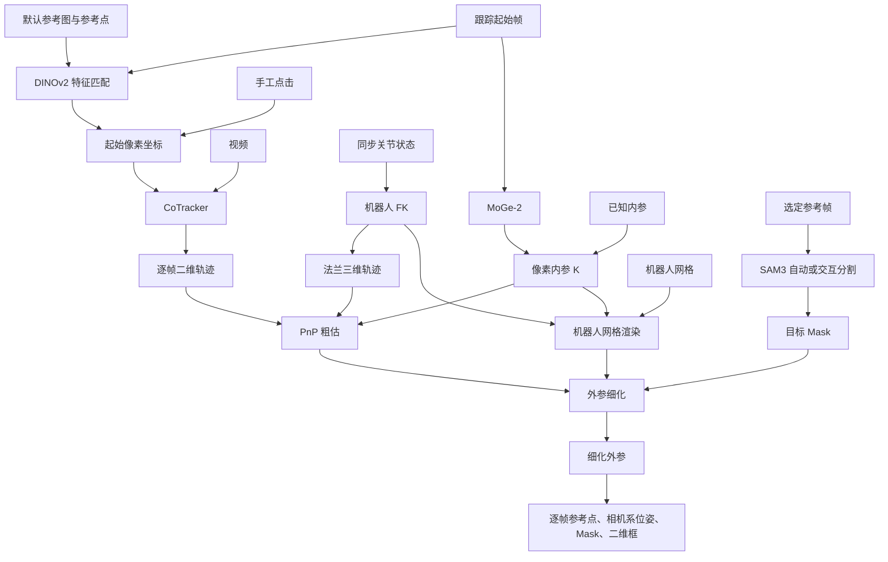

# CalibAll 中 DINOv2、CoTracker、SAM3、MoGe 的使用与配合

本文依据当前项目实现，结合 Panda demo 解释模型输入、输出、调用位置和边界。它们提供视觉线索；相机外参由 PnP 和可微渲染优化求解。模型使用预训练权重，外参细化不重新训练这些模型。

## 1. 总体架构

| 组件 | 回答的问题 | 输入 | 输出 | 后续用途 |
| --- | --- | --- | --- | --- |
| DINOv2 + Recognizer | 起始帧里，哪里最像默认参考点？ | 参考图片及指定点、目标帧 | 候选像素坐标 (u,v) | 设置 CoTracker 的起点；手工指定时可跳过 |
| CoTracker | 同一个点在后续各帧哪里？ | 视频、查询帧、查询坐标 | 逐帧二维轨迹及可见性预测 | 与 FK 三维轨迹对应，供 PnP 求粗外参 |
| MoGe-2 | 没有已知内参时，如何得到投影参数？ | RGB 图片 | 归一化内参 K；模型还可输出几何结果 | 转为像素内参，供 PnP 与渲染使用 |
| SAM3 | 图片中机械臂占据哪些像素？ | 图片、文字或交互点提示 | 目标机器人 Mask | 与渲染 Mask 比较，细化外参 |
| 机器人 FK | 关节状态对应什么三维位置和姿态？ | 关节状态、匹配的机器人模型 | 法兰与连杆变换 | 提供 PnP 三维轨迹和渲染姿态 |
| PnP | 怎样把三维轨迹投影成二维轨迹？ | 三维点、二维点、K | 粗外参 R、t | 初始化细化 |
| 可微渲染优化 | 怎样让模型投影轮廓贴近目标 Mask？ | K、粗外参、网格、FK、目标 Mask | 细化外参 | 后续批量几何标注 |



图中“已知内参 / MoGe”和“手工点击 / DINOv2”是替代入口，并非每次都要运行两条路径。细化会反复使用当前外参进行渲染并更新外参。

## 2. DINOv2：自动选择跟踪起点

### 2.1 默认参考从哪里来

入口在 `scripts/caliball_web.py`，初始化时读取：

```python
ref_img_path = _PROJECT_ROOT / "assets" / "test_img" / "source.png"
if ref_img_path.exists():
    coarse_init._init_recognizer(
        Image.open(ref_img_path).convert("RGB"),
        (376, 131),
    )
```

这是一张固定参考图及预设位置，不是从 Panda 关节角中算出的点。Recognizer 会先将参考图缩放为 784×784，再采样该位置的特征，因此 `(376,131)` 在这段实现中作用于缩放后的特征图，而不是自动按原图尺寸换算。

DINOv2 本身提供图像特征，Recognizer 负责参考点特征提取、相似度计算、最大值选择和坐标换算。

### 2.2 点击 Auto（DINOv2）后发生什么

1. `src/caliball/web/templates/annotate.html` 的 `autoTracking()` 请求 `/api/auto_tracking`。
2. 请求包含 `target_fi: S.s`，即跟踪范围的起始帧；还传入 `fi`，但当前后端这条分支实际用 `target_fi` 选图。
3. `src/caliball/web/routes/annotate_routes.py` 将任务放入命令队列，等待响应，当前等待上限为 30 秒。
4. `scripts/caliball_web.py` 读取 `video[target_fi]`，调用 `coarse_init.recognizer.get_uv(...)`。
5. `src/caliball/algorithms/recognizer.py` 匹配并返回原图坐标。
6. 网页将坐标写入 `S.tx/S.ty`，显示红点与 `Tracking point set (...)`。

接口 timeout 表示等待响应超时，不能只据此判断是网络下载、模型计算还是命令队列阻塞，应结合服务日志区分。

### 2.3 特征匹配算法

```python
# 参考图特征上采样到 784×784，取指定点的特征向量
src_ft = nn.Upsample(size=(self.img_size, self.img_size), mode='bilinear')(feature)
vec = src_ft[0, :, y, x].view(1, num_channel)
```

对目标图片做同样的特征提取与上采样，然后与参考向量计算余弦相似度，选择全图最高分位置：

```python
src_vec = F.normalize(self.vec)
trg_vec = F.normalize(trg_vec)
cos_map = torch.matmul(src_vec, trg_vec).view(1, self.img_size, self.img_size)
# 实际代码转换成 NumPy 后执行：
max_yx = np.unravel_index(cos_map[0].argmax(), cos_map[0].shape)
```

上面最后两行是展示主线的节选；实际实现会先对 `cos_map` 调用 `.float().cpu().numpy()`。

### 2.3.1 参考点的特征向量怎样得到

参考向量不是参考点的 RGB 值，也不是三维坐标。程序先用 DINOv2 提取整张参考图的视觉特征，再从特征图中采样指定位置。

**第一步：参考图预处理。**

```python
img_pil = img_pil.resize((self.img_size, self.img_size))
img_tensor = (PILToTensor()(img_pil) / 255.0 - 0.5) * 2
img_tensor = img_tensor.unsqueeze(0).to(self.device)
```

当前 `img_size=784`，RGB 输入形状为 `(1,3,784,784)`，像素值从 0～255 转为 -1～1。

**第二步：DINOv2 输出特征网格。**

```python
feats_dict = self.model.get_intermediate_layers(img_tensor, n=1)
out = feats_dict[0]
B, N, C = out.shape
h = w = int(N ** 0.5)
out = out.transpose(1, 2).reshape(B, C, h, w)
```

按当前默认 `dinov2_vitb14`，patch 大小是 14×14，784/14=56，因此空间网格为 56×56，每个位置的特征维数为 768。模型输出 token 形状为 `(1,3136,768)`，整理后的特征图为 `(1,768,56,56)`。这些具体维度对应当前默认模型，换成其他模型时通道数可能不同。

Transformer 会聚合上下文，因此一个位置的特征不只反映局部颜色，也包含周围乃至整张图的视觉信息。每个通道通常没有可以直接命名的物理含义。

**第三步：把特征图插值到 784×784。**

```python
src_ft = nn.Upsample(
    size=(self.img_size, self.img_size),
    mode='bilinear'
)(feature)
```

形状从 `(1,768,56,56)` 变为 `(1,768,784,784)`。插值只沿空间维度进行，768 个通道分别处理，不把通道混在一起。

**第四步：取指定位置的所有通道。**

```python
x, y = p
vec = src_ft[0, :, y, x].view(1, num_channel)
self.vec = vec
```

默认 `p=(376,131)`，所以取 `src_ft[0,:,131,376]`：第 0 张图、全部通道、y=131、x=376。最后得到 `(1,768)` 的参考向量。这里坐标作用在 784×784 特征图上。

```text
source.png
  → 784×784 RGB 输入
  → DINOv2：56×56 个特征位置，每个 768 维
  → 双线性插值：784×784 个特征位置，每个仍为 768 维
  → 采样 (376,131)
  → 一个 768 维参考向量
  → 与目标图各位置的特征做余弦相似度比较
```

例如 `[0.23,-0.71,1.05,…]` 只能作为向量外形的示意，并不是本次实际提取值。该向量表达“这个位置在模型看来长什么样”，不会自动赋予它“法兰原点”的物理身份。

### 2.3.2 双线性插值是什么

双线性插值是在二维网格上，用相邻四个已知值，按距离计算中间位置的值。可以理解成先沿水平方向做两次线性插值，再沿竖直方向做一次。

假设单个特征通道中相邻四个位置为：

```text
A=10 ───────── B=20
 │                │
 │     P          │
 │                │
C=30 ───────── D=40
```

设 P 从左往右的位置比例为 α，从上往下的比例为 β，均在 0～1 之间。先计算上边和下边的水平插值：

```text
上边：U = (1−α)A + αB
下边：L = (1−α)C + αD
```

再沿竖直方向插值：

```text
P = (1−β)U + βL
  = (1−α)(1−β)A + α(1−β)B + (1−α)βC + αβD
```

例如 P 位于从左向右 25%、从上向下 50% 的位置，即 α=0.25、β=0.5：

```text
U = 0.75×10 + 0.25×20 = 12.5
L = 0.75×30 + 0.25×40 = 32.5
P = 0.5×12.5 + 0.5×32.5 = 22.5
```

对于 DINOv2 特征图，A、B、C、D 各自不是一个 RGB 像素，而是 768 维向量。每个通道使用同一组空间权重分别插值，因此 P 仍然是 768 维向量：

```text
v_P = w_A v_A + w_B v_B + w_C v_C + w_D v_D
```

这段代码中的 `nn.Upsample(..., mode='bilinear')` 未显式指定 `align_corners`，当前 PyTorch 的行为相当于 `align_corners=False`。对内部位置，输出到输入的坐标映射是：

```text
x_in = (x_out + 0.5) × W_in / W_out − 0.5
y_in = (y_out + 0.5) × H_in / H_out − 0.5
```

在 56→784 的例子中，输出位置 `(376,131)` 对应输入网格坐标约为 `(26.392857,8.892857)`，因此采样主要由输入网格的 `(26,8)、(27,8)、(26,9)、(27,9)` 四个位置加权得到。这里坐标统一按 `(x,y)` 表示，数组索引仍用 `[y,x]`。边界位置由插值实现处理。

**为什么要这样做？** 原始特征图只有 56×56，不能直接用 784×784 图片坐标索引。插值将特征表示变得稠密，方便采样参考点，并让目标相似度图有更细的搜索网格。

**它没有做什么？** 插值不会重新运行 DINOv2，也不会恢复原始特征网格没有保留的细节。搜索网格变细不代表物理定位精度相应提高。最终坐标仍受 patch 分辨率、特征匹配、视角和遮挡影响。

### 2.4 Panda 的 (284.1,219.2) 怎样得到

目标图为 640×480，特征匹配坐标位于 784×784 空间。返回前进行：

```python
x_orig = max_yx[1] * (w / self.img_size)
y_orig = max_yx[0] * (h / self.img_size)
```

例如最大值坐标为 `(x,y)=(348,358)` 时：

```text
u = 348 × 640 / 784 = 284.0816…
v = 358 × 480 / 784 = 219.1837…
页面 toFixed(1) → Tracking point set (284.1,219.2)
```

这是与该显示值一致的坐标换算示例，不是保存下来的当次模型相似度日志。坐标以图片左上角为原点，向右为 u 正方向，向下为 v 正方向，单位为像素。小数来自缩放换算，不代表 0.1 像素定位精度。

### 2.5 手工点击和自动选点的关系

```python
if tracking_point is not None:
    u, v = tracking_point
else:
    u, v = self.recognizer.get_uv(target_img_pil=img_pil)
```

这是 `pipeline/coarse_init.py` 内部的分支。网页可先通过 Auto 调用 DINOv2 得到坐标，再把该坐标作为显式 `tracking_point` 交给流水线；此时流水线不重复匹配。手工点击则完全可以绕过 DINOv2 自动匹配。

当前实现取相似度最大值，没有设置匹配置信度门槛，也没有保证得到的就是法兰原点。Auto 成功表示选出了候选点，应目视检查是否适合跟踪。

## 3. CoTracker：从起点得到二维轨迹

文件：`src/caliball/algorithms/tracker.py`。

```python
queries = [[img_idx, u, v]]
queries = torch.tensor(queries).to(self.device, dtype=torch.float32)
pred_tracks, pred_visibility = self.cotracker(video, queries=queries[None])
```

视频由 `(T,H,W,C)` 转为 `(1,T,C,H,W)`；查询同时指定帧号和像素坐标。当前封装只取一个查询点，得到形状约为 `(T,2)` 的二维轨迹。

CoTracker 不读取 URDF、关节角或相机外参，也不负责估计三维轨迹。它跟踪视觉点，FK 计算三维法兰点，两者在 PnP 阶段组合。

### 3.1 与运动学的配合

`src/caliball/pipeline/coarse_init.py`：

```python
hom = np.array([self.robot_tf.fkine_flange(q)[0] for q in joint_angles])
points_3d = hom[:, :3, 3]
extrinsic = self.pnp_solver(
    points_3d=points_3d,
    points_2d=points_2d,
    camera_matrix=K,
    method=method,
    init_w2c=init_w2c,
)
```

每帧二维点与三维点必须同步。当前用法兰原点轨迹近似被跟踪点轨迹；如果选点与法兰有偏移，末端旋转时会产生不同轨迹。严格处理应计算：

```text
P_base,i = R_base←flange,i × p_offset + t_base←flange,i
```

其中 `p_offset` 固定在法兰局部坐标系。刚体上的点共享同一个刚体变换，但不意味着它们在基座中的轨迹完全相同。

当前 CoTracker 返回可见性，但粗估路径没有利用它过滤点；遮挡和跟踪漂移可能影响 PnP。

## 4. MoGe-2：没有已知内参时估计 K

文件：`src/caliball/algorithms/intrinsic_estimator.py`。

项目使用 `from moge.model.v2 import MoGeModel`，默认模型 ID 为 `Ruicheng/moge-2-vitl-normal`，优先加载本地 `ckpt/moge/model.pt`。

```python
input_image = np.array(img_pil.convert("RGB"))
input_image = torch.tensor(
    input_image / 255.0, dtype=torch.float32, device=self.device
).permute(2, 0, 1)
model_output = self.moge.infer(input_image)
intrinsic = model_output['intrinsics'].cpu().detach().numpy()
return intrinsic, 1.0, 1.0
```

输入为 `[0,1]` RGB 张量，形状 `(3,H,W)`。MoGe 内部先预测场景点图，再通过 `recover_focal_shift(points, mask_binary)` 恢复焦距与点图 Z 方向偏移。这个 shift 不等于机器人到相机外参中的 t。

本地实现位于 `third_party/moge/moge/model/v2.py` 和 `third_party/moge/moge/utils/geometry_torch.py`，假设主点居中、无畸变、横纵几何尺度一致。归一化主点固定为 `(0.5,0.5)`，fx/fy 由同一个焦距参数与宽高比得到，并非四个内参独立估计。

### 4.1 为什么返回 1.0,1.0

结合 `CoarseInit._get_intrinsic()` 可以确定：后两个返回值作为 `origin_width, origin_height` 使用：

```python
self._intrinsic, origin_width, origin_height = self.intrinsic_estimator.estimate(img_pil)
width, height = img_pil.size
self._intrinsic[0, :3] *= width / origin_width
self._intrinsic[1, :3] *= height / origin_height
```

因为 MoGe 输出基于归一化图像坐标的 K，所以返回 1.0、1.0，使第一行乘 W、第二行乘 H。它们不是置信度，也不是深度尺度。

已知 K 时直接使用并缓存，不必再次调用 MoGe。细化期间 K 固定，只优化外参。

### 4.2 可靠性如何理解

MoGe 提供自动初值，不能直接当作精确相机标定。单张图具有几何歧义，预测点图误差和相机模型假设会影响焦距。焦距偏差可能被外参中的距离变化部分补偿，所以轮廓重合度高不等于相机三维位置准确。可以用真实相机内参、棋盘格标定和未参与优化的姿态做独立验证。

## 5. SAM3：为细化提供目标轮廓

文件：`src/caliball/algorithms/mask_extractor.py`、`scripts/caliball_web.py`、`src/caliball/pipeline/refinement.py`。

自动提取封装默认使用文字提示：

```python
inference_state = self.processor.set_image(img_pil)
output = self.processor.set_text_prompt(
    state=inference_state, prompt="robotic arm"
)
masks = output["masks"]
if len(masks) > 0:
    return masks[0]
return None
```

当前直接取返回列表第一张 Mask，没有额外做多机械臂选择逻辑。网页还提供基于正负点的交互分割，由 `predict_inst(...)` 生成和修正 Mask。它们都是目标轮廓的来源。

### 5.1 与可微渲染的配合

```text
参考图片 → SAM3 / 人工交互 → 固定目标 Mask
                                  ↑ 比较轮廓差异
机器人网格 + 关节 FK + K + 当前 R,t → 渲染 Mask
                                  ↓
                              更新 R,t
```

项目以像素 MSE 与 IoU 相关损失组合为优化目标，调整相机六自由度位姿；机器人模型、关节角、K 和目标 Mask 不随这个过程学习更新。支持使用单帧或多帧目标 Mask；数量与选定参考帧必须对应。

SAM3 分得越符合实际机器人和所用模型范围，通常约束越有效。但只追求细小边缘还不够：网格是否包含夹爪、遮挡如何处理、是否存在时间错位、单帧姿态是否有歧义，都影响标定。错误的目标 Mask 可能把外参拉向错误位置。

### 5.2 分清三类 Mask

| Mask | 来源 | 用途 |
| --- | --- | --- |
| MoGe 几何有效 Mask | MoGe 几何预测 | 焦距恢复时排除无效几何区域，不表示机器人 |
| 标定目标 Mask | SAM3 自动或人工交互 | 约束外参细化 |
| 渲染 / 标注 Mask | 机器人网格、FK、K、外参投影 | 优化时比较轮廓；标定后生成逐帧标签 |

批量标注不是每帧重新运行 SAM3，生成的 Mask 依赖机器人模型与已有标定。

## 6. Panda 实际使用顺序

1. 选择 `data/demo/panda_lerobot`：episode 0，共 180 帧，30 FPS，640×480，camera_top。
2. 选择跟踪范围与起始点：手工点击，或者点击 Auto，使用默认参考图经 DINOv2 匹配。
3. 检查候选点，选择参考帧，使用 SAM3 自动或交互方式准备机器人 Mask。
4. 提交运行后，CoTracker 生成二维轨迹；FK 使用前 7 个关节值生成法兰三维轨迹。
5. 使用已知 K，或由 MoGe 估计 K，再由 PnP 得到粗外参。
6. 以目标 Mask 和渲染 Mask 的差异细化外参。
7. 将固定标定用于整段视频，生成相机系参考点位姿、像素位置、Mask 和二维框。

这里是逻辑与网页使用顺序；MoGe 只在需要 K 时调用，分割也可能在提交前已完成。Auto 按钮只选起点，不会立即执行整段 CoTracker 跟踪。

此前 Panda 标注沿用 `franka` 纯机械臂模型：参考点为法兰，不是夹爪指尖；第 8 项是原始夹爪值，不进入机械臂 7 关节 FK。没有独立夹爪网格标签。

已有估计结果：

```text
K ≈ [[588.0321, 0, 320],
     [0, 588.0320, 240],
     [0, 0, 1]]

标定结果：results/extrinsic_notebook/panda_lerobot/ep_000000/pipeline/
标注结果：label_out/panda_demo_label_20261017/
```

其中主点居中与 MoGe 假设一致；此前日志和代码支持自动估计来源的判断，但没有保存完整请求选项，不能仅凭 K 数值证明当次输入选项。以上为已有运行结果，不代表本次重新跑了标定。

## 7. 常见误解与排查

| 现象 / 疑问 | 正确理解与检查方向 |
| --- | --- |
| Auto 显示坐标，是否说明点选对了？ | 只说明返回了最高相似位置；检查是否在适合跟踪的末端区域 |
| DINOv2 是否一直跟踪视频？ | 不负责逐帧跟踪；逐帧跟踪是 CoTracker |
| 手工点选后还需要 DINOv2 吗？ | 起点已指定，可绕过自动匹配 |
| Auto 超时，是否模型坏了？ | API 等待 30 秒，查命令队列、加载和计算日志，不能只凭 timeout 判断 |
| 跟踪轨迹漂移 | 检查遮挡、纹理与参考点；可见性预测目前未用于粗估点过滤 |
| Mask 很贴合，外参一定准确吗？ | 不一定；内参偏差、模型误差可能互相补偿，应在其他姿态验证 |
| 调整 Mask 能解决所有错位吗？ | 不能；还应检查同步、关节单位和零位、机器人模型、K、末端偏移 |
| 能否直接复用到腕部相机？ | 固定基座到相机外参不能描述腕部相机运动，需要对应运动链与手眼标定处理 |

外参采用 `P_camera = R P_base + t`；相机在基座中的位置为 `C = -R^T t`，不是 t 本身。

## 8. 推荐代码阅读路径

1. `src/caliball/web/templates/annotate.html`：`autoTracking()`，理解按钮请求与坐标显示。
2. `src/caliball/web/routes/annotate_routes.py`：`auto_tracking()`，理解队列和超时。
3. `scripts/caliball_web.py`：默认参考初始化、`/api/auto_tracking` 分支和 SAM3 交互逻辑。
4. `src/caliball/algorithms/recognizer.py`：参考特征采样、相似度图和原图坐标换算。
5. `src/caliball/algorithms/tracker.py`：视频维度与点查询格式。
6. `src/caliball/algorithms/intrinsic_estimator.py` 与 `pipeline/coarse_init.py`：内参单位转换、FK 与 PnP 配合。
7. `src/caliball/algorithms/mask_extractor.py` 与 `pipeline/refinement.py`：目标 Mask 和渲染细化。
8. `src/caliball/pipeline/extrinsic_pipeline.py`：端到端串联与结果导出。
9. `scripts/label.py` 与 `src/caliball/labeling/`：标定后生成逐帧标签。

延伸阅读：[项目 STAR 说明](caliball-star.html)、[关键代码走读](caliball-code-walkthrough.md)。
